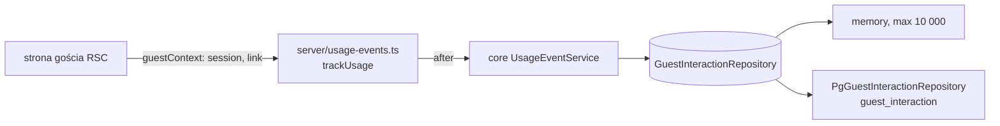

# Zdarzenia użycia gościa i kelnera (E02)

## 📝 TLDR
Tabela `guest_interaction` istnieje, ale nic do niej nie pisze, więc pilotaż nie zweryfikuje A03 (goście używają aplikacji) ani nie da licznika sesji i wyborów do D04/E04. **Proponujemy**, by strony gościa (komponenty serwerowe) same zapisywały kluczowe zdarzenia po stronie serwera — bez JavaScriptu, ciasteczek i pamięci przeglądarki — z anonimowym identyfikatorem sesji w nowym parametrze URL `sid`. Zdarzenia kelnera (`/r/{slug}/staff`) mają źródło `staff` i nie tworzą sesji gościa. Zapis idzie po wysłaniu odpowiedzi (`after()`), więc błąd **zapisu zdarzenia** nigdy nie zmienia odpowiedzi strony. Ruch własny (smoke, CI, monitoring — nagłówek `x-wine-match-synthetic: 1`), boty/podglądy linków i prefetch nie są zapisywane.

## Problem
- Brak portu, repozytorium, serwisu i punktu zapisu dla `guest_interaction` (`packages/db/src/entities/guests/guest-interaction.ts` — tylko encja). D01 i Q05 briefu (zamknięte przez D09) wymagają analityki przed pilotażem; A03/A05 są `accepted untested` (C06).
- Konflikt dokumentacji: `docs/SCREEN_SPECIFICATION.md` (l. 27) trzyma `sessionId` w `sessionStorage`, `docs/API_SPECIFICATION.md` zakłada `POST /public/events` z JS, a gość musi działać bez JS i storage (R05, `packages/app/AGENTS.md`).
- Kelner używa tego samego silnika na `/r/{slug}/staff` (D03, bez logowania); jego odsłony liczone jako sesje gości zawyżyłyby KPI.

## Cel i zakres
Zapis zdarzeń lejka gościa (landing → menu → danie → wina → wino → wybór; ścieżka stolika) i lookupów kelnera, z sesją w URL, plus jeden odczyt agregatu (`countGuestSessions`) dla E04.

**Poza zakresem:** `POST /public/events` i zdarzenia tylko‑JS (`recommendation_clicked`, `quick_preference_set`); migracje/tabela `GuestSession`/kolumna `version_id`; wygasanie sesji, retencja, partycjonowanie; limity zapisu; dashboard (E04 — `.ai/specs/2026-10-15-kpi-dashboard.md`); zmiana UX ekranu wina nieaktywnego.

## Wymagania
- **R1** Każda strona G0, G1, G2, G3, G6, G7, G8, G9 po udanym renderze zapisuje zdarzenia z katalogu (API Contracts) z `restaurant_id`, `session_id`, `engine_version`, `props.menuVersion` i `created_at`.
- **R2** Sesja gościa to parametr `sid` (UUID v4, małe litery). Brak lub niepoprawny `sid` = nowa sesja. Żadnych ciasteczek, `localStorage`/`sessionStorage` ani JS.
- **R3** Każdy link `/r/{slug}/…` i każdy formularz GET na stronach gościa i G9 niesie bieżący `sid` — także linki budowane we współdzielonych komponentach. Wyjątek: link „For staff” na G0.
- **R4** `guest_session_started` (`props.source`: `qr`/`link`) powstaje tylko dla nowej sesji na stronie gościa; G9 nigdy go nie zapisuje.
- **R5** Zapis odbywa się w `after()`, rejestrowanym jako ostatnia instrukcja przed `return`. Wyjątek zapisu nie wychodzi poza pomocnik, trafia do `logger.warn`.
- **R6** Brak zapisu dla: żądań prefetch (`Next-Router-Prefetch`, `Sec-Purpose: prefetch|prerender`), żądań z nagłówkiem `x-wine-match-synthetic: 1`, żądań z pustym UA lub UA z listy botów/podglądów, stron kończących się 404, wina nieaktywnego na G8.
- **R7** `GuestInteractionRepository` zakresowany `restaurantId`, z implementacją w pamięci (ograniczoną do 10 000 zdarzeń) i PostgreSQL, przechodzący `repositoryContract`. `countGuestSessions` liczy unikalne `session_id` z `guest_session_started` w `[from, to)`.
- **R8** `props` typowane per zdarzenie przy zapisie; wartości wyłącznie zwalidowane (`parseGuestPrefs`, identyfikatory z bazy); żadnego IP, UA, numeru stolika ani tekstu od gościa.
- **R9** Każda faza aktualizuje w tym samym PR‑ze `docs/SCREEN_SPECIFICATION.md` (katalog zdarzeń), a faza 1 także `BACKWARD_COMPATIBILITY.md` §1 (`sid`), `docs/API_SPECIFICATION.md` (`POST /public/events` „planowane”), `docs/DATA_MODEL.md` i README (nagłówek syntetyczny w opisie smoke).

## Resolved assumptions (autonomous defaults)

| # | Pytanie | Przyjęta odpowiedź | Uzasadnienie |
|---|---|---|---|
| Q1 | Gdzie żyje `sessionId`? | Parametr URL `sid` (UUID v4) w każdym linku i formularzu gościa; brak/zły = nowa sesja. Docs poprawione. ✅ potwierdzone przez właściciela (Filip, 2026-10-15) | Jedyna opcja zgodna z R05 (bez JS, bez storage). Koszt do akceptacji: udostępniony link w środku ścieżki łączy dwie osoby w jedną sesję (zaniżenie sesji); `sid` trafia do logów dostępu i historii przeglądarki. Ignorowanie `sid` później jest trywialne — trwałe są tylko nazwa parametru (§1 BC) i niezmiennik „każdy link go niesie”. |
| Q2 | Jedna spec czy trzy (S01–S03)? | Jedna, trzy fazy = trzy PR‑y. | S02/S03 nie działają bez mechanizmu S01. |
| Q3 | Zmiana schematu? | Nie. `source`, `context`, `menuVersion` idą do `props`. | Kolumny wystarczają; brak ryzyka §3 BC. |
| Q4 | `POST /public/events`? | Odłożone; w docs „planowane”. | Nowa publiczna trasa = kontrakt §2 BC; żadne AC jej nie wymaga. |
| Q5 | Zakres zdarzeń? | AC (`guest_session_started`, ~~`dish_viewed`~~ (usunięte 2026-10-15, spec `2026-10-15-guest-short-path-and-desktop` A7), `recommendations_viewed`, `wine_selected`, `staff_lookup`) + `menu_viewed`, `wine_viewed`, `table_recommendation_viewed`. | Jedna linia na stronę; bez nich lejek stolika i wino→wybór są niepoliczalne. |
| Q6 | AC #13: „wino nieaktywne → not-found”, a G8 dziś pokazuje „This wine is no longer available” (200). | Zostaje obecny ekran (wino spoza karty dalej 404); w obu przypadkach **brak** `wine_selected`. ✅ potwierdzone przez właściciela (Filip, 2026-10-15) | Spec analityki nie zmienia UX gościa; odstępstwo od literalnego AC. |
| Q7 | Odświeżenie / powrót = duplikat? | Akceptujemy duplikaty; KPI liczą unikalne (sesja, obiekt). Otwarcie `sheet=filters` nie zapisuje. | Deduplikacja nieproporcjonalna w MVP; E04 Q8 liczy unikalne pary. |
| Q8 | `qr` vs `link`? | G0 bez `sid` → `qr`; inna strona gościa bez `sid` → `link`. | Kody QR bez zmian (§1 BC); ręcznie wpisany `/r/halka` = `qr` (znane przybliżenie). |
| Q9 | Kiedy `staff_lookup`? | Tylko przy jawnym `dish=` istniejącym w menu. Kelner ma własny `sid`; link „For staff” nie niesie `sid` gościa; wszystkie linki i formularz G9 (w tym „Back”) niosą `sid` kelnera. | Literalnie „wybiera danie”; sesje kelnera się nie mieszają. |
| Q10 | Zapis synchroniczny czy po odpowiedzi? | `after()` z `next/server`, ostatnia instrukcja przed `return`; błąd → `logger.warn`. Utrata zdarzenia przy padnięciu procesu akceptowana. | AC #12.3; brak latencji. |
| Q11 | Boty, podglądy, ruch własny? | Pomijamy: prefetch, nagłówek `x-wine-match-synthetic: 1` (kontrakt dla smoke/CI/monitoringu, Q14), pusty UA i UA pasujący do listy `NON_GUEST_UA` (bot, crawl, spider, slurp, preview, facebookexternalhit, whatsapp, telegrambot, slackbot, discordbot, linkedinbot, twitterbot, embedly, curl/, wget/, python-requests, go-http-client, uptime, pingdom). Limity zapisu odłożone. | Pierwsze sesje pilota nie mogą zawierać naszych smoke'ów i podglądów linków. Lista nie zawiera `HeadlessChrome` — E2E musi zapisywać. |
| Q12 | Wygasanie, retencja, partycje? | Brak w MVP. | Wolumen pilota mały; podział po przerwie można zrobić w zapytaniu. |
| Q13 | Czy zapis podlega konwencji komend (§1.3: `actor`, `expectedVersion`, `DomainError`)? | Nie — telemetria nie jest komendą. ✅ potwierdzone przez właściciela (Filip, 2026-10-15) | Wyjątek od prawa repo (§1.3) — zatwierdza owner razem ze speciem. |
| Q14 | Jak oznaczyć ruch własny? | Nagłówek żądania `x-wine-match-synthetic: 1` (stała `SYNTHETIC_TRAFFIC_HEADER` w `app/src/server/usage-events.ts`). Wysyłają go: `scripts/smoke.mjs` (każde żądanie, oba tryby), `curl` w runbooku i monitoring (E05-S02). E2E **nie** wysyła. | Działa dla `curl` i probe'ów bez znajomości URL‑i; zarezerwowany `sid` musiałby krążyć w linkach. Podrobienie nagłówka tylko ukrywa własne zdarzenia — nieszkodliwe. |
| Q15 | Wersja menu (`menuVersion` z SCREEN_SPECIFICATION)? | `props.menuVersion = restaurant.publishedAt` (ISO lub `null`) w każdym zdarzeniu. | Pozwala E04-S03 powiązać zdarzenie z migawką bez migracji; restauracja jest już załadowana. |
| Q16 | Definicja sesji gościa? | Sesja z `guest_session_started` (bez zmian; E04 Q9 na tym stoi). | Start zapisywany w tym samym `insert` co pierwsze zdarzenie strony (atomowo); utrata pierwszego zapisu tylko zaniża sesje — E04 pomija zdarzenia sesji bez startu we wszystkich KPI, więc konwersja nie rośnie. |
| Q17 | Kolejność scalania z E03? | **E02 F1 scalane przed E03 F1**; E03 robi rebase (oba ruszają `Repositories`, `container.ts`, `repository-contract.ts`, `memory-repositories.ts`, `DATA_MODEL.md`). E04 wymaga E02 F1–F3. | Jedna spec = jeden worktree (AGENTS §8); jawna kolejność zamiast konfliktów. |

## Architektura


Strony nadal „parsują → wołają serwis → renderują”; jedyna nowa zależność strony to `trackUsage`.

**Pliki:**
- `core/src/guest/session.ts` (nowe, czyste): `GUEST_SESSION_PARAM = 'sid'`, `parseSessionId(q): string | null` (tylko kanoniczny UUID małymi literami; tablica/inne → `null`), typ `GuestSessionRef = { id: string; isNew: boolean; source: 'qr' | 'link' | 'staff' }`, `usageContext(q, menu): 'table' | 'dish' | 'direct'` (`table` gdy `table=`, `dish` gdy opublikowane `dish=`, inaczej `direct`).
- `core/src/services/guest/usage-events.ts` (nowe): `GUEST_EVENT_NAMES`, typ `UsageEvent` jako unia dyskryminowana po `name` (typowane `props` per zdarzenie, tabela w API Contracts), `UsageEventService` z deps `Pick<Repositories, 'guestInteractionRepository'> & { clock: Clock; idGenerator: IdGenerator }`:
  - `session(q, source): GuestSessionRef` — `parseSessionId` albo `idGenerator.uuid()`;
  - `record(restaurant: { id; publishedAt }, session, events: UsageEvent[])` — dokleja `guest_session_started { source }` gdy `session.isNew && source !== 'staff'`, ustawia `engineVersion = ENGINE_VERSION`, `props.menuVersion`, `createdAt = clock.now()`; jedno wywołanie portu (jeden `insert`).
- `core/src/ports/repositories.ts`: `GuestInteractionRepository` + pole w `Repositories`. `core/src/domain/types.ts`: `GuestEventName`, `GuestInteraction`.
- `core/src/memory/memory-repositories.ts`: tablica w `MemoryStore`, po przekroczeniu 10 000 usuwa najstarsze.
- `db/src/repositories/index.ts`: `PgGuestInteractionRepository` — `em.insertMany` (natywny insert, **bez** `flush`, by nie zapisać encji z mapy tożsamości żądania); `count(distinct session_id)` natywnie; mapper w `db/src/mappers.ts`.
- `app/src/server/container.ts`: `usageEventService: asClass(UsageEventService).scoped()`, `guestInteractionRepository` w obu gałęziach `DATA_SOURCE`.
- `app/src/server/guest-page.ts`: `guestContext(searchParams, { source })` zwraca dodatkowo `session` i `link(path, prefs?, extra?)` = `hrefWith` + `sid` na końcu; `hrefWith` bez zmian.
- `app/src/server/usage-events.ts` (nowe): `SYNTHETIC_TRAFFIC_HEADER`, `NON_GUEST_UA`, `shouldRecord(headers): boolean` (czysta, testowana), `trackUsage(services, restaurant, session, events)` — czyta `headers()` przed `after()`, w `after()` woła `record`, w `catch` `logger.warn('usage event not recorded', { names, restaurantId, sessionId, error })` (`sid` anonimowy).
- **Reguły `after()` (wiążące):** (1) `trackUsage` jako ostatnia instrukcja przed `return` — Next.js wykonuje `after()` także gdy render potem rzuci `notFound()`; (2) `headers()`, `searchParams`, `getRequestScope()` czytane przed `after()`, w zamknięciu tylko zwykłe wartości i rozwiązany serwis; (3) zakres żądania gościa nie jest zwalniany (`request-scope.ts`), więc `em` w zamknięciu pozostaje ważny; `insertMany` nie używa mapy tożsamości. Tylko w eksporcie domyślnym strony, nigdy w `generateMetadata`.

## Model danych
Bez migracji. Mapowanie na `guest_interaction`:

| Kolumna | Wartość |
|---|---|
| `restaurant_id` | `restaurant.id` z załadowanych danych strony |
| `session_id` | `sid` |
| `name` | `GuestEventName` |
| `dish_id`, `wine_id` | gdy zdarzenie dotyczy jednego dania/wina |
| `props` (jsonb) | `menuVersion` zawsze; reszta per zdarzenie (tabela niżej); `source` tylko w `guest_session_started` i `staff_lookup` |
| `engine_version` | `ENGINE_VERSION` |
| `created_at` | `clock.now()` |

**Port** (nazwy zgodne z E04, które dodaje `usageTotals` i `pairingStats` do tego samego interfejsu):
```ts
// core/src/domain/types.ts
export type GuestEventName = (typeof GUEST_EVENT_NAMES)[number];
export interface GuestInteraction { sessionId: string; name: GuestEventName; dishId: string | null; wineId: string | null; props: Record<string, unknown>; engineVersion: string | null; createdAt: string }
// core/src/ports/repositories.ts
export interface GuestInteractionInput { sessionId: string; name: GuestEventName; dishId?: string; wineId?: string; props: Record<string, unknown>; engineVersion: string; createdAt: Date }
export interface GuestInteractionRepository {
  record(restaurantId: string, events: GuestInteractionInput[]): Promise<void>;
  /** events of one session in insertion order — contract tests and diagnostics */
  listBySession(restaurantId: string, sessionId: string): Promise<GuestInteraction[]>;
  /** distinct session_id with a guest_session_started event, createdAt in [from, to) */
  countGuestSessions(restaurantId: string, range: { from: Date; to: Date }): Promise<number>;
}
```
Odczyt ma `props: Record<string, unknown>` (stare/uszkodzone wiersze); typowanie wymusza `UsageEventService.record` przy zapisie. Sesje (E02) i rachunki (E03) to różne jednostki — E04 nie dzieli jednych przez drugie. Konwersja w E04 liczy tylko ścieżkę dania (`recommendations_viewed` → `wine_selected` z `context: 'dish'`); zdarzenia stolika są zapisywane (`context: 'table'`), ale nie wchodzą do konwersji. `tier` w `items` pozwala E04 przypisać parę do sommeliera lub silnika historycznie, a nie po dzisiejszym statusie pary.

**Pomocnik testowy (dla E2E E04):** `core/src/testing/usage-events.ts` eksportuje `seedUsageEvents(repo, restaurantId, events)` — zapisuje zdarzenia przez `GuestInteractionRepository.record` z podanym `createdAt`; używany w testach jednostkowych i E2E dashboardu.

## Kontrakty
Brak nowych tras HTTP.
- **Adresy gościa (§1 BC, dodanie):** opcjonalny `sid` na wszystkich `/r/{slug}/…`; bez `sid` działa jak dziś. Kolejność: preferencje jak `prefsToQuery`, `sid` na końcu.
- **Nagłówek ruchu syntetycznego (kontrakt z E05-S02):** żądanie z `x-wine-match-synthetic: 1` renderuje się normalnie, ale nie zapisuje zdarzeń. Opis w README (smoke) i `docs/SCREEN_SPECIFICATION.md` (Analytics).
- **Katalog zdarzeń** (`docs/SCREEN_SPECIFICATION.md`, jeden z `GUEST_EVENT_NAMES`):

| Ekran | Zdarzenie | `dish_id` / `wine_id` | `props` (oprócz `menuVersion`) |
|---|---|---|---|
| G0 bez `sid` | `guest_session_started` | – | `source: 'qr'` |
| inna strona gościa bez `sid` | `guest_session_started` | – | `source: 'link'` |
| G1 menu | `menu_viewed` | – | – |
| G3 wina (bez `sheet`) | `recommendations_viewed` | dish | `wineIds` (kolejność wyświetlenia), `items: [{ wineId, tier }]` (`tier` jak w API: `sommelier_primary` \| `sommelier` \| `engine`, stan w chwili wyświetlenia), `prefs` |
| G6 wynik stolika | `table_recommendation_viewed` | – | `dishIds`, `wineIds` |
| G7 wino | `wine_viewed` | dish?, wine | `context` |
| G8 wybór (wino aktywne) | `wine_selected` | dish?, wine | `serving`, `context`, `dishIds` (tylko `table`) |
| G9 kelner (`dish=` jawnie) | `staff_lookup` | dish | `source: 'staff'`, `prefs`, `wineIds` |

`prefs` = tylko wartości niedomyślne (jak `prefsToQuery`). G5 (formularz stolika) nie zapisuje zdarzenia, ale może rozpocząć sesję (`link`).

## UI/UX
Brak zmian widocznych; adresy dłuższe o `sid`. Propagacja (R3):
- strony: `link()` zamiast szablonów `/r/${slug}/…` w G0–G9; ukryte `<input name="sid">` w formularzach G5 (`table/page.tsx`), G7 (`wine/[wineId]/page.tsx`), G9 (`staff/page.tsx`);
- współdzielone komponenty (`_components/guest-ui.tsx`, `pref-chips.tsx`): `TopBar`, `Button`, `Chip`, `BestCard`, `WineRow`, `PrefChips.hrefFor` dostają gotowe `href` zbudowane przez `link()`; `ModeSwitch` (dziś na sztywno `/r/${slug}/menu|table`) dostaje `link` jako prop;
- wyjątki: „For staff” na G0 bez `sid`; `not-found.tsx` linkuje do `/` (poza `/r/`, bez `sid`);
- `sid` nie trafia do tytułów, treści ani `aria-*`.

## Przypadki brzegowe
| Sytuacja | Zachowanie |
|---|---|
| Zapis rzuca / baza niedostępna przy zapisie | Odpowiedź bez zmian; `logger.warn`. |
| `notFound()` (nieznany slug, danie, wino spoza karty) | Brak zapisu (reguła 1 `after()`). |
| `sid` niepoprawny | Jak brak: nowa sesja (`link`, na G9 `staff` bez startu). |
| Stary link / zakładka bez `sid` | Działa jak dziś + nowa sesja `link`. |
| Udostępniony link z `sid` | Kontynuacja cudzej sesji (Q1). |
| Nawigacja miękka z JS (`RSC: 1`, bez prefetch) | Liczona jak odsłona. |
| Powrót „wstecz” | Z JS cache routera → brak zdarzenia; bez JS możliwy duplikat (Q7). |
| Zamknięcie arkusza filtrów G3 | Nowe `recommendations_viewed` ze zmienionymi `prefs`. |
| Pusta lista win | `recommendations_viewed` z `wineIds: []`. |
| Restauracja bez opublikowanego menu (`onboarding`, placeholder na G0 — zachowanie opisane w E05-S01) | `guest_session_started` zapisane, `menuVersion: null`. |
| `sid` kelnera ręcznie na stronie gościa | Zdarzenia gościa bez startu sesji — pomijane w KPI (Q16). |
| Ten sam `sid` w innej restauracji | Zapis z `restaurant_id` tej restauracji; zliczanie per restauracja. |
| `DATA_SOURCE=memory` | Do 10 000 zdarzeń w pamięci, giną po restarcie. |

## Ryzyka
- **Trwałe:** nazwa `sid` (§1 BC) i nazwy zdarzeń/klucze `props` (czyta E04) — katalog w kodzie i w SCREEN_SPECIFICATION musi być jeden.
- **Zawyżenie:** anonimowy zapis przez GET; filtr UA/nagłówka nie zatrzyma celowego nadużycia (curl z UA przeglądarki). Zdarzenia nie wpływają na to, co widzą goście; limity → osobny ticket przed rozszerzeniem poza pilota.
- **Prywatność:** `Referrer-Policy: strict-origin-when-cross-origin` nie wypuszcza `sid` do obcych domen; strony gościa nie mają linków zewnętrznych.
- **Wycofanie:** usunięcie wywołań `trackUsage`; `sid` nadal akceptowany i ignorowany; wiersze zostają.

## Decyzje w grze
D01 (analityka w MVP) — realizowane; D04 — licznik sesji i wyborów, sam Attach Rate to E03; D03 — zachowane (`source: staff`); R05/N04 — bez identyfikacji osoby i ciasteczek; R04 — `wine_selected` tylko dla aktywnego wina. Zmieniamy tylko dokumentację (SCREEN_SPECIFICATION l. 27, §Analytics API_SPECIFICATION) — zatwierdza owner.

## Fazy i zależności
- **Faza 1 — #12:** sesja, port/serwis/repozytoria, filtry `shouldRecord`, propagacja `sid` na **wszystkich** stronach (z G9 i komponentami), zdarzenia G0–G3, nagłówek w `smoke.mjs`, docs + BC. **Czeka na Q1 i Q13.**
- **Faza 2 — #13:** `wine_viewed`, `wine_selected`, `table_recommendation_viewed`. Q6 potwierdzone 2026-10-15.
- **Faza 3 — #14:** `staff_lookup`, sesja kelnera bez startu.
- **Kolejność scalania (Q17):** E02 F1 przed E03 F1; E04 F1 po E02 F1–F3. E05-S02 dodaje nagłówek do `curl`/monitoringu w runbooku i do `smoke --production` (kontrakt Q14).

## Plan implementacji

### Faza 1 — sesja i odsłony (#12)
1. **Core: sesja.** `core/src/guest/session.ts`, eksport w `index.ts`. Testy `core/tests`: UUID przyjęty; wielkie litery/obcy tekst/tablica → `null`; `usageContext`.
2. **Core: port + pamięć + kontrakt.** Port, `MemoryStore` z limitem 10 000, przypadki w `testing/repository-contract.ts`: `record` + `listBySession` w kolejności; inna restauracja → `[]`/0; `countGuestSessions` liczy unikalne sesje ze startem w `[from, to)` i pomija sesje bez startu (same `staff_lookup`, także na `sid` użytym potem na stronie gościa). Test limitu pamięci w `core/tests`.
3. **Db: `PgGuestInteractionRepository`.** `insertMany` bez `flush`, mapper; `npm run test:db`, `schema:check` bez zmian.
4. **Core: `UsageEventService`.** Unia `UsageEvent`, `session()`, `record()` (start dla nowej sesji poza `staff`, `menuVersion`, `engineVersion`, `createdAt`, jeden `insert`). Testy na repozytorium pamięciowym ze stałym zegarem.
5. **App: kompozycja i pomocnik.** `container.ts` (obie gałęzie), `usage-events.ts`, `guestContext(…, { source })` z `session` i `link()`. Mock `next/server` w `app/tests/unit/setup.ts` (wzorzec `next/headers`): `after` wykonuje callback od razu. Testy `app/tests/unit/server.test.ts`: repozytorium rzucające → brak wyjątku + `warn`; `shouldRecord` dla prefetch, nagłówka syntetycznego, pustego UA, UA z listy (`WhatsApp/2…`, `curl/8…`, `Slackbot…`) → `false`; Safari iOS, Chrome Android, `HeadlessChrome`, `RSC: 1` → `true`.
6. **App: propagacja `sid`.** Strony G0–G9 na `guestContext`/`link()`, ukryte pola w G5/G7/G9, `ModeSwitch` z `link`. Test SSR: w HTML każdej strony gościa i G9 każdy `href`/`action` zaczynający się od `/r/` — poza „For staff” — ma `sid=` (lekcja `ssr-html-assertions-and-test-races`).
7. **App: zapis odsłon.** G0 (start przez `isNew`), G1, G2, G3 (bez `sheet`); `trackUsage` ostatnie przed `return`. E2E (`app/tests/e2e`, pomocnik `pg` czytający `guest_interaction` po `sid` z URL; E04 użyje go do wstawiania): scenariusz bez JS (AC1, AC2), z JS (AC6), 404 (AC6a), nagłówek syntetyczny (AC6b). `scripts/smoke.mjs`: nagłówek `x-wine-match-synthetic: 1` na **każdym** żądaniu; strona wina z `sid` → 200.
8. **Docs (R9).** BC §1 (`sid`), SCREEN_SPECIFICATION (l. 27 → `sid` w URL, `menuVersion` = `publishedAt`; katalog F1; nagłówek syntetyczny), API_SPECIFICATION (`POST /public/events` „planowane”), DATA_MODEL (GuestSession = `sid` w URL), README (smoke wysyła nagłówek). Bramka: `lint`, `check:boundaries`, `typecheck`, `test`, `test:db`, `build`, `smoke` w `memory` i `postgres`, 390 px bez JS.

### Faza 2 — wybór wina (#13)
9. G7 `wine_viewed`, G8 `wine_selected` (brak dla nieaktywnego i 404), G6 `table_recommendation_viewed`. E2E: danie → wino → „Select” (AC7); stolik (AC9); wino nieaktywne (AC8). Katalog w SCREEN_SPECIFICATION.

### Faza 3 — kelner (#14)
10. G9: `source: 'staff'`, `staff_lookup` tylko przy jawnym `dish=`. E2E: AC10 + liczba sesji gości bez zmian. Katalog G9 w SCREEN_SPECIFICATION; bramka jak w kroku 8.

## User stories
- **#12** Gość skanuje QR → `/r/halka` (często bez JS, tryb prywatny) → menu → danie → „Show matching wines” → te same ekrany, adresy z `sid` → system zapisuje start sesji i odsłony z jednym `sid` → GM i PO liczą sesje i odsłony rekomendacji (A03).
- **#13** Gość otwiera wino i naciska „Select” (lub butelkę dla stolika) → „Show this to your waiter” → zapis `wine_viewed`, potem `wine_selected` z `serving`, `dishId`/`dishIds`, `context`; dla wina nieaktywnego nic → konwersja rekomendacja → wybór.
- **#14** Kelner otwiera `/r/halka/staff`, wybiera danie, „Show” → ranking jak dziś → zapis `staff_lookup` pod własnym `sid`, bez startu sesji → KPI sesji gości nie rośnie od pracy personelu.

## Kryteria akceptacji
- [ ] AC1 (#12, R1) Bez JS `/r/halka` → menu → danie → wina: w `guest_interaction` są `guest_session_started`, `menu_viewed`, `recommendations_viewed` (z `dishId`, `wineIds`, `engineVersion`, `menuVersion`) z tym samym `session_id` i `restaurant_id` Halki. *E2E na PostgreSQL.*
- [ ] AC2 (#12, R2) Żadna odpowiedź tej ścieżki nie ma `Set-Cookie`. *E2E: nagłówki odpowiedzi.*
- [ ] AC3 (#12, R5) Gdy repozytorium rzuca, `trackUsage` nie przepuszcza wyjątku i loguje `warn`. *Test jednostkowy (mock `after`).*
- [ ] AC4 (#12, R2) Link bez `sid` (`/r/halka/dish/{id}/wines?serving=glass`) renderuje się jak dotąd, zapisuje sesję `source: link`, a linki na stronie niosą nowy `sid`. *Test SSR + kontrakt.*
- [ ] AC5 (#12, R3) Każdy `href`/`action` `/r/…` na stronach gościa i G9 (poza „For staff”) zawiera `sid`. *Test SSR wszystkich stron.*
- [ ] AC6 (#12, R6) Prefetch nie tworzy zdarzeń, miękka nawigacja RSC tworzy. *Test `shouldRecord` + E2E z JS: liczba zdarzeń = liczba odwiedzonych ekranów.*
- [ ] AC6a (#12, R6) Strona kończąca się 404 nie zapisuje zdarzeń. *E2E.*
- [ ] AC6b (#12, R6) Żądanie z `x-wine-match-synthetic: 1` albo z UA z listy `NON_GUEST_UA` daje 200 i zero nowych wierszy; `npm run smoke` na `postgres` nie zmienia liczby wierszy `guest_interaction`. *Test `shouldRecord` + E2E (fetch z nagłówkiem).*
- [ ] AC7 (#13) `/r/{slug}/selected/{wineId}?dish=…&sid=…`: `wine_selected` z `wineId`, `serving`, `dishId`, `context: 'dish'` w tej samej sesji. *E2E.*
- [ ] AC8 (#13) Wino nieaktywne („no longer available”) lub spoza karty (404): brak `wine_selected`. *E2E/SSR.* (Q6 ✅)
- [ ] AC9 (#13) Stolik → „Select” butelki: `wine_selected` z `context: 'table'` i `dishIds`. *E2E.*
- [ ] AC10 (#14, R4) `/r/{slug}/staff?dish={id}`: `staff_lookup` z `dishId` i `props.source = 'staff'`, bez `guest_session_started`. *E2E.*
- [ ] AC11 (#14, R7) `countGuestSessions` nie wlicza sesji kelnera. *Kontrakt (memory i PostgreSQL).*
- [ ] AC12 (R7) Zdarzenia innej restauracji niewidoczne w `listBySession`/`countGuestSessions`; pamięć trzyma najwyżej 10 000 zdarzeń. *Kontrakt + test `core`.*

Dokumentacja (R9) — pozycja checklisty PR (CODE_REVIEW §3), nie AC.

## Grill log
| # | Pytanie | Odpowiedź | Przyjęte przez |
|---|---|---|---|
| 1 | Ruch własny oznaczamy nagłówkiem `x-wine-match-synthetic: 1`, nie zarezerwowanym `sid`? | Tak (Q14) | agent-default |
| 2 | Filtr UA: stała lista podciągów bez rozróżniania wielkości liter, pusty UA pomijany, bez `HeadlessChrome`? | Tak (Q11) | agent-default |
| 3 | Żądanie pominięte renderuje się normalnie, linki dostają `sid`? | Tak | agent-default |
| 4 | Wszystkie linki G9 (z „Back”) niosą `sid` kelnera? | Tak (Q9) | agent-default |
| 5 | Propagacja `sid` na wszystkich stronach i komponentach już w F1; F3 tylko zapis? | Tak | agent-default |
| 6 | `menuVersion = restaurant.publishedAt` w każdym zdarzeniu? | Tak (Q15) | agent-default |
| 7 | `props` typowane unią przy zapisie, odczyt `Record`? | Tak | agent-default |
| 8 | Definicja sesji gościa zostaje „ma `guest_session_started`”? | Tak (Q16) | agent-default |
| 9 | Pamięć ograniczona do 10 000 zdarzeń (FIFO)? | Tak | agent-default |
| 10 | `after` mockowany w `setup.ts` zamiast parametru `defer`? | Tak | agent-default |
| 11 | Serwis bez `countGuestSessions` (E04 czyta port), port zachowuje `listBySession` i `countGuestSessions`? | Tak | agent-default |
| 12 | E02 F1 scalane przed E03 F1; E04 po E02 F1–F3? | Tak (Q17) | agent-default |
| 13 | `ModeSwitch` dostaje `link` jako prop; pozostałe komponenty dalej biorą gotowe `href`? | Tak | agent-default |
| 14 | Niepoprawny `sid` na G9 → nowy `sid` kelnera bez startu? | Tak | agent-default |
| 15 | Restauracja bez opublikowanego menu zapisuje start z `menuVersion: null`? | Tak | agent-default |
| 16 | `not-found.tsx` (link do `/`) wyłączony z AC5? | Tak | agent-default |
| 17 | `parseSessionId` przyjmuje tylko małe litery? | Tak | agent-default |
| 18 | Podrobiony nagłówek syntetyczny akceptowany (ukrywa tylko własne zdarzenia)? | Tak | agent-default |
| 19 | Nagłówek w `curl`/monitoringu i `smoke --production` dodaje E05-S02, `smoke.mjs` (oba tryby) — E02 F1? | Tak | agent-default |
| 20 | E2E nigdy nie wysyła nagłówka syntetycznego? | Tak | agent-default |
| 21 | Zapis tylko w eksporcie domyślnym strony, nie w `generateMetadata`? | Tak | agent-default |
| 22 | E04 nie łączy sesji (E02) z rachunkami (E03) w jeden wskaźnik? | Tak | agent-default |
| 23 | Bramki faz: F1 czeka na Q1 i Q13, F2 na Q6, F3 bez dodatkowych? | Tak | agent-default |
| 24 | `sid` w URL (Q1) jako trwały parametr §1 BC? | Rekomendacja: tak | owner ✅ |
| 25 | Ekran wina nieaktywnego bez zmian, odstępstwo od literalnego AC #13 (Q6)? | Rekomendacja: tak | owner ✅ |
| 26 | Telemetria poza konwencją komend §1.3 (Q13)? | Rekomendacja: tak | owner ✅ |
| 27 | `recommendations_viewed` zapisuje `tier` każdego wina w chwili wyświetlenia? (z review E04) | Tak | agent-default |
| 28 | Konwersja w E04 tylko ścieżka dania; stolik zapisany, ale poza konwersją? (z review E04) | Tak | agent-default |

## Changelog
- 2026-10-15 — draft (om-spec-writing --autonomous)
- 2026-10-15 — cross-model review (Sonnet 5.5): 13 accepted, 1 rejected. Accepted: Q1 złagodzone ryzyko (nadal ⚠); Q6 zostaje ⚠; propagacja `sid` przez komponenty i G9 w F1; filtr ruchu własnego/botów + AC6b; typowane `props`; `menuVersion`; limit pamięci; mniej metod (serwis bez `countGuestSessions`; port zostaje — konsument E04); mock `after` zamiast `defer`; reguła `source` w tabeli; TLDR; usunięte research/narracja przeglądu/duplikaty; AC2 bez grep, AC13 → checklista. Cross-spec przyjęte: nagłówek syntetyczny (kontrakt), restauracja bez menu, kolejność scalania, jednostki sesja vs rachunek, Wymagania R1–R9, bramki faz. Rejected: definicja sesji przez wykluczenie — E04 Q9 stoi na `guest_session_started`, a start jest w tym samym `insert` co pierwsze zdarzenie (utrata = tylko zaniżenie, bez zawyżenia konwersji).
- 2026-10-15 — grill: 26 questions, 3 left for owner (Q1, Q6, Q13)
- 2026-10-15 — from E04 review: `items: [{ wineId, tier }]` w `recommendations_viewed`, zakres konwersji (tylko danie), pomocnik `seedUsageEvents` dla testów E04.
- 2026-10-15 — approved: właściciel (Filip) przyjął rekomendacje we wszystkich decyzjach ⚠; status `approved`.

- 2026-10-15 — superseded częściowo przez `2026-10-15-guest-short-path-and-desktop` (approved przez właściciela): G2 to przekierowanie 308, zdarzenie `dish_viewed` usunięte; wejście w danie liczy `recommendations_viewed`; `menu_viewed` także na G0.

## Realizacja
- **Faza 1 (#12) — 2026-10-16/17, gałąź `feat/e02-f1-usage-events`, log `.ai/runs/2026-10-16-e02-f1-usage-events.md`.** Zrobione: `core/src/guest/session.ts`, `UsageEventService` + unia `UsageEvent` (`core/src/services/guest/usage-events.ts`), `GUEST_EVENT_NAMES`/`GuestInteraction` w `domain/types.ts`, port `GuestInteractionRepository` (pamięć z limitem 10 000, `PgGuestInteractionRepository` z `insertMany` bez `flush`), przypadki w `repositoryContract`, `seedUsageEvents`, `server/usage-events.ts` (`shouldRecord`, `trackUsage` w `after()`), `guestContext(…, { source })` z `session`, `sid` w `href`/`langHrefs` i ukrytych polach G5/G7/G9, zdarzenia G0 (`guest_session_started` qr + `menu_viewed`), G1, G3; nagłówek syntetyczny w `scripts/smoke.mjs`; docs (BC §1, SCREEN_SPECIFICATION, API_SPECIFICATION, DATA_MODEL, README, `packages/app/AGENTS.md`). Odstępstwa: (1) prefetch routera rozpoznaje proxy (`x-wine-prefetch`), bo `headers()` w Next.js 16 ukrywa `Next-Router-Prefetch`/`RSC` (lekcja `nextjs-headers-hide-router-prefetch`); (2) `link()` z planu to istniejący `href` z `guestContext` (ten sam kontrakt, bez drugiej nazwy); `ModeSwitch` już dostawał gotowe `href` — bez zmiany propsów; (3) `GUEST_EVENT_NAMES` w `domain/types.ts` (typ domenowy nie importuje serwisu); (4) G5–G8 w F1 zapisują tylko `guest_session_started` dla nowej sesji (R4; bez startu na G8 dla wina nieaktywnego), zdarzenia G6–G8 — F2; G9 ma sesję `staff` i `sid` w linkach/formularzu, bez zapisu — F3; (5) link „Więcej o doborze win” (`howHref`) jeszcze nie istnieje na `main` — dostanie `sid` automatycznie przez `href`.
