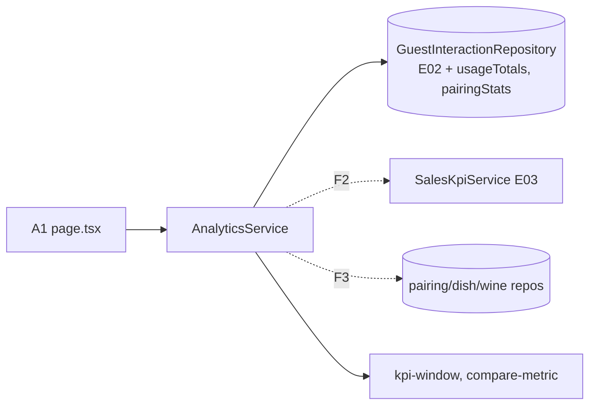

# Dashboard KPI w panelu (E04)

## 📝 TLDR
GM i sommelier otwierają dziś przegląd panelu (A1) i widzą tylko liczby katalogu oraz kartę „Nothing has been recorded yet”, choć po E02 i E03 zdarzenia gości i sprzedaż z POS będą w bazie. **Proponujemy**, by A1 pokazywał za ostatnie 28 pełnych dni, z deltą wobec poprzednich 28: KPI użycia (sesje gości, wyświetlenia rekomendacji dań, konwersja rekomendacja → wybór), KPI sprzedaży (wyróżniony Wine Attach Rate, przychód z wina na gościa i na stolik, średnia butelka i kieliszek) oraz tabelę skuteczności par danie–wino ze źródłem (Sommelier/Engine) **w chwili wyświetlenia**. Stawki pokazują mianownik, a delta stawek przy małej próbie jest ukryta. Liczy to jeden serwis odczytu `AnalyticsService` w `core` — bez nowej tabeli, trasy HTTP i biblioteki wykresów. Faza 1 (użycie) nie zależy od E03.

**Akceptacja (AGENTS §3):** `approved` przez właściciela (Filip) 2026-10-15 — wszystkie decyzje ✅ przyjęte zgodnie z rekomendacją; bramki faz z sekcji Fazy są spełnione.

## Wymagania
- **R1** Okno KPI = 28 pełnych dni kalendarzowych kończących się wczoraj w `Europe/Warsaw`; okno poprzednie = 28 dni bezpośrednio przed nim. Granice zdarzeń jako półotwarte przedziały UTC `[from, to)`, poprawne przy zmianie czasu.
- **R2** Sesja gościa okna = `session_id` z `guest_session_started` o `createdAt` w oknie. Zdarzenia sesji bez takiego startu (kelner, `sid` przeniesiony ręcznie, start przed oknem) nie wchodzą do żadnego KPI ani do tabeli par. Ruch syntetyczny nie istnieje w danych (E02 R6).
- **R3** Konwersja = sesje okna z ≥ 1 `recommendations_viewed` i ≥ 1 `wine_selected` z `props.context = 'dish'` / sesje okna z ≥ 1 `recommendations_viewed`. Ścieżka stolika (`table_recommendation_viewed`, `context: 'table'`) poza konwersją (zgodnie z E02).
- **R4** Żaden KPI nie dzieli liczb sesji (E02) przez liczby rachunków (E03) ani odwrotnie.
- **R5** `Metric.value` stawek to ułamek 0..1; `Metric.change` w jednostkach wyświetlania: `unit: '%'` (liczniki, kwoty) = zmiana względna w procentach, `unit: 'pp'` (stawki) = `(v − p) × 100`. UI: `%` zaokrąglone do całości, `pp` do 0,1; wynik zaokrąglony do 0 → „No change”.
- **R6** `change = null` z powodem `no_comparison`, gdy `value` lub `previous` jest `null` albo licznik/kwota poprzednia = 0; z powodem `small_sample`, gdy mianownik stawki w którymkolwiek oknie < `MIN_RATE_SAMPLE = 30`.
- **R7** Kafelek stawki zawsze pokazuje licznik i mianownik („5 of 16 sessions”, „123 of 267 checks with food”).
- **R8** Źródło pary (Sommelier/Engine) pochodzi z `props.items[].tier` zdarzenia `recommendations_viewed` (`sommelier_primary`/`sommelier` → Sommelier, `engine` → Engine), nie z dzisiejszego statusu pary.
- **R9** Usage, Sales i Pairing performance są ładowane i obsługiwane osobno: awaria jednej sekcji pokazuje w niej „Analytics are temporarily unavailable.” (nagłówek `h2`), pozostałe sekcje i reszta A1 renderują się.
- **R10** Każde nowe zapytanie ma zakres `restaurantId`.
- **R11** Faza 1 kompiluje się, testuje i wdraża bez kodu E03.
- **R12** A1 przy 390 px i 1440 px bez poziomego przewijania strony, także z `?pairs=all` i długimi nazwami.

## Resolved assumptions (autonomous defaults)
Uruchomienie `--autonomous`. Każde założenie można nadpisać przed `approved`. ✅ = potwierdzone przez właściciela 2026-10-15.

| # | Pytanie | Przyjęta odpowiedź | Uzasadnienie |
|---|---|---|---|
| Q1 | Jedna spec czy trzy (#20–#22)? | Jedna, trzy fazy = trzy PR‑y; F2 i F3 niezależne od siebie. | Wspólny ekran, okno, serwis i reguła sesji. |
| Q2 | Okno czasu? | R1; bez selektora okresu. Strefa jako stała `KPI_TIME_ZONE` (`Restaurant.timezone` jest w `DATA_MODEL.md`, ale nie w typie domenowym). | Dzisiejszy niepełny dzień zaniżałby deltę; selektor bez AC. |
| Q3 | Okno sprzedaży przy opóźnionym imporcie? | To samo okno co użycie. Brak sprzedaży w oknie → stan „brak danych” + `latestDataDay`. Częściowo zaimportowane okno renderuje się; sekcja pisze „Sales data through {latestDataDay}”, gdy `latestDataDay` < koniec okna. (wcześniej ✅ → agent-default: odwracalne, bez wpływu na dane) | Porównywalność z sesjami; KPI sprzedaży to ilorazy/średnie, więc niepełne okno jest czytelne, gdy daty są jawne. |
| Q4 | Trasy `analytics/*` z API_SPECIFICATION? | Nie w tej spec; w docs „planowane”. Bez obietnicy zgodności kształtu `KpiSummary` z dokumentem — mapowanie ustali spec trasy. | BC §2; żadne AC nie wymaga HTTP. |
| Q5 | Wykresy z A1? | Odłożone; bez `recharts`. Docs A1: „wykresy: później”. | Brak AC; nowa zależność (§1.1). |
| Q6 | Kto widzi KPI? | `panel.view` (owner, manager, sommelier) przez `requireAccess`; link „Import sales” tylko z `access.can('import.manage')`. | Bez zmian w `permissions.ts` (BC §5). |
| Q7 | AC #21.3 zakłada sommeliera bez `import.manage`. | Macierz bez zmian; AC #21.3 usunięte z kryteriów tej spec (żadna rola panelu nie ma tego stanu); warunek linku pokryty testem SSR `canImport=false`. Odebranie uprawnienia — osobna decyzja/spec. (wcześniej ✅ → agent-default: nic nie zmieniamy w uprawnieniach) | Nie da się spełnić AC bez zmiany risk-high, której ta spec nie robi. |
| Q8 | Konwersja i „wyświetlenia”? | R3. „Dish recommendations viewed” = unikalne (sesja, danie) `recommendations_viewed`. Kafelek konwersji: „5 of 16 sessions · dish recommendations only”. | Zgodnie z E02 (tylko ścieżka dania); E02 Q7 — unikalne (sesja, obiekt). |
| Q9 | Sesja gościa? | R2. `usageTotals` zwraca `sessions` (ta sama definicja co `countGuestSessions`, kontrakt sprawdza równość). | Jedno zapytanie, jedna definicja. |
| Q10 | Wiersze i źródło tabeli par? | Wiersz = (danie, wino, źródło). Źródło per (sesja, danie, wino) = `tier` z **ostatniego** w oknie `recommendations_viewed` tej sesji dla dania, którego `items` zawiera wino (R8). Do wierszy z `shown > 0` dochodzą pary `approved`/`modified` z `listPublishedByRestaurant` (źródło Sommelier) bez wyświetleń, tylko dla opublikowanego dania i aktywnego wina. Para dziś `rejected`, ale wyświetlana w oknie, ma wiersz ze źródłem historycznym. | Port zwraca tylko zrecenzowane i odrzucone pary migawki; `suggested` nie istnieją jako wiersze `Pairing` — wino „Engine” powstaje wyłącznie ze zdarzeń. Historyczny tier = uczciwe porównanie A04/A05. |
| Q11 | Długa lista par? | 10 wierszy (shown ↓, chosen ↓, nazwa dania, źródło; wiersze bez wyświetleń na końcu); „Show all N pairings” = `?pairs=all`; inna wartość = 10. | Bez nowego ekranu i paginacji. |
| Q12 | Gdzie liczyć? | Nowy `AnalyticsService` w `core/src/services/analytics/`. `packages/app/AGENTS.md` „dane panelu wyłącznie przez `adminService`” → „przez `adminService` i serwisy odczytu z `core`”. ✅ potwierdzone przez właściciela (Filip, 2026-10-15) | Zmiana prawa repozytorium — decyduje owner. Precedens: `salesKpiService` na A13 (E03). |
| Q13 | Agregacje? | Dwie nowe metody `GuestInteractionRepository` (własność E04): `usageTotals` (F1), `pairingStats` (F3); pamięć + PostgreSQL + kontrakt. Bez migracji. | AGENTS §1.3; indeks `(restaurant_id, created_at)` istnieje. |
| Q14 | Awaria analityki? | R9: trzy metody serwisu, każda przez `settleSection` na stronie (`Promise.all` po wynikach `settleSection`, jak `AdminService` z `Promise.all` na jednym zakresie). `ErrorMessage` dostaje opcjonalny `compact` (`h2`, `py-8`). | `ErrorMessage` ma dziś `h1` i `py-24`. Zmiana addytywna w `ui`. |
| Q15 | Ładowanie? | Istniejący `(lists)/loading.tsx`. | Mniej ruchomych części. |
| Q16 | „Revenue per table”, `dashboard_viewed`? | „Wine revenue per table” — tak (E03 zwraca `wineRevenuePerTable`). `dashboard_viewed` — nie. | Kafelek kosztuje zero; zdarzeń panelu nie ma w E02. |
| Q17 | Delta North Star: poprzednie 28 dni czy baseline pilota (C03, D04)? | Poprzednie 28 dni; etykieta „vs previous 28 days”. Stały baseline (C03) na A1 — pozycja „Later” w docs A1 i w Decisions in play. | Najmniejszy zakres; nie zmienia definicji D04 (4 tygodnie przed/po liczy owner z tych samych danych). |
| Q18 | Mała próba przy stawkach? | R6/R7, `MIN_RATE_SAMPLE = 30` (stała w `compare-metric.ts`). | Pilot = jedna restauracja; delta z 16 sesji to szum. |

## Problem
- `(lists)/page.tsx` pokazuje kafelki katalogu i stałą kartę „Guest activity… Nothing has been recorded yet”; A1 w `docs/SCREEN_SPECIFICATION.md` opisuje KPI z deltami i tabelę par.
- Po E02 i E03 dane są w `guest_interaction` i `sales_record`, ale brak odczytu agregatów (E02: `countGuestSessions`; E03: `getSalesKpis` dla jednego okresu) i porównania okresów.
- D01 obiecuje dashboard KPI w MVP; D04 — GM widzi Wine Attach Rate; pilot (D09, A03, A05) potrzebuje porównania okresów.

## User stories
**#20 — GM sprawdza, czy goście używają aplikacji.** GM Halki w czwartek 15 X rano → *Dashboard* → „Guest usage · Last 28 days · 17 Sep – 14 Oct 2026”: Guest sessions 412 (▲ 18% vs previous 28 days), Dish recommendations viewed 1,030, Recommendation → selection 31.2% „129 of 413 sessions” (▲ 4.1 pp) → liczone tylko sesje gości → GM decyduje o kodach QR na stolikach. Bez zdarzeń: „No guests have used Wine Match yet” + „Get the QR code”.

**#21 — GM czyta North Star.** Po imporcie POS (A13) → *Dashboard* → wyróżniony „Wine attach rate 46.0%”, „123 of 267 checks with food”, „▲ 3.2 pp vs previous 28 days”; obok przychód z wina na gościa i na stolik, średnia butelka i kieliszek → GM porównuje z poprzednim miesiącem. Bez sprzedaży w oknie: „Upload a POS export to see attach rate” + *Import sales* (z `import.manage`) i data ostatnich danych.

**#22 — sommelier sprawdza, które pary działają.** *Dashboard* → „Pairing performance”: „Duck breast · Savigny-lès-Beaune 2019 · Sommelier · Match 86 · shown 54 · chosen 19 · 35%”; zatwierdzona para bez wyświetleń: „No views” → klik w danie → A6 (`/admin/{slug}/pairings/{dishId}`). „Show all 63 pairings” rozwija listę.

## 📝 Proposed Solution
`AnalyticsService` z trzema metodami (`usageSummary` F1, `salesSummary` F2, `pairingPerformance` F3), czyste `kpi-window.ts` i `compare-metric.ts`, dwie metody agregujące portu E02, `SalesKpiService` z E03 wołany dla obu okien. A1 renderuje sekcje komponentami z propsami (testowalne SSR) na wspólnym `Kpi`.

**Odrzucone:** trasy `analytics/*` + `fetch` z klienta (BC §2, pierwszy `apiCall` w panelu); wykresy (Q5); tabela agregatów dziennych (migracja + job; wolumen pilota mieści się w zapytaniu); rozszerzenie `adminService` (Q12).

## 📝 Architecture


**`core/src/services/analytics/`:**
- `kpi-window.ts`: stałe `KPI_DAYS = 28`, `KPI_TIME_ZONE = 'Europe/Warsaw'`; `kpiWindow(now: Date) → { current: KpiPeriod; previous: KpiPeriod; currentRange: TimeRange; previousRange: TimeRange }`. `KpiPeriod = { from: string; to: string }` (daty lokalne `YYYY-MM-DD`, obie włącznie — strukturalnie zgodne z `SalesPeriod` E03, bez importu z E03), `TimeRange = { from: Date; to: Date }`.
- `compare-metric.ts`: `MIN_RATE_SAMPLE = 30`; `count(value, previous)`, `money(value, previous)`, `rate(num, den, prevNum, prevDen)` → `Metric` (reguły R5/R6).
- `analytics-service.ts`: `AnalyticsService`. Deps F1: `Pick<Repositories, 'restaurantRepository' | 'guestInteractionRepository'> & { clock: Clock }`; F2 dodaje `salesKpiService: SalesKpiService`; F3 dodaje `pairingRepository`, `dishRepository`, `wineRepository`. Nieznany slug → `null` (jak `adminService.overview`).
- Match Score: `pairingScore(dish, wine).score` — surowy wynik silnika bez preferencji gościa (R02). Nie używamy `Pairing.modelScore` (zapis z chwili generowania, nie bieżący wynik) ani `Pairing.source` (źródło liczymy z tieru zdarzenia, R8).
- `app/src/server/container.ts`: `analyticsService: asClass(AnalyticsService).scoped()` (obie gałęzie `DATA_SOURCE`).
- `app/src/server/analytics-section.ts`: `settleSection<T>(section, promise) → { ok: true; value: T } | { ok: false }`; odrzucenie → `logger.error('analytics section failed', { slug, section, error })`.

## 📝 Data Model
Brak nowych encji i migracji. Odczyt `guest_interaction` (E02) i przez `SalesKpiService` — `sales_record` (E03). Wyniki bez danych osobowych.

```ts
// core/src/ports/repositories.ts — GuestInteractionRepository (dodatek E04)
/** Guest sessions only: guest_session_started.createdAt in [from, to); counted events also in [from, to).
 *  sessions === countGuestSessions(restaurantId, range). */
usageTotals(restaurantId: string, range: TimeRange): Promise<{
  sessions: number;
  recommendationViews: number;     // distinct (session_id, dish_id) of recommendations_viewed
  sessionsWithViews: number;       // distinct sessions with recommendations_viewed
  sessionsWithSelection: number;   // of those, sessions with wine_selected where props.context = 'dish'
}>;                                                                                 // F1
/** Per (session, dish, wine): source = tier of the session's latest recommendations_viewed for the dish whose
 *  props.items contains the wine (sommelier_primary|sommelier → 'sommelier', engine → 'engine').
 *  shown = such sessions; chosen = of those, sessions with wine_selected (context 'dish') for the same dish_id and wine_id.
 *  Rows whose props.items is missing or not an array are skipped. */
pairingStats(restaurantId: string, range: TimeRange): Promise<Array<{
  dishId: string; wineId: string; source: 'sommelier' | 'engine'; shown: number; chosen: number }>>; // F3
```
PostgreSQL: natywne SQL, `count(distinct …)`, `EXISTS` na `guest_session_started` tej samej restauracji i okna, `jsonb_array_elements(props->'items')` tylko gdy `jsonb_typeof(props->'items') = 'array'`, „ostatni” = `row_number() over (partition by session_id, dish_id, wine_id order by created_at desc)`.

## 📝 API Contracts
Brak nowych tras HTTP. Kontrakt wewnętrzny (eksport z `core/src/index.ts`):
```ts
export interface Metric {
  value: number | null;          // count: liczba; rate: ułamek 0..1; money: PLN
  previous: number | null;
  change: number | null;         // '%': zmiana względna ×100 (18.2 = +18.2%); 'pp': (v − p) × 100; bez zaokrąglenia
  unit: '%' | 'pp';
  noChange: 'no_comparison' | 'small_sample' | null;  // powód change = null
  sample?: { numerator: number; denominator: number; previousDenominator: number }; // tylko stawki
}
export interface UsageSummary { period: { current: KpiPeriod; previous: KpiPeriod }; hasData: boolean;
  sessions: Metric; recommendationViews: Metric; recommendationToSelection: Metric }                       // F1
export interface SalesSummary { period: UsageSummary['period']; source: 'sales_import' | null; latestDataDay: string | null;
  attachRate: Metric; wineRevenuePerGuest: Metric; wineRevenuePerTable: Metric; averageBottle: Metric; averageGlass: Metric } // F2
export interface PairingPerformanceRow { dish: { id: string; name: string }; wine: { id: string; name: string; vintage: string };
  source: 'sommelier' | 'engine'; matchScore: number; shown: number; chosen: number; conversion: number | null }
export interface PairingPerformance { period: UsageSummary['period']; rows: PairingPerformanceRow[];
  total: number;    // wiersze przed limitem (bez pominiętych)
  omitted: number } // wiersze pominięte, bo danie lub wino nie istnieje już w katalogu                     // F3

class AnalyticsService {
  usageSummary(slug: string): Promise<UsageSummary | null>;                                               // F1
  salesSummary(slug: string): Promise<SalesSummary | null>;                                               // F2
  pairingPerformance(slug: string, opts?: { limit?: number }): Promise<PairingPerformance | null>;        // F3; limit 10, undefined = wszystkie
}
```
Reguły: `hasData = false` gdy `sessions = 0` w obu oknach. `recommendationToSelection` = `rate(sessionsWithSelection, sessionsWithViews, …)`; mianownik 0 → `value: null`. `salesSummary`: `getSalesKpis(slug, current)` i `(slug, previous)`, `latestDataDay = (await dataRange(slug))?.to ?? null`; `attachRate` = `rate(foodChecksWithWine, foodChecks, …)` (wartość = `attachRate` z E03, 0..1, per rachunek), pozostałe — `money`. `conversion = chosen / shown`, `null` gdy `shown = 0`. Docs §Analytics: trasy „planowane (E04 liczy w panelu)”.

## 📝 UI/UX
A1 `/admin/{slug}` (`(lists)/page.tsx`): nagłówek → baner review → **Sales** (F2) → **Guest usage** → Wine program (istniejące kafelki) → „Needs your attention” → **Pairing performance** (F3, osobny pełnej szerokości rząd). Karta „Guest activity” znika w F1. Nagłówek sekcji: „Last 28 days · 17 Sep – 14 Oct 2026”.

- **`Kpi`** przeniesiony z `page.tsx` do `app/src/app/(admin)/admin/_components/kpi.tsx`, nowe opcjonalne `delta?: string`. Linia delty: „▲ 18% vs previous 28 days” / „▼ 2.1 pp …” / „No change” / „No comparison” / „Too few to compare” (`small_sample`). Strzałka `aria-hidden`, bez kolorów znaczeniowych. `detail` stawki = „N of M sessions” / „N of M checks with food”.
- **Format:** liczniki i stawki `en-GB` (`1,030`, `46.0%`), kwoty `zl()`.
- **Komponenty sekcji** (propsy, SSR‑testowalne, w `(lists)/`): `usage-kpis.tsx` (`result: SettledSection<UsageSummary>`, `slug`), `sales-kpis.tsx` (`result`, `slug`, `canImport`), `pairing-performance.tsx` (`result`, `slug`, `showAll`). `{ ok: false }` → `ErrorMessage compact`.
- **Sales:** Wine attach rate (`lead`; bez sprzedaży nic nie jest wyróżnione), Wine revenue per guest, Wine revenue per table, Average bottle, Average glass; `value = null` → „No data”.
- **Pairing performance:** `Table` (Dish → link do A6, Wine, Source `Badge`, Match, Shown, Chosen, Conversion); `shown = 0` → „No views”. Pod tabelą „Show all N pairings” / „Show top 10”; `omitted > 0` → „N pairings hidden: the dish or wine was removed.”

| Stan | Co widzi użytkownik |
|---|---|
| Empty (użycie) | `EmptyState` „No guests have used Wine Match yet” / „Usage figures appear once guests scan the QR code.”, akcje „Get the QR code”, „Open the guest app”. |
| Empty (sprzedaż) | `EmptyState` „Upload a POS export to see attach rate”; z `canImport` akcja „Import sales” → `/admin/{slug}/import/sales`, bez — „Someone with import access can upload it.”; `latestDataDay` przed oknem → „Latest sales data: 2 Sep 2026.” |
| Empty (pary) | `EmptyState` „No pairings to measure yet” + link do A7, gdy 0 wierszy. |
| Loading | `(lists)/loading.tsx` bez zmian. |
| Error | sekcja: `ErrorMessage compact` „Analytics are temporarily unavailable.” / „Pairings and guest app work normally.”; inne sekcje działają. |
| No-permission | `requireAccess` w layoucie; bez `import.manage` brak linku importu. |
| 390 px | kafelki w 1 kolumnie (`grid sm:grid-cols-2 xl:grid-cols-4`, dzieci `min-w-0`), tabela przewija się w swoim kontenerze. |
| 1440 px | kafelki w rzędach po 4/3; tabela par w pełnej szerokości. |

Strona tylko czyta (`force-dynamic`), działa bez JS.

## 📝 Edge Cases & Failure Scenarios
| Sytuacja | Zachowanie |
|---|---|
| Brak zdarzeń w obu oknach | `hasData = false` → `EmptyState` (AC #20.2). |
| Zdarzenia tylko w poprzednim oknie | Liczniki 0 z „▼ 100%”; konwersja „No data” (mianownik 0). Zdarzenia zapisują się same, więc brak = prawdziwe zero. |
| Poprzednie okno puste | „No comparison”, nie „+∞%”. |
| Mianownik stawki < 30 w którymkolwiek oknie | Wartość + „N of M”, delta „Too few to compare”. |
| Sesja kelnera / bez `guest_session_started` / start przed oknem | Poza wszystkimi KPI i parami (R2; znane przybliżenie na granicy okna). |
| `wine_selected` bez `recommendations_viewed` w sesji | Poza licznikiem konwersji i `chosen`. |
| Wybór ze stolika (`context: 'table'`) | Poza konwersją i parami (R3). |
| Para wyświetlona raz jako Engine, potem jako Sommelier (zatwierdzona w oknie) | Dwa wiersze; każda sesja w jednym (ostatni tier tej sesji). |
| `props.items` brak / nie‑tablica | Wiersz pominięty w `pairingStats`. |
| Danie lub wino usunięte z katalogu | Wiersz pominięty, `omitted` w stopce. |
| Para `approved` bez wyświetleń, danie nieopublikowane lub wino nieaktywne | Brak wiersza. Z wyświetleniami w oknie — wiersz zostaje. |
| Sprzedaż tylko w poprzednim oknie | Stan pusty sprzedaży + data ostatnich danych (sprzedaż przychodzi importem — brak to brak danych, nie spadek). |
| Okno sprzedaży zaimportowane częściowo | Wartości + „Sales data through 9 Oct”. |
| `attachRate = null` przy `source ≠ null` | „No data”; pozostałe KPI sprzedaży widoczne. |
| Zmiana czasu 25 X 2026 w oknie | Test `kpiWindow`. |

## 📝 Risks & Impact Review
- **Definicje KPI jako kontrakt de facto:** zmiana R2/R3/Q2 zmienia historię liczb → zapisane w docs A1 i JSDoc portu; zmiana = nowa wersja spec.
- **Wydajność:** na żądanie A1: 2× `usageTotals`, 1× `pairingStats`, 2× `getSalesKpis`, 1× `dataRange`, odczyt par/dań/win; `jsonb_array_elements` ograniczone oknem 28 dni. Przy wzroście — tabela dzienna (osobna spec).
- **Zgodność:** brak migracji (BC §3), tras (BC §2), zmian uprawnień (BC §5); `ErrorMessage.compact` addytywny; nowe metody portu wewnętrzne (BC §8) z kontraktem na obu magazynach.
- **Izolacja tenantów:** R10 + przypadek kontraktu „druga restauracja niewidoczna”.
- **Zależność od kluczy `props` E02** (`items[].tier`, `context`): nazwy w kontrakcie E02; zmiana tam = zmiana tu.
- **Wycofanie:** poprzedni `page.tsx`; serwis i metody portu mogą zostać bez konsumenta.

## 📝 Decisions in play
- **D01** — realizowane. **D04** — wyróżniony kafelek; definicja z E03 Q7 ✅; delta vs poprzednie 28 dni (Q17). **Later:** stały baseline pilota (C03) na A1 — owner decyduje po pierwszym miesiącu pilota.
- **R01** — „Sommelier” = tier sommeliera w chwili wyświetlenia. **R02** — Match Score = `pairingScore`.
- **D09** — KPI mierzą A03/A05, nie zmieniają ich statusu. **N04** — bez prognoz.
- **Q12 ✅** — zmiana `packages/app/AGENTS.md`. Owner: Filip. Zmiany docs A1/§Analytics zatwierdza owner.

## 📋 Phasing
- **F1 — #20 Guest usage.** Wymaga E02 F1–F3 (E02 Q17). **Bez E03.**
- **F2 — #21 Sales.** Wymaga E03 F2 (i jej bramek Q2/Q7/Q17 ✅) oraz F1.
- **F3 — #22 Pairing performance.** Wymaga F1 i E02 F1 z `items[].tier`; niezależna od F2 (kolejność F2/F3 dowolna).

## 📋 Implementation Plan
Każdy krok zostawia działającą aplikację. Bramka każdej fazy: `lint`, `check:boundaries`, `typecheck`, `test`, `test:db`, `build`, smoke w `memory` i `postgres`, 390/1440 px.

### F1 — użycie (#20)
1. **Core: okno i metryki.** `kpi-window.ts`, `compare-metric.ts` + testy: 28 dni do wczoraj; okno przez 25 X 2026; `count` z `p = 0` → `no_comparison`; `rate` w pp (0.312 vs 0.271 → 4.1); mianownik 29 → `small_sample`, 30 → liczba; `money` jak `count`.
2. **Core: `usageTotals`.** Port, pamięć, przypadki `repository-contract.ts` (dane przez `seedUsageEvents` z E02): `sessions === countGuestSessions`; kelner pominięty; start przed oknem pominięty; druga restauracja; granice `[from, to)`; unikalne (sesja, danie); `wine_selected` bez widoku i z `context: 'table'` poza licznikiem.
3. **Db: `PgGuestInteractionRepository.usageTotals`.** `test:db` (ten sam kontrakt).
4. **Core: `AnalyticsService.usageSummary`.** Deps F1. Testy na pamięci ze stałym `Clock`: AC1 (wartości, delta, `sample`), `hasData = false`, tylko poprzednie okno, nieznany slug → `null`.
5. **UI: `ErrorMessage compact`** + test w `ui/tests`; **`Kpi`** do `admin/_components/kpi.tsx` z `delta` (page.tsx bez zmian wizualnych).
6. **App: sekcja Guest usage.** `container.ts`, `analytics-section.ts` (+ test `app/tests/unit/server.test.ts`), `usage-kpis.tsx` + test SSR (dane, pusto, `{ ok: false }` → tekst błędu i `h2`, brak `h1`), podpięcie w `page.tsx`, usunięcie „Guest activity”. Smoke: A1 200 i „Guest usage” lub „No guests have used Wine Match yet”.
7. **E2E + docs.** `app/tests/e2e` (PostgreSQL, `seedUsageEvents` przez `PgGuestInteractionRepository`, zdarzenia w obu oknach + sesja kelnera): kafelki z deltą; pusto → `EmptyState`; 390 px `scrollWidth <= innerWidth`. Docs: A1 (definicje R1–R7, okno, „wykresy/baseline: później”), §Analytics „planowane”, `packages/app/AGENTS.md` (po Q12).

### F2 — sprzedaż (#21)
8. **Core: `salesSummary`.** Dep `salesKpiService`; testy: AC4 (wartości, pp dla attach rate, `sample` z `foodChecks`), brak sprzedaży → `source: null` + `latestDataDay`, `attachRate: null` przy samych rachunkach barowych, `foodChecks < 30` → `small_sample`.
9. **App: `sales-kpis.tsx`** + test SSR (`canImport` true/false → obecność `href=".../import/sales"`, „Sales data through …”, `{ ok: false }`); podpięcie w `page.tsx` z `access.can('import.manage')`; docs A1.

### F3 — pary (#22)
10. **Port `pairingStats`.** Pamięć + kontrakt (shown/chosen per (danie, wino, źródło); ostatni tier sesji; kelner, `context: 'table'`, `items` nie‑tablica pominięte; druga restauracja) + PostgreSQL; `test:db`.
11. **Core: `pairingPerformance`.** Deps F3; łączenie z `listPublishedByRestaurant` (`approved`/`modified`, bez wyświetleń tylko opublikowane danie + aktywne wino), `pairingScore`, sortowanie, `limit`, `total`, `omitted`. Testy: AC7–AC9, para `rejected` wyświetlona jako Sommelier → wiersz Sommelier.
12. **App: `pairing-performance.tsx`** + test SSR; `?pairs=all`; smoke `?pairs=all` → 200; E2E: wiersz z wyświetleniami, „No views”, `?pairs=all` z długimi nazwami w fixture przy 390 i 1440 px bez poziomego przewijania; docs A1.

## Kryteria akceptacji
- [x] AC1 (#20, R2, R3, R5, R7) Przy zdarzeniach w oknie A1 pokazuje sesje gości, wyświetlenia rekomendacji dań i konwersję z „N of M sessions” oraz deltą vs poprzednie 28 dni. *Test `usageSummary` + E2E.*
- [x] AC2 (#20) Bez zdarzeń A1 pokazuje „No guests have used Wine Match yet”, nie zera. *Test serwisu + SSR + smoke `memory`.*
- [x] AC3 (#20, R2) Zdarzenia kelnera i sesji bez startu nie wchodzą do żadnego KPI. *Kontrakt `usageTotals` (memory, PostgreSQL).*
- [ ] AC4 (#21, R5–R7) Przy sprzedaży w oknie Wine Attach Rate jest wyróżniony, z „N of M checks with food” i deltą w pp; obok 4 KPI kwotowe z deltą w %. *Test `salesSummary` + SSR.*
- [ ] AC5 (#21) Bez sprzedaży w oknie A1 pokazuje komunikat z linkiem do importu (z `import.manage`). *SSR `canImport=true`; `canImport=false` → brak linku.*
- [ ] AC6 (R6) Mianownik stawki < 30 w którymkolwiek oknie → brak delty („Too few to compare”); poprzednie 0 → „No comparison”; zaokrąglenie do 0 → „No change”. *Test `compare-metric` + SSR.* — F1: liczniki i stawka konwersji ✅ (`core/tests/analytics.test.ts`, `app/tests/unit/usage-kpis.test.ts`); attach rate — F2.
- [ ] AC7 (#22, R8) Każdy wiersz par ma shown, chosen, konwersję i źródło z tieru w chwili wyświetlenia. *Kontrakt `pairingStats` + test `pairingPerformance`.*
- [ ] AC8 (#22) Para bez wyświetleń pokazuje „No views”, nie 0%. *Test serwisu + SSR.*
- [ ] AC9 (#22) Match Score pary zatwierdzonej = `pairingScore(dish, wine).score` (R02). *Test serwisu.*
- [ ] AC10 (R10) Dane drugiej restauracji niewidoczne w `usageTotals`, `pairingStats`. *Kontrakt.* — F1: `usageTotals` ✅ (kontrakt, pamięć + PostgreSQL); `pairingStats` — F3.
- [ ] AC11 (R9) Sekcja z `{ ok: false }` renderuje „Analytics are temporarily unavailable.” w `h2`; `settleSection` loguje `error`. *Testy SSR komponentów sekcji + test `settleSection`.* — F1: sekcja Guest usage ✅; Sales / Pairing performance — F2/F3.
- [ ] AC12 (R12) 390 i 1440 px bez poziomego przewijania z długimi nazwami i `?pairs=all`. *E2E (kroki 7, 12).* — F1 (krok 7) ✅ `kpi-usage.e2e.test.ts`; `?pairs=all` — F3.
- [x] AC13 (R11) Faza 1 przechodzi bramkę na gałęzi bez kodu E03. *CI fazy 1.*

Dokumentacja (A1, §Analytics, `packages/app/AGENTS.md`) — checklista PR (CODE_REVIEW §3), nie AC.

## Grill log
| # | Pytanie | Odpowiedź | Przyjęte przez |
|---|---|---|---|
| 1 | Źródło pary z `items[].tier` zdarzenia, nie z bieżącego statusu? | Tak (R8, Q10) | agent-default |
| 2 | Wiersz = (danie, wino, źródło); sesja liczona raz, wg ostatniego tieru w oknie? | Tak | agent-default |
| 3 | Wiersze bez wyświetleń tylko `approved`/`modified`, opublikowane danie, aktywne wino? | Tak | agent-default |
| 4 | Konwersja tylko ścieżka dania (`context: 'dish'`), zgodnie z E02? | Tak (R3) | agent-default |
| 5 | Stawki 0..1, `change` w jednostkach wyświetlania (`%` / `pp`)? | Tak (R5) | agent-default |
| 6 | `MIN_RATE_SAMPLE = 30` ukrywa deltę, wartość z „N of M” zostaje? | Tak (R6, R7) | agent-default |
| 7 | Trzy metody serwisu, każda przez `settleSection`? | Tak (R9) | agent-default |
| 8 | F1 bez zależności od E03; `salesKpiService` dochodzi w F2? | Tak (R11) | agent-default |
| 9 | Delta vs poprzednie 28 dni; baseline C03 „Later”? | Tak (Q17) | agent-default |
| 10 | Okno sprzedaży = okno użycia + „Sales data through …”? | Tak (Q3, zdjęte ⚠) | agent-default |
| 11 | AC #21.3 poza kryteriami, macierz uprawnień bez zmian? | Tak (Q7, zdjęte ⚠) | agent-default |
| 12 | `usageTotals` zwraca `sessions`, kontrakt = `countGuestSessions`? | Tak | agent-default |
| 13 | Wybór bez wymogu kolejności względem widoku (podzbiór sesji z widokiem)? | Tak | agent-default |
| 14 | Wiersze bez tablicy `items` pomijane, bez fallbacku na `wineIds`? | Tak | agent-default |
| 15 | Delta zaokrąglona do 0 → „No change”; `%` do całości, `pp` do 0,1? | Tak | agent-default |
| 16 | Liczniki i stawki `en-GB`, kwoty `zl()`? | Tak | agent-default |
| 17 | `Kpi` do `admin/_components/kpi.tsx` z opcjonalnym `delta`? | Tak | agent-default |
| 18 | Tabela par w osobnym rzędzie pełnej szerokości? | Tak | agent-default |
| 19 | Kafelek „Wine revenue per table”? | Tak (Q16) | agent-default |
| 20 | Bez obietnicy kształtu `GET /analytics/summary`? | Tak (Q4) | agent-default |
| 21 | Strefa jako stała, nie z `Restaurant`? | Tak (Q2) | agent-default |
| 22 | F1 czeka na E02 F1–F3 (E02 Q17)? | Tak | agent-default |
| 23 | F2 i F3 niezależne, kolejność dowolna? | Tak | agent-default |
| 24 | F2 dziedziczy bramki E03 (Q2, Q7, Q17)? | Tak | agent-default |
| 25 | E2E wstawia zdarzenia `seedUsageEvents` z E02 przez repozytorium PostgreSQL? | Tak | agent-default |
| 26 | Testy SSR sekcji z `{ ok: false }` zamiast „review” dla AC11? | Tak | agent-default |
| 27 | Zmiana `packages/app/AGENTS.md` (panel czyta też serwisy odczytu `core`)? | Rekomendacja: tak | owner ✅ |

## Changelog
- 2026-10-15 — draft (om-spec-writing --autonomous)
- 2026-10-15 — cross-model review (Sonnet 5.5): 20 accepted, 1 rejected, 1 partial. Accepted: D1 delta vs poprzednie 28 dni + baseline „Later”; D2 skutek częściowego okna; D4 AC6 usunięte; H1 uniwersum par (migawka = `approved`/`modified`, Engine tylko ze zdarzeń); H2 źródło z `items[].tier` (E02); H3 F1 niezależna od E03; skala delty; próba i mianowniki; bez obietnicy kształtu API; izolacja per sekcja + usunięte twierdzenie o jednym połączeniu; pomocnik `seedUsageEvents` + podział kroku 6; `Kpi` do `_components`; testy SSR dla AC11; tabela pełnej szerokości i filtr wierszy bez wyświetleń; `sessions` z `usageTotals`; etykiety jednostek; revenue per table; daty/locale; stałe okna, `total`/`omitted`, `source`/`modelScore`, długie nazwy w E2E; cięcia (Research, narracja przeglądu, trywialne wiersze). Cross-spec: sesje vs rachunki (R4), Wymagania R1–R12, bramki faz. Rejected: D3 stolik w konwersji — E02 ustalił konwersję tylko dla ścieżki dania. Partial: sortowanie „niska konwersja” — bez AC i z arbitralnym progiem; zostaje „Show all” + wiersze bez wyświetleń.
- 2026-10-15 — grill: 27 questions, 1 left for owner (Q12); Q3 i Q7 zdjęte z ⚠.
- 2026-10-15 — approved: właściciel (Filip) przyjął rekomendacje we wszystkich decyzjach ⚠; status `approved`.

## Realizacja

- **F1 — #20 Guest usage (2026-10-18/19, gałąź `feat/e04-f1-usage-kpis`, log `.ai/runs/2026-10-18-e04-f1-usage-kpis.md`).** Zrobione: `core/src/services/analytics/` (`kpi-window.ts` — `KPI_DAYS`, `KPI_TIME_ZONE`, `kpiWindow`, `startOfLocalDay`; `compare-metric.ts` — `Metric`, `MIN_RATE_SAMPLE`, `count`/`money`/`rate`; `analytics-service.ts` — `AnalyticsService.usageSummary`), port `GuestInteractionRepository.usageTotals` + typ `UsageTotals` (pamięć, `PgGuestInteractionRepository` jednym zapytaniem z CTE, przypadek kontraktu przez `seedUsageEvents`), `ErrorMessage compact` (`ui`), `Kpi` w `admin/_components/kpi.tsx` z deltą, formatowanie w `_components/kpi-format.ts`, `server/analytics-section.ts` (`settleSection`), sekcja `(lists)/usage-kpis.tsx` na A1 (karta „Guest activity” usunięta, „Needs your attention” na pełną szerokość), `analyticsService` w `container.ts`, słowniki EN/PL (`admin.dashboard.usage`, `admin.dashboard.delta`, `admin.explain.usage`), smoke, docs (SCREEN_SPECIFICATION A1, API_SPECIFICATION §Analytics „planowane”, DATA_MODEL). Testy: `core/tests/analytics.test.ts`, kontrakt (memory + `test:db`), `ui/tests/feedback.test.tsx`, `app/tests/unit/usage-kpis.test.ts`, E2E `app/tests/e2e/kpi-usage.e2e.test.ts`. Odstępstwa: (1) **kafelek „Waiter lookups”** — po E02 F3 i E08 lookupy kelnera (`staff_lookup` + `staff_table_lookup`, unikalne (sesja, danie lub zestaw dań stołu), bez wymogu startu sesji) liczone osobno w `UsageTotals.staffLookups` / `UsageSummary.staffLookups`, nigdy w KPI gości — definicje R2/R3 bez zmian; (2) wyjaśnienie „Guest usage” (E07 przekazało je E04) jako osobne „i” sekcji (`data-explain="usage"`, jedno na sekcję), widoczne tylko przy kafelkach; liczby w tekście z `KPI_DAYS` i `MIN_RATE_SAMPLE`; (3) `Kpi.delta` to `{ text, arrow? }` zamiast `string` (strzałka `aria-hidden` + czytane „Up”/„Down”); (4) liczby w języku panelu (`en-GB` / `pl-PL`); (5) E2E wstawia zdarzenia przez `seedUsageEvents` + `PgGuestInteractionRepository` (`getOrm` z adresem bazy e2e), A1 z JS (strona w `(lists)`); (6) zmiana `packages/app/AGENTS.md` z Q12 była już na `main`. Zostają F2 (#21) i F3 (#22): spec `in-progress`.
