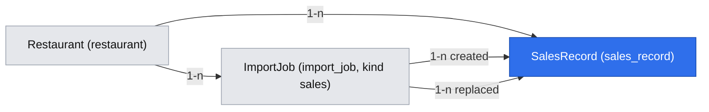

# Import sprzedaży z POS i Wine Attach Rate (E03)

## 📝 TLDR

GM / właściciel nie ma dziś jak wgrać sprzedaży z POS, więc North Star (Wine Attach Rate, D04) jest niemierzalny, a A05 nie ma baseline'u. **Proponujemy:** czwarty rodzaj importu `sales` na istniejącym potoku importu (CSV/XLSX → podgląd z błędami → atomowe zatwierdzenie), nową tabelę `sales_record` (pozycje rachunków, bez danych osobowych) i jedną metodę `SalesKpiService.getSalesKpis(slug, period)`, która liczy Wine Attach Rate i KPI sprzedażowe dla okresu — punkt wejścia dla dashboardu KPI (E04, #21).

**Akceptacja (AGENTS §3):** `approved` przez właściciela (Filip) 2026-10-15 — wszystkie decyzje ✅ przyjęte zgodnie z rekomendacją; bramki faz z sekcji Fazy są spełnione.

## Resolved assumptions (autonomous defaults)

Uruchomienie `--autonomous` (prośba product ownera). Każde założenie można nadpisać przed `approved`. ✅ = potwierdzone przez właściciela 2026-10-15.

| # | Pytanie | Przyjęta odpowiedź | Uzasadnienie |
|---|---|---|---|
| Q1 | Rozdzielić import (#16) i wskaźnik (#18) na dwie specyfikacje? | **Nie** — jedna spec, dwie fazy (import + podgląd; karta okresu i serwis dla E04). | Kontrakt `getSalesKpis` i model danych projektujemy razem; fazy wdrażalne osobnymi PR-ami. |
| Q2 | Jaki format eksportu POS (Q03, #6 nieznane)? | Ogólny plik **pozycji rachunku** (jeden wiersz = jedna pozycja) z kolumnami z `DATA_MODEL.md` „SalesRecord”, rozpoznawanymi przez synonimy PL/EN; bez presetów dostawców POS. ✅ potwierdzone przez właściciela (Filip, 2026-10-15) | Format pilotażu nieznany (Q03 briefu, otwarte pytanie właściciela); jeśli POS eksportuje tylko sumy rachunków, potrzebny drugi tryb mapowania. Synonimy dopisuje się bez łamania (BC §6). |
| Q3 | Jak klasyfikować typ pozycji (`food` / `wine_glass` / `wine_bottle` / `other`)? | Kolumna typu/kategorii **wymagana**. Wartość ze słownika → typ wprost; ogólne „wino/wina” → `wine_bottle` z ostrzeżeniem; **nierozpoznana wartość → błąd `unmapped_category`** (wiersz odznaczony), a podgląd pokazuje **jedno pole wyboru na każdą odrębną nierozpoznaną wartość** („Wina białe → wine bottle”), stosowane do wszystkich jej wierszy. | Klasyfikacja wprost zmienia North Star; cicha zamiana na `other` dałaby ~0% zamiast odmowy (fail-closed). Jedna decyzja na wartość zamiast edycji do 2000 wierszy. |
| Q4 | Jak uniknąć duplikatów przy ponownym wgraniu? | **Zastąpienie po rachunku, miękkie:** zatwierdzenie w jednej transakcji ustawia `replaced_at`, `replaced_by_job_id` na aktywnych `sales_record` restauracji o kluczu (`business_date`, `check_id`) obecnym w importowanych rachunkach i wstawia nowe. Rachunek importuje się **w całości albo wcale**. Podgląd mówi, ile rachunków zostanie zastąpionych. | Ten sam plik → ten sam stan; poprawiony eksport nadpisuje zamiast podwajać; nic nie jest kasowane, więc odwracalne SQL-em. Koszt: plik podzielony w środku rachunku — druga część zastępuje pierwszą. |
| Q5 | Limit wierszy dla sprzedaży? | Bez zmian: `IMPORT_LIMITS` (10 MB, 2000 wierszy); w UI wskazówka „dziel plik po całych dniach”. Podniesienie limitu z podglądem agregatów per rachunek i tylko wierszy z problemami — osobna spec, gdy pilotaż pokaże koszt. | Najmniejszy zakres; BC §6 pozwala limit podnieść później bez łamania. 4 tygodnie baseline'u (C03) = kilka–kilkanaście plików. |
| Q6 | Kto może wgrywać sprzedaż? | Istniejące `import.manage` (owner, manager, sommelier); kelner — nie. | Bez zmiany tabeli uprawnień (risk-high, CODE_REVIEW §3). |
| Q7 | Definicja Wine Attach Rate. | **Rachunki z jedzeniem i winem / rachunki z jedzeniem** (wynik ≤ 100%); jednostka = **rachunek** (stolik), nie gość. Rachunki barowe (samo wino) nie liczą się do licznika. W tym samym PR-ze fazy 2 `docs/PRODUCT_CONCEPT.md` §6 i słownik briefu dostają to doprecyzowanie. ✅ potwierdzone przez właściciela (Filip, 2026-10-15) | `PRODUCT_CONCEPT.md` §6 i brief: „zamówienia z ≥1 winem / zamówienia z jedzeniem” — licznik nie jest tam ograniczony do rachunków z jedzeniem. Nasza wersja jest ograniczona i porównywalna, ale to zmiana definicji North Star (D04, owner Filip). Uwaga: per rachunek ≠ per gość, więc „+5 pp” z A05 nie przekłada się 1:1. |
| Q8 | Zwroty / storna (ujemna ilość lub kwota)? | Przyjmujemy; rachunek „ma wino/jedzenie”, gdy **suma** ilości danego typu > 0. | Tak modelują to otwarte POS-y (Odoo: zwrot = linia z ujemną ilością). |
| Q9 | Kwota netto czy brutto? | Tylko **netto** (`net_amount`). Kolumna „brutto” nie jest mapowana. | #16 i `DATA_MODEL.md`; stała podstawa KPI. |
| Q10 | Dopasowywać pozycje do `dish` / `wine`? | **Nie**; `dish_id` / `wine_id` (i nazwa pozycji) dojdą addytywnie z osobną spec. | Wskaźnik ich nie potrzebuje. |
| Q11 | Gdzie GM widzi wskaźnik przed E04? | Na stronie importu sprzedaży: karta „Wine Attach Rate” z formularzem GET okresu. Brak nowej trasy analityki. | Najmniej nowej powierzchni publicznej. |
| Q12 | Porównanie z poprzednim okresem? | Poza zakresem; E04 woła `getSalesKpis` dwa razy. | Brak nowego kontraktu. |
| Q13 | Plik bez rozpoznanego nagłówka albo bez wymaganej kolumny? | Odmowa `no_header` z listą brakujących kolumn; bez `DEFAULT_ORDER` dla `sales`; nagłówki dopasowywane **tylko dokładnie** (bez prefiksu). | Zgadywanie kolumn w danych finansowych groźniejsze niż odmowa; prefiks wciągałby „Nazwa klienta”, „Typ płatności”. |
| Q14 | PDF dla sprzedaży? | Odmowa `unsupported_format` (tylko CSV i XLSX). | Eksport POS to tabela. |
| Q15 | Klucz główny `sales_record`? | **UUID**, jak wszystkie tabele (BC §3); `DATA_MODEL.md` aktualizowany. | Jeden typ klucza; `IdGenerator` z `core`. |
| Q16 | Niejednoznaczne daty `03/04/2026`? | Kolejność dnia i miesiąca ustalana dla **całego pliku**: składnik > 12 rozstrzyga; sprzeczność → błąd wierszy; same niejednoznaczne → `DD/MM` z notatką. | Cicha zamiana dnia z miesiącem psuje okresy. |
| Q17 | Tożsamość rachunku i dnia biznesowego. | Kolumna rachunku = **numer rachunku/paragonu unikalny w dniu biznesowym**, nie numer stolika (synonimy nie obejmują „stolik/table”). Kolumna daty = **dzień biznesowy**: wartość z godziną (tekst z czasem, seryjna Excela z częścią ułamkową) → błąd „Use the business day column, not a timestamp”, bez obcinania. Plik, w którym ten sam `check_id` występuje w ≥ 2 dniach, dostaje notatkę informacyjną. ✅ potwierdzone przez właściciela (Filip, 2026-10-15) | Numer stolika używany przez kilka grup w dniu albo rachunek po północy rozbity na dwie daty fałszują wskaźnik i zastępowanie. Zależy od formatu pilotażu (Q03); jeśli POS daje tylko znaczniki czasu, potrzebne ustawienie „koniec dnia biznesowego” (osobna decyzja). |
| Q18 | Przechowywać nazwę pozycji? | **Nie.** `itemName` jest opcjonalną kolumną widoczną w podglądzie (rozpoznanie wiersza), ale nie trafia do `sales_record`. | Q10 odracza dopasowanie; tekst wolny może zawierać notatki z danymi osobowymi. Dodanie kolumny później jest addytywne. |
| Q19 | Wycofanie migracji i pojedynczego importu. | Produkcja: **nigdy `migration:down` dla `sales_record`, gdy tabela ma dane**; wycofanie wdrożenia = poprzedni obraz, schemat zostaje (tabela addytywna, stary kod jej nie dotyka). Pojedynczy import: udokumentowany SQL po `import_job_id` / `replaced_by_job_id` w `docs/` (runbook), bez UI; przycisk „Revert this import” — kolejna spec. | `down` usuwa dane, których restauracja może już nie mieć w plikach; BC §3 expand → contract. |
| Q20 | Kolejność scalania. | **Po E02** (sugerowana kolejność: E05-S01 → E05-S02 F1 → E02 → E03 → E04). E03 rebase'uje się na zmiany E02 w `Repositories`, `memory-repositories.ts`, `repository-contract.ts`, `container.ts`, `docs/DATA_MODEL.md`. | Wspólne pliki; AGENTS §8 (jedna spec = jeden worktree). |

## Problem

- `import_job.kind` ma wartość `sales`, ale `core` zna tylko `ImportKind = 'menu' | 'wines'`; nie ma tabeli sprzedaży, trasy ani ekranu.
- Panel pokazuje „Nothing has been recorded yet” (`(lists)/page.tsx`), North Star D04 jest niemierzalny, a C03 / A05 / Q02 czekają na baseline z POS (brief, D09).
- Ryzyka domenowe z briefu: format eksportu nieznany (Q03), dane gości nie mogą trafić do systemu (N04).

**Poza zakresem:** integracja z API POS (N04), presety dostawców POS, dopasowanie pozycji do dań/win, porównanie okresów i dashboard (E04), UI wycofania importu, podniesienie limitu wierszy.

## User stories

**US1 (#16) — GM wgrywa eksport z POS.** GM (lub sommelier) z `import.manage` po zamknięciu tygodnia → otwiera *Import sales* i wybiera plik CSV/XLSX → widzi podsumowanie (zakres dat, rachunki, wiersze per typ, wstępny Wine Attach Rate pliku), listę nierozpoznanych kategorii do przypisania, notatki („zastąpi 12 rachunków już zapisanych”) i wiersze z błędami → nic nie jest zapisane przed zatwierdzeniem → GM przypisuje kategorie, poprawia lub odznacza wiersze, klika *Import* → widzi wynik (zapisane / zastąpione / pominięte).

**US2 (#18) — GM sprawdza Wine Attach Rate.** GM wybiera okres (od–do) w karcie *Wine Attach Rate* → widzi „40,0% — 4 of 10 checks with food had wine” oraz przychód z wina na gościa / rachunek i średnią butelkę / kieliszek, albo „No sales data for this period” → liczone tylko rachunki tej restauracji → GM używa liczby jako baseline'u (C03).

## Wymagania

- **R1** `ImportKind` obejmuje `sales`; upload, podgląd, poprawki, zatwierdzenie i anulowanie idą istniejącym `ImportService` i trasami `/imports/*`.
- **R2** Import sprzedaży przyjmuje CSV (UTF-8, Windows-1250, BOM) i XLSX; PDF → `unsupported_format`; limity `IMPORT_LIMITS` bez zmian.
- **R3** Wymagane kolumny: data, rachunek, typ pozycji, ilość, kwota netto; brak którejkolwiek albo nierozpoznany nagłówek → `no_header` z listą brakujących; nagłówki tylko dokładnie (bez prefiksu i domyślnej kolejności).
- **R4** Nierozpoznana wartość typu pozycji jest błędem wiersza; GM przypisuje typ raz dla każdej odrębnej wartości i przypisanie dotyczy wszystkich jej wierszy.
- **R5** Data z częścią czasową jest błędem wiersza (Q17); niejednoznaczne `DD/MM` rozstrzygane dla całego pliku (Q16).
- **R6** Zapisywane są tylko pełne rachunki: rachunek z choć jedną linią z błędem lub odznaczoną nie jest zapisany i nie zastępuje wcześniejszej wersji.
- **R7** Zatwierdzenie zastępuje (miękko) aktywne linie tych samych rachunków (`business_date`, `check_id`) tej restauracji; ponowne wgranie tego samego pliku nie zmienia liczby aktywnych linii ani KPI.
- **R8** Równoległe zatwierdzenia z tymi samymi rachunkami zostawiają jeden aktywny komplet linii na rachunek.
- **R9** Do bazy trafiają wyłącznie pola z tabeli `sales_record`; kolumny spoza `SALES_FIELDS` i `itemName` nie są zapisywane.
- **R10** `getSalesKpis` liczy Wine Attach Rate według Q7 i KPI z kontraktu dla okresu ≤ 366 dni (`to − from ≤ 365`), tylko z aktywnych linii restauracji; brak rachunków z jedzeniem → `attachRate: null`.
- **R11** Uprawnienie `import.manage` jest sprawdzane w trasie API, akcji panelu i stronie; inna restauracja → 403 / `not_found`.
- **R12** Sygnatury `getSalesKpis(slug, period)` i `dataRange(slug)` oraz kształt `SalesKpis` są stabilne dla E04.

## 📝 Proposed Solution

1. **Rozszerzenie potoku importu, nie nowy potok.** `ImportKind` += `'sales'`; ten sam `ImportService`, parsery, limity, trasy, formularz podglądu i akcje. Specyficzne dla sprzedaży: pola i synonimy, walidacja wiersza i rachunku (`validate-sales.ts`), przypisanie kategorii, plan zapisu i jego zastosowanie w repozytorium.
2. **Nowe pojęcie `sales`:** tabela `sales_record`, port `SalesRepository`, czysta funkcja `computeSalesKpis`, serwis `SalesKpiService`.
3. **Agregacja dwuetapowa:** repozytorium sumuje linie do poziomu rachunku (SQL `GROUP BY`, typy domenowe), reguły KPI w `core` jako czysta funkcja — wspólne dla podglądu (wiersze pliku), pamięci i PostgreSQL.

**Odrzucone:** osobny `SalesImportService` (duplikat przepływu, DRY); KPI w SQL (reguły poza `core`); deduplikacja po odcisku linii (dwa identyczne kieliszki to dwie linie); integracja przez API POS (N04).

**Research (otwarte POS/BI):** Odoo POS (`pos.order.line`: `qty`, `price_subtotal` netto, kategoria, `customer_count` na zamówieniu, zwrot = ujemna ilość), ERPNext (`item_group`), Floreant/uniCenta, metryki koszykowe Metabase/Superset (`count(distinct order)` z X / `count(distinct order)`). **Bierzemy:** linie z kategorią, goście na poziomie rachunku (`max(covers)`), netto, zwroty jako ujemne linie. **Pomijamy:** kartoteki, podatki, płatności, sesje kasowe, kelnerów.

## 📝 Architecture

| Warstwa | Zmiana |
|---|---|
| `core/src/import/types.ts` | `ImportKind` += `'sales'`, `SALES_FIELDS`, `ImportResult.replaced?: number`, `ImportIssue.code` += `'unmapped_category' \| 'check_incomplete'`. Wiersze sprzedaży: `action: 'create'`, `matchId: null` zawsze. |
| `core/src/import/mapping.ts` | `SYNONYMS.sales`, wymagane kolumny per rodzaj, tylko dokładne dopasowanie dla `sales`, brak `DEFAULT_ORDER.sales` → `no_header` (menu/wina bez zmian) |
| `core/src/import/normalize.ts` | `parseBusinessDate` (ISO, `DD.MM.YYYY`, `DD/MM/YYYY`, seryjna Excela całkowita; czas → błąd), `parseQuantity`, `normaliseItemType` (słownik → typ \| `null`) |
| `core/src/import/validate-sales.ts` | `evaluateSalesRow`; reguły pliku: kolejność dat, ostrzeżenie `check_incomplete` (pochodne, liczone na nowo przy każdym `revalidate`; **nie zmienia `include` innych linii**), notatka o `check_id` w wielu dniach; `applyValueMap(rows, map)` → `RowEdit[]` (dopasowanie po `normKey`, `Map`) |
| `core/src/import/import-service.ts` | gałąź `sales`: odmowa PDF; **bez** `existing()` i ładowania dań/win/par; notatka o zastępowanych rachunkach (`countChecks`); `updateRows` / `confirm` przyjmują opcjonalne `valueMap`; `planSales()` (tylko pełne rachunki, liczone raz); `salesPreview(slug, jobId)` → `{ summary, kpis: SalesKpis, unmappedValues: string[] }` |
| `core/src/ports/import.ts` | `ImportPlan` jako unia: `{ kind: 'catalog'; …dotychczasowe pola }` \| `{ kind: 'sales'; records: SalesRecord[]; checks: CheckKey[]; result }`; `confirm` zwraca `{ replacedChecks: number }` (katalog: 0) |
| `core/src/ports/sales.ts` | `SalesRepository`: `checkTotals(restaurantId, period)`, `dataRange(restaurantId)`, `countChecks(restaurantId, keys)` — tylko aktywne linie; pole w `Repositories` |
| `core/src/services/sales/` | `sales-kpis.ts` (`computeSalesKpis`, typy `SalesKpis`, `SalesPeriod`, `CheckTotals`), `sales-kpi-service.ts` |
| `core/src/validators/sales/sales-period.schema.ts`, `validators/imports/*` | `salesPeriodSchema`; `rowEditsSchema` / `confirmImportSchema` += klucze `SALES_FIELDS` i opcjonalne `valueMap: [{ field: 'itemType', from, to }]` (`strictObject`, ≤ 200) |
| `core/src/memory`, `core/src/testing` | pamięciowy `SalesRepository`; pamięciowy `confirm` stosuje plan `sales`; przypadki w `import-contract.ts`, nowy `sales-contract.ts` podpięty do `repositoryContract` |
| `db/src/entities/sales/sales-record.ts`, migracja | `SalesRecordEntity` w `ENTITIES`, `Migration…_sales_record` |
| `db/src/repositories` | `PgSalesRepository`; `PgImportRepository.confirm` stosuje plan `sales` |
| `app` | `container.ts` (`salesRepository` w obu gałęziach `DATA_SOURCE`, `salesKpiService` scoped), trasa `[ref]` przyjmuje `sales`, `import-samples/sales`, strona `import/sales`, `import-actions.ts` (`KINDS`, `FIELDS`, pola `typemap_<i>_from` / `typemap_<i>_to` → `valueMap`), `import-screen.tsx` (`COLUMNS.sales`, podsumowanie, przypisanie kategorii), nawigacja |

**Zapis:** `ImportFileParser` (bez zmian) → `mapTable('sales')` → `buildRows` → `import_job.rows` → `confirm` → `PgImportRepository.confirm` w jednej transakcji: (1) blokada wiersza zadania `PESSIMISTIC_WRITE` (jak dziś; podwójne kliknięcie → `job_closed`), (2) `select pg_advisory_xact_lock(hashtext('sales_record:' || restaurant_id))`, (3) `UPDATE sales_record SET replaced_at, replaced_by_job_id WHERE restaurant_id = ? AND replaced_at IS NULL AND (business_date, check_id) IN (…)` — liczba odrębnych zastąpionych rachunków, (4) `insertMany`, (5) zamknięcie zadania. Kolejność stała (zadanie → advisory), więc brak cyklu blokad.

**Odczyt:** strona → `SalesKpiService.getSalesKpis` → `SalesRepository.checkTotals` → `computeSalesKpis`. `checkTotals` zwraca jeden obiekt na rachunek (≤ 366 dni, dziesiątki tysięcy obiektów — wystarcza dla pilotażu; przy wzroście agregaty dzienne w osobnej spec). Brak zdarzeń; E04 zależy tylko od `getSalesKpis` i `dataRange`.

### Kontrakt dla konsumentów (E04) — stabilny

```ts
// packages/core/src/services/sales/ — eksport z core/src/index.ts
export interface SalesPeriod { from: string; to: string }   // daty biznesowe YYYY-MM-DD, obie włącznie, to − from ≤ 365 dni

export interface SalesKpis {
  period: SalesPeriod;
  source: 'sales_import' | null;          // null: brak jakichkolwiek aktywnych linii w okresie
  checks: number;                         // rachunki (business_date, check_id)
  foodChecks: number;
  foodChecksWithWine: number;
  attachRate: number | null;              // foodChecksWithWine / foodChecks (0..1), per rachunek; null = „brak danych”
  covers: number | null;                  // suma max(covers) rachunków z jedzeniem, które mają gości; null gdy żaden
  wineRevenue: number;                    // netto, kieliszek + butelka, wszystkie rachunki (także barowe)
  wineRevenuePerGuest: number | null;     // przychód z wina rachunków z jedzeniem i gośćmi / covers
  wineRevenuePerTable: number | null;     // przychód z wina rachunków z jedzeniem / foodChecks
  averageBottle: number | null;           // przychód z butelek / liczba butelek
  averageGlass: number | null;            // przychód z kieliszków / liczba kieliszków
}

export class SalesKpiService {
  constructor(deps: Pick<Repositories, 'restaurantRepository' | 'salesRepository'>);
  /** NotFoundError dla nieznanego sluga, ValidationError('invalid_period') dla złego okresu. */
  getSalesKpis(slug: string, period: SalesPeriod): Promise<SalesKpis>;
  /** Pierwszy i ostatni dzień z aktywnymi danymi, null gdy brak. */
  dataRange(slug: string): Promise<SalesPeriod | null>;
}
```

Kwoty zaokrąglone do 0,01 w `computeSalesKpis`; `attachRate` bez zaokrąglenia (UI: 1 miejsce po przecinku). Pola odpowiadają `GET /analytics/summary` w `API_SPECIFICATION.md`. **Dla E04:** `attachRate` jest per rachunek — nie łączyć w jednym ilorazie z licznikami sesji gości (E02).

## 📝 Data Model

Nowa tabela `sales_record`. Brak zmian w istniejących tabelach (`import_job.kind` już dopuszcza `sales`).

| Kolumna | Typ | Uwagi |
|---|---|---|
| `id` | uuid PK | `IdGenerator` |
| `restaurant_id` | uuid FK → `restaurant`, not null | zakres tenanta w każdym zapytaniu |
| `import_job_id` | uuid FK → `import_job`, not null | pochodzenie linii (audyt, wycofanie) |
| `business_date` | `date`, not null | dzień biznesowy z POS, bez konwersji stref (Q17) |
| `check_id` | varchar(64), not null | numer rachunku unikalny w dniu biznesowym (Q17) |
| `covers` | smallint null, `CHECK (covers BETWEEN 0 AND 999)` | goście rachunku (powtarzani w liniach) |
| `item_type` | enum `food`, `wine_glass`, `wine_bottle`, `other` | |
| `quantity` | decimal(10,3) → `number`, not null, `CHECK (quantity <> 0)` | ujemna = zwrot |
| `net_amount` | decimal(12,2) → `number`, not null | netto linii, PLN |
| `replaced_at` | timestamptz null | ustawione, gdy nowszy import zastąpił rachunek; odczyty: `replaced_at IS NULL` |
| `replaced_by_job_id` | uuid FK → `import_job` null | który import zastąpił |
| `created_at` | timestamptz | |

Indeks `(restaurant_id, business_date, check_id)` — pokrywa indeks z #17 i zastępowanie. Zamiast `deleted_at` — `replaced_at`; linii nikt nie edytuje ani nie kasuje. `check_id` i kwoty to dane operacyjne restauracji; tekst wolny (nazwy pozycji) nie jest przechowywany (Q18).



**Migracja** `Migration<ts>_sales_record` (generowana `npm run db:migration:create`): `up` — tabela + FK + `CHECK` + indeks; `down` — `drop table sales_record` (tylko dev/test i środowisko bez danych sprzedaży; Q19). Docs w tym samym PR-ze: `docs/DATA_MODEL.md` („SalesRecord”: UUID, `import_job_id`, bez `item_name`/`dish_id`/`wine_id`), `BACKWARD_COMPATIBILITY.md` §3 (dopisać `sales_record` do listy tabel), runbook: SQL wycofania importu.

## 📝 API Contracts

Wszystkie zmiany addytywne w `/api/v1` (BC §2); uprawnienie bez zmian (`import.manage`).

- `POST /api/v1/imports/sales?restaurant={slug}` — `multipart/form-data` z `file` przez `readUpload()` i `handle(req, { write: true, slug, permission: 'import.manage' })` → `201` z podglądem (`importJson`). Błędy: `403`, `422` `file_too_large`, `no_header`, `no_rows`, `too_many_rows`, `unsupported_format`, `format_mismatch`, `legacy_xls`.
- `PATCH /imports/{id}/rows`, `POST /imports/{id}/confirm` — ciało dopuszcza klucze `SALES_FIELDS` i opcjonalne `valueMap`. Odpowiedź `confirm` dla sprzedaży: `{created, updated: 0, skipped, suggestions: 0, replaced}` — `created` = wstawione linie, `skipped` = pominięte linie (także z niepełnych rachunków), `replaced` = zastąpione rachunki (nowe, opcjonalne pole). `GET|DELETE /imports/{id}` bez zmian.
- `GET /api/v1/import-samples/sales` — publiczny statyczny CSV (`SAMPLE_SALES_CSV`), w `generateStaticParams`.
- Nowe kody (`docs/API_SPECIFICATION.md` + `fromDomainError`, oba → `422`): `no_header`, `invalid_period`.

**Pola importu (`SALES_FIELDS`).** Synonimy porównywane po `normKey`, tylko dokładnie; pełna lista żyje w `mapping.ts` i testach, poniżej rdzeń:

| Pole | Wymagane | Rdzeń synonimów PL/EN | Zakazane (zbyt ogólne) |
|---|---|---|---|
| `businessDate` | tak | business date, date, data, data sprzedazy, dzien | — |
| `checkId` | tak | check, check number, receipt, bill, ticket, rachunek, nr rachunku, paragon, nr paragonu | order, stolik, table |
| `covers` | nie | covers, guests, pax, goscie, liczba gosci | — |
| `itemType` | tak | item type, category, product group, kategoria, grupa, grupa towarowa | type, typ |
| `itemName` | nie (tylko podgląd) | item, item name, product, produkt, pozycja, nazwa | — |
| `quantity` | tak | qty, quantity, ilosc, szt | — |
| `netAmount` | tak | net, net amount, netto, kwota netto, wartosc netto | — |

`normaliseItemType`: słownik PL/EN (kuchnia, dania, desery… → `food`; kieliszek / by the glass → `wine_glass`; butelka / bottle → `wine_bottle`; wino/wina/wine → `wine_bottle` + ostrzeżenie); kanoniczne wartości przechodzą wprost; reszta → `null` = błąd `unmapped_category`.

## 📝 UI/UX

Nowy ekran **A13 Import sales** `/admin/[slug]/import/sales` (wpis w `docs/SCREEN_MAP.md` i `SCREEN_SPECIFICATION.md`, link w `admin-nav.tsx` pod „Import wines”, sprawdzenie w `scripts/smoke.mjs` — tylko GET, bez zapisu). Strona poza `(lists)/`, `force-dynamic`, `requireAccess` + `can('import.manage')`.

- **Upload:** `UploadStep kind="sales"` („Export item lines from your POS as CSV or Excel. Use the business day column, not a time stamp. Split large files by whole days. Guest names and card data are not needed — such columns are ignored.”), link do przykładu.
- **Podgląd:** nad `PreviewStep` karta z `importService.salesPreview` (zaznaczone wiersze, odświeżana przez „Check again”, bez JS): zakres dat, rachunki, wiersze per typ, rachunki niepełne, wstępny wskaźnik pliku. Pod nią **„Unrecognised categories”**: jeden wiersz na odrębną wartość (liczba wierszy, select z 4 typami) — przesyłane jako `valueMap`. `COLUMNS.sales`: Date, Check, Guests, Type (select), Item, Qty, Net (zł). Notatki: niewykorzystane kolumny, „N checks already saved for these dates will be replaced”.
- **Wynik:** `DoneStep` — „Saved N lines, replaced M checks, skipped K” + link do karty wskaźnika.
- **Karta Wine Attach Rate** (faza 2, pod importem): formularz `GET` `from`/`to` (domyślnie 28 dni kończące się na `dataRange().to`), „40,0%” + „4 of 10 checks with food had wine”, cztery KPI; brak danych → `EmptyState`; zły okres → `ErrorMessage`. Bez JS; 390 px i 1440 px bez poziomego przewijania.

## 📝 Edge Cases & Failure Scenarios

| Sytuacja | Co widzi użytkownik / co robi system |
|---|---|
| Wiersz bez numeru rachunku | błąd „Check number is missing.”, wiersz odznaczony, nigdy niezapisany |
| Brak / zła data, data > 1 dzień w przyszłości | błąd w `businessDate` |
| Data z godziną (`2026-10-14 23:45`, seryjna z ułamkiem) | błąd „Use the business day column, not a time stamp” (Q17) |
| Data jako całkowita liczba seryjna Excela (20000–80000) | zamiana na datę (epoka 1900) |
| `quantity` = 0 lub nieliczba; `netAmount` nieliczba lub \|kwota\| > 100 000 | błąd w polu |
| Nierozpoznana kategoria („Wina białe”) | błąd `unmapped_category`; jedna decyzja w „Unrecognised categories” naprawia wszystkie jej wiersze i je zaznacza |
| Ogólne „Wino” | `wine_bottle` + ostrzeżenie (wskaźnik bez wpływu; średnia butelka może być zaniżona) |
| Linia rachunku z błędem albo odznaczona | pozostałe linie: ostrzeżenie „Check incomplete: the whole check will be skipped” (bez zmiany ich zaznaczenia); plan pomija cały rachunek, nie zastępuje starego |
| Ten sam `check_id` w kilku dniach pliku | notatka informacyjna („check numbers repeat across days — fine if your POS numbers receipts per day”) |
| `03/04/2026` bez dni > 12 | `DD/MM` z notatką; `13/04` i `04/13` w jednym pliku → błędy dat |
| Ujemna ilość / kwota | ostrzeżenie „Return or void”, wiersz zaznaczony; liczy się suma w rachunku |
| `covers` puste w liniach z jedzeniem; różne w rachunku | ostrzeżenie; rachunek poza „per guest”; liczy się `max` |
| Ten sam plik drugi raz | notatka „N checks … will be replaced”; liczba aktywnych linii bez zmian |
| Plik podzielony w środku rachunku | druga część zastępuje pierwszą (znane ograniczenie Q4); wskazówka „split by whole days” |
| Dwa zatwierdzenia różnych zadań z tymi samymi rachunkami | advisory lock restauracji: drugie czeka; bez duplikatów aktywnych |
| Podwójne kliknięcie *Import* | blokada zadania → `job_closed` |
| Brak wymaganych kolumn / „Brutto” zamiast „Netto” | `no_header`: „Could not find the columns: net amount.” |
| Nagłówki „Nazwa klienta”, „Typ płatności”, „Typ”, „Stolik” | brak dopasowania → kolumny niewykorzystane |
| Plik > 10 MB / > 2000 wierszy / PDF | `file_too_large` / `too_many_rows` / `unsupported_format` |
| Okres bez rachunków z jedzeniem (np. same barowe) | `attachRate: null` → „No data” (`source` ≠ null) |
| `from > to`, zły format, `to − from` > 365 | `ValidationError('invalid_period')` |
| `__proto__` / `constructor` w poprawkach lub `valueMap` | odrzucone przez `strictObject`; słowniki per rachunek i per wartość jako `Map` (lekcja `client-chosen-keys`) |

## 📝 Risks & Impact Review

- **Schemat (risk-high, SDLC):** nowa tabela, nic istniejącego się nie zmienia; test `up`/`down` w `test:db`, `schema:check`.
- **Wycofanie (Q19):** po pierwszym imporcie sprzedaży w produkcji `migration:down` tej migracji jest **zabronione** — kasuje dane, których restauracja może już nie mieć. Wycofanie wdrożenia = poprzedni tag obrazu, schemat zostaje (tabela addytywna, poprzedni kod jej nie używa). Usunięcie tabeli tylko ścieżką contract (osobny PR, po decyzji właściciela). Przed migracją `pg_dump` (runbook E05-S02). Runbook E05-S02 musi to ostrzeżenie zawierać.
- **Izolacja danych (risk-high):** każde zapytanie `SalesRepository` i `UPDATE` w `confirm` z `restaurant_id`; test izolacji (dwie restauracje; `confirm` zadania innej restauracji → `not_found`).
- **Kontrakty (BC §2, §6, §8):** tylko addytywne publicznie (rodzaj `sales`, synonimy, `replaced`, `valueMap`, próbka, dwa kody). `ImportPlan` (port wewnętrzny) zmienia kształt na unię — obie implementacje i kontrakt w jednym PR-ze. Synonimy i `DEFAULT_ORDER` menu/win bez zmian, chronione testami fixture.
- **Kierunek produktu:** Q2, Q17 zależą od nieznanego formatu POS (Q03); Q7 zmienia brzmienie definicji North Star.
- **Kolejność scalania (Q20):** po E02; konflikty w `Repositories`, `memory-repositories.ts`, `repository-contract.ts`, `container.ts`, `DATA_MODEL.md`; z E05-S02 w `fromDomainError` / `API_SPECIFICATION.md`.
- **Prywatność:** brak danych osobowych w modelu; nazwy pozycji nie są przechowywane.

## 📝 Decisions in play

- **D04** (North Star z eksportu POS, owner Filip) — realizowana; definicja Q7 ✅.
- **D01** (opcjonalny import sprzedaży z CSV w MVP) — realizowana (CSV + XLSX).
- **D09** — Q2/Q17 to przyjęte założenia, oznaczone ✅.
- **N04** (bez integracji z POS) — przestrzegana.
- **A05**, **Q03**, **C03** — spec daje narzędzie do baseline'u, nie rozstrzyga ich.

## Kryteria akceptacji

- [ ] AC1 (#16, R1) GM z `import.manage` wgrywa `packages/db/tests/fixtures/sales-pos.csv` i widzi podgląd z rozpoznanymi kolumnami, zanim cokolwiek zostanie zapisane — test `ImportService` + smoke A13.
- [ ] AC2 (#16, R6) Wiersz bez numeru rachunku ma błąd, jest odznaczony i nie trafia do `sales_record`; pozostałe rachunki da się zatwierdzić — test `validate-sales` + `import-contract`.
- [ ] AC3 (#16, R7) Ten sam plik zatwierdzony drugi raz: liczba aktywnych linii i KPI bez zmian, `replaced` = liczba rachunków pliku — `import-contract` (pamięć i PostgreSQL).
- [ ] AC4 (#16, R11) Kelner, użytkownik bez `import.manage` i użytkownik innej restauracji dostają 403 przez akcję panelu i `POST /api/v1/imports/sales`; nic nie zapisano — `app/tests/unit`.
- [ ] AC5 (#16, R2) Plik > 10 MB → panel: `error=file_too_large`; API: `422 file_too_large` — `app/tests/unit`.
- [ ] AC6 (#17) Encja + migracja `up`/`down`, indeks `(restaurant_id, business_date, check_id)`, `schema:check` zgodny, test migracji w `test:db`.
- [ ] AC7 (#18, R10) 10 rachunków z jedzeniem, w tym 4 z winem, plus 2 rachunki barowe z winem → `attachRate` = 0.4 (UI „40,0%”) — test `computeSalesKpis` i `getSalesKpis`.
- [ ] AC8 (#18, R10) Okres bez rachunków z jedzeniem → `attachRate: null`, ekran „No data”, bez błędu.
- [ ] AC9 (#18, R11) Dane dwóch restauracji → wynik liczy tylko rachunki wskazanej — `sales-contract` (pamięć i PostgreSQL).
- [ ] AC10 (R10) Zwrot wina (−1 butelka) znosi sprzedaż w tym samym rachunku: rachunek nie liczy się jako „z winem” — test `computeSalesKpis` i `sales-contract` (agregacja `SUM`).
- [ ] AC11 (R2) Parsery i mapowanie na prawdziwych plikach: `sales-pos.csv` (UTF-8, PL nagłówki, `;`), `sales-pos-1250.csv`, `sales-pos.xlsx` (daty seryjne, kolumny gościa/kelnera ignorowane); fixture menu/win nadal przechodzą — `db/tests`.
- [ ] AC12 (R8) Dwa równoległe zatwierdzenia z tymi samymi rachunkami zostawiają dokładnie jeden aktywny komplet linii każdego rachunku — `test:db`, dwie sesje.
- [ ] AC13 (R6) Rachunek z jedną linią z błędem nie jest zapisany ani nie zastępuje wcześniejszej wersji; pozostałe tak; odznaczenie jednej linii nie zmienia zaznaczenia jej sąsiadów — `import-contract` + test `revalidate`.
- [ ] AC14 (R3) „Nazwa klienta”, „Typ płatności”, „Typ”, „Stolik” nie są mapowane; plik bez kolumny netto → `no_header` z „net amount” — test `mapTable` + `sales-pos.xlsx`.
- [ ] AC15 (R5) `03/04/2026` i `13/04/2026` → dzień/miesiąc; `13/04` i `04/13` → błędy dat; `2026-10-14 23:45` i seryjna `45943.98` → błąd „time stamp” — test `validate-sales`.
- [ ] AC16 (R4) Plik z kategorią „Wina białe” (40 wierszy): wiersze mają `unmapped_category` i są odznaczone; `valueMap` `Wina białe → wine_bottle` naprawia i zaznacza wszystkie 40; `valueMap` z kluczem `__proto__` nie psuje słownika — test `ImportService` + akcja panelu.
- [ ] AC17 (R9) Po zatwierdzeniu pliku z kolumnami „Nazwa klienta” i „Item” żadna wartość z nich nie występuje w `sales_record` — `import-contract` (PostgreSQL).
- [ ] AC18 Docs zaktualizowane: `DATA_MODEL.md`, `API_SPECIFICATION.md`, `SCREEN_MAP.md`, `SCREEN_SPECIFICATION.md`, `BACKWARD_COMPATIBILITY.md` §3, runbook (SQL wycofania importu, zakaz `down` w produkcji); po odpowiedzi na Q7 — `PRODUCT_CONCEPT.md` §6 i słownik briefu.

## 📋 Phasing

- **Faza 1 — tabela, import i podgląd (#17, #16).** Encja, migracja, `SalesRepository` + rejestracja w kontenerze, `computeSalesKpis` (używana przez podgląd), rodzaj `sales` w potoku, walidacja, przypisanie kategorii, plan z zastąpieniem, trasa, próbka, A13 bez karty okresu. Kroki 1–2 mogą wejść osobnym PR-em (#17). Czeka na Q2, Q7, Q17.
- **Faza 2 — Wine Attach Rate (#18).** `SalesKpiService.getSalesKpis` / `dataRange`, walidator okresu, karta okresu na A13, docs definicji. Odblokowuje E04 F2.

## 📋 Implementation Plan

Gałąź po scaleniu E02 (Q20). Każdy krok zostawia działającą aplikację.

**Faza 1**
1. `core`: typy `SalesRecord`, `CheckKey`, `CheckTotals`; port `SalesRepository` (`checkTotals`, `dataRange`, `countChecks`; tylko aktywne linie) w `Repositories`; pamięciowa implementacja (puste dane demo); `sales-contract.ts` podpięty do `repositoryContract` (zakres restauracji, agregacja per rachunek, zwroty, pomijanie zastąpionych). `sales-kpis.ts` z `computeSalesKpis` i `SalesKpis` + testy (AC7, AC8, AC10, zaokrąglenia, rachunki bez gości poza „per guest”, barowe poza „per table”). Rejestracja `salesRepository` w gałęzi memory `container.ts`. Test: `npm test`.
2. `db`: `sales-record.ts` w `ENTITIES`, migracja (generowana, przejrzany SQL), `PgSalesRepository` (`GROUP BY business_date, check_id` z `SUM(CASE …)`), rejestracja w gałęzi postgres `container.ts`; `sales-contract` w `test:db`, test `up`/`down`. Test: `npm run test:db`, `schema:check`.
3. `core/src/import`: `SALES_FIELDS`, `ImportKind`, synonimy i wymagane kolumny w `mapTable`, `no_header`, `normalize.ts`, `validate-sales.ts` (w tym `applyValueMap`), schematy z `SALES_FIELDS` i `valueMap`. Testy w `core/tests` (`__proto__`, `ł` w nagłówkach, liczby seryjne, znaczniki czasu, brak kaskady zaznaczeń).
4. Fixture: `generate.py` tworzy `sales-pos.csv`, `sales-pos-1250.csv`, `sales-pos.xlsx` (openpyxl; daty seryjne, „Nazwa klienta”/„Kelner”/„Typ płatności”, kategoria „Wina białe”); test łańcucha parser → `mapTable` → `buildRows` w `db/tests`.
5. `ImportService` + porty: `ImportPlan` jako unia (`catalog` | `sales`), `confirm` zwraca `{ replacedChecks }`; gałąź `sales` bez `existing()`; `planSales()`, `ImportResult.replaced`, `valueMap` w `updateRows`/`confirm`, `salesPreview`; `PgImportRepository.confirm` i pamięciowy `confirm` według kolejności blokad z Architecture; przypadki w `import-contract` (AC2, AC3, AC13, AC16, AC17, cudza restauracja). Test: `npm test`, `npm run test:db` (AC12).
6. `app`: trasa `[ref]` (`sales`), `import-samples/sales` (+ `SAMPLE_SALES_CSV` w `core`), `import-actions.ts` (`KINDS`, `FIELDS`, `typemap_*`), `import-screen.tsx` (`COLUMNS.sales`, karta podsumowania, „Unrecognised categories”), strona `import/sales`, nawigacja, `smoke.mjs` (GET); testy 403/413 w `app/tests/unit` (AC4, AC5). Docs (AC18 bez Q7). Test: lint, typecheck, build, smoke w `memory` i `postgres`, 390/1440 px, bez JS.

**Faza 2**
7. `core`: `SalesKpiService` (`getSalesKpis`, `dataRange`) + `salesPeriodSchema`; eksport w `index.ts`; testy: okres `to − from` = 365 / 366, nieznany slug, izolacja (AC9).
8. `app`: `salesKpiService` (scoped) w `container.ts`; karta Wine Attach Rate na A13; `invalid_period` w `fromDomainError`; docs (w tym `PRODUCT_CONCEPT.md` §6 po Q7). Test: smoke, 390/1440 px, bez JS.

## Grill log

| # | Pytanie | Odpowiedź | Przyjęte przez |
|---|---|---|---|
| G1 | Attach rate = rachunki z jedzeniem i winem / rachunki z jedzeniem? | Tak (Q7) | owner ✅ |
| G2 | Jednostka wskaźnika = rachunek, tekst UI mówi „checks”? | Tak | agent-default |
| G3 | Nierozpoznana kategoria = błąd (fail-closed), nie `other`? | Tak (Q3) | agent-default |
| G4 | Przypisanie kategorii raz na odrębną wartość (`valueMap`), nie per wiersz? | Tak | agent-default |
| G5 | Usunąć z synonimów `type`, `typ`, `order`; nie dodawać `stolik`/`table`? | Tak | agent-default |
| G6 | Kolumna rachunku = numer rachunku unikalny w dniu, nie stolik? | Tak (Q17) | owner ✅ |
| G7 | Data z godziną → błąd zamiast obcinania? | Tak (Q17) | owner ✅ |
| G8 | „Cały rachunek albo nic” liczone raz w planie, bez kaskady zaznaczeń; ostrzeżenie pochodne? | Tak | agent-default |
| G9 | Limit 2000 wierszy bez zmian; podgląd agregatów — osobna spec? | Tak (Q5) | agent-default |
| G10 | Nie przechowywać nazwy pozycji? | Tak (Q18) | agent-default |
| G11 | Wycofanie importu: SQL w runbooku, bez UI w tej spec? | Tak (Q19) | agent-default |
| G12 | `ImportPlan` jako unia `catalog` \| `sales`? | Tak | agent-default |
| G13 | Wiersze sprzedaży `action: 'create'`, `matchId: null`; bez `existing()` i ładowania katalogu? | Tak | agent-default |
| G14 | Advisory lock `hashtext('sales_record:' \|\| restaurant_id)` po blokadzie wiersza zadania? | Tak | agent-default |
| G15 | `computeSalesKpis` / `SalesKpis` w fazie 1 (podgląd)? | Tak | agent-default |
| G16 | `salesRepository` rejestrowany w obu gałęziach kontenera w krokach 1–2? | Tak | agent-default |
| G17 | Zachować `source` i pełny `SalesKpis` (konsumuje E04)? | Tak | agent-default |
| G18 | Scalanie po E02 (E05-S01 → E05-S02 F1 → E02 → E03)? | Tak (Q20) | agent-default |
| G19 | Zakaz `migration:down` w produkcji po pierwszym imporcie; wycofanie = poprzedni obraz? | Tak (Q19) | agent-default |
| G20 | Dopisać `sales_record` do BC §3? | Tak | agent-default |
| G21 | Aktualizacja `PRODUCT_CONCEPT.md` §6 i briefu w fazie 2? | Tak, warunkowo od G1 | owner ✅ (z G1) |
| G22 | Spec niezatwierdzalna przed Q2/Q7/Q17; faza 1 czeka na wszystkie trzy? | Tak | agent-default |
| G23 | Smoke A13 tylko GET? | Tak | agent-default |
| G24 | E04 nie łączy attach rate (rachunki) z sesjami w jednym ilorazie? | Tak | agent-default |

## Changelog

- 2026-10-15 — draft (om-spec-writing --autonomous)
- 2026-10-15 — cross-model review (Sonnet 5.5): 13 accepted, 2 rejected. Przyjęte: Q7 ⚠ + jednostka per rachunek; nierozpoznana kategoria = błąd + `valueMap`, węższe synonimy; Q17 tożsamość rachunku / znaczniki czasu; faza 1 zawiera `computeSalesKpis` i rejestrację `salesRepository`; bez kaskady „cały rachunek”; SQL wycofania importu (bez UI); unia `ImportPlan`, `action`/`matchId` dla sprzedaży, bez `existing()`; klucz i kolejność advisory lock; bez `item_name`, złagodzone „bez danych osobowych”; ograniczenie `checkTotals` opisane; higiena (numeracja, AC10 z testem, skrócone synonimy); smoke A13 tylko GET; cross-spec 6/7/8/9/10/11 (wycofanie, kolejność, metryki, R1–R12, usunięta narracja przeglądu, bramka faz). Odrzucone: przebudowa podglądu na agregaty z wyższym limitem (zostaje Q5, osobna spec); zawężenie `SalesKpis` / usunięcie `source` (konsumuje E04). Kontrakt `getSalesKpis` / `dataRange` bez zmian — nie łamie E04.
- 2026-10-15 — grill: 24 questions, 3 left for owner (G1/G21 → Q7, G6 → Q17, G7 → Q17; plus Q2 z draftu)
- 2026-10-15 — approved: właściciel (Filip) przyjął rekomendacje we wszystkich decyzjach ⚠; status `approved`.

## Realizacja
(Uzupełnia agent po implementacji.)
