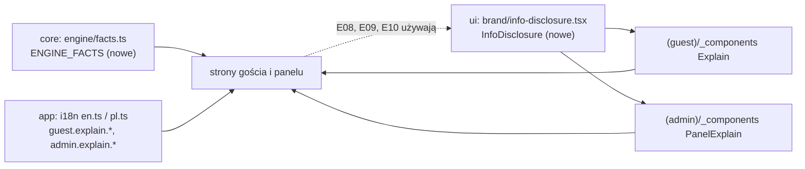

# „Jak to działa” — wyjaśnienia działania rekomendacji (E07)

## 📝 TLDR
Gość, kelner i sommelier widzą wynik silnika (listę win, „Rekomendacja sommeliera”, procent dopasowania, „Najlepsza cena”, wynik dla stolika), ale nigdzie nie jest napisane, skąd się bierze; dwa teksty obiecują dziś więcej, niż robi silnik, a panel nazywa propozycje silnika etykietą („Best match”), której gość nigdy nie widzi. **Proponujemy** (D14) jeden wspólny, natywny komponent wyjaśnienia `InfoDisclosure` (`
`/`
`, działa bez JavaScriptu, klawiaturą, czytnikiem ekranu i dotykiem) w `@wine-match/ui/brand`, po jednym wyjaśnieniu na każdym ekranie z wynikiem silnika (9 ekranów gościa i kelnera, 8 ekranów panelu), krótką stronę gościa „Jak dobieramy wino” (`/r/{slug}/how-it-works`, **G12** — G11 zajmuje ścieżka kelnera z E08), spójne nazewnictwo z D13 („Para sommeliera” / „Polecane do Twojego dania”) oraz liczby w tekstach brane z jednego eksportu stałych silnika (`ENGINE_FACTS`), a nie wpisane ręcznie. Bez słowa „AI” (N02), bez zmiany wyników silnika, bez nowych tras API i bez migracji.

## Problem
- **Brak wyjaśnienia.** Właściciel (2026-10-16, D14): „Na pewno w MVP musimy to wyeksponować — sposób działania”. Dziś gość widzi procent i odznaki bez legendy (`(guest)/_components/guest-ui.tsx`: `Score`, `Badges`, `BestCard`), kelner widzi kolejność bez reguły (`staff/page.tsx`), sommelier widzi „Engine match score” tylko w atrybucie `title` (`(admin)/admin/_components/badges.tsx` → `ScoreBadge`), który nie działa na dotyk ani klawiaturą.
- **Niespójne nazwy (D13).** Gość: „Sommelier recommendation” / „Rekomendacja sommeliera” (G3), „Sommelier pairing available” / „Para od sommeliera” (G0/G1), „Sommelier pairing” (G6), „Wine Director’s first choice” (G9), „Perfect with your dish” / „Pasuje do Twojego dania” (najlepsza propozycja silnika). Panel trzy razy (`admin.dashboard.waitingText`, `admin.pairings.suggestionsText`, `admin.publish.unreviewedShown`) mówi, że gość widzi propozycję jako „Best match” / „Najlepsze dopasowanie” — takiej etykiety u gościa nie ma.
- **Teksty, które obiecują za dużo** (wyjaśnienie musi być prawdziwe):
  - `guest.hero.directorLine`: „Every recommendation follows her pairings” — nieprawda, gdy włączone „Fill empty places with engine picks” (`showUnreviewed`, domyślnie `true`) i zawsze dla stolika; do tego zakłada płeć.
  - `guest.wines.footer`: „Pairings are … reviewed by {director}” — propozycje silnika nie są przejrzane.
  - `admin.publish.showUnreviewedText`: „When off, guests only see pairings you approved” — `RecommendationService.forTable` nie stosuje `showUnreviewed`, więc G6 nadal liczy całą aktywną kartę.
  - G6 pokazuje procent dla każdego dania z premią +3 dla par sommeliera i limitem 50 dla par odrzuconych (`engine/table.ts`), a R02 mówi, że wyświetlany wynik jest zawsze surowy. G6 pokazuje też procenty mimo wyłączonego „Show match percentages”.
  - G7 rysuje `MatchGlass score={70}`, gdy `wineDetails` nie zwraca dopasowania — bez dania, po wejściu z G6, a także gdy wino do tego dania nie przechodzi progu (< 62% bez pary sommeliera) albo jest odrzucone; G8 rysuje `MatchGlass score={100}`. Kieliszek wygląda jak ocena, której nie ma, a czytnik ekranu czyta go jako „Match 70 / 100 percent”.
  - G6: pieczęć przy daniu ma tylko atrybut `title` (nie działa na dotyk ani z klawiatury); paski i „Overall match” pokazują procenty niezależnie od `showScores`.
  - Panel: czwarte miejsce z „sommelier recommendation” w obecnym słowniku — `admin.review.description` (`en.ts` l. 479, `pl.ts` l. 480), poza trzema „Best match”.
  - Kontrast: `text-ink-3` (#857a80) na `paper` ma 3,73:1 (< 4,5:1 dla małego tekstu, WCAG 1.4.3); stopka `RecoFooter` i drobne etykiety używają go dziś, więc nowy link do G12 i `summary` nie mogą go dziedziczyć.
  - `Score` nie przekazuje `label` do `MatchGlass`, więc czytnik ekranu czyta po angielsku „Match 80 percent” także po polsku i także wtedy, gdy restauracja ukryła procenty.
- **Ryzyko zmyślonych liczb.** Progi i wagi są literałami w kilku plikach (`8` w `markBestValue`, `2` w luzowaniu budżetu, `1.5`, `3`, `50` w `table.ts`); tekst wyjaśnienia z ręcznie wpisaną liczbą rozjedzie się z silnikiem przy pierwszej kalibracji.

## Cel i zakres
- Wspólny komponent wyjaśnienia (gość i panel) i zasady jego użycia; E08 i E10 używają go na swoich nowych ekranach i dopisują własne treści.
- Treści wyjaśnień PL i EN dla **istniejących** ekranów: G0, G1, G3 (z G4), G5, G6, G7, G8, G9 oraz A1, A2, A3, A4, A5, A6, A7, A11.
- Strona gościa G12 „Jak dobieramy wino” (bez JS) z linkami z G0 i ze stopki G3.
- Spójne nazewnictwo etykiet (D13) i poprawki tekstów, które dziś są nieprawdziwe.
- `ENGINE_FACTS` w `core`: jeden eksport stałych silnika, z którego biorą liczby wszystkie teksty (refaktor bez zmiany wyników).
- Dokumentacja: `docs/SCREEN_SPECIFICATION.md`, `docs/SCREEN_MAP.md` (G12), `docs/RECOMMENDATION_ENGINE.md` (§5, `ENGINE_FACTS`), `docs/API_SPECIFICATION.md` (tekst etykiety, l. 152; pola `tier` bez zmian), `docs/USE_CASES.md` (l. 367 „Best match” / „Sommelier recommendation”), `docs/PRODUCT_CONCEPT.md` (§8 p. 1, l. 117), `docs/USER_ROLES.md` (l. 25), `docs/SCREEN_SPECIFICATION.md` (etykiety w G1 l. 61, G3 l. 83–84 i G6), `BACKWARD_COMPATIBILITY.md` §1 (trasa G12), `AGENTS.md` §7 i `CODE_REVIEW.md` (nazwa etykiety), `README.md` (l. 143), komentarz w `core/src/auth/permissions.ts` (l. 8), brief (R01, glosariusz). Wyszukanie kontrolne przed PR: `grep -rniE "sommelier recommendation|rekomendacja sommeliera|best match|najlepsze dopasowanie|perfect with your dish|para od sommeliera" docs *.md scripts packages/*/src packages/*/tests` — wynik poza `packages/mockups` ma być pusty.

**Poza zakresem:**
- Zmiana reguł, wag, progów i wyników silnika (`ENGINE_VERSION` bez zmian); poprawienie G6 tak, by procent na danie był surowy i by `showUnreviewed` działał dla stolika — należy do E08 (Q4).
- Rozbicie oceny na czynniki dla sommeliera („dlaczego 80%: +8 klasyczne połączenie, −5 waga”) — wymaga modelu odczytu w `core`; osobny follow-up (Q6).
- Treści nowych ekranów i elementów z E08 (ścieżka kelnera, liczba osób, „pasuje do 3 z 4”, butelka stołu), E09 (kod polecenia na G8/G9) i E10 (okazje) — piszą je te specyfikacje, tym komponentem.
- Zdarzenia analityczne dla otwarcia wyjaśnienia (natywny `
` nie wysyła żądania; E02 zapisuje tylko po stronie serwera); zdarzenie `explainer_viewed` dla G12 — nie w tej spec (Q9).
- Pakiet `mockups` (prototyp do wycofania), publiczne API `/api/v1` (teksty po angielsku bez zmian), ekrany A0, A8, A9, A10, A12 (nie pokazują wyniku silnika; A10 „Generate suggestions” ma już opis).
- Tooltipy na najechanie myszą, biblioteki popoverów, Radix.

## Wymagania
- **R1 Komponent.** `InfoDisclosure` w `packages/ui/src/brand/info-disclosure.tsx`: natywne `
` z `
`; widoczny tekst w `summary` (np. „Skąd te wina?”) poprzedzony ikoną „i” (`aria-hidden`); wariant kompaktowy (sama ikona) ma pełną nazwę dostępną (``); treść w zwykłym przepływie strony (bez pozycjonowania absolutnego); domyślnie zamknięty (`open` tylko jako prop). `summary` nie zawiera nagłówków ani elementów interaktywnych, a `
` nigdy nie stoi w `
`. Bez JS, bez `'use client'`, bez Radix, kolory wyłącznie przez klasy od wywołującego (`packages/ui/AGENTS.md`). Eksport `@wine-match/ui/brand/info-disclosure`.
- **R2 Dostępność i dotyk.** `summary` osiągalne z klawiatury (Tab, Enter/Spacja przełącza), widoczny fokus (`focus-visible:outline-2`), stan rozwinięcia ogłaszany natywnie; obszar dotyku `summary` ≥ 44 × 44 px u gościa i ≥ 24 × 24 px w panelu (WCAG 2.2, 2.5.8); żadna informacja nie jest dostępna wyłącznie przez `title` lub najechanie. `ScoreBadge` dostaje tekst `sr-only` zamiast samego `title`; to samo pieczęć przy daniu na G6. Kontrast: tekst `summary` i treści ≥ 4,5:1 (u gościa `text-ink-2` lub ciemniejszy — `text-ink-3` ma 3,73:1 i jest zabroniony), ikona „i” i obrys fokusu ≥ 3:1 (WCAG 1.4.11). Ogłaszanie stanu rozwinięcia przez czytnik ekranu jest zachowaniem przeglądarki, nie testem automatycznym: sprawdzane ręcznie na VoiceOver (iOS Safari) i TalkBack (Chrome) i opisane w logu przebiegu.
- **R3 Umiejscowienie.** `InfoDisclosure` nigdy nie leży wewnątrz `<a>` ani `<button>` (karty `BestCard`, `WineRow`, karta G6 są linkami): jedno wyjaśnienie na ekran gościa i kelnera, w miejscu z tabeli „Inwentaryzacja”; E08 i E09 dopisują akapity do **tego samego** wyjaśnienia ekranu (klucze `guest.explain.<ekran>`), a nie drugie „i” (Q15). Wyjątek: arkusz filtrów G4 (osobny kontekst) i ekrany nowe w innych specyfikacjach, każdy z jednym. Panel: jedno na kartę (A6 ma ich 2, po E10 3). Zamknięte wyjaśnienie to jeden wiersz (≤ 1 linia przy 390 px, bez marginesów powyżej 16 px), a karta pierwszego wina na G3 zaczyna się nie niżej niż 520 px od góry przy 390 × 844 (AC15). Przy 390 px i 1440 px brak poziomego przewijania przy otwartym i zamkniętym wyjaśnieniu.
- **R4 Treści.** Wszystkie teksty w słownikach `packages/app/src/i18n/en.ts` (źródło kluczy) i `pl.ts` (`satisfies Dictionary`), w przestrzeniach `guest.explain.<ekran>` i `admin.explain.<ekran>`; liczby wyłącznie jako parametry funkcji słownika podawane z `ENGINE_FACTS` (nigdy literał w tekście). Każde wyjaśnienie gościa ma ≤ 6 punktów i ≤ 90 słów (G3, najdłuższe, ≤ 110), panelu ≤ 130 słów (wywołane z `ENGINE_FACTS`, w obu językach); G12 ≤ 350 słów. Liczby niecałkowite formatuje funkcja słownika dla języka strony (PL „0,6”, „1,5”; EN „0.6”, „1.5”), procenty wag jako całkowite („60%”).
- **R5 Bez „AI”.** Teksty `guest.*` (w tym `guest.explain.*`) nie zawierają „AI”, „LLM”, „sztuczn”, „artificial”, „algorytm”, „algorithm”, „silnik”, „engine”; gość czyta o „zasadach łączenia wina z jedzeniem” / „pairing rules”. Panel może mówić „silnik” / „engine” (jak dziś), nigdy „AI”.
- **R6 Prawdziwość.** Wyjaśnienie opisuje bieżące zachowanie kodu, z wariantami: (a) `showScores=false` — bez procentów, opis kieliszka; (b) `showUnreviewed=false` — tylko pary sommeliera przy winach do dania; (c) G6 — opis wyniku stołu zgodny z `table.ts` (w tym premia dla par sommeliera) do czasu zmiany w E08. (d) G7 i G8 nie rysują `MatchGlass`, gdy nie ma wyniku do pokazania (Q13). Wyjaśnienie nie obiecuje więcej niż kod: „odrzucone pary nigdy się nie pokażą” dotyczy wyboru wina do jednego dania; dla stołu odrzucona para tylko obniża wynik dania do 50 i wino może się pojawić (do zmiany w E08, Q4). Teksty z sekcji Problem (hero, stopka G3, `showUnreviewedText`, „Best match”) poprawione według Q1 i Q5.
- **R7 Nazewnictwo (D13, Q1).** Etykieta par `approved`/`modified` (tier 0 i 1): PL „Para sommeliera”, EN „Sommelier’s pairing” — wszędzie, gdzie dziś są „Rekomendacja sommeliera”, „Para od sommeliera”, „Sommelier recommendation”, „Sommelier pairing (available)”, „Wybór / Pierwszy wybór Wine Director”. Nagłówek najlepszej propozycji silnika: PL „Polecane do Twojego dania”, EN „Recommended for your dish”. Pieczęć (`Seal`) tylko przy parach sommeliera (zdjęta z nagłówka karty G6); jej nazwa to tekst `sr-only`, nie `title`. Panel: także `admin.review.description` („…labelled as a sommelier recommendation…”). Pola API (`tier: sommelier_primary | sommelier | engine`, `why`) bez zmian — etykiety to tylko słownik aplikacji. Reguła R01 bez zmiany znaczenia.
- **R8 `ENGINE_FACTS`.** `packages/core/src/engine/facts.ts` eksportuje (przez `src/index.ts`) obiekt tylko do odczytu z nazwanymi stałymi; literały `8`, `2`, `1.5`, `3`, `50`, `limit = 3` w `recommend.ts` / `table.ts` zastąpione stałymi. Wyniki silnika identyczne: `engine:matrix` liczy tylko `pairingScore`, więc nie wystarcza — przed refaktorem (osobny, pierwszy commit w PR) powstaje test „golden” `core/tests/engine-golden.test.ts`: `recommendForDish` dla każdego dania demo × zestaw preferencji (`DEFAULT_PREFS`, `serving` glass/bottle, każdy styl, `maxPrice` 0 / 60 / 200 z luzowaniem budżetu, `weight`, `mood`) i `recommendForTable` dla wszystkich par i trójek dań demo × te same preferencje, porównane z migawką zapisaną z `main`; po refaktorze migawka bez zmian.
- **R9 Strona G12.** `/r/{slug}/how-it-works`: komponent serwerowy, `force-dynamic`, dane tylko przez `catalogService.publishedMenu(slug, locale)`; nieznany slug → 404; restauracja bez dań → strona działa (`publishedMenu` zwraca restaurację z pustą listą dań); puste `wineDirector` → wariant „sommelier restauracji”; linki zbudowane przez `href` / `link()` z `guestContext` (niosą `lang`, a po E02 także `sid`) i przekazane do współdzielonych komponentów jako gotowe propsy (`RecoFooter howHref`, `WineDirectorNote howHref`, `RestaurantHero howHref`) — komponenty nie składają adresów `/r/…` same (R3 E02); ustawienia `showScores` / `showUnreviewed` czytane z `restaurant.settings ?? DEFAULT_RESTAURANT_SETTINGS` (żywe, nie z migawki, jak na G3); `TopBar` z powrotem do G0 i przełącznikiem języka; tytuł karty z `guest.meta.howItWorks`. Treść uwzględnia `showScores` i `showUnreviewed`.
- **R10 Bez JS.** Każde wyjaśnienie i G12 działają z wyłączonym JavaScriptem (natywne `
`, linki).
- **R11 Dokumentacja** w tym samym PR co zmiana (AGENTS.md §7): pliki z „Cel i zakres”; `SCREEN_SPECIFICATION.md` dostaje wiersz „Wyjaśnienie” dla każdego ekranu z inwentaryzacji i sekcję G12.

## Resolved assumptions (autonomous defaults)

| # | Pytanie | Przyjęta odpowiedź | Uzasadnienie |
|---|---|---|---|
| Q1 | Jakie nazwy etykiet? | „Para sommeliera” / „Sommelier’s pairing” dla tier 0–1; „Polecane do Twojego dania” / „Recommended for your dish” dla najlepszej propozycji silnika; pozostałe wiersze silnika bez odznaki pod nagłówkiem „Też pasuje do tego dania” (bez zmian). Kelner widzi te same nazwy („Para sommeliera · pierwszy wybór”). Panel: „Best match” → nowa etykieta gościa. Zmiana treści reguły R01 i AGENTS.md §7 / CODE_REVIEW.md tylko w nazwie etykiety. ✅ rekomendacja zatwierdzona przez właściciela (Filip, 2026-10-16) | D13 podaje dokładnie te nazwy; jedna nazwa na gościa, kelnera i panel pozwala wyjaśnić ją raz. Zmiana brzmienia reguły projektu (§7) i reguły biznesowej R01 (właściciel: Domain expert + PO) wymaga świadomej zgody. EN „Sommelier’s pairing” zamiast dosłownego „Sommelier pair” — naturalne w angielskim. Ryzyko: „Polecane do Twojego dania” może brzmieć mocniej niż „Para sommeliera”; łagodzi je pieczęć tylko przy parach sommeliera, nagłówek bez superlatywu (dziś „Perfect with your dish” obiecuje więcej, także przy 62%) i wyjaśnienie punkt po punkcie. Rekomendacja: zatwierdzić. |
| Q2 | Jeden komponent czy osobne dla gościa i panelu? | Jeden prymityw `InfoDisclosure` w `@wine-match/ui/brand` (wolno go importować na stronach gościa) + dwie cienkie nakładki ze stylami: `Explain` w `(guest)/_components/guest-ui.tsx` i `PanelExplain` w `(admin)/admin/_components/explain.tsx`. | Jedno zachowanie (klawiatura, bez JS, a11y) i jeden test; `brand/*` to jedyna część `ui` dozwolona dla gościa. shadcn nie ma natywnego disclosure, a Tooltip/Popover wymagają JS i najechania. |
| Q3 | Strona „Jak dobieramy wino” dla gościa? | Tak: G12 `/r/{slug}/how-it-works` (numer G12, bo G11 to `/staff/table` z E08 — `SCREEN_MAP.md` jest jedynym źródłem numerów), link z G0 (obok linku dla obsługi i pod listą dań) i ze stopki G3; wyjaśnienia na ekranach są samowystarczalne i nie odsyłają do G12. ✅ rekomendacja zatwierdzona przez właściciela (Filip, 2026-10-16) | Wyjaśnienia na ekranach muszą być krótkie; dłuższa, spokojna strona buduje zaufanie (D14) i jest miejscem na „nikt nie płaci za miejsce na liście” (N01). Koszt: nowa trasa gościa staje się chronionym kontraktem §1 BC (dodanie jest bezpieczne, usunięcie już nie). Rekomendacja: zatwierdzić; alternatywa bez trwałego adresu — wyjaśnienia na ekranach bez G12 (tracimy stronę do wysłania sceptycznemu gościowi lub właścicielowi). |
| Q4 | Jak uczciwie wyjaśnić G6, skoro procent na danie zawiera premię +3 / limit 50, a `showUnreviewed` i `showScores` nie działają dla stolika? | E07 opisuje bieżące zachowanie (tekst G6 mówi o „niewielkiej premii dla par sommeliera”, tekst A11 o tym, że dobór dla stołu bierze całą kartę); decyzję o naprawie (surowy procent na danie, ukrycie procentów, `showUnreviewed` dla stolika) podejmuje E08, a E07 aktualizuje teksty po scaleniu E08. ✅ rekomendacja zatwierdzona przez właściciela (Filip, 2026-10-16) | Zmiana wyświetlanych liczb to zmiana zachowania silnika/ekranu stolika, którego właścicielem jest E08; E07 nie może ani ukryć niezgodności z R02, ani jej po cichu naprawić. Rekomendacja dla E08: pokazywać surowy wynik na danie (R02), premię zostawić tylko w rankingu. |
| Q5 | Czy zmieniamy obietnice w hero i stopce G3? | Tak: hero „Pary Wine Directora zawsze otwierają listę dania.” / „The Wine Director’s pairings always lead a dish’s list.”; stopka G3 według wariantu `showUnreviewed` (treść w Inwentaryzacji). Bez zaimków zakładających płeć (wersja „Jego pary…” odrzucona w przeglądzie spójności 2026-10-16). Zdanie mówi o liście dania, bo przy „Całym stole” kolejność wyznacza wynik stołu, nie pieczęć. ✅ rekomendacja zatwierdzona przez właściciela (Filip, 2026-10-16) | Wyjaśnienie obok nieprawdziwej obietnicy podważa zaufanie, które ma budować. To głos restauracji wobec gościa, więc zgoda właściciela. |
| Q6 | Rozbicie oceny na czynniki dla sommeliera (A3/A5/A6)? | Nie w E07; follow-up po akceptacji (czynniki już są w `pairingScore().factors`, brakuje modelu odczytu w `AdminService` i tłumaczeń nazw reguł). ✅ rekomendacja zatwierdzona przez właściciela (Filip, 2026-10-16) | Najmniejszy zakres, który wyjaśnia „jak” (zasady, progi); „dlaczego ta liczba” dla jednej pary to osobna funkcja dla championa (D13), warta własnej specyfikacji. |
| Q7 | Jedno wyjaśnienie na ekran czy „i” przy każdej karcie? | Jedno na ekran, nad listą (G3: między szybkimi preferencjami a kartą najlepszego wina). | Karty są linkami (R3); „i” przy każdej z 4 kart powtarza ten sam tekst; uzasadnienie konkretnego wina już jest w karcie („why”). |
| Q8 | Otwarte czy zamknięte domyślnie? | Zamknięte; `summary` jest widocznym zdaniem-pytaniem, nie samą ikoną (poza wariantem kompaktowym w nagłówku karty „Engine suggestions” na A6). | Gość ma być 3 dotknięcia od wina (cel briefu); pytanie w `summary` samo eksponuje sposób działania. |
| Q9 | Mierzymy użycie wyjaśnień? | Nie w E07. G12 jako zwykła strona mogłaby zapisać zdarzenie E02, ale katalog zdarzeń to kontrakt E02/E04 — dopisanie `explainer_viewed` w osobnej zmianie po E02 F1. ✅ rekomendacja zatwierdzona przez właściciela (Filip, 2026-10-16) (rekomendacja: po E02 F1 dodać jedno zdarzenie odsłony G12 — to zwykła strona, więc sygnał jest tani i mówi, czy ktokolwiek chce „długiej” wersji; otwarć `
` nie mierzymy, a ocenę D14 w pilotażu robimy rozmową z gośćmi i obsługą). | Bez nowego kontraktu danych; natywne `
` i tak nie daje sygnału serwerowi bez JS. Bez żadnego pomiaru D14 pozostaje niesprawdzalne — stąd rekomendacja. |
| Q10 | Skąd liczby w tekstach? | `ENGINE_FACTS` (R8); refaktor literałów na stałe bez zmiany wyników i bez podnoszenia `ENGINE_VERSION`. | Wymóg „nie zmyślaj liczb” zamieniony w mechanizm; BC §7 wymaga podniesienia wersji tylko przy zmianie wyników. |
| Q11 | Czy gość może czytać „silnik”, „reguły”, „model”? | Gość: „zasady łączenia wina z jedzeniem” / „pairing rules”; bez „silnik/engine/model/algorytm/AI” (R5). Panel: „silnik” / „engine” jak dziś. | N02 i D13 (AI niewidzialne); dla gościa „zasady” są prawdziwe (silnik to reguły) i zrozumiałe. |
| Q12 | Kolejność scalania z E08–E10? | E07 **F1a** (tylko `core`: test golden + `ENGINE_FACTS`, mały PR) idzie pierwszy — przed E08 F1, które zmienia te same pliki silnika (`table.ts`) i dopisuje stałe do `facts.ts`; **F1b** (komponent, nazewnictwo, G3/G4/G7) przed fazami UI E08 (F2, F3), E09 (G8) i E10 (F2). Jeśli E08 F1 scali się wcześniej, F1a przejmuje jego stałe (rebase po stronie F1a, bez zmiany wyników). E07 F2 i F3 niezależne; przy konflikcie w G5/G6/G9 rebase robi faza scalana później, a treści stolika przejmuje E08. | Komponent i `ENGINE_FACTS` są zależnością pozostałych specyfikacji (jedna spec = jeden worktree, AGENTS.md §8). |
| Q13 | G7 (bez dania, z G6, wino poza wynikiem dania) pokazuje kieliszek do 70%, G8 do 100%. | Gdy nie ma wyniku (`match === null`), kieliszka na G7 nie rysujemy (puste miejsce w siatce); G8 nie rysuje kieliszka wcale (to ekran potwierdzenia, nie oceny). | Dekoracja udająca ocenę przeczy wyjaśnieniu „kieliszek = dopasowanie”. Drobna zmiana UX na istniejących ekranach. |
| Q14 | Numer ekranu strony „Jak dobieramy wino”? | **G12**. G11 zajmuje `/r/{slug}/staff/table` z E08 (R6 E08). | Dwie specyfikacje nie mogą mieć tego samego ID (`SCREEN_MAP.md` to jedyne źródło). E08 ma już zależności (E09 slot, zdarzenia E02 `staff_table_lookup`), więc E07 ustępuje. |
| Q15 | Kto pisze treści G5/G6/G9, skoro E07 przekazuje je E08, a E08 — E07? | E07 pisze i scala treści istniejących elementów (Inwentaryzacja); E08 w swoim PR **zmienia** te klucze, gdy zmienia zachowanie (premia +3, „n z m”, ilość), i dopisuje akapity do istniejącego `Explain` ekranu (G6, G5, G9). E09 robi to samo na G8 (`guest.explain.selected`) zamiast drugiego „i” przy kodzie. Nowy ekran (G11 E08) ma własne wyjaśnienie. ✅ rekomendacja zatwierdzona przez właściciela (Filip, 2026-10-16) (rekomendacja: przyjąć; E08 R12 i E09 slot `info` do dostosowania przy ich przeglądzie) | Bez tego nikt nie jest właścicielem tekstu G6 i na jednym ekranie lądują dwa „i”, co łamie R3 i przeładowuje ekran. |
| Q16 | Czy test „golden” silnika jest potrzebny, skoro jest `engine:matrix`? | Tak (R8): `engine:matrix` liczy tylko `pairingScore`; refaktor stałych w `recommend.ts` i `table.ts` tą ścieżką nie przechodzi. | Bez migawki „nie zmieniamy wyników” jest deklaracją, nie sprawdzeniem. |
| Q17 | Czy wyjaśnienie nie podważa autorytetu sommeliera? | Nie: pierwsza i ostatnia teza wyjaśnień to „sommelier ma ostatnie słowo” (para sommeliera zawsze pierwsza; jego wybór zmienia kolejność, nie liczbę). Wyjaśnienia opisują, **czym różni się** pieczęć od reguł, nie ranking ich wiarygodności. | Przeciwnie niż „czarna skrzynka”: gość widzi, że człowiek stoi nad regułami (D13). |
| Q18 | Ile wyjaśnień naraz i ile tekstu? | Zamknięte domyślnie, jeden wiersz, ≤ 90 słów (G3 ≤ 110); na G3 przy 390 px karta pierwszego wina nie zjeżdża poniżej 520 px (R3, AC15). | Gość ma być 3 dotknięcia od wina (brief); wyjaśnienie nie może przesuwać wyniku poza pierwszy ekran. |

## Inwentaryzacja ekranów i szkice treści

Liczby w nawiasach klamrowych pochodzą z `ENGINE_FACTS` (wartości dziś: `baseScore` 72, `maxScore` 99, `minModelScore` 62, `sommelierRankBoost` 6, `dishLimit` 4, `budgetFallbackCount` 2, `bestValueWindow` 8, `tableLimit` 3, `tableMeanWeight` 0,6, `tableMinWeight` 0,4, `tableMainsWeight` 1,5, `tableSommelierBonus` 3, `tableRejectedCap` 50, `compromiseThreshold` 76, `weakDishThreshold` 64 — źródła: `engine/scoring.ts`, `recommend.ts`, `table.ts`, `docs/RECOMMENDATION_ENGINE.md` §4–§8). `{dir}` = `restaurant.wineDirector`, `{rest}` = `restaurant.name`. Teksty są szkicem do redakcji w PR, nie wolno w nich zmieniać faktów.

### Gość i kelner

| Ekran (plik) | Co wyjaśniamy | Gdzie stoi „i” (`Explain`) |
|---|---|---|
| G0 `r/[slug]/page.tsx`, `_components/restaurant-hero.tsx` | skąd wina, pieczęć, że nikt nie płaci; link do G12 | pod `landing.pickDishLead`, nad `DishList`; link „Więcej o doborze win” / „More on how we pick wines” (inna nazwa niż `summary`, żeby nie dublować pytania) w `WineDirectorNote` i w `RestaurantHero` obok linku dla obsługi (kolor `text-ink-2` na `paper`, na ciemnym hero jasny na `wine-deep`); nowy `hero.directorLine` (Q5) |
| G1 `r/[slug]/menu/page.tsx` | znacznik „Para sommeliera” przy daniu | pod `menu.pickLead` |
| G3 `r/[slug]/dish/[dishId]/wines/page.tsx` | etykiety, procent/kieliszek, kolejność, „Najlepsza cena”, filtry, luzowanie budżetu, cena nie wpływa | między `QuickPrefs`/`Notice` a `BestCard` (także przy pustej liście); nowa stopka `RecoFooter` (Q5) + link do G12 |
| G4 (arkusz `?sheet=filters` na G3) | filtry twarde vs miękkie | pod `PrefChips` w arkuszu, przed stopką |
| G5 `r/[slug]/table/page.tsx` | jak wybieramy jedną butelkę | pod `table.lead` (E08 przebudowuje ekran — przenosi `Explain`) |
| G6 `r/[slug]/table/result/page.tsx` | „Dopasowanie ogółem”, paski na danie, pieczęć, propozycja kieliszków | pod nagłówkiem i listą dań, nad kartą (poza `<Link>`); pieczęć zdjęta z nagłówka karty (R7) |
| G7 `r/[slug]/wine/[wineId]/page.tsx` | procent dla tego dania, uzasadnienie, kropki profilu | pod blokiem „why” (lub pod listą `dl`, gdy brak dania); Q13 |
| G8 `r/[slug]/selected/[wineId]/page.tsx` | co dalej (to nie zamówienie) | pod kartą wyboru; E09 dopisuje akapit o kodzie do tego samego wyjaśnienia (Q15); bez `MatchGlass` (Q13) |
| G9 `r/[slug]/staff/page.tsx` | kolejność, procent, „Powiedz:” | pod `staff.lead` |
| G12 `r/[slug]/how-it-works/page.tsx` (nowa) | całość | — |

**G0 — summary** PL „Jak dobieramy wino?” / EN „How do we pick your wine?”
- PL: „Wybierasz danie, a my pokazujemy do {dishLimit} win z karty {rest}, które do niego pasują. Wina z pieczęcią to pary sommeliera — poleca je {dir}. [wariant `showUnreviewed`] Pozostałe dobieramy według zasad łączenia wina z jedzeniem. Producenci nie płacą za miejsce na liście.”
- EN: „Pick a dish and we show up to {dishLimit} wines from {rest}’s list that go with it. Wines with the seal are sommelier’s pairings, recommended by {dir}. [variant] The others are matched by our pairing rules. No producer pays to be listed.”

**G1 — summary** PL „Co znaczy pieczęć przy daniu?” / EN „What does the seal next to a dish mean?”
- PL: „Do tego dania sommelier wybrał już wino — zobaczysz je jako pierwsze. [fill on] Do pozostałych dań dobieramy wina z karty według zasad łączenia wina z jedzeniem. [fill off] Przy pozostałych daniach sommelier jeszcze wybiera wino — kelner chętnie pomoże.”
- EN analogicznie.

**G3 — summary** PL „Skąd te wina?” / EN „Why these wines?” (≤ 110 słów, 5 punktów)
1. „Para sommeliera” — „wino polecane do tego dania przez {dir}; zawsze pierwsze na liście.” / „recommended for this dish by {dir}; always first on the list.”
2. [fill on] „Polecane do Twojego dania” — „dobrane według zasad łączenia wina z jedzeniem (waga, kwasowość, słodycz, taniny, ostrość, klasyczne połączenia); pokazujemy je od {minModelScore}%.” (bez procentów: „…; pokazujemy tylko te, które pasują wystarczająco dobrze.”)
3. [`showScores`] „Procent (0–{maxScore}) to ocena dopasowania wina do dania. Wybór sommeliera zmienia kolejność, nie liczbę; cena jej nie podnosi.” / [bez procentów] „Im pełniejszy kieliszek, tym lepiej wino pasuje do dania. Wybór sommeliera zmienia kolejność, nie ocenę; cena jej nie podnosi.”
4. „Najlepsza cena — wybór sommeliera albo najtańsza butelka z listy, tańsza od pierwszego wina i pasująca najwyżej {bestValueWindow} punktów słabiej od najlepszej.” (bez procentów: „…i pasująca prawie tak dobrze jak najlepsza.”)
5. „»Na kieliszki«, kolor i budżet wykluczają wina; budowa i nastrój zmieniają kolejność (i mogą wyprzeć wino z listy). Gdy nic nie mieści się w budżecie, pokazujemy {budgetFallbackCount} najlepiej pasujące wina spoza budżetu i o tym piszemy.”
- „Producenci nie płacą za miejsce na liście” stoi na G0, w stopce i na G12 (nie powtarzamy w G3, żeby zmieścić się w limicie słów).
- **Stopka G3 (Q5):** [fill on] PL „Wszystkie wina pochodzą z karty {rest}. Wina z pieczęcią poleca {dir}, pozostałe dobieramy według zasad łączenia wina z jedzeniem.” EN „Every wine comes from {rest}’s list. Wines with the seal are recommended by {dir}; the others are matched by our pairing rules.” [fill off] PL „Wszystkie wina pochodzą z karty {rest} i poleca je {dir}.” + link „Więcej o doborze win”.

**G4 — summary** PL „Jak działają filtry?” / EN „How do the filters work?” — punkt 5 z G3.

**G5 — summary** PL „Jak wybieramy butelkę dla stolika?” / EN „How do we pick one bottle for the table?”
- PL: „Każde wino z karty oceniamy do każdego zaznaczonego dania. Dania główne liczą się mocniej ({tableMainsWeight}×). Liczy się średnia, ale też najsłabsze danie — wolimy butelkę dobrą do wszystkiego niż świetną do jednego i słabą do reszty. Desery wybierasz osobno, po daniach głównych (chyba że stół zamawia tylko desery). Pod uwagę bierzemy tylko wina z karty, które spełniają Twoje filtry.”

**G6 — summary** PL „Jak liczymy dopasowanie ogółem?” / EN „How is the overall match worked out?”
- PL: „Ogółem = {tableMeanWeight·100}% średniej z dań (dania główne ×{tableMainsWeight}) + {tableMinWeight·100}% wyniku najsłabszego dania. Paski pokazują dopasowanie do każdego dania; pieczęć oznacza parę sommeliera, która w tym wyliczeniu dostaje {tableSommelierBonus} pkt więcej. Gdy najlepsza butelka ma ogółem mniej niż {compromiseThreshold}% albo jej najsłabsze danie mniej niż {weakDishThreshold}%, proponujemy też kieliszki osobno do każdego dania.” (zdanie o premii znika razem z premią — Q4; w tekście dla gościa nie ma odwołań do numerów pytań)
- EN analogicznie. Tekst o premii znika, gdy E08 przejdzie na surowy wynik na danie.

**G7 — summary** PL „Co znaczy ta ocena?” / EN „What does this score mean?”
- [z daniem, `showScores`] PL: „{score}% to ocena, jak dobrze to wino pasuje do dania „{dish}”. Pod spodem uzasadnienie: słowa sommeliera (z podpisem) albo zasady, które zdecydowały.” [bez procentów] „Kieliszek pokazuje, jak dobrze…”.
- [wejście z G6 lub bez dania] „Tu nie pokazujemy oceny — jest tylko do konkretnego dania.” (zamiast zdania o procencie; `Explain` zostaje, bo opisuje kropki)
- Zawsze: „Kropki to profil wina w skali 0–5 według opisu z karty restauracji.”

**G8 — summary** PL „Co dalej?” / EN „What happens next?”
- PL: „Wybór nie jest zamówieniem i niczego nie płacisz w aplikacji. Pokaż ten ekran kelnerowi — przyjmie zamówienie.” (E09 dopisuje zdanie o kodzie.)

**G9 — summary** PL „Skąd ta kolejność?” / EN „Why this order?”
- PL: „Kolejność jak u gościa: najpierw pierwszy wybór sommeliera, potem jego pozostałe pary w ustalonej kolejności, potem wina dobrane według zasad (od {minModelScore}%, jeśli restauracja je pokazuje). Procent to ocena dopasowania do dania — para sommeliera nie dostaje wyższego procentu. „Powiedz:” to notatka sommeliera albo uzasadnienie z zasad. Filtry działają jak u gościa.”
- Etykiety (R7): „Para sommeliera · pierwszy wybór” / „Sommelier’s pairing · first choice”, „Para sommeliera” / „Sommelier’s pairing”.

**G12 — „Jak dobieramy wino” / „How we pick your wine”** (sekcje `h2`, ≤ 350 słów na język):
1. „Tylko z karty {rest}” — wina z karty tej restauracji, tylko dostępne dziś.
2. „Sommelier ma ostatnie słowo” — „Para sommeliera”: wybór {dir}, zawsze pierwszy na liście dania; odrzucone przez sommeliera wino nie pojawi się przy tym daniu (przy „Całym stole” odrzucenie tylko mocno obniża wynik — do czasu E08 nie obiecujemy więcej).
3. „Zasady łączenia wina z jedzeniem” (gdy fill on) — najważniejsze zasady prostym językiem (nie „sześć”: silnik ma więcej reguł, a sześć to wybór do czytania), z tabeli reguł §4 dokumentacji silnika: waga wina do siły dania; kwasowość przy tłustych daniach; wino co najmniej tak słodkie jak deser, wytrawne do dań wytrawnych; delikatne taniny do ryb; przy ostrych daniach mniej alkoholu, lekka słodycz pomaga; klasyczne połączenia (np. pinot noir do kaczki). „Te same dane zawsze dają ten sam wynik.”
4. „Co znaczy procent” (lub „kieliszek” przy `showScores=false`) — jak w G3 p. 3.
5. „Cały stolik” — jak G5 + G6 (bez premii, jeśli E08 ją zdejmie).
6. „Twoje wybory” — filtry twarde i miękkie.
7. „Uczciwie” — cena nie podnosi oceny; producenci nie płacą; nie zakładasz konta.

### Panel

| Ekran (plik) | Co wyjaśniamy | Gdzie stoi „i” (`PanelExplain`) |
|---|---|---|
| A1 `[slug]/(lists)/page.tsx` | kafelki programu; co widzi gość przy propozycjach | bezpośrednio nad siatką kafelków sekcji „Wine program” (sekcja nie ma widocznego nagłówka); karta „Guest activity” należy do E04 |
| A2 `[slug]/(lists)/menu/page.tsx` | profil smaku napędza ocenę; szkic | pod `PageHeader`, nad formularzem filtrów (nie w `description` — to `
`, a `
` w `
` to błędny HTML) |
| A3 `[slug]/menu/[dishId]/page.tsx` | jak silnik liczy ocenę; „Top matches” | w `CardHeader` karty „Top matches” |
| A4 `[slug]/(lists)/wines/page.tsx` | ukrycie wina | pod `PageHeader`, nad formularzem filtrów |
| A5 `[slug]/wines/[wineId]/page.tsx` | jak silnik liczy ocenę; „Best dishes” | w `CardHeader` karty „Best dishes” (ten sam tekst co A3: `admin.explain.score`) |
| A6 `[slug]/pairings/[dishId]/page.tsx` | kolejność u gościa, procent, notatka, odrzucenie, filtry gościa, „Najlepsza cena” | w `CardHeader` „Approved for guests”; drugi (kompaktowy) w „Engine suggestions” |
| A7 `[slug]/(lists)/review/page.tsx` | co robi zatwierdzenie / odrzucenie | pod paskiem postępu |
| A11 `[slug]/publish/page.tsx` | ustawienia dla gości | w `CardHeader` karty „Guest settings” |

- **`admin.explain.score` (A3, A5)** PL „Jak silnik liczy ocenę?”: „Każda para startuje od {baseScore}. Reguły sommelierskie dodają lub odejmują punkty: waga, kwasowość wobec tłuszczu, słodycz, taniny wobec ryby, ostrość wobec alkoholu, dym i beczka, sól i bąbelki, kremowość oraz klasyczne połączenia. Wynik 0–{maxScore}. Te same profile zawsze dają tę samą ocenę, więc sprawdź profil szkicowy, zanim mu zaufasz. Gość widzi propozycję silnika dopiero od {minModelScore}%.” EN: „How does the engine score a pairing?” …
- **A1** PL „Co liczą te kafelki?”: „Dania prowadzone przez sommeliera: opublikowane dania z zatwierdzoną parą podstawową — przy nich gość zawsze widzi najpierw Twój wybór. Zatwierdzone pary: zatwierdzone i zmienione. Propozycje silnika czekają w kolejce; gość widzi je jako „Polecane do Twojego dania”, nigdy jako „Para sommeliera” (gdy włączone „Uzupełniaj puste miejsca…”).”
- **A2** PL „Jak profil wpływa na pary?”: „Profil smaku (intensywność, tłuszcz, sól, słodycz, kwasowość, ostrość, umami, dym, kremowość w skali 0–5, główny składnik, technika) to jedyne dane dania, z których silnik liczy ocenę. Profil „szkic” powstał z opisu przy imporcie.”
- **A4** PL „Co znaczy ukrycie wina?”: „Ukryte wino od razu znika z rekomendacji dla gości, także z Twoich par; publikacja nie jest potrzebna. „Pokaż” przywraca je od razu.”
- **A6** PL „Jak gość widzi Twoje pary?”: „Kolejność: para podstawowa, potem pozostałe zatwierdzone w Twojej kolejności, potem propozycje silnika (od {minModelScore}%, gdy włączone „Uzupełniaj…”). Gość widzi najwyżej {dishLimit} wina. Procent to zawsze ocena silnika — zatwierdzenie zmienia kolejność, nie liczbę. Twoja notatka zastępuje uzasadnienie silnika. Odrzucona para nigdy nie pojawi się przy tym daniu (przy „Całym stole” tylko obniża wynik). Filtry gościa mogą ukryć nawet parę podstawową (np. wino tylko na butelki przy filtrze „Na kieliszki”). Najlepsza cena: Twoja para z tą rolą (jeśli jest na liście), a bez niej najtańsza butelka z listy, tańsza od pierwszego wina i do {bestValueWindow} pkt poniżej najlepszej.”
- **A7** PL „Co daje zatwierdzenie?”: „Po publikacji zatwierdzona para ma u gościa etykietę „Para sommeliera” i stoi przed propozycjami silnika. Odrzucona nigdy nie będzie polecana do tego dania. Nieprzejrzane propozycje gość widzi jako „Polecane do Twojego dania” (gdy włączone „Uzupełniaj…”).”
- **A11** PL „Co zmieniają te ustawienia?”: „Uzupełniaj puste miejsca: gdy włączone, gość widzi też propozycje silnika od {minModelScore}%; gdy wyłączone — przy winach do dania tylko Twoje pary. Dobór butelki dla stolika zawsze bierze całą aktywną kartę. Pokazuj procenty: gdy wyłączone, gość widzi kieliszek wypełniony do poziomu dopasowania, bez liczby (ekran „Cały stół” pokazuje dziś procenty zawsze — zdanie do usunięcia, gdy E08 to naprawi, Q4). Ustawienia działają od razu, bez publikacji.” — i poprawiony `showUnreviewedText` (Q4).
- **Poprawki słownika panelu (R7):** `admin.dashboard.waitingText`, `admin.pairings.suggestionsText`, `admin.publish.unreviewedShown` — „Best match” / „Najlepsze dopasowanie” → „Recommended for your dish” / „Polecane do Twojego dania”; `admin.pairings.sommelier` (odznaka w „What guests see now”) → „Sommelier’s pairing” / „Para sommeliera”; `admin.review.description` (en l. 479, pl l. 480) — „sommelier recommendation” → „sommelier’s pairing”; `guest.tableResult.sommelierPairing` (l. 153/154) i `guest.menu.sommelierAvailable` według R7.

## Kryteria akceptacji
- [ ] AC1 (R1, R2) `InfoDisclosure` renderuje `
` z `
` zawierającym widoczny tekst, ikonę `aria-hidden="true"`, bez `open` domyślnie, z `open` gdy prop; wariant kompaktowy ma tekst `sr-only`; brak atrybutu `title`. *Test `packages/ui/tests/info-disclosure.test.tsx` (`renderToStaticMarkup`).*
- [ ] AC2 (R3, R10) Test SSR (`app/tests/unit`, HTML strony, bez przeglądarki): na G0, G1, G3, G5, G6, G7, G8, G9 (Halka, PL i EN) jest dokładnie jeden element `[data-explain]` o ID z tabeli „Inwentaryzacja” (na G3 z `?sheet=filters` dwa: `wines` i `filters`), żaden `
` nie leży w `<a>`, `<button>`, `
` ani w `summary` innego `
`, a `
` nie zawiera `<a>`/`<button>`. Dodatkowo jeden przebieg E2E (`browser.count`) na G3.
- [ ] AC3 (R2, R10) Strukturalnie (test SSR): `summary` jest pierwszym dzieckiem `
`, a w HTML strony nie ma `<script>` potrzebnego do rozwinięcia. Zachowanie (Tab → fokus widoczny, Enter/Spacja przełącza, drugi raz zwija) na G3 i A6 przy wyłączonym JS: **ręcznie** w Chrome i Safari, z wynikiem w logu przebiegu; automat tylko jeśli `agent-browser` 0.39.1 ma polecenia wyłączania JS i klawisza (dziś `AgentBrowser` w `testkit` ich nie opakowuje — dodanie metody z testem jest wtedy częścią F1b). Czytnik ekranu: VoiceOver iOS i TalkBack, ręcznie (R2).
- [ ] AC4 (R3) Przy 390 × 844 i 1440 × 900 z otwartym wyjaśnieniem na G3, G6, G9, G12 i A6 (PL, najdłuższe teksty i najdłuższa nazwa dania): `document.documentElement.scrollWidth ≤ innerWidth`, brak błędów w konsoli. *Skrypt przeglądarkowy (`agent-browser eval`, jeśli dostępny — E2E dotąd nie ustawiają rozmiaru okna) albo ręcznie według AGENTS §6.1; zrzuty w PR i wynik w logu.*
- [ ] AC5 (R5) Żaden tekst w `en.guest`, `pl.guest` (rekurencyjnie, funkcje wywołane z przykładowymi argumentami) nie pasuje do `/\b(AI|LLM)\b|sztuczn|artificial|algorytm|algorithm|silnik|engine/i`; żaden tekst `admin.*` nie pasuje do `/\b(AI|LLM)\b|sztuczn|artificial/i`. *Test `app/tests/unit/i18n.test.ts`.*
- [ ] AC6 (R4, R8) Liczby w tekstach pochodzą z parametrów: funkcje `guest.explain.*` / `admin.explain.*` wywołane z `ENGINE_FACTS` zawierają odpowiednie liczby (np. `62`, `8`, `76`, `64`), a wywołane z kopią `ENGINE_FACTS`, w której każda wartość ma unikalny znacznik (np. 1001, 1002, …), zawierają znaczniki tych faktów, które opisują, i żadnej oryginalnej wartości jako samodzielnej liczby (`\b62\b`, nie podciąg); limity punktów i słów z R4 spełnione dla każdego wariantu (`showScores`, `showUnreviewed`). *Test `app/tests/unit/i18n.test.ts`.*
- [ ] AC7 (R8) Po refaktorze `npm run engine:matrix` daje wynik identyczny z `main` (diff pusty; obejmuje tylko `pairingScore`), testy `core/tests/engine.test.ts` przechodzą bez zmian, `ENGINE_VERSION` bez zmiany względem `main` w chwili PR (E08 podnosi ją do 1.1.0 — test nie zakłada literału); test golden z R8 (`engine-golden.test.ts`) przechodzi na migawce z `main`; `ENGINE_FACTS` jest zamrożony (`Object.isFrozen`) i równy użytym stałym (test importuje stałe i porównuje). *Testy `core/tests/engine.test.ts` i `engine-golden.test.ts` + `engine:matrix` w opisie PR (jako dodatkowy przegląd `pairingScore`).*
- [ ] AC8 (R6) Przy `showScores=false` wyjaśnienie G3 i G7 nie zawiera „%”, a zawiera tekst o kieliszku; `aria-label` kieliszka w `Score` nie zawiera liczby i jest w języku strony; przy `showScores=true` etykieta jest zlokalizowana (`pl`: „Dopasowanie 80 procent”). *Test jednostkowy słownika (oba warianty) + E2E: sommelier wyłącza „Show match percentages” w A11, sprawdza G3, przywraca ustawienie w `afterAll`.*
- [ ] AC9 (R6) Przy `showUnreviewed=false` wyjaśnienie G3 i stopka nie wspominają o „Polecane do Twojego dania”; przy `true` — wspominają. *Test jednostkowy słownika + E2E (przełącznik w A11, potem G3, przywrócenie w `afterAll`).*
- [ ] AC10 (R7) G3 dla kaczki (Halka) pokazuje „Sommelier’s pairing” / „Para sommeliera”; danie bez pary sommeliera pokazuje „Recommended for your dish” / „Polecane do Twojego dania”; w HTML gościa i panelu (A1, A6, A7, A11; `hasNot` także dla angielskiego „sommelier recommendation” w `admin.review.description`) nie ma „Sommelier recommendation”, „Rekomendacja sommeliera”, „Best match”, „Najlepsze dopasowanie”, „Perfect with your dish”, „Pasuje do Twojego dania”, „Para od sommeliera”, „Every recommendation follows”; kontrolne `grep` z „Cel i zakres” bez trafień poza mockupami. *`scripts/smoke.mjs` (has / hasNot, oba języki) + E2E `home.e2e.test.ts` l. 38.*
- [ ] AC11 (R7) Karta G6 nie ma pieczęci w nagłówku; pieczęć tylko przy daniach z `sommelierPick`, z tekstem `sr-only` zamiast `title`. *Test SSR / E2E (`count`).*
- [ ] AC12 (R9) `/r/halka/how-it-works` → 200, `h1` „How we pick your wine” (EN) / „Jak dobieramy wino” (PL, `?lang=pl`), link powrotu do `/r/halka` (z `lang=pl`, gdy był jawnie w URL); `/r/nieznana/how-it-works` → 404; G0 i G3 linkują do G12. *Smoke + E2E bez JS.*
- [ ] AC13 (Q13) G7 otwarte z G6 (`?table=…`), bez dania i z daniem, do którego wino nie przechodzi progu lub jest odrzucone, nie renderuje `MatchGlass`; otwarte z dania z wynikiem renderuje (z zlokalizowanym `aria-label`); G8 nie renderuje `MatchGlass` wcale. *Test SSR (`count('svg[role=img]')` w nagłówku).*
- [ ] AC14 (R2) `ScoreBadge` w panelu ma tekst `sr-only` („Engine match score” / zlokalizowany) i nie ma `title`. *Test jednostkowy renderu albo smoke panelu (HTML A6).*

- [ ] AC15 (R3, Q18) Przy 390 × 844 na G3 (Halka, kaczka, PL) górna krawędź karty pierwszego wina jest nie niżej niż 520 px, a zamknięte wyjaśnienie zajmuje jeden wiersz. *Pomiar `getBoundingClientRect` w skrypcie przeglądarkowym albo ręcznie, wynik w logu.*
- [ ] AC16 (R2) Kontrast: tekst `summary`, treści i nowego linku do G12 ≥ 4,5:1, ikona „i” i fokus ≥ 3:1 — obliczone z tokenów `guest.css` / `styles.css` (test jednostkowy z funkcją kontrastu na tokenach) albo narzędziem w przeglądarce, wynik w logu. *Bez `text-ink-3` w nowych klasach (`grep`).*
- [ ] AC17 (R5, R6) Każde wyjaśnienie opisuje kod: test jednostkowy zestawia liczby i warianty z `ENGINE_FACTS` (AC6), a przegląd sommeliera (człowiek) potwierdza treść G3, G6, G12 i A6 przeciw `docs/RECOMMENDATION_ENGINE.md` §4–§8 — wynik w opisie PR.

Dokumentacja (R11) — pozycja checklisty PR (CODE_REVIEW §3), nie AC.

## Projekt rozwiązania

### Architektura

Strony nadal „parsują → wołają serwis → renderują”; wariant tekstu wybierają z `restaurant.settings` (już ładowane) i `ENGINE_FACTS`. Brak nowych serwisów, portów, tras API i migracji.

### Pliki
- `packages/core/src/engine/facts.ts` (nowe): `export const ENGINE_FACTS = Object.freeze({ baseScore: BASE_SCORE, maxScore: 99, minModelScore: MIN_MODEL_SCORE, sommelierRankBoost: SOMMELIER_BOOST, dishLimit: DEFAULT_LIMIT, budgetFallbackCount: BUDGET_FALLBACK_COUNT, bestValueWindow: BEST_VALUE_WINDOW, tableLimit: TABLE_LIMIT, tableMeanWeight: TABLE_MEAN_WEIGHT, tableMinWeight: TABLE_MIN_WEIGHT, tableMainsWeight: TABLE_MAINS_WEIGHT, tableSommelierBonus: TABLE_SOMMELIER_BONUS, tableRejectedCap: TABLE_REJECTED_CAP, compromiseThreshold: COMPROMISE_THRESHOLD, weakDishThreshold: WEAK_DISH_THRESHOLD })`, typ `EngineFacts`. Eksport w `src/index.ts`.
- `packages/core/src/engine/recommend.ts`: `BEST_VALUE_WINDOW = 8`, `BUDGET_FALLBACK_COUNT = 2` zamiast literałów. `scoring.ts`: `MAX_SCORE = 99` w `clamp`. `table.ts`: `TABLE_LIMIT = 3`, `TABLE_MAINS_WEIGHT = 1.5`, `TABLE_SOMMELIER_BONUS = 3`, `TABLE_REJECTED_CAP = 50`. Tylko nazwy, bez zmiany wyników.
- `packages/ui/src/brand/info-disclosure.tsx` (nowe): `InfoDisclosure({ summary, children, compact?, open?, id?, className?, summaryClassName?, bodyClassName?, iconClassName? })`; `summary` z `list-none [&::-webkit-details-marker]:hidden`; ikona „i” jako SVG w okręgu; atrybut `data-explain` z propu `explainId` (identyfikator ekranu dla testów; **nie** `name`, bo `name` na `
` tworzy wykluczający się akordeon).
- `packages/app/src/app/(guest)/_components/guest-ui.tsx`: `Explain` (style gościa: `min-h-11`, `text-ink-2`, treść `rounded-[10px] bg-paper` / `bg-surface`), `RecoFooter` z wariantem `showUnreviewed` i gotowym propsem `howHref` (link do G12 zbudowany przez `link()`; do F2 bez linku), `BestCard` (nagłówek wg R7), `Badges` (R7), `Score` (zlokalizowany `label`, bez liczby przy `showScores=false`).
- `packages/app/src/app/(admin)/admin/_components/explain.tsx` (nowe): `PanelExplain` (style panelu: `text-muted-foreground`, `text-sm`, `size-6` dla wariantu kompaktowego). `badges.tsx`: `ScoreBadge` z `sr-only` zamiast `title`.
- Strony z Inwentaryzacji + nowa `packages/app/src/app/(guest)/r/[slug]/how-it-works/page.tsx`.
- `packages/app/src/i18n/en.ts` / `pl.ts`: `guest.explain.{landing,menu,wines,filters,table,tableResult,wine,selected,staff}`, `guest.howItWorks.*`, `guest.meta.howItWorks`, `admin.explain.{dashboard,menu,score,wines,pairings,suggestions,review,publish}`; zmiany etykiet R7 i tekstów Q5 / Q4. Funkcje przyjmują `(facts: EngineFacts, ctx: { showScores; showUnreviewed; director; restaurant })` tylko tam, gdzie tekst ich potrzebuje; zwracają `string[]` (punkty listy) albo `string`.
- `scripts/smoke.mjs`: nowe napisy (R7), G12, `hasNot` starych etykiet; `packages/app/tests/e2e/home.e2e.test.ts` l. 38 i nowe przypadki.

### Kontrakty
- **§1 BC (dodanie):** trasa gościa `/r/{slug}/how-it-works` (G12; numer ustalony w Q14, G11 = `/staff/table` z E08), parametry jak na pozostałych stronach (`lang`, po E02 `sid`). Bez nowych parametrów. API `/api/v1` bez zmian (§2): zmieniają się tylko teksty słownika aplikacji, nie pola ani `tier`.
- **§7 BC:** bez zmian wyników; nowe eksporty `core` (`ENGINE_FACTS`, `EngineFacts`, stałe) — dodanie w §8.
- **Dla E08 / E09 / E10:** używają `Explain` / `PanelExplain` z propem `explainId` (`data-explain`) i dopisują klucze w `guest.explain.<ekran>` / `admin.explain.<ekran>`; liczby z `ENGINE_FACTS` (nowe stałe dopisują do `facts.ts`); obowiązuje R2–R5.

### Przypadki brzegowe
| Sytuacja | Zachowanie |
|---|---|
| G3 bez win (pusty wynik) | wyjaśnienie widoczne nad `EmptyState` (tłumaczy filtry i próg). |
| Luzowanie budżetu (`notice`) | `Notice` jak dziś, wyjaśnienie pod nim (punkt 5). |
| `showScores=false` | bez „%” w wyjaśnieniach gościa (poza G9 — kelner zawsze widzi procent, jak dziś) i bez liczby w `aria-label` kieliszka. G6 pokazuje dziś procenty niezależnie od ustawienia — tekst opisuje to, co widać, do decyzji E08 (Q4). |
| `showUnreviewed=false` | warianty G0, G1, G3, stopki, G9 bez „Polecane do Twojego dania”. |
| Restauracja bez opublikowanego menu | G0 bez wyjaśnienia (jest komunikat „menu się aktualizuje”), link do G12 zostaje; G12 działa. |
| Puste `wineDirector` | teksty z `{dir}` używają wariantu „sommelier restauracji” / „the restaurant’s sommelier”. |
| Arkusz filtrów otwarty (`?sheet=filters`) | wyjaśnienie G4 w arkuszu; wyjaśnienie G3 pod spodem zostaje w DOM, ale jest zasłonięte (jak dziś cała lista). |
| JS włączony, nawigacja miękka | `
` po nawigacji wraca zamknięty (nowy render); bez stanu w URL. |
| Druk / czytnik ekranu w trybie przeglądania | zamknięta treść nie jest czytana, `summary` jest; to zachowanie natywne. |
| Bardzo długa nazwa dania w G7 | tekst w przepływie, łamanie słów (`break-words`), test 390 px. |
| G7 z `?dish=` dla wina poniżej progu / odrzuconego, G7 z G6, G8 | bez `MatchGlass`, wyjaśnienie G7 bez zdania o procencie (Q13). |
| `settings` zmienione w A11 po publikacji | wyjaśnienia używają bieżących `showScores` / `showUnreviewed` (ustawienia są „żywe”, jak na G3); menu i pary pochodzą z migawki. |
| `restaurant.settings` nieustawione | `?? DEFAULT_RESTAURANT_SETTINGS` (oba `true`). |
| Brak wina na liście / restauracja bez dań | G12 działa i nie podaje przykładów; G0 bez `Explain`, link do G12 zostaje. |
| Gość w trybie wysokiego kontrastu / powiększonej czcionki (200%) | `summary` zawija się (bez stałej wysokości, tylko `min-h-11`), ikona nie traci obrysu; sprawdzane przy AC4. |

## Ryzyka i otwarte pytania
- **⚠ decyzje właściciela:** Q1 (nazwy etykiet, zmiana brzmienia AGENTS.md §7 / CODE_REVIEW / R01), Q3 (nowa trasa G12 jako trwały kontrakt), Q4 (niezgodność G6 z R02 i z `showUnreviewed`/`showScores` — do rozstrzygnięcia w E08), Q5 (nowe brzmienie hero i stopki), Q6 (rozbicie oceny odłożone), Q9 (czy mierzyć odsłonę G12), Q15 (kto pisze treści G5/G6/G8/G9 i „jedno „i” na ekran” z E08/E09).
- **Zależność od E08** (`2026-10-16-whole-table-waiter-path.md`): przebudowuje G5, G6, G9 i dodaje ścieżkę kelnera — przenosi `Explain` na nowe układy; treści istniejących elementów G5/G6/G9 pisze E07, a E08 je **zmienia** w swoim PR, gdy zmienia zachowanie (Q15); po zmianie liczb (Q4) aktualizuje tekst G6 i A11; własny ekran E08 (G11 `/staff/table`) ma własne wyjaśnienie, a numer G12 tej spec jest rozstrzygnięty w Q14; nowe progi (np. „pasuje do 3 z 4”) dopisuje do `ENGINE_FACTS`. Konflikt plików: G5/G6/G9 i `en.ts`/`pl.ts` — kolejność Q12.
- **Zależność od E09** (`2026-10-16-recommendation-code.md`): kod polecenia na G8/G9 — E09 dopisuje akapit w `guest.explain.selected` / `guest.explain.staff` (jedno „i” na ekran, Q15 — E09 do dostosowania: dziś opisuje slot `info` z osobną ikoną na G8), właścicielem modelu kodu jest E09; E07 nie opisuje kodu.
- **Zależność od E10** (`2026-10-16-sommelier-opportunities.md`): okazje w panelu z `PanelExplain` i własnymi treściami (`admin.explain.opportunities`); E07 tylko dostarcza komponent (w F1b, więc E10 F2 czeka tylko na F1b, nie na F3). Na A6 powstaną trzy wyjaśnienia (po jednym na kartę) — dopuszczalne w panelu (R3).
- **Zależność od E02** (`2026-10-15-guest-usage-events.md`): G12 to nowa strona gościa — jej linki muszą nieść `sid` (R3 E02); jeśli E02 F1 scali się po E07 F2, test SSR „każdy `/r/` ma `sid`” z E02 musi objąć G12. G12 nie obiecuje nic o prywatności poza „nie zakładasz konta”, dopóki E02 nie jest wdrożone.
- **Zależność od E04** (`2026-10-15-kpi-dashboard.md`): karta „Guest activity” na A1 i nowe KPI dostają wyjaśnienia w E04 (tym komponentem).
- **Zmiana etykiet łamie oczekiwania testów i dokumentów** (smoke, E2E, README, API_SPECIFICATION, CODE_REVIEW) — wszystkie zmieniane w F1b; mockupy zostają ze starą nazwą (poza kontraktem).
- **Długość tekstów:** limit słów (R4) i redakcja w PR; po polsku dłuższe zdania mogą łamać się przy 390 px — sprawdzane w AC4.
- **Rozjazd z dokumentacją silnika:** `docs/RECOMMENDATION_ENGINE.md` §5 mówi o etykiecie „Sommelier recommendation” — aktualizacja w F1b (stałe: F1a); nowe stałe opisane w §4–§8 (bez zmiany wartości).
- **Otwarte (nieblokujące):** czy EN dla gościa w Polsce ma mówić „sommelier” czy „Wine Director” w etykiecie (dziś mieszane) — przyjęto „sommelier” w etykiecie i `{dir}` w zdaniach.

### Przegląd krzyżowy 2026-10-16
Niezależny przegląd (kod silnika, strony gościa i panelu, E02, E04, E08–E10, dokumentacja). Znaleziska wg wagi; „naprawione” = poprawione w tej specyfikacji, „⚠” = decyzja właściciela lub innej specyfikacji (w Resolved assumptions).

**High**
- **Kolizja ID G11 z E08** (`/staff/table`) — dwie specyfikacje, dwa ekrany, jeden numer. Naprawione: E07 używa **G12** (Q14); E08 używa G11 dla `/staff/table` (przegląd spójności 2026-10-16).
- **Dwóch właścicieli treści G5/G6/G9 i drugie „i” na G6/G8** — E07 oddawał treści stołu E08, a E08 (R12, l. 26) oddaje je E07; E08 R12 i E09 (slot `info`) dodają drugie „i” na ekranie, co łamie „jedno na ekran”. Naprawione w E07 (Q15, R3: E07 pisze, E08/E09 dopisują akapity do tego samego `Explain`); **⚠** E08 R12 i E09 do dostosowania.
- **AC7 nie dowodzi „bez zmiany wyników”** — `engine:matrix` liczy tylko `pairingScore`; refaktor stałych w `recommend.ts` (okno najlepszej ceny, luzowanie budżetu) i `table.ts` (wagi, limit, premia, limit 50) przez niego nie przechodzi. Naprawione: test golden (R8, Q16, AC7).
- **Zbyt długie wyjaśnienie G3** — szkic miał 130 słów przy limicie 120 w R4. Naprawione: G3 przepisane do 5 punktów (~100 słów), limity 90 / 110 (R4, Q18, AC15).
- **Obietnice w szkicach niezgodne z kodem** — „najbliższe wina” przy luzowaniu budżetu (to najlepiej pasujące spoza budżetu, nie najbliższe cenowo); „najtańsza butelka z listy” (musi być tańsza od pierwszego wina, liczona po cenie butelki); „odrzucone pary nigdy się nie pokażą” (dla stołu odrzucenie tylko obniża wynik dania do 50); „Desery dobieramy osobno” (G6 odsyła do wyboru deseru w menu); hero „zawsze pierwsze” (nieprawda dla stołu). Naprawione w szkicach G3, G5, G12, A6, Q5; wada G6 → Q4 (**⚠**).

**Medium**
- **Dekoracyjny `MatchGlass` także na G8 (100) i na G7, gdy wino nie przechodzi progu** (nie tylko „bez dania”); czytnik ekranu czyta go jako ocenę. Naprawione (Q13, AC13).
- **Pieczęć na G6 z samym `title`**; `admin.review.description` z „sommelier recommendation” (a AC10 zabrania tej frazy) — naprawione (R2, R7, AC10, AC11).
- **Lista dokumentów do aktualizacji niepełna** — brakowało `USE_CASES.md` (l. 367), `PRODUCT_CONCEPT.md` (l. 117), `USER_ROLES.md` (l. 25), etykiet w `SCREEN_SPECIFICATION.md`. Naprawione (Cel i zakres + `grep` kontrolny).
- **Kontrast**: `text-ink-3` = 3,73:1; `summary` ma używać `ink-2` (6,73:1). Naprawione (R2, AC16).
- **Testowalność AC3/AC4**: `AgentBrowser` w `testkit` nie ma wyłączania JS, klawiatury ani rozmiaru okna, a dotychczasowe E2E ich nie używają; „stan ogłaszany natywnie” nie jest automatyzowalny. Naprawione: struktura w teście SSR, zachowanie ręcznie z logiem (AC2, AC3, AC4).
- **Link do G12 w komponentach współdzielonych a `sid` (E02 R3)** — komponenty nie mogą składać adresów same. Naprawione (R9: `howHref`).
- **Faza 1 zbyt duża i w kolizji z E08 F1** (oba zmieniają `table.ts`, `facts.ts`). Naprawione: F1a (core) / F1b (UI), kolejność w Q12.
- **AC6 „żadnej starej liczby”** — podciąg, kruche. Naprawione: unikalne znaczniki i `\b…\b`.
- **Brak pomiaru D14** — nie wiemy, czy ktokolwiek otwiera wyjaśnienia. **⚠** Q9 (rekomendacja: zdarzenie odsłony G12 po E02, reszta w rozmowach z pilotem).

**Low**
- Panel ma 8 ekranów, TLDR mówił 7 (naprawione). Link do G12 i `summary` G0 nazywały się tak samo (link „Więcej o doborze win”). `(Q4)` w tekście dla gościa (usunięte). AC7 zakładał literał `ENGINE_VERSION` (E08 go zmienia). G7 przy `showUnreviewed=false` pokazuje wynik silnika po bezpośrednim linku (poza zakresem; `wineDetails` nie stosuje ustawienia). Formatowanie liczb PL (przecinek) dopisane w R4. Test panelu: użyć istniejącego `admin-i18n.test.ts`.

**Bez zastrzeżeń:** pliki i nazwy w Problem, liczby `ENGINE_FACTS` (72, 99, 62, 6, 4, 2, 8, 3, 0,6/0,4, 1,5, 3, 50, 76, 64), brak zmian w `/api/v1` (§2 BC) i brak migracji, `
` jako natywne rozwiązanie bez JS, zgodność z AGENTS §7 po zmianie nazwy etykiety (wymaga zgody — Q1), zgodność z E02 (brak nowych zdarzeń), E04 (karta „Guest activity” poza zakresem), E10 (komponent z F1b).

**Grill — trudne pytania**
- *Właściciel: „Czy gość to w ogóle otworzy?”* — Nie liczymy na to: 3 tezy zaufania (sommelier pierwszy, nikt nie płaci, cena nie podnosi oceny) stoją w etykietach, stopce i na G0 bez klikania; `summary` to widoczne pytanie, nie sama ikona (Q8). Pomiar: odsłona G12 (Q9), reszta rozmowami w pilotażu.
- *Właściciel: „Czy to nie przeładuje ekranu?”* — Jedno zamknięte, jednowierszowe „i” na ekran, ≤ 90 słów, G3 ≤ 110, karta pierwszego wina nie niżej niż 520 px (AC15). Dłuższa treść idzie na G12.
- *Sommelier: „Czy wyjaśnienie nie podważa mojego autorytetu?”* — Nie: opisuje, że para sommeliera jest zawsze pierwsza i zmienia kolejność, a reguły są uzupełnieniem „tam, gdzie sommelier jeszcze nie zdecydował” (Q17). Dopóki G6 daje parom premię +3, tekst mówi to wprost (Q4) — rekomendacja: E08 zdejmuje premię przed wdrożeniem F2.
- *Sommelier: „Skąd pewność, że opis zgadza się z kodem?”* — Liczby z `ENGINE_FACTS`, warianty `showScores` / `showUnreviewed` w testach, przegląd treści przez sommeliera (AC17).
- *Gość przy stoliku: „Ile tekstu mam czytać na telefonie?”* — Nic, dopóki nie dotknie; potem ≤ 90 słów w 5–6 krótkich punktach, bez żargonu („zasady łączenia wina z jedzeniem”, nie „algorytm”).
- *Gość: „Skoro to nie AI, to co to jest?”* — Zasady (waga, kwasowość, słodycz, taniny, ostrość, klasyczne połączenia) i człowiek nad nimi; słowo „AI” nie pada (N02) i nie trzeba go zaprzeczać.
- *Staff engineer: „Czy `
` wystarczy dostępnościowo?”* — Tak jako baza (klawiatura, dotyk, bez JS), ale ogłaszanie stanu na iOS/Android trzeba sprawdzić ręcznie; jeśli zawiedzie, rezerwa to link z kotwicą na G12, bez zmiany treści.

## Decyzje w grze
D13 (nazwy i AI niewidzialne) i D14 (wyjaśnienie w MVP) — realizowane; N01 (nikt nie płaci za miejsce), N02 (bez „AI”), R01 (etykieta tylko dla approved/modified — znaczenie bez zmian, brzmienie zmienione, Q1), R02 (procent surowy — niezgodność G6 przekazana E08, Q4), R03 (gość widzi migawkę — G12 i wyjaśnienia nie pokazują wersji roboczej), R05 (bez konta). Zmiany do zatwierdzenia przez właściciela: brzmienie R01 i AGENTS.md §7 (Q1), nowa trasa gościa (Q3).

## Plan implementacji

### Faza 1a — `ENGINE_FACTS` w `core` (mały PR, pierwszy w kolejności, Q12)
1. **Core: test golden i `ENGINE_FACTS`.** Pierwszy commit: `core/tests/engine-golden.test.ts` z migawką z `main` (R8). Drugi: stałe w `recommend.ts`, `scoring.ts`, `table.ts`; `facts.ts`; eksport. Testy AC7; `npm run engine:matrix` — diff z `main` pusty, wynik w opisie PR. Docs: `RECOMMENDATION_ENGINE.md` (§4–§8). Bramka: `lint`, `check:boundaries`, `typecheck`, `test`, `build`.

### Faza 1b — komponent, nazewnictwo i ekran wyników gościa (jeden PR, po 1a)
2. **UI: `InfoDisclosure`.** Komponent + test `packages/ui/tests/info-disclosure.test.tsx` (AC1).
3. **App: nakładki.** `Explain` (gość), `PanelExplain` (panel), `ScoreBadge` z `sr-only` (AC14), `Score` ze zlokalizowanym `label` i bez liczby przy `showScores=false`.
4. **Słowniki i nazewnictwo (R7, Q5).** Nowe klucze `guest.explain.wines`, `guest.explain.filters`, `guest.explain.wine`; zmiany etykiet gościa, G9 i panelu; hero i stopka. Test słownika (AC5, AC6).
5. **Ekrany G3, G4, G7.** `Explain` według Inwentaryzacji, Q13 na G7, stopka z linkiem do G12 (link aktywny od F2 — w F1b bez linku). Testy: AC2 (dla G3/G4/G7), AC3 (G3), AC8, AC9, AC10, AC13, AC15, AC16.
6. **Docs i smoke.** `smoke.mjs` (nowe/zakazane napisy), `home.e2e.test.ts`; `AGENTS.md` §7, `CODE_REVIEW.md`, `README.md`, `API_SPECIFICATION.md` l. 152, `RECOMMENDATION_ENGINE.md` §5, `SCREEN_SPECIFICATION.md` (G3, G4, G7, wspólne zasady: „Wyjaśnienia”), `permissions.ts` (komentarz), brief R01 i glosariusz (po akceptacji Q1). Bramka: `lint`, `check:boundaries`, `typecheck`, `test`, `build`, `smoke` w `memory` i `postgres`, 390 px i 1440 px z JS i bez JS (AC4 dla G3).

### Faza 2 — pozostałe ekrany gościa i kelnera + strona G12 (jeden PR)
7. **G0, G1, G5, G6, G8, G9.** `Explain` i treści; G6 bez pieczęci w nagłówku (AC11); G9 etykiety. E2E: AC2 dla wszystkich ekranów gościa, AC4 dla G6 i G9.
8. **G12.** `r/[slug]/how-it-works/page.tsx`, `guest.howItWorks.*`, `guest.meta.howItWorks`; linki z G0 i ze stopki G3. Smoke i E2E (AC12, AC4). `BACKWARD_COMPATIBILITY.md` §1 (trasa), `SCREEN_MAP.md` (G12), `SCREEN_SPECIFICATION.md` (G0, G1, G5, G6, G8, G9, G12). Bramka jak w kroku 6.

### Faza 3 — panel (jeden PR)
9. **A1, A2, A3, A4, A5, A6, A7, A11.** `PanelExplain` i treści `admin.explain.*` (A3/A5 wspólny `score`); poprawiony `admin.publish.showUnreviewedText` (Q4). E2E w `admin.e2e.test.ts`: A6 klawiatura bez JS (AC3), AC4 dla A6; smoke panelu: klucz wyjaśnienia na A3, A6, A11. `SCREEN_SPECIFICATION.md` (A1–A7, A11). Bramka jak w kroku 6.

## Changelog
- 2026-10-16 — draft (om-spec-writing --autonomous), w ramach przebiegu `.ai/runs/2026-10-16-positioning-table-specs.md`.
- 2026-10-16 — samoprzegląd: `explainId` zamiast `name` (akordeon `
`), A2/A4 poza `
` opisu, A1 bez wariantu kompaktowego, AC2 z dwoma wyjaśnieniami na G3+arkusz, limity słów testowalne (AC6), AC8/AC9 z przywróceniem ustawień w E2E. Przegląd niezależnym agentem — przed akceptacją (AGENTS.md §3), w przebiegu nadrzędnym.

- 2026-10-16 — przegląd krzyżowy niezależnym agentem (sekcja „Przegląd krzyżowy 2026-10-16” w Ryzykach): numer G11 → G12 (kolizja z E08), własność treści G5/G6/G8/G9 i „jedno „i” na ekran” (Q15), test golden silnika (R8, Q16), limity słów i pozycja karty na G3 (R4, R3, AC15), poprawione obietnice w szkicach, brakujące dokumenty i etykiety, kontrast, testowalność AC3/AC4, podział F1 na F1a/F1b.

## Zatwierdzenie
Filip (product owner) 2026-10-16: „Akceptuję rekomendacje we wszystkich decyzjach ⚠” — każda pozycja ⚠ w tej specyfikacji (tabela i Ryzyka) przyjęta zgodnie z rekomendacją.

## Realizacja

- **F1a (2026-10-16, gałąź `feat/e07-f1a-engine-facts`, issue #37, log `.ai/runs/2026-10-16-e07-f1a-engine-facts.md`).** Pierwszy commit: test złoty `packages/core/tests/engine-golden.test.ts` z migawkami z `main` (`35ec64d`) w `tests/__snapshots__/engine-golden.*.txt` — każde danie demo i każda para dań w pełnym zapisie, każda trójka jako skrót FNV-1a (pełny zapis miałby 1 MB), 18 zestawów preferencji; dodatkowo scenariusz z odrzuconymi trzema najlepszymi winami każdego dania (pełna lista butelek), bo jedyna odrzucona para demo ma wynik poniżej limitu 50 i bez niego zmiana `TABLE_REJECTED_CAP` przechodziła niezauważona. Drugi commit: stałe `MAX_SCORE` (`scoring.ts`), `BUDGET_FALLBACK_COUNT`, `BEST_VALUE_WINDOW` (`recommend.ts`), `TABLE_LIMIT`, `TABLE_MAINS_WEIGHT`, `TABLE_SOMMELIER_BONUS`, `TABLE_REJECTED_CAP` (`table.ts`); `engine/facts.ts` (`ENGINE_FACTS`, `EngineFacts`) z eksportem w `src/index.ts`; testy AC7 w `engine.test.ts`; `docs/RECOMMENDATION_ENGINE.md` §4–§8 i §10. Migawki bez zmian po refaktorze, `engine:matrix` identyczny z `main`, `ENGINE_VERSION` bez zmian. Odstępstwo: `EngineFacts` to typ z polami `number` (nie `typeof ENGINE_FACTS`, który miałby typy literałów 72, 99…), żeby AC6 mógł podać kopię z unikalnymi znacznikami.
- **F1b (2026-10-16, gałąź `feat/e07-f1b-explain-component`, issue #38, log `.ai/runs/2026-10-16-e07-f1b-explain-component.md`).** `InfoDisclosure` w `packages/ui/src/brand/info-disclosure.tsx` (+ test AC1, eksport w `src/index.ts`); nakładki `Explain` (`(guest)/_components/guest-ui.tsx`) i `PanelExplain` (`(admin)/admin/_components/explain.tsx`, bez użycia na ekranach — treści panelu w F3); `ScoreBadge` z `sr-only` zamiast `title` (AC14); `Score` z `aria-label` w języku strony i bez liczby przy `showScores=false`; słowniki `guest.explain.{wines,filters,wine}` (funkcje `(facts: EngineFacts, ctx)`, typy `ExplainContext` / `WineExplainContext` w `en.ts`); nazewnictwo R7/Q1 u gościa (G1, G3, G6 — tylko tekst słownika, G9), w panelu (`waitingText`, `suggestionsText`, `unreviewedShown`, `review.description`, `pairings.sommelier`); klucze `wines.sommelierRecommendation` → `wines.sommelierPairing`, `wines.perfect` → `wines.recommended`; hero Q5; stopka G3 z wariantem `showUnreviewed` (`ink-2`, bez linku do G12 — F2). Ekrany: G3 (`wines` między preferencjami / notką a pierwszą kartą, także nad pustą listą), G4 (`filters` w arkuszu), G7 (`wine`; Q13: bez `MatchGlass` bez wyniku, z G6, dla wina poza wynikiem dania), G8 bez `MatchGlass` (AC13). Testy: `app/tests/unit/explain.test.ts` (AC5, AC6 ze znacznikami, limity słów, AC8, AC9, AC10 słownika, AC16 kontrast z tokenów), `app/tests/unit/explain-pages.test.ts` (render SSR stron przez `react-dom/static` `prerender`: AC2, AC3 struktura, AC8, AC9, AC10, AC13, AC14), E2E (`home` — G3 `count`, otwarcie; `admin` — ustawienia A11 → G3, przywrócenie w `afterAll`), smoke (nowe / zakazane napisy, G3–G9, A1, A6, A7, A11). Docs: `AGENTS.md` §7, `CODE_REVIEW.md`, `README.md`, `API_SPECIFICATION.md`, `RECOMMENDATION_ENGINE.md` §5, `SCREEN_SPECIFICATION.md` (wspólne zasady „Wyjaśnienia” i „Nazwy etykiet”, G1, G3, G4, G7, G8, G9), `USE_CASES.md`, `PRODUCT_CONCEPT.md`, `USER_ROLES.md`, `permissions.ts`, brief (R01 → `superseded`, nowa R06 z nowym brzmieniem, glosariusz). Odstępstwa: (1) hero bez przedrostka „Wine Director.” — samo zdanie Q5 pod „Kartę win układa …”; (2) stopka przy `showUnreviewed=true` „wspomina” propozycje silnika zdaniem o zasadach łączenia (bez nazwy etykiety — ta jest w wyjaśnieniu), AC9 sprawdza to na wyjaśnieniu i stopce; (3) w G3 procent zapisany „0–99%” (znak `%` w zdaniu o skali), żeby wariant `showUnreviewed=false` też mówił o procentach; (4) grep kontrolny trafia tylko w listy zakazanych napisów w testach i smoke (asercje negatywne); (5) treści G7 dla wina poza wynikiem dania („nie ma go wśród win, które proponujemy do …”) dopisane, bo szkic opisywał tylko wejście bez dania; (6) zrzuty 390 px z panelu przeglądarki (emulacja 390 × 844), 1440 px i „bez JS” z Chrome headless (HTML serwera bez `<script>`), bo `agent-browser` nie jest zainstalowany lokalnie; AC3 (klawiatura) sprawdzone w panelu przeglądarki z JS, czytniki ekranu (VoiceOver / TalkBack) — do QA ręcznego.
- **F3 (2026-10-17, gałąź `feat/e07-f3-panel-explanations`, issue #40, log `.ai/runs/2026-10-16-e07-f3-panel-explanations.md`).** `PanelExplain` na A1 (`dashboard`, nad kafelkami „Wine program”), A2 (`menu`) i A4 (`wines`) pod `PageHeader` (poza `
` opisu), A3 i A5 (`score`, wspólny tekst) w nagłówku kart „Top matches” / „Best dishes”, A6 (`pairings` w „Approved for guests” i kompaktowy `suggestions` przy tytule „Engine suggestions” — tytuł pływa w lewo, więc otwarta treść zajmuje całą szerokość nagłówka bez pozycjonowania), A7 (`review`, pod paskiem postępu), A11 (`publish`, w nagłówku „Guest settings”). Słowniki `admin.explain.{dashboard,menu,score,wines,pairings,suggestions,review,publish}` (EN/PL; liczby wyłącznie z `ENGINE_FACTS`: `baseScore`, `maxScore`, `minModelScore`, `dishLimit`, `bestValueWindow`, `tableRejectedCap`); `admin.publish.showUnreviewedText` poprawiony (Q4: butelka dla „Całego stolika” nadal z całej karty). Teksty o stole zgodne z kodem po E08 F1 (`wm-rules-1.1.0`): odrzucona para przy stole tylko obniża wynik dania do `tableRejectedCap` w rankingu butelek; `showUnreviewed` nie działa dla stołu; na G6 wynik ogólny respektuje `showScores`, ale paski przy daniach nadal pokazują procent; ekran kelnera zawsze pokazuje procent — E08 F2 zmienia te klucze, gdy zmieni zachowanie (Q15). Testy: `app/tests/unit/explain-panel.test.ts` (AC6 dla panelu: liczby z faktów i znaczniki, ≤ 130 słów; render SSR ośmiu ekranów po zalogowaniu, PL i EN: dokładnie te `data-explain`, zamknięte, poza `<a>` / `<button>` / `
`, bez `title`), wspólne helpery HTML w `tests/unit/html.ts`, E2E `admin.e2e.test.ts` (A6: dwa zamknięte wyjaśnienia, otwarcie), smoke (A1–A7, A11, PL A6 / A11). Docs: `SCREEN_SPECIFICATION.md` — wiersze „Wyjaśnienie” A1–A7, A11. Odstępstwa: (1) A2 i A4 mają treść jako stałą listę (bez liczb), pozostałe funkcje `(facts)`; (2) treści panelu nie zależą od bieżących ustawień restauracji — mówią „gdy włączone «Uzupełniaj puste miejsca…»”; (3) dopisano `admin.explain.suggestions` (szkicu nie było w Inwentaryzacji); (4) A7 przy 390 px ma poziome przewijanie z nagłówków grup dań („No primary pick yet” + przyciski) — istniejące przed F3, poza zakresem. Po F3 zostaje F2 — specyfikacja zostaje `in-progress`.
- **F2 (2026-10-18, gałąź `feat/e07-f2-guest-explanations`, issue #39, log `.ai/runs/2026-10-18-e07-f2-guest-explanations.md`).** `Explain` na G0 (`landing`, pod „Pick your dish”, tylko z opublikowanym menu), G1 (`menu`, pod leadem), G5 (`table`, pod leadem), G9 (`staff`, pod leadem); G6 — punkty E07 dopisane do istniejącego `guest.explain.tableResult` z akapitem E08 (jedno „i”, Q15): paski = surowy wynik dania, wagi wyniku ogółem, premia `tableSommelierBonus` tylko w wyniku ogółem (G6 po E08 F3 pokazuje surowy procent przy daniu, więc zdanie szkicu o premii w procencie przy daniu odpadło), `tableRejectedCap`, kieliszki poniżej `compromiseThreshold` / `weakDishThreshold`; pieczęć zdjęta z nagłówka karty G6 (AC11). Słowniki `guest.explain.{landing,menu,table,staff}`, `guest.howItWorks.*`, `guest.meta.howItWorks`, `guest.hero.howLink` (typy `RestaurantExplainContext`, `HowItWorksSection` w `en.ts`); liczby wyłącznie z `ENGINE_FACTS`, warianty z żywych `showScores` / `showUnreviewed`. **G12** `/r/{slug}/how-it-works` (`force-dynamic`, `publishedMenu`, 404 dla nieznanego sluga, `TopBar` z powrotem do G0 i przełącznikiem języka, 7 sekcji `h2` z `data-section`, sekcja „Zasady” tylko przy `showUnreviewed`, „Co znaczy kieliszek” przy `showScores=false`, ≤ 350 słów); linki do G12 jako gotowe propsy `howHref` (`RecoFooter` na G3, `WineDirectorNote` i `RestaurantHero` na G0) budowane przez `href` z `guestContext` (preferencje, `lang`, `sid`). Q9: zdarzenie `explainer_viewed` (E02 wdrożone) — `GUEST_EVENT_NAMES` i `UsageEvent` w `core`, zapis `trackUsage` na G12. Testy: `app/tests/unit/how-it-works.test.ts` (AC6 ze znacznikami dla nowych kluczy, limity R4 we wszystkich wariantach, warianty R6, AC2/AC3 SSR dla G0, G1, G5, G6, G9 w PL i EN, AC11, AC12), `usage-events.test.ts` (G12 w teście „każdy `/r/` ma `sid`” i zdarzenie `explainer_viewed`), `explain.test.ts` (AC5 obejmuje nowe teksty), E2E `how-it-works.e2e.test.ts` (bez JS: G0 → G12, PL, 404, jedno zamknięte „i” na G1/G5/G6/G9, G6 bez pieczęci w nagłówku), smoke (G0, G1, G3, G5, G6, G9, G12 EN/PL/404). Docs: `SCREEN_SPECIFICATION.md` (wiersze „Wyjaśnienie” G0, G1, G5, G9, opis G6 i G3, sekcja G12, katalog zdarzeń), `SCREEN_MAP.md` (G12), `BACKWARD_COMPATIBILITY.md` §1. Odstępstwa: (1) **G8 bez wyjaśnienia** — równolegle E09 F1 przebudowuje G8 i ma dopisać zdanie o kodzie do `guest.explain.selected`; polecenie przebiegu: nie dotykać G8, więc `Explain` G8 (krok 7 planu, AC2 dla G8) zostaje do E09 F1 albo osobnej poprawki — specyfikacja zostaje `in-progress`; (2) G12 nie ma „i” (sama jest wyjaśnieniem) i nie jest w AC2; (3) czytniki ekranu (VoiceOver / TalkBack, R2/AC3) — nadal do QA ręcznego; (4) G0 przy 390 × 844: pierwsze danie na 758 px (karta „Cały stół” E08 + zamknięte „i” 44 px) — limit 520 px (AC15) dotyczy G3, gdzie pierwsza karta jest na 330 px.
