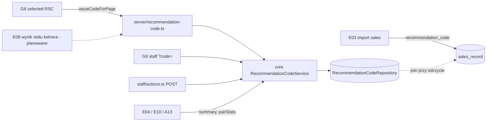
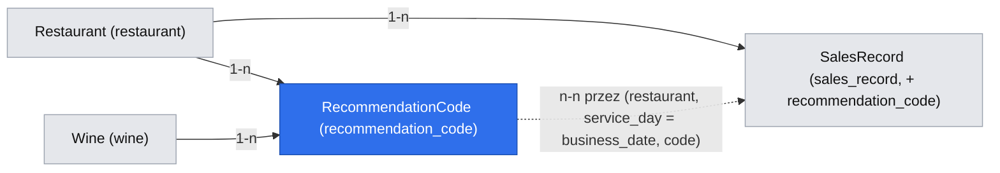

# Kod polecenia (E09)

## 📝 TLDR
Dziś gość pokazuje kelnerowi ekran G8 („Pokaż to kelnerowi”), ale nic nie łączy sprzedanej butelki z rekomendacją. Restauracja nie ma więc dowodu ROI (D13), a E04 i E10 nie wiedzą, co zamówiono. **Proponujemy** krótki kod polecenia (np. `W7K`). G8 zapisuje go przy wyświetleniu jako rekord „polecenie”: restauracja, wino, danie lub dania stołu, porcja, źródło, `sid`, wersja menu, dzień serwisu. Kelner może oznaczyć kod jako „zamówione” w widoku personelu `/r/{slug}/staff` (zwykły formularz, bez JS, z cofnięciem). Może też wpisać kod w kasie jako komentarz albo pozycję. Wtedy import sprzedaży (E03) wyciąga kod z eksportu POS i przypisuje rachunek do polecenia. Bez integracji z POS (N04), bez danych osobowych, każde zapytanie w zakresie jednej restauracji (D18).

## Problem
- G8 (`packages/app/src/app/(guest)/r/[slug]/selected/[wineId]/page.tsx`) kończy ścieżkę gościa bez śladu w danych. E02 zapisze `wine_selected`, ale to tylko deklaracja gościa, nie sprzedaż.
- E03 liczy Wine Attach Rate z eksportu POS, ale nie wie, które rachunki wynikały z rekomendacji. E03 Q10 i Q18 nie dopasowują pozycji do win i nie przechowują nazw pozycji. Dowodu „ta butelka była z Wine Match” nie ma.
- D16 (zatwierdzone 2026-10-16) wymaga atrybucji bez POS. D17/E10 chce sygnału „para często pokazywana, rzadko zamawiana”. A05 (Wine Match podnosi sprzedaż) nie ma dziś miary bezpośredniej.
- `docs/SCREEN_SPECIFICATION.md` G8 mówi „Dane wyjściowe: brak (MVP nie tworzy zamówienia)”. G9 nie ma żadnego zapisu.

## Cel i zakres
Kod polecenia: wydanie (G8, ścieżka kelnera E08 przez kontrakt), wyszukanie i oznaczenie „zamówione” w G9, dopasowanie w imporcie sprzedaży E03, model odczytu dla E04/E10 i karta wyniku na A13.

**Poza zakresem:** integracja z API POS (N04); dopasowanie pozycji POS do konkretnego wina (E03 Q10); kafelek na A1 (E04) i ekran okazji (E10), które tylko czytają kontrakt; logowanie kelnera i PIN (brief „Later”); limity żądań (rate limiting) na poziomie infrastruktury; drukowanie kodu na paragonie; kod w `/api/v1`; benchmarki między restauracjami (D18); treść i komponent „i” (E07: tu tylko teksty).

## Wymagania
- **R1** Kod: 3 znaki w układzie litera-cyfra-litera z alfabetu `CODE_LETTERS = ACDEFGHJKLMNPRTUVWXY` (20 liter, bez B, I, O, Q, S, Z) i `CODE_DIGITS = 23456789`. Gdy przestrzeń 3 znaków jest zajęta, kod ma 4 znaki (litera-cyfra-litera-cyfra). Parser przyjmuje oba formaty bez rozróżniania wielkości liter, ignoruje spacje, `-`, `#` i prefiks `kod`/`code`. `codeFromUuid` czyta cyfry szesnastkowe spoza nibbli wersji i wariantu UUID v4 (pozycje 14 i 19 są stałe).
- **R2** Kod jest unikalny w obrębie `(restaurant_id, service_day)`. `service_day` = data kalendarzowa `Europe/Warsaw` chwili wydania, a gdy lokalna godzina < `SERVICE_DAY_CUTOFF_HOUR = 4`, poprzednia data. Liczone na lokalnych składnikach daty i godziny z `Intl`, **nie** przez odjęcie 4 godzin od chwili (w dniach zmiany czasu daje to złą datę).
- **R3** Wydanie jest idempotentne: ten sam `sid`, wino, porcja i zbiór dań w tym samym dniu serwisu zwraca ten sam kod bez nowego wiersza (odświeżenie, „wstecz”). Stabilność kodu zależy od `sid` w adresie G8: wejście na G8 bez `sid` tworzy nową sesję przy każdym renderze, więc każde odświeżenie takiego adresu wydaje nowy kod (znane, patrz Przypadki brzegowe).
- **R4** G8 z aktywnym winem pokazuje kod. Brak kodu (wyjątek zapisu, przekroczony `ISSUE_TIMEOUT_MS = 1500`, ruch pominięty przez `shouldRecord` z E02, wyczerpana przestrzeń, limit z R13) nie zmienia reszty ekranu ani statusu HTTP. Wino nieaktywne i 404: brak kodu i brak zapisu. Odpowiedź G8 ma `Cache-Control: no-store` (kod jest per sesja i nie może trafić do cache proxy/CDN).
- **R5** Rekord polecenia zawiera wyłącznie: restaurację, dzień serwisu, kod, `sid`, źródło (`guest`/`staff`), kontekst (`dish`/`table`/`direct`), `wineId`, posortowane i zdeduplikowane `dishIds`, porcję, `menuVersion`, `engineVersion`, czas wydania i stan potwierdzenia. Nie zawiera IP, UA, stolika ani tekstu od użytkownika. Kontekst wynika ze **zwalidowanych** danych: `dish` gdy `dish=` wskazuje opublikowane danie tej restauracji (ma pierwszeństwo, jak na G8), `table` gdy `table=` wskazuje 2–12 różnych opublikowanych dań tej restauracji, w pozostałych przypadkach `direct` (wino otwarte bez dania, `dishIds = []`). Nieznane, nieopublikowane i cudze identyfikatory są odrzucane, a więcej niż 12 dań daje brak kodu.
- **R6** G9 przyjmuje `code` (GET), pokazuje polecenie z bieżącego dnia serwisu tej restauracji (wino, porcja, danie/dania, godzina w `Europe/Warsaw`, stan) i formularz POST „Zamówione”/„Cofnij”. Działa bez JS. Kod z innego dnia, innej restauracji, nieznany albo w niepoprawnym formacie daje ten sam komunikat „nie znaleziono” (bez rozróżniania przyczyn, więc bez wyroczni „taki kod istniał wczoraj”) i nic nie ujawnia.
- **R7** Oznaczenie jest idempotentne: drugie „Zamówione” nie zmienia `confirmed_at` (`COALESCE(confirmed_at, :at)` w jednym `UPDATE`). „Cofnij” zeruje `confirmed_at` tylko w bieżącym dniu serwisu. Akcja POST odrzuca żądanie z `Sec-Fetch-Site: cross-site` jak `handle()` w panelu.
- **R8** Import sprzedaży (E03) rozpoznaje opcjonalną kolumnę kodu (synonimy w API Contracts) i zapisuje w `sales_record.recommendation_code` tylko znormalizowany kod. Wyciągnięcie kodu następuje **już w `mapTable`** (przed utworzeniem `import_job`), więc tekst komentarza nie trafia ani do `sales_record`, ani do `import_job.rows`, ani do podglądu. Wartość pola `recommendationCode` (także po poprawce w podglądzie) musi być poprawnym znormalizowanym kodem, inaczej jest pusta. Kod występujący w `itemName` jest przyjmowany tylko wtedy, gdy komórka zawiera wyłącznie kod (z opcjonalnym prefiksem).
- **R9** Polecenie jest „dopasowane w POS”, gdy w tej samej restauracji istnieje aktywny (`replaced_at IS NULL`) rachunek `(business_date = service_day, check_id)` z tym kodem na którejkolwiek linii i sumą ilości `wine_glass` + `wine_bottle` > 0 w rachunku. Złączenie przez `EXISTS` (jedno polecenie liczy się raz, także gdy kod jest na wielu liniach lub rachunkach). Dopasowanie liczymy przy odczycie, nie zapisujemy, więc ponowny import go nie podwaja.
- **R10** „Zamówione” = potwierdzone przez kelnera **lub** dopasowane w POS, liczone raz na polecenie.
- **R11** `RecommendationCodeRepository` przechodzi `repositoryContract` (pamięć i PostgreSQL). Każda metoda przyjmuje `restaurantId`. Pamięć trzyma najwyżej 10 000 poleceń.
- **R12** Kontrakt odczytu (`summary`, `pairStats`) i wydania (`issue`) jest stabilny dla E04, E08 i E10. `issued` liczy **wybory** (G8, jawny wybór kelnera), nie odsłony wyniku (Q5, Q19).
- **R13** Jedna sesja gościa (`source: 'guest'`) może mieć najwyżej `MAX_CODES_PER_SESSION_DAY = 30` poleceń w dniu serwisu; sesja kelnera (`source: 'staff'`, cały wieczór w jednej zakładce) — `MAX_STAFF_CODES_PER_SESSION_DAY = 300`. Kolejne wydania zwracają `null`, a ekran pokazuje zdanie „Kod niedostępny — poleć wino słownie” zamiast pustego miejsca. Ogranicza to wyczerpywanie przestrzeni kodów pętlą z jednym `sid` i zmiennym `table=`.

## Resolved assumptions (autonomous defaults)

| # | Pytanie | Przyjęta odpowiedź | Uzasadnienie |
|---|---|---|---|
| Q1 | Format kodu? | R1: `L D L` (np. `W7K`, 3200 kombinacji na restaurację i dzień), awaryjnie `L D L D` (25 600). Alfabet bez znaków mylących wzrokowo (0/O/Q, 1/I, 2/Z, 5/S, 8/B). Zawsze jest cyfra w środku, więc kod nie tworzy słowa („BEZ”, „NIE”) i nie myli się z tekstem w komentarzu kasy. ✅ rekomendacja zatwierdzona przez właściciela (Filip, 2026-10-16) | Przykład właściciela „W7K”. 3 znaki da się podyktować i wpisać w kasie. Format jest kontraktem z wydrukowanymi paragonami i eksportami (trudno zmienić po pilocie). |
| Q2 | Zapis przy wyświetleniu czy deterministyczne wyliczenie? | **Zapis** (`recommendation_code`) przy renderze G8, przed odpowiedzią, bo kod musi być na stronie. | Krótkiego kodu nie da się odwrócić do (wino, dania, sesja) bez tabeli. Hash bez zapisu daje kolizje i nie pozwala na oznaczenie ani cofnięcie. |
| Q3 | Unikalność i ważność? | Unikalny w `(restaurant_id, service_day)`. Dzień serwisu kończy się o 04:00 czasu warszawskiego (liczone na lokalnych składnikach, R2). Oznaczenie w G9 tylko w bieżącym dniu serwisu. Dopasowanie POS po `business_date = service_day`. ✅ rekomendacja zatwierdzona przez właściciela (Filip, 2026-10-16) (godzina odcięcia) | Rachunki po północy w POS zwykle należą do dnia otwarcia. Stała `SERVICE_DAY_CUTOFF_HOUR` w `core`. Ustawienie per restauracja to osobna zmiana (`Restaurant.timezone` jest w `DATA_MODEL.md`, ale nie w typie domenowym, tak jak w E04 Q2). |
| Q4 | Kolizje? | Kandydat z `IdGenerator.uuid()` (bez nowego portu i bez `Math.random`, R1). `INSERT … ON CONFLICT DO NOTHING`; po konflikcie odczyt po kluczu wyboru rozstrzyga `existing` (ten sam wybór) od `code_taken` (zajęty kod). Do 6 prób 3-znakowych, potem do 6 prób 4-znakowych, potem brak kodu i `logger.warn`. Kod 4-znakowy może mieć 3-znakowy prefiks równy innemu kodowi z tego dnia; G9 i import dopasowują zawsze cały kod, nigdy prefiks. | Deterministyczne testy ze stałym `IdGenerator`. Przy ~200 wyborach dziennie kolizja 3-znakowa ma prawdopodobieństwo ~6% na próbę. |
| Q5 | Kiedy kod powstaje? | Na G8 (wybór wina; kontekst `dish`, `table` albo `direct`, R5), zawsze z `source: 'guest'`. W ścieżce kelnera E08 przez `issue(…, source: 'staff')` wywołane przez ekran E08, a nie przez G8 (G8 nie umie odróżnić kelnera od gościa po samym `sid`). Nie na G3/G6/G7 (wyświetlenie to nie wybór). Kod = jeden wybór: E08 wydaje kod tylko dla wina wskazanego jawnie (butelka główna albo kliknięta alternatywa), nie dla każdej wyświetlonej alternatywy (Q19). | Kod = intencja zamówienia, a `issued` jest mianownikiem `ordered / issued`. Kod na każdej odsłonie zawyżałby mianownik 3–4 razy i zużywał przestrzeń kodów. |
| Q6 | Ruch botów/podglądów/smoke? | Wydanie tylko gdy `shouldRecord(headers)` z E02 zwraca `true`. W przeciwnym razie strona bez kodu. | Podgląd linku G8 w komunikatorze nie zużywa kodów, a `smoke` nie zaśmieca danych pilota. E2E nie wysyła nagłówka syntetycznego, więc kod testuje. |
| Q7 | Czy wydanie to komenda (§1.3: `actor`, `expectedVersion`, `DomainError`)? | **Nie**, wydanie jest jak telemetria E02: bez `actor`, a błąd daje `null` i `logger.warn`. **Oznaczenie/cofnięcie to komenda**: `actor: 'staff_view'` (zapisywany w `confirmed_by`), błąd jako `DomainError` (`code_not_found`; osobnego `code_expired` nie ma, bo rozróżnienie byłoby wyrocznią i R6 każe pokazywać jedno „nie znaleziono”), bez `expectedVersion` (operacja idempotentna). ✅ rekomendacja zatwierdzona przez właściciela (Filip, 2026-10-16) | Rozszerza wyjątek telemetrii z AGENTS §1.3 (zatwierdzony dla E02) o zapis w renderze, który zwraca wartość. To zmiana prawa repozytorium, więc decyduje właściciel. |
| Q8 | Publiczne oznaczanie bez logowania (D03) a nadużycia? | Zostaje publiczne (akcja serwerowa POST). Ochrona `Origin` Next.js broni tylko przed cudzą stroną w przeglądarce, **nie** przed bezpośrednim żądaniem z `curl` (nagłówek można dopisać), więc nie jest zabezpieczeniem przed nadużyciem. Dodatkowo akcja odrzuca `Sec-Fetch-Site: cross-site` (R7). Ograniczenia: (1) tylko kody bieżącego dnia serwisu tej restauracji; (2) najpierw GET pokazuje wino i porcję, kelner potwierdza drugim krokiem; (3) jedno potwierdzenie na polecenie, więc zawyżenie jest ograniczone do liczby wydanych kodów danego dnia; (4) potwierdzenia kelnera i dopasowania POS są raportowane osobno, a dowodem ROI jest POS; (5) `confirmed_at`/`confirmed_by` jako ślad; (6) enumeracja: przestrzeń dnia to 3200 kodów, a trafienie pokazuje tylko wino, porcję i dania (bez danych osobowych), więc ryzykiem jest zawyżenie potwierdzeń i podgląd wyborów gości przez osobę znającą adres. Limity żądań to osobny ticket (Poza zakresem). To świadomy wyjątek od zasady „każde drzwi sprawdzają same” (`authorizeAction`): sprawdzeniem jest ważność kodu w restauracji ze sluga, nie sesja. Logowanie kelnera (rola `waiter` istnieje) to osobna spec z PIN-em. ✅ rekomendacja zatwierdzona przez właściciela (Filip, 2026-10-16) | D03 jest aktywne. Wymóg logowania zmieniłby D03 i ścieżkę kelnera z E08. Ryzyko zostaje (patrz Ryzyka). |
| Q9 | Gdzie kelner wpisuje kod w kasie? | Komentarz pozycji wina albo rachunku (zalecane) albo pozycja o nazwie kodu. Import czyta kolumnę kodu/komentarza (wyszukuje token kodu) i `itemName` (tylko cała komórka = kod). Kod na dowolnej linii rachunku przypisuje **cały rachunek**. | Eksport POS pilota jest nieznany (brief Q03) i może w ogóle nie zawierać komentarzy ani nazw pozycji (E03 wymaga tylko dat, rachunku, typu, ilości i kwoty): wtedy zostaje wyłącznie potwierdzenie kelnera w G9. Czy eksport ma kolumnę komentarza, sprawdza zadanie C03/E01-T03 (Ryzyka). Przypisanie na poziomie rachunku działa bez dopasowania wina (E03 Q10). |
| Q10 | Wiele kodów w jednym rachunku? | Każdy kod jest dopasowany osobno, jeśli rachunek ma wino (R9). Nie sprawdzamy, która butelka odpowiada któremu kodowi. | Bez dopasowania pozycji do win (E03 Q10) nie da się tego rozstrzygnąć. Znane przybliżenie. |
| Q11 | Kod w pliku, którego nie wydaliśmy? | Wiersz importuje się normalnie (kod zapisany), a podgląd pokazuje notatkę „N kodów nie pasuje do żadnego polecenia z tego dnia”. Bez błędu wiersza. | Literówka kelnera nie może blokować importu sprzedaży (North Star). |
| Q12 | Co liczymy i dla kogo? | `summary`: wydane, potwierdzone przez kelnera, dopasowane w POS, zamówione (R10), rachunki z kodem bez polecenia (liczy też kontekst `direct`). `pairStats`: to samo per (danie, wino, kontekst). Polecenie stołu rozwija się na każde danie zbioru z `context: 'table'`, a `direct` (bez dania) nie ma wierszy. Dlatego suma `pairStats` ≠ `summary`. E10 (S5 „zamówiona, niezatwierdzona”) i „pokazywana, rzadko zamawiana” czytają tylko wiersze `context: 'dish'` (`ordered` = `orders` w E10); stół przypisałby jedno zamówienie każdemu daniu zbioru. Kod = dowód powiązania wyboru z rachunkiem, nie przyczynowości: kelner wpisze go także przy stole, który zamówiłby wino i tak (UI mówi „zamówione z kodem”, a nie „sprzedane dzięki Wine Match”). Mianownik „pokazań” daje E02 (`recommendations_viewed`), nie ta spec. | E04 R4: nie dzielić sesji przez rachunki. `ordered / issued` to iloraz w jednej jednostce (polecenie). |
| Q13 | Gdzie GM widzi wynik w tej spec? | Karta „Wino z polecenia” na A13 pod kartą Wine Attach Rate (ten sam formularz okresu z E03). A1 i okazje czytają kontrakt w E04/E10. | Najmniejsza nowa powierzchnia. A13 ma już okres i dane sprzedaży. |
| Q14 | Retencja? | Brak w MVP (jak E02 Q12). Wiersze nie mają danych osobowych, a `sid` jest anonimowy. Przegląd po pilocie. | Wolumen pilota jest mały. |
| Q15 | Zakres tenantów (D18)? | Każda metoda portu ma `restaurantId`. Kod jest unikalny tylko w restauracji. G9 szuka kodu wyłącznie w restauracji ze sluga. Brak agregatów między restauracjami. | D18, AGENTS §1.3. |
| Q16 | Jedna spec czy podział? | Jedna spec, trzy fazy = trzy PR-y. F2 (kelner) i F3 (POS) zależą od F1, ale nie od siebie. | Każda faza osobno daje wartość, a model danych jest wspólny. |
| Q17 | Kolejność scalania? | Po E02 F1–F2 (`sid`, `shouldRecord`, G8). F3 po E03 F2 (`sales_record`, `SalesKpiService`, A13). E08 (kod na stole) po E09 F1. E10 czyta `pairStats` po F3 (przed F3 tylko potwierdzenia kelnera). | Wspólne pliki: `Repositories`, `container.ts`, `repository-contract.ts`, `memory-repositories.ts`, `DATA_MODEL.md`. |
| Q18 | Czy rekord ma `tier` pary (sommelier / silnik)? | **Rekomendacja: tak** — kolumna `tier` (`sommelier_primary` \| `sommelier` \| `engine`, null dla `table`/`direct`/`staff`), brana z `match` zwracanego już przez `wineDetails`. ✅ rekomendacja zatwierdzona przez właściciela (Filip, 2026-10-16) | D13: argument dla sommeliera brzmi „Twój program win dociera do gościa”. Bez `tier` w rekordzie trzeba łączyć po `sid` z `recommendations_viewed` (E02), a G8 zna tier za darmo. Koszt: jedna kolumna null; po pilocie nie da się odtworzyć. Bez tej odpowiedzi spec nie ma `tier` (E10 i E04 liczą go z E02). |
| Q19 | Ile kodów na wyniku stołu kelnera (E08 G11)? | **Rekomendacja:** jeden kod, dla butelki głównej, wydawany przy renderze G11 (kelner nie ma kroku G8); alternatywy dostają kod dopiero po kliknięciu „Wybierz tę” (jawny wybór). Każda zmiana składu stołu w formularzu „Zmień stół” to nowy wybór i nowy kod; `staff` jest raportowane osobno od `guest`. ✅ rekomendacja zatwierdzona przez właściciela (Filip, 2026-10-16) (decyduje też E08; jego Q10 mówi dziś o slocie przy każdej alternatywie) | Kod przy każdej odsłonie zawyża `issued` i zużywa przestrzeń; kelner eksplorujący stoły wydaje kody, których nikt nie zamówi, więc `ordered / issued` dla `staff` jest dolną granicą. |
| Q20 | Czy kelner w piątek o 21:00 to zrobi? | Nie zakładamy tego. Jedyny krok „obowiązkowy” to wpisanie 3 znaków do kasy (komentarz) albo jedno dotknięcie w G9; oba są opcjonalne, a bez nich wartością jest nadal `issued` + `wine_selected`. Pilot mierzy współczynniki: kod pokazany → potwierdzony / dopasowany. Kryterium decyzji (⚠ do ustalenia z właścicielem): jeśli po 2 tygodniach `ordered / issued` < 10%, upraszczamy (np. tylko POS) zamiast dokładać ekrany. | Ten mechanizm pokazuje, czy ROI da się w ogóle zmierzyć bez integracji z POS (N04); nie jest dowodem sam w sobie. |

## Projekt rozwiązania


Wydanie i oznaczenie idą przez serwis z `core`. Dopasowanie POS to złączenie przy odczycie w repozytorium, a reguły pozostają w `core` (`code-format.ts`, `service-day.ts`).

**Pliki:**
- `core/src/recommendation-code/code-format.ts` (nowe, czyste): `CODE_LETTERS`, `CODE_DIGITS`, `codeFromUuid(uuid, length: 3 | 4)` (R1), `normalizeCode(input): string | null` (R1), `findCodeInText(text): string | null` (pierwszy token `\b`-ograniczony pasujący do formatu, po zamianie na wielkie litery), `isWholeCellCode(text)`.
- `core/src/recommendation-code/service-day.ts`: `SERVICE_DAY_CUTOFF_HOUR = 4`, `SERVICE_TIME_ZONE = 'Europe/Warsaw'`, `serviceDay(at: Date): string` (`Intl.DateTimeFormat` → lokalne Y-M-D i godzina; godzina < 4 → poprzednia data liczona arytmetyką na dacie, nie na chwili; R2), `formatServiceTime(at: Date, locale): string` (godzina `HH:mm` w `SERVICE_TIME_ZONE`, bo serwer działa w UTC).
- `core/src/services/recommendations/recommendation-code-service.ts`: `RecommendationCodeService`, deps `Pick<Repositories, 'restaurantRepository' | 'wineRepository' | 'dishRepository' | 'recommendationCodeRepository'> & { clock: Clock; idGenerator: IdGenerator }`.
- `core/src/validators/recommendations/code-action.schema.ts`: `strictObject({ slug, code (≤ 16 znaków), intent: 'confirm' | 'undo', sid?, lang? })`.
- `core/src/ports/repositories.ts`: `RecommendationCodeRepository` + pole w `Repositories`; typy w `core/src/domain/types.ts`.
- `core/src/memory/memory-repositories.ts`: tablica w `MemoryStore` (limit 10 000, FIFO). Dopasowanie POS czyta pamięciowy `SalesRepository` (E03).
- `core/src/testing/recommendation-code-contract.ts` podpięty do `repositoryContract`.
- `db/src/entities/recommendations/recommendation-code.ts` (+ `ENTITIES`), migracja, `PgRecommendationCodeRepository` w `db/src/repositories/index.ts`, mapper.
- `app/src/server/recommendation-code.ts`: `issueCodeForPage(services, restaurant, input)`: sprawdza `shouldRecord(await headers())`, woła `issue` w limicie `ISSUE_TIMEOUT_MS` (`Promise.race`; przegrany zapis może się jeszcze zatwierdzić, co jest nieszkodliwe: kod jest po prostu nieużyty), łapie wyjątek (`logger.warn('recommendation code not issued', { restaurantId, error })`) i zwraca `IssuedCode | null`.
- `app/src/app/(guest)/_components/recommendation-code.tsx`: `CodeForWaiter({ code, t })` (serwerowy, bez logiki). Własnej ikony „i” nie ma: zdanie o kodzie dopisuje się do istniejącego „i” ekranu z E07 (`guest.explain.selected`, `guest.explain.staff`), żeby G8 miał jedno „i”.
- `app/src/app/(guest)/r/[slug]/staff/actions.ts` (`'use server'`): `markCode(formData)`. Odrzuca `Sec-Fetch-Site: cross-site`, parsuje schemat, woła `confirm`/`undo`, przekierowuje na `/r/{slug}/staff?code=…&sid=…&marked=confirmed|undone` albo `&codeError=not_found` (slug z restauracji, `sid` przez `parseSessionId`, `lang` tylko `pl|en`; adres budowany z zaufanych części, bez open redirect), `revalidatePath(…, 'layout')`. Nie używa `act()`/`authorizeAction` (to drzwi panelu), a świadomy brak sesji opisuje Q8. Błędy rozpoznaje `domainError()`.
- `app/src/server/container.ts`: `recommendationCodeRepository` (obie gałęzie), `recommendationCodeService` (scoped).
- F3: `core/src/import/*` (pole `recommendationCode`, ekstrakcja w `mapTable`, R8), encja i migracja `sales_record.recommendation_code`, `PgSalesRepository`/pamięć, `import-screen.tsx` (notatka), karta na A13.

## Model danych

Nowa tabela `recommendation_code` (F1). Addytywna kolumna `sales_record.recommendation_code` (F3, tabela z E03).

| Kolumna | Typ | Uwagi |
|---|---|---|
| `id` | uuid PK | `IdGenerator` |
| `restaurant_id` | uuid FK → `restaurant`, not null | zakres tenanta |
| `service_day` | `date`, not null | R2 |
| `code` | varchar(4), not null | R1, znormalizowany |
| `session_id` | uuid, not null | `sid` z E02 (gościa albo kelnera) |
| `source` | enum `guest`, `staff` | |
| `context` | enum `dish`, `table`, `direct` | R5: `table` 2–12 dań, `direct` bez dania |
| `wine_id` | uuid FK → `wine`, not null | |
| `dish_ids` | jsonb not null | posortowana, zdeduplikowana tablica UUID opublikowanych dań restauracji (1 dla `dish`, 2–12 dla `table`, `[]` dla `direct`); limit 12 mieści się z zapasem w limicie wiersza indeksu btree (~2,7 kB) |
| `serving` | enum `glass`, `bottle` | jak G8; serwis sam sprawdza, że `glass` wymaga ceny kieliszka, inaczej `bottle` |
| `menu_version` | timestamptz null | `restaurant.publishedAt` |
| `engine_version` | varchar(40), not null | `ENGINE_VERSION` |
| `issued_at` | timestamptz, not null | `clock.now()` |
| `confirmed_at` | timestamptz null | oznaczenie kelnera; „Cofnij” → null |
| `confirmed_by` | varchar(20) null | `'staff_view'` (wartość `actor`) |

Indeksy: unikalny `(restaurant_id, service_day, code)` (R2); unikalny `(restaurant_id, service_day, session_id, wine_id, serving, dish_ids)` (idempotencja R3, jego prefiks obsługuje też licznik R13; `jsonb` ma klasę operatorów btree, a indeks idzie jako `indexes: [{ expression }]` w encji, `packages/db/AGENTS.md`); `(restaurant_id, issued_at)` (okresy). `sales_record.recommendation_code varchar(4) null` + indeks `(restaurant_id, business_date, recommendation_code)` z warunkiem `recommendation_code IS NOT NULL`.



Dania są w `dish_ids` (jsonb), bez FK. Dania z wycofanych wersji menu zostają czytelne po `id`. **Migracje:** `Migration<ts>_recommendation_code` (F1), `Migration<ts>_sales_record_recommendation_code` (F3). `down` usuwa tabelę lub kolumnę tylko w dev i test. W produkcji z danymi obowiązuje ta sama reguła co E03 Q19 (wycofanie = poprzedni obraz, schemat zostaje).

## Kontrakty

**Port:**
```ts
// core/src/domain/types.ts
export type CodeSource = 'guest' | 'staff';
export type CodeContext = 'dish' | 'table' | 'direct';
export interface RecommendationCodeRecord {
  code: string; serviceDay: string; sessionId: string; source: CodeSource; context: CodeContext;
  wineId: string; dishIds: string[]; serving: 'glass' | 'bottle'; menuVersion: string | null; // Q18 (⚠): + tier
  engineVersion: string; issuedAt: string; confirmedAt: string | null;
}
// core/src/ports/repositories.ts
export interface RecommendationCodeRepository {
  /** inserts unless (serviceDay, code) or the selection key exists. */
  tryIssue(restaurantId: string, input: Omit<RecommendationCodeRecord, 'confirmedAt'>):
    Promise<{ status: 'created' | 'existing'; record: RecommendationCodeRecord } | { status: 'code_taken' }>;
  findByCode(restaurantId: string, serviceDay: string, code: string): Promise<RecommendationCodeRecord | null>;
  /** idempotent; returns null for an unknown code */
  setConfirmed(restaurantId: string, serviceDay: string, code: string, at: Date | null, by: string | null): Promise<RecommendationCodeRecord | null>;
  /** issued codes of one session on one service day (R13) */
  countBySession(restaurantId: string, serviceDay: string, sessionId: string): Promise<number>;
  /** serviceDay in [from, to] inclusive; posMatched per R9 (EXISTS on active sales_record); rows only for context dish/table */
  pairStats(restaurantId: string, period: { from: string; to: string }): Promise<PairCodeStats[]>;
  /** totals per R10 for the period, including context 'direct' */
  totals(restaurantId: string, period: { from: string; to: string }): Promise<Omit<CodeSummary, 'period' | 'unmatchedPosCodes'>>;
  /** stored checks in the period whose code matches no issued code (A13 card) */
  unmatchedPosCodes(restaurantId: string, period: { from: string; to: string }): Promise<number>;
  /** import preview (before sales_record exists): how many of these (businessDate, code) pairs have no issued code */
  countUnmatched(restaurantId: string, pairs: { businessDate: string; code: string }[]): Promise<number>;
}
```

**Serwis (eksport z `core/src/index.ts`). Z tego korzystają E08 i E10:**
```ts
export interface IssueCodeInput {
  session: GuestSessionRef;            // E02
  source: CodeSource;                  // E08 waiter path: 'staff'
  wineId: string;                      // active wine of the restaurant (`wine.active`)
  serving: 'glass' | 'bottle';
  dishIds: string[];                   // validated per R5: 1 → 'dish', 2–12 → 'table', none → 'direct'
}
export interface IssuedCode { code: string; serviceDay: string; issuedAt: string }
export interface PairCodeStats {
  dishId: string; wineId: string; context: CodeContext;
  issued: number; staffConfirmed: number; posMatched: number; ordered: number; // ordered = confirmed ∪ matched (R10)
}
export interface CodeSummary {
  period: { from: string; to: string };     // service days, both inclusive, ≤ 366 days (as SalesPeriod E03)
  issued: number; staffConfirmed: number; posMatched: number; ordered: number;
  unmatchedPosCodes: number;
}
export class RecommendationCodeService {
  /** null when the wine is inactive, the code space is exhausted, or R13 is hit; never throws for a missing slug/wine (→ null) */
  issue(slug: string, input: IssueCodeInput): Promise<IssuedCode | null>;
  /** current service day only; null for anything else (R6). record + wine (also inactive); the page maps dishIds to names from the published menu it already loads (an id missing there → "dish no longer on the menu") and localizes the wine via recommendationService.wineDetails */
  lookup(slug: string, rawCode: string): Promise<CodeLookup | null>;   // CodeLookup = { record: RecommendationCodeRecord; wine: Wine | null }
  confirm(slug: string, rawCode: string, actor: 'staff_view'): Promise<CodeLookup>;  // DomainError code_not_found
  undo(slug: string, rawCode: string, actor: 'staff_view'): Promise<CodeLookup>;
  summary(slug: string, period: { from: string; to: string }): Promise<CodeSummary>;  // ValidationError invalid_period
  pairStats(slug: string, period: { from: string; to: string }): Promise<PairCodeStats[]>;
}
```
- **E08:** woła `issueCodeForPage` (nie bezpośrednio `issue`) na swoim ekranie wyniku stołu kelnera z `source: 'staff'` i renderuje `CodeForWaiter`. Wybór wina, dla którego pokazuje kod, należy do E08, ale zgodnie z Q5/Q19 kod jest wydawany tylko dla jawnie wybranego wina (nie dla każdej alternatywy). Slot na G6 (karta gościa) odpowiada G8 po kliknięciu „Wybierz”, więc na G6 kodu nie wydajemy.
- **E10/E04:** czytają `pairStats`/`summary` (okres w dniach serwisu, a nie `[from, to)` UTC: okno „28 dni” przeliczają na daty serwisu przez `serviceDay`). „Pokazania” pary biorą z E02, a „zamówienia” z `ordered` (S5 w E10: `orders` = `ordered`, tylko wiersze `context: 'dish'`). Nie łączą `ordered` z rachunkami E03 w jednym ilorazie (E04 R4).

**Adresy gościa (BC §1, dodanie):** opcjonalny `code` na `/r/{slug}/staff`. Komunikat `marked` / `codeError` w URL (tylko `confirmed|undone`, `not_found`; inna wartość jest ignorowana).

**Akcja serwerowa (nie `/api/v1`):** pola formularza `slug`, `code`, `intent`, `sid`, `lang` (BC §8, nazwy pól akcji). Za reverse proxy akcje serwerowe wymagają zgodnych `Host`/`X-Forwarded-Host` z `Origin`; sprawdza to runbook E05-S02 (smoke produkcyjny nie wykonuje POST, więc krok ręczny: jedno „Zamówione” po wdrożeniu).

**Import sprzedaży (BC §6, dodanie):** pole `recommendationCode`, opcjonalne. Synonimy (dokładne, `normKey`): `kod`, `kod polecenia`, `kod wine match`, `code`, `recommendation code`, `komentarz`, `uwagi`, `notatka`, `comment`, `note`, `notes`. Wartość → `findCodeInText` → kod albo `null` (bez błędu), **w `mapTable`**, zanim rekord trafi do `import_job.rows`. `itemName` → `isWholeCellCode`. Do bazy trafia tylko kod. Synonimy komentarza są „zbyt ogólne” w rozumieniu E03 Q13, więc kolumna jest rozpoznana tylko przy dokładnym dopasowaniu i niczego poza kodem z niej nie czytamy.

**Kody błędów (domenowe):** `code_not_found` (tylko akcja i G9, poza `/api/v1`); `invalid_period` (istnieje z E03).

## UI/UX
- **G8:** pod kartą wina blok „Kod dla kelnera” / „Code for your waiter” z dużym kodem (serif, `tabular-nums`, odstępy między znakami), `aria-label` znak po znaku („W, 7, K”), widoczne znaki w `aria-hidden`, a obok `sr-only` z tekstem „W, 7, K” (`aria-label` na zwykłym elemencie nie jest czytany niezawodnie), pod spodem „Pokaż go kelnerowi razem z winem.” (bez obietnicy, że kelner coś wpisze: personel może nie być przeszkolony). Osobnej ikony „i” nie ma: do „i” ekranu G8 z E07 (`guest.explain.selected`) dopisujemy zdanie PL/EN: „Kod łączy to wino z poleceniem, żeby restauracja wiedziała, co gościom smakuje. Nie zawiera żadnych danych o Tobie.” Bez słowa „AI” (N02). Gdy brak kodu, bloku i zdania nie ma.
- **G9:** nad wyborem dania sekcja „Zamówienie z kodu” z formularzem GET (`code`, ukryte `sid`, `lang`). Po wpisaniu kodu: karta polecenia (wino, „List no.”, porcja i cena, danie albo „Dla stołu: …”, godzina wydania). Danie spoza bieżącej karty (wycofane po ponownej publikacji): „Danie spoza obecnej karty”. Przycisk POST „Zamówione” albo, gdy już oznaczone, „Oznaczone o 19:42” (czas w `Europe/Warsaw`, `formatServiceTime`) i przycisk „Cofnij”. Komunikat `role=status` po przekierowaniu. Nieznany, stary i obcy kod: „Nie ma dziś kodu W7K w tej restauracji. Sprawdź znaki z ekranu gościa.” Zdanie o kodzie w „i” G9 (`guest.explain.staff`). Działa przy 390 px i bez JS.
- **A13 (F3):** karta „Wino z polecenia” w okresie z formularza E03: „Zamówione: 41 z 96 poleceń (kelner 30, kasa 28)”, „Kody w kasie bez polecenia: 3”. Brak danych → `EmptyState`. Podgląd importu: notatka „12 rachunków ma kod polecenia; 2 kody nie pasują do poleceń z tego dnia”.
- Teksty w `src/i18n/en.ts` i `pl.ts`, `docs/SCREEN_SPECIFICATION.md` G8/G9/A13.

## Przypadki brzegowe
| Sytuacja | Zachowanie |
|---|---|
| Odświeżenie G8, „wstecz”, ten sam `sid` | ten sam kod (R3) |
| Ten sam wybór z innym `sid` (inny telefon, link bez `sid`) | nowy kod (osobne polecenie) |
| Zmiana porcji kieliszek ↔ butelka | nowy kod |
| Link G8 z `sid` udostępniony innej osobie | ten sam kod co u nadawcy (E02 Q1, akceptowane) |
| Wydanie o 00:30 | dzień serwisu = poprzedni dzień kalendarzowy (R2) |
| Zmiana czasu (marzec/październik) | `serviceDay` przez `Intl`, test na obu datach |
| Przestrzeń 3 znaków zajęta | kod 4-znakowy; po 12 próbach brak kodu + `warn` |
| Baza niedostępna lub wolna przy wydaniu | G8 bez kodu, 200, `warn`; po `ISSUE_TIMEOUT_MS` strona nie czeka dłużej |
| G8 bez `sid` w adresie (wklejony link) | nowa sesja przy każdym renderze: każde odświeżenie = nowy kod i nowy wiersz (R3). Akceptowane: ścieżka z G7 zawsze niesie `sid` (E02 R3) |
| G8 bez dania i bez stołu (wino otwarte wprost) | kod z `context: 'direct'`, `dishIds = []` (R5); poza `pairStats` |
| `dish=` i `table=` jednocześnie | jak na G8: dania wygrywa `dish` (kontekst `dish`) |
| `table=` z obcym / nieopublikowanym / nieistniejącym daniem albo > 12 daniami | identyfikatory odrzucone (R5); po odrzuceniu 0 dań → `direct`, 1 → `dish`, > 12 → brak kodu |
| Pętla z jednym `sid` i zmiennym `table=` | po 30 poleceniach brak kodu (R13) |
| G8 w cache proxy/CDN | wykluczone: `Cache-Control: no-store` (R4); test AC14 |
| Kod małymi literami, ze spacją, `#W7K`, `kod: w7k` | normalizacja → `W7K` |
| `W7O`, `W1K`, `BEZ` | niepoprawny format → „nie znaleziono” (bez zapytania do bazy) |
| Kod z wczoraj w G9 | „nie znaleziono” (R6), jak nieznany |
| Kod innej restauracji w G9 | ten sam komunikat co nieznany kod |
| Formularz G9 otwarty przed 04:00, wysłany po 04:00 | „nie znaleziono”, stan bez zmian |
| Wydanie 03:30 w noc zmiany czasu (poprawnie: poprzednia data) | R2: lokalne składniki, nie odejmowanie 4 h |
| Podwójne „Zamówione” | bez zmiany `confirmed_at` |
| „Cofnij” po zmianie dnia serwisu | „nie znaleziono”, stan bez zmian |
| POST z obcej strony (przeglądarka, `Sec-Fetch-Site: cross-site` albo obcy `Origin`) | odrzucone (Next.js + R7) |
| POST wprost z `curl` z poprawnym `Origin` | przyjęty jak z formularza (Q8: publiczne, nadużycie ograniczone Q8 pkt 1–6) |
| Akcja za reverse proxy z niezgodnym `Host` | Next.js odrzuca akcję: formularz nie działa; wykrywa to krok ręczny runbooka (Kontrakty) |
| Kod w kasie, rachunek bez wina | brak dopasowania POS (R9) |
| Dwa kody w jednym rachunku z jedną butelką | oba dopasowane (Q10, znane przybliżenie) |
| Ponowny import tego samego pliku | zastąpione linie E03 mają `replaced_at`, więc dopasowanie liczy się raz |
| Komentarz „Pan Kowalski, alergia, W7K” | w `mapTable` zostaje tylko `W7K`; reszta nie trafia ani do `sales_record`, ani do `import_job.rows`, ani do podglądu (R8) |
| W komentarzu token podobny do kodu („A4K”, numer sali) | traktowany jak kod; jeśli brak polecenia, liczy się do „kody bez polecenia” (Q11), bez błędu |
| Kod w POS w dwóch rachunkach tego dnia | jedno polecenie, liczone raz (R9, `EXISTS`) |
| Eksport POS bez komentarzy / bez nazw pozycji | brak dopasowania POS; zostaje potwierdzenie kelnera (Q9) |
| Wino potem ukryte / usunięte z karty | polecenie i potwierdzenie zostają; `lookup` pokazuje nazwę wina z repozytorium (także nieaktywnego) |
| Danie z rekordu usunięte z karty po ponownej publikacji | G9: „Danie spoza obecnej karty”; `pairStats` zostaje po `dishId` |
| Ponowna publikacja karty między wydaniem a oznaczeniem | kod ważny (dzień serwisu, nie wersja); `menuVersion` zostaje z chwili wydania |
| Kelner na wyniku stołu zmienia skład stołu | nowy wybór, nowy kod (Q19) |
| `DATA_SOURCE=memory` | do 10 000 poleceń, giną po restarcie |

## Ryzyka i otwarte pytania
- **Nadużycie publicznego oznaczania (Q8, ⚠):** każdy, kto zna adres `/staff`, może potwierdzić kody z bieżącego dnia. Maksymalne zawyżenie to wszystkie wydane tego dnia kody. Podział „kelner” / „kasa” w raportach pozwala oprzeć ROI na POS. Nadużycie wydawania (pętla G8 z nowymi `sid` i UA przeglądarki) wyczerpuje przestrzeń dnia (brak kodów, a nie błędne dane); R13 ogranicza tylko pętlę z jednym `sid`. Enumeracja G9 (3200 kodów dziennie) ujawnia wino, porcję i dania cudzych wyborów, bez danych osobowych. Limity żądań to osobny ticket przed rozszerzeniem poza pilota (jak E02).
- **Adopcja (Q20):** efekt zależy od dwóch ludzkich kroków (gość pokazuje, kelner wpisuje albo klika). Przed pilotem: potwierdzić w C03/E01-T03, czy eksport POS ma komentarz lub nazwę pozycji i czy kasa pozwala wpisać komentarz do pozycji albo rachunku; bez tego zostaje tylko G9. Kod dowodzi powiązania wyboru z rachunkiem, nie przyczynowości (Q12).
- **Koordynacja z E08 (Q19):** slot kodu przy każdej alternatywie na G11 (E08 Q10) zawyżyłby `issued`; E08 musi wywołać `issueCodeForPage` tylko dla wybranej butelki.
- **Trwałe kontrakty:** format kodu (wydruki, nawyki kelnerów, komentarze w kasie), nazwa parametru `code`, synonimy importu, kształt `PairCodeStats`/`CodeSummary` (E04, E10).
- **Dzień serwisu vs dzień biznesowy POS (Q3, ⚠):** jeśli POS pilota zamyka dzień o innej godzinie, rachunki 00:00–04:00 mogą trafić do innej daty i nie zostaną dopasowane. Pomiar na pierwszym eksporcie pilota. Ustawienie per restauracja to osobna spec.
- **Zależności:** E02 F1–F2 (`sid`, `GuestSessionRef`, `shouldRecord`), E03 F1–F2 (`sales_record`, pola importu, A13, `SalesPeriod`), E07 (komponent „i”; do jego scalenia blok bez ikony), E08 (wywołuje `issueCodeForPage` po F1), E10 (`pairStats`; przed F3 tylko `staffConfirmed`).
- **Prawo repozytorium (Q7, ⚠):** zapis w renderze GET poza konwencją komend wymaga zgody właściciela i dopisku w AGENTS §1.3 (w F1).
- **Wycofanie:** usunięcie bloku z G8 i sekcji z G9. Tabele zostają, a parametr `code` jest ignorowany. Bez `migration:down` w produkcji.
- **Prywatność:** brak danych osobowych. `sid` jest anonimowy. Tekst komentarza z POS nie jest przechowywany (R8).

### Przegląd krzyżowy 2026-10-16
Recenzja niezależna (staff engineer + product) względem AGENTS.md, E02/E03/E04, kodu (G8, G9, `wineDetails`, `mapTable`, `parseDishIds`) i równoległych E07/E08/E10. Skrót: naprawione w treści = ✔, decyzja właściciela = ⚠ (Resolved assumptions).

- **High: komentarz z POS trafiał do `import_job.rows`.** `mapTable` przepisuje surową komórkę do rekordu, więc ekstrakcja kodu w `validate-sales.ts` zostawiałaby „Pan Kowalski, alergia” w bazie i podglądzie wbrew R8/D18. ✔ ekstrakcja w `mapTable`, walidacja pola przy poprawce, AC9 sprawdza `import_job.rows`.
- **High: sprzeczność `code_expired` vs „nie znaleziono”.** R6 i AC8 mówiły co innego, a rozróżnienie dawało wyrocznię istnienia wczorajszych kodów. ✔ jeden komunikat, `code_expired` usunięty.
- **High: wydanie kodu przy odsłonie wyniku stołu (E08 Q10) psuje `issued`.** Slot przy każdej alternatywie zawyża mianownik 3–4 razy i zużywa przestrzeń. ✔ Q5/Q19 i R12 (kod = wybór); ⚠ Q19, wymaga zmiany w E08.
- **Medium: `serviceDay` przez „−4 h od chwili” jest błędny w noc zmiany czasu** (np. 04:10 CEST 2026-03-29 → 28.03). ✔ R2 na lokalnych składnikach, AC2 z czterema przypadkami.
- **Medium: brak kontekstu `direct`.** G8 jest osiągalny z G7 bez dania; model miał tylko `dish`/`table`. ✔ `direct`, `dish_ids = []`, poza `pairStats`.
- **Medium: `dishIds` z URL bez walidacji.** `table=` nie jest sprawdzane na G8, a indeks btree na `jsonb` ma limit rozmiaru wiersza. ✔ R5 (opublikowane dania restauracji, 2–12), AC13.
- **Spójność z E08 (2026-10-16):** limit 30 odcinałby kelnera obsługującego cały wieczór jednym `sid` na G11 — osobny limit 300 dla `source: 'staff'` i widoczny komunikat (R13, AC13).
- **Medium: nadużycia bez limitu.** Pętla z jednym `sid` i zmiennym `table=` zapełnia przestrzeń kodów. ✔ R13 (30 poleceń na `sid`/dzień); pętla ze świeżymi `sid` zostaje w Ryzykach (limity żądań = osobny ticket).
- **Medium: fałszywe twierdzenie o ochronie `Origin`.** Next.js broni przed cudzą stroną w przeglądarce, nie przed `curl`. ✔ Q8 poprawione, odrzucenie `Sec-Fetch-Site: cross-site` (jak `handle()`), AC15.
- **Medium: podgląd importu nie ma jak policzyć „kodów bez polecenia”** (`sales_record` jeszcze nie istnieje). ✔ port `countUnmatched`, `totals`, `countBySession`.
- **Medium: dwa „i” na G8** (E07 dopisuje akapit do własnego „i”, E09 dodawała drugie). ✔ jedno „i”, zdanie w `guest.explain.selected` / `staff`.
- **Medium: `issued` miesza wybory gości i eksplorację kelnera; `pairStats` dla stołu rozwija kod na dania.** ✔ `source` rozdzielone (Q19), E10 S5 czyta tylko `context: 'dish'` (Q12, Kontrakty); ⚠ Q19.
- **Medium: serwis bez limitu czasu na zapis w renderze G8.** Wiszące połączenie blokowałoby ekran gościa. ✔ `ISSUE_TIMEOUT_MS`, test w AC6.
- **Medium: ROI i adopcja.** Kod dowodzi powiązania, nie przyczynowości, a eksport POS może nie mieć komentarza. ✔ Q12, Q9, Q20 (kryterium decyzji pilota); ⚠ Q20.
- **Low:** `codeFromUuid` na nibblach wersji UUID (✔ R1); godzina w G9 w strefie serwera UTC (✔ `formatServiceTime`); `aria-label` na elemencie nie-interaktywnym (✔ `sr-only`); cache proxy/CDN dla G8 (✔ `no-store`, AC14); prefiks 4-znakowego kodu = inny 3-znakowy (✔ Q4: dopasowanie tylko całego kodu); dania spoza karty w G9 (✔ fallback); `serving` ponownie sprawdzany w serwisie (✔); `COALESCE` w `setConfirmed` (✔ R7); `GuestSessionRef.source` nie rozróżnia kelnera na G8 (✔ Q5: G8 = `guest`); za reverse proxy akcje wymagają zgodnego `Host` (✔ krok ręczny w runbooku); tekst „Kelner wpisze go” obiecywał czynność personelu (✔ „Pokaż go kelnerowi razem z winem”).
- **⚠ do decyzji właściciela:** Q1 (format kodu), Q3 (odcięcie 04:00), Q7 (wyjątek w AGENTS §1.3), Q8 (publiczne oznaczanie), Q18 (kolumna `tier`), Q19 (jeden kod na wynik stołu, zmiana w E08), Q20 (kryterium sukcesu pilota).
- **Poprawne po sprawdzeniu:** alfabet (20 × 8 × 20 = 3200, 4 znaki 25 600), ścieżki G8/G9, `Restaurant.timezone` poza typem domenowym, `restaurant.publishedAt`, `IdGenerator.uuid()`, `ENGINE_VERSION`, ID ekranów (A13 = import sprzedaży E03, A14 = E10, G10 = E08 bez kolizji z E09), zgodność z E02 (`sid`, `shouldRecord`) i z E03 (`replaced_at`, `(business_date, check_id)`).

## Decyzje w grze
D16 (realizowana), D13 (dowód ROI dla restauracji), D03 (zachowane: kelner bez logowania, Q8 ⚠), D17 (wejście dla E10), D18 (zakres restauracji, Q15), N04 (bez integracji z POS), N02 (bez „AI” w tekstach), R05 (gość bez konta, bez cookies), E03 Q10/Q18 (bez dopasowania win i bez tekstu pozycji, utrzymane).

## Kryteria akceptacji
- [ ] AC1 (R1) `codeFromUuid` daje wyłącznie `L D L` / `L D L D` z alfabetu. `normalizeCode` przyjmuje `w7k`, ` W-7K `, `#W7K`, `kod: W7K` i odrzuca `W7O`, `W1K`, `BEZ`, `W7KK`. `findCodeInText('Pan Kowalski, alergia, W7K')` = `W7K`. `codeFromUuid` nie używa pozycji nibbli wersji i wariantu. *Test `core`.*
- [ ] AC2 (R2) `serviceDay`: 2026-10-16 03:59 Europe/Warsaw → `2026-10-15`, 04:00 → `2026-10-16`. Zmiana czasu: 2026-03-29 03:30 → `2026-03-28`, 04:10 → `2026-03-29`; 2026-10-25 03:30 (CET, po cofnięciu) → `2026-10-24`, 04:10 → `2026-10-25`. *Test `core`.*
- [ ] AC3 (R3, R11) `tryIssue` tego samego wyboru dwa razy → `existing` z tym samym kodem. Zajęty kod → `code_taken`. Kod innej restauracji niewidoczny w `findByCode`. *Kontrakt repozytorium (pamięć i PostgreSQL).*
- [ ] AC4 (R1, Q4) Serwis ze stałym `IdGenerator` dającym kolidujące kandydaty przechodzi na 4 znaki, a po wyczerpaniu prób zwraca `null`. *Test `core`.*
- [ ] AC5 (R4, R5) Bez JS: danie → wino → „Wybierz” → G8 pokazuje kod. W `recommendation_code` jest wiersz z `sid`, `wineId`, `dishIds=[dish]`, `context: 'dish'`, `menuVersion`. Odświeżenie nie dodaje wiersza. G8 bez dania i stołu daje `direct` z `dishIds=[]`; `table=` z cudzym, nieopublikowanym i nieistniejącym daniem nie trafia do `dishIds`. *E2E na PostgreSQL + test serwisu.*
- [ ] AC6 (R4) G8 dla wina nieaktywnego, 404 i żądania z `x-wine-match-synthetic: 1` nie ma kodu i nie tworzy wiersza. Repozytorium rzucające albo wolniejsze niż `ISSUE_TIMEOUT_MS` → 200 bez kodu i `logger.warn`. Odpowiedź G8 z kodem ma `Cache-Control: no-store` (AC14). *E2E + test `app/tests/unit`.*
- [ ] AC7 (R6, R7) Bez JS: G9 `?code=W7K` pokazuje wino i porcję. „Zamówione” ustawia `confirmed_at`, drugie kliknięcie go nie zmienia, „Cofnij” zeruje. Odpowiedzi bez `Set-Cookie`. *E2E.*
- [ ] AC8 (R6, Q15) Kod nieznany, innej restauracji, z poprzedniego dnia serwisu i niepoprawny dają ten sam komunikat i ten sam kod odpowiedzi (`lookup` → `null`, `confirm`/`undo` → `code_not_found`), bez zmiany stanu. Formularz z poprzedniego dnia (po 04:00) nie zmienia stanu. Dania spoza karty pokazują „Danie spoza obecnej karty”. *Test serwisu + kontrakt + SSR.*
- [ ] AC9 (R8) Import `sales-pos-codes.csv` (kolumna „Uwagi” z tekstem i kodem) zapisuje w `sales_record` tylko `recommendation_code`. Żaden inny fragment komentarza nie trafia do bazy: ani do `sales_record`, ani do `import_job.rows` (asercja na zapisanych wierszach zadania i na HTML podglądu). Ręczna poprawka pola kodu w podglądzie ignoruje tekst niebędący kodem. Pozycja „W7K” w `itemName` daje kod, a „Wino W7K butelka” nie. *Test łańcucha w `db/tests` + `import-contract` (PostgreSQL).*
- [ ] AC10 (R9, R10) Polecenie potwierdzone + dopasowane w POS liczy się raz w `ordered`. Rachunek z kodem bez wina nie jest dopasowany. Ponowny import tego samego pliku nie zmienia `posMatched`. Dane drugiej restauracji nie wpływają na wynik. Kod na dwóch liniach i w dwóch rachunkach tego dnia liczy się raz. *Kontrakt (pamięć i PostgreSQL).*
- [ ] AC11 (Q12) Polecenie stołu z 3 daniami daje 3 wiersze `pairStats` z `context: 'table'`. `summary` liczy je jako jedno polecenie. Polecenie `direct` jest w `summary`, a nie ma go w `pairStats`. *Test serwisu.*
- [ ] AC12 (Q13) A13 pokazuje kartę „Wino z polecenia” dla okresu, a bez danych `EmptyState`. Bez JS, 390 px i 1440 px bez poziomego przewijania. *SSR + smoke.*
- [ ] AC13 (R13, R5) 31. polecenie jednego `sid` gościa i 301. polecenie `sid` kelnera w dniu serwisu → `null`, a ekran pokazuje komunikat o braku kodu. `table=` z 13 daniami → `null`. *Test serwisu + kontrakt (`countBySession`).*
- [ ] AC14 (R4) Odpowiedź G8 z kodem ma `Cache-Control` zawierające `no-store`. *E2E / `curl -D -` na `next start` (lekcja `nextjs-vary-header-overwritten`).*
- [ ] AC15 (R7) Akcja `markCode` z `Sec-Fetch-Site: cross-site` nie zmienia stanu. Obcy `Origin` w przeglądarce jest odrzucony. *Test jednostkowy akcji + E2E z natywnym formularzem (lekcja `auth-conventions`).*

Dokumentacja (pozycja checklisty PR): `docs/DATA_MODEL.md` (RecommendationCode, `sales_record.recommendation_code`), `docs/SCREEN_SPECIFICATION.md` (G8 „Dane wyjściowe”, G9 sekcja kodu, A13 karta), `docs/API_SPECIFICATION.md` (brak nowych tras, nowe pole importu sprzedaży i synonimy, kod `code_not_found` poza API), `BACKWARD_COMPATIBILITY.md` (§1 `code`, §3 `recommendation_code` i nowa kolumna, §6 pole importu), AGENTS §1.3 (wyjątek Q7), runbook (bez `down` w produkcji; krok ręczny „jedno Zamówione” po wdrożeniu za proxy), README/`scripts/smoke.mjs` bez zmian poza GET `/staff?code=AAA`.

## 📋 Plan implementacji

### Faza 1 — wydanie kodu na G8 (po E02 F1–F2)
1. **Core: format i dzień serwisu.** `code-format.ts`, `service-day.ts` (lokalne składniki, nie −4 h), eksport w `index.ts`. Testy AC1, AC2 (w tym obie zmiany czasu).
2. **Core: port, pamięć, kontrakt.** Typy, `RecommendationCodeRepository` (`tryIssue`, `findByCode`, `setConfirmed`, `countBySession`, `totals`; `pairStats`/`unmatchedPosCodes`/`countUnmatched` na razie bez POS: `posMatched = 0`), `MemoryStore` z limitem, `recommendation-code-contract.ts` (AC3, izolacja). `npm test`.
3. **Db: encja, migracja, repozytorium.** `recommendation-code.ts` w `ENTITIES`, migracja (przejrzany SQL, indeksy unikalne z `dish_ids` jsonb), `PgRecommendationCodeRepository` (`INSERT … ON CONFLICT DO NOTHING RETURNING`, potem odczyt po kluczu wyboru, bez `flush` mapy tożsamości). `npm run test:db`, `schema:check`, test `up`/`down`.
4. **Core: serwis `issue`.** Walidacja `dishIds` względem opublikowanych dań restauracji (`dishRepository`), `context` z R5, limit R13, wino aktywne, `serving` sprawdzony, kolejność prób (Q4), `menuVersion`, `engineVersion`. Testy AC4, AC13.
5. **App: kompozycja, pomocnik, G8.** `container.ts` (obie gałęzie), `server/recommendation-code.ts` (z `ISSUE_TIMEOUT_MS`), `CodeForWaiter`, G8 (kontekst z R5; `Cache-Control: no-store` przez `headers`/segment, AC14), teksty PL/EN, zdanie w „i” G8 (z E07, a do tego czasu blok bez „i”). Test jednostkowy AC6 (rzucające repozytorium, `shouldRecord`). E2E AC5, AC6. Docs: DATA_MODEL, SCREEN_SPECIFICATION G8, BC §3, AGENTS §1.3 (po zgodzie Q7). Bramka: `lint`, `check:boundaries`, `typecheck`, `test`, `test:db`, `build`, `smoke` w `memory` i `postgres`, 390 px bez JS.

### Faza 2 — oznaczenie przez kelnera (po F1)
6. **Core: `lookup`, `confirm`, `undo`.** Schemat `code-action.schema.ts`, `DomainError` `code_not_found`, bieżący dzień serwisu z `clock`, `COALESCE` w `setConfirmed`. Testy AC8, idempotencja.
7. **App: G9 i akcja.** Sekcja kodu w `staff/page.tsx` (formularz GET z `sid`, `lang`), `staff/actions.ts` (POST, odrzucenie `cross-site`, `domainError()`, przekierowanie z `marked`/`codeError`, `revalidatePath`), komunikaty PL/EN, `formatServiceTime`, fallback dania spoza karty. E2E AC7 (bez JS i z JS), AC15. Test SSR: formularze G9 niosą `sid`. Docs: SCREEN_SPECIFICATION G9, BC §1 (`code`), §8 (pola formularza). `scripts/smoke.mjs`: GET `/staff?code=AAA` → 200 (bez POST).

### Faza 3 — dopasowanie w imporcie sprzedaży i wynik (po E03 F2)
8. **Core: pole importu.** `SALES_FIELDS` += `recommendationCode` (opcjonalne), synonimy, ekstrakcja w `mapTable` (`findCodeInText`, `isWholeCellCode` na `itemName`; surowy komentarz nie trafia do rekordu), walidacja pola przy poprawce w `validate-sales.ts` (tylko poprawny kod), notatka podglądu (rachunki z kodem, kody bez polecenia: `countUnmatched` dla par (data, kod) z wierszy zadania). Fixture `sales-pos-codes.csv` w `generate.py`. Testy AC9 (część `core`).
9. **Db: kolumna i złączenie.** Encja `SalesRecord` + migracja `sales_record_recommendation_code`. `PgImportRepository.confirm` zapisuje kod. `pairStats`/`unmatchedPosCodes` ze złączeniem aktywnych linii (`replaced_at IS NULL`, `SUM` ilości wina > 0 per rachunek). To samo w pamięci. Kontrakt AC10. `test:db`, `schema:check`.
10. **Core + app: odczyt i A13.** `summary`, `pairStats` (`invalid_period` jak E03, ≤ 366 dni), rozwinięcie stołu (AC11), karta „Wino z polecenia” na A13 (AC12), notatka w podglądzie importu. Docs: DATA_MODEL, SCREEN_SPECIFICATION A13, API_SPECIFICATION (pole importu), BC §6. Bramka jak w kroku 5.

## Zatwierdzenie
Filip (product owner) 2026-10-16: „Akceptuję rekomendacje we wszystkich decyzjach ⚠” — każda pozycja ⚠ w tej specyfikacji (tabela i Ryzyka) przyjęta zgodnie z rekomendacją.

## Realizacja
- **F1 (2026-10-18, gałąź `feat/e09-f1-recommendation-code`, issue #47, log `.ai/runs/2026-10-17-e09-f1-recommendation-code.md`).** `core`: `recommendation-code/code-format.ts` (`CODE_LETTERS`, `CODE_DIGITS`, `codeFromUuid`, `normalizeCode`, `findCodeInText` z granicami `\p{L}\p{N}` zamiast `\b`, `isWholeCellCode`), `recommendation-code/service-day.ts` (`serviceDay` na lokalnych składnikach `Intl`, `formatServiceTime`), typy (`RecommendationCodeRecord` z `tier`, `PairCodeStats`, `CodeSummary`, `CODE_SOURCES`/`CODE_CONTEXTS`/`CODE_TIERS`), port `RecommendationCodeRepository` (wszystkie metody; bez POS: `posMatched = 0`, `unmatchedPosCodes = 0`, `countUnmatched` liczy już pary bez wydanego kodu), pamięć (FIFO 10 000), kontrakt `testing/recommendation-code-contract.ts` w `repositoryContract`, `RecommendationCodeService.issue` (R5, R13 30/300, Q4 6+6 prób, Q18). `db`: encja `RecommendationCode`, migracja `Migration20261018125821_recommendation_code` (unikalne `(restaurant_id, service_day, code)` i `recommendation_code_choice_unique` z `dish_ids` jsonb, `CHECK` na enumy), `PgRecommendationCodeRepository` (natywne `insert … on conflict do nothing returning`, `service_day::text`). `app`: kontener (repozytorium w obu gałęziach, `recommendationCodeService`, `logger`), `server/recommendation-code.ts` (`issueCodeForPage`, `ISSUE_TIMEOUT_MS`), `CodeForWaiter`, G8, teksty PL/EN. Docs: `DATA_MODEL.md`, `SCREEN_SPECIFICATION.md` G8, `BACKWARD_COMPATIBILITY.md` §3, AGENTS §1.3 (Q7), `packages/*/AGENTS.md`. Odstępstwa: (1) G8 nie ma jeszcze wyjaśnienia E07 (`guest.explain.selected` dodaje E07 F2), więc zgodnie z krokiem 5 blok jest bez „i”, a zdanie o kodzie czeka w słowniku jako `guest.selected.code.explain`; (2) `tryIssue` przyjmuje też `id` wiersza (z `IdGenerator`; kandydat kodu czytany z tego samego UUID); (3) serwis dostaje `logger` (`warn` przy wyczerpaniu przestrzeni) — w kontenerze zarejestrowany jako wartość; (4) komunikat R13 „Kod niedostępny…” pokazuje się przy każdym braku kodu dla aktywnego wina (także bot/synthetic, błąd zapisu), bo strona nie rozróżnia przyczyn `null`; (5) `Cache-Control: no-store` daje Next.js dla stron dynamicznych — sprawdzone E2E na `next start` (AC14), bez własnego nagłówka; (6) `API_SPECIFICATION.md` bez zmian w F1 (brak tras i pól). Zostają F2 (G9) i F3 (POS, A13).
