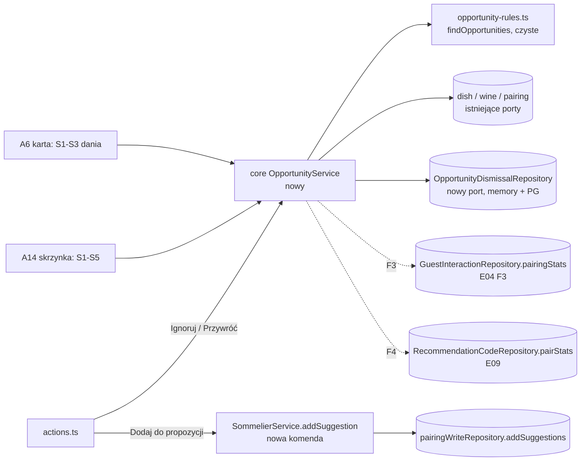
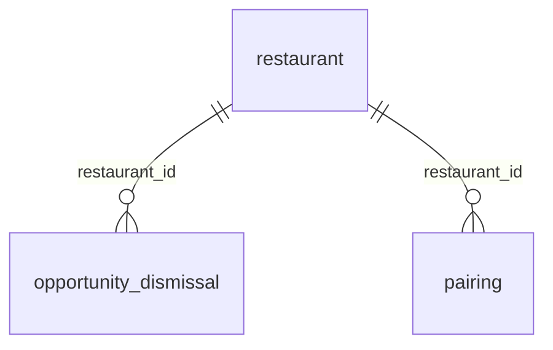

# Okazje w panelu sommeliera (E10)

## 📝 TLDR
Sommelier ma dziś w panelu pary danie–wino (A6), kolejkę propozycji silnika (A7) i na przeglądzie (A1) listę dań bez Primary. Panel nie mówi mu jednak, że:
- wino na kieliszek pasuje do dania lepiej niż obecne pary, a nie ma go wśród 4 propozycji;
- wino z karty nie ma żadnej pary;
- para jest często pokazywana, a rzadko wybierana;
- goście zamawiają z kodem polecenia parę, której nikt nie zatwierdził.

**Proponujemy** „Okazje” (D17): deterministyczne sygnały liczone **przy odczycie**, wyłącznie z danych, które mamy albo będziemy mieć bez POS:
- karta, wynik silnika, role i statusy par, dostępność na kieliszek;
- później zdarzenia użycia E02 (przez E04) i „zamówione” z kodów polecenia E09.

Każda okazja to jedno zdanie z liczbami: „zobacz tutaj”, nie „ja wiem lepiej”. Przy okazji sommelier ma przyciski „Dodaj do propozycji” (komenda `SommelierService` z `actor`; wpis do kolejki A7, gość niczego nie widzi do „Approve” i publikacji) albo „Ignoruj” (okazja wraca najwcześniej po 30 dniach). Okazje pokazujemy na karcie na stronie dania (A6) i w skrzynce „Okazje” (A14). Sell-through z eksportu POS to osobna, późniejsza specyfikacja (wymaga E03 i dopasowania pozycji rachunku do wina). Integracja z POS jest dalej poza MVP (N04).

## Problem
- **Propozycje to tylko 4 najlepsze wina na danie.** `generateSuggestions` (`packages/core/src/engine/suggest.ts`) bierze `perDish = 4` wina z wynikiem ≥ 62 i ignoruje to, jak wino jest podawane. Nowe wina trafiają do propozycji przy imporcie (`ImportService.suggestionsFor`) albo po ręcznym „Generate suggestions” w Setup (`regenerateSuggestions`), ale też tylko wtedy, gdy wejdą do tych 4. Wino na kieliszek z wynikiem 88 na piątym miejscu leży w polu „Add your own pairing” na A6 (lista `addable` posortowana wynikiem, z wynikiem w opisie), ale nic nie mówi sommelierowi, że warto tam zajrzeć. Po `setWineActive(true)` nic nie podpowiada, że wino nie ma par.
- **Luki są rozproszone.** Dania bez Primary wymienia A1 (`overview().primaryCoverage.without`), checklista A11 (`PublishService.preview().withoutPrimary`) i plakietka na A7, ale bez powodu (brak par, brak roli Primary, ukryte wino Primary). Wino Primary ukryte (`active = false`) nie jest wykrywane nigdzie: obie listy sprawdzają tylko rolę pary, a gość traci wtedy Primary po cichu (tier 0 wymaga aktywnego wina) i widzi propozycje silnika. A1 nie pozwala też odłożyć sprawy. A4 pokazuje przy winie liczbę zatwierdzonych par, a A5 ich listę, ale żaden ekran nie zbiera win bez par.
- **Dane o gościach nie wracają do sommeliera.** E04 F3 (`pairingStats`) pokaże tabelę skuteczności par, a E09 (`pairStats`) liczbę zamówień z kodem. Żadna z nich nie wskaże jednak, którą parę warto przejrzeć.
- **D17 (active, 2026-10-16)** wymaga okazji w MVP bez POS: sommelier zatwierdza albo ignoruje (D13: sommelier jest autorytetem, AI jest niewidzialne). Dowód potrzeby jest taki sam jak dla całego produktu: A01 i A04 są `accepted untested` (D09).
- **Co E10 wnosi ponad istniejące listy (przegląd 2026-10-16).** Nie wszystkie sygnały są nowe:

  | Sygnał | Czy lista już istnieje? | Wartość dodana E10 |
  |---|---|---|
  | S1 `none` / `no_primary` | tak: A1, A11, plakietka A7 | powód i „odłóż”; **powtórzenie**, patrz Q18 ⚠ |
  | S1 `primary_hidden` | nie | nowa informacja |
  | S2 | nie | gość z filtrem „na kieliszek” widzi bez etykiety sommeliera same propozycje silnika, a sommelier nie wie, że jego pary nie obejmują kieliszka |
  | S3 | nie | wino bez żadnej pary nie ma dziś żadnej listy |
  | S4, S5 | nie | dane gości (E02/E04) i zamówień z kodem (E09), których A6/A7 nie pokazują |

  **Dla gościa „Dodaj do propozycji” nie zmienia nic**: para `suggested` nie wchodzi do migawki (`publishable` = zatwierdzone i odrzucone), a `recommendForDish` traktuje wino bez zatwierdzonej pary jako tier 2 (propozycja silnika, jeśli `showUnreviewed`) niezależnie od wiersza `suggested`. Zmianę widzi gość dopiero po „Approve” i publikacji. „Dodaj” to wpis do kolejki sommeliera, a nie zmiana oferty.

## Cel i zakres
Zakres:
- read model okazji w `core`, liczony przy odczycie z danych jednej restauracji;
- karta „Okazje” na A6 i skrzynka A14;
- akcje „Dodaj do propozycji”, „Ignoruj” i „Przywróć”;
- tabela zignorowanych okazji.

Pięć sygnałów w czterech fazach MVP:
- F1–F2: karta i silnik (S1–S3);
- F3: użycie (S4);
- F4: kody polecenia (S5).

**Poza zakresem:**
- integracja z POS (N04);
- sell-through z eksportu POS (S6: tylko warunki wejścia w „Fazy”, projekt w osobnej specyfikacji);
- scheduler i obliczanie wsadowe;
- licznik okazji w nawigacji;
- powiadomienia;
- REST API;
- przebudowa A6;
- zmiana reguł, wag i progów silnika (R02);
- automatyczne „Generate suggestions”;
- sygnały i uczenie między restauracjami (D18);
- komponent wyjaśnień (właściciel: E07, tu tylko treść);
- zapis „zamówione” (właściciel: E09, tu tylko odczyt).

## Wymagania
- **R1** `findOpportunities(input)` to czysta funkcja w `core`:
  - te same dane wejściowe dają tę samą listę w tej samej kolejności, także po permutacji tablic wejściowych;
  - kolejność wynika z jawnego klucza sortowania, nie z kolejności wejścia;
  - funkcja nie używa zegara, `Math.random` ani sieci (okno czasowe i wygasanie liczy serwis z `Clock`).
- **R2** Każdy sygnał ma:
  - nazwę `rule`;
  - warunek;
  - progi ze stałych w jednym pliku;
  - jedno zdanie uzasadnienia PL/EN z liczbami (tabela „Definicje sygnałów”).

  `core` zwraca `evidence`, a zdanie buduje aplikacja ze słownika.
- **R3** Okazja może zaproponować tylko danie `published` i wino `active` tej restauracji (wyjątek: S1 `primary_hidden` wymienia ukryte wino jako dowód, nigdy nie proponuje go do dodania). Wszystkie odczyty są zakresowane `restaurantId` (D18). Wynik to bieżący `pairingScore(dish, wine).score`, bez podbijania (R02).
- **R4** Para `rejected` nigdy nie wywołuje okazji „dodaj” ani „zatwierdź” dla tego samego (danie, wino).
- **R5** „Dodaj do propozycji” = `SommelierService.addSuggestion(slug, { dishId, wineId }, actor)`.
  - Komenda tworzy parę `suggested` (rola `null`, `source: 'engine'`, `modelScore` = bieżący wynik, `updatedBy` = `actor.name`) przez `pairingWriteRepository.addSuggestions`, tę samą ścieżkę co import i „Generate suggestions”: `dirty: false`, **bez wpisu historii**, więc nie podbija licznika publikacji (Q14). Historia zaczyna się od „Approve”.
  - Wymaga dania `published`, wina `active` i wyniku `≥ MIN_MODEL_SCORE`.
  - Wynik `recommendForDish` dla gościa się nie zmienia.
- **R6** „Ignoruj” = `OpportunityService.dismiss(slug, key, actor)`:
  - działa tylko dla klucza **kandydata** (warunek spełniony przed filtrem zignorowań), inaczej `opportunity_stale`;
  - robi upsert z `expiresAt = now + DISMISS_DAYS`, a ponowne zignorowanie przedłuża termin (idempotentne).

  „Przywróć” = `restore(slug, key, actor)` usuwa wiersz; gdy go nie ma, zwraca `opportunity_not_dismissed`.
- **R7** Okazje widzi każdy z dostępem do panelu (`requireAccess`). Role bez `pairings.decide` (owner, manager) widzą je bez przycisków. Każda akcja sprawdza `authorizeAction(slug, 'pairings.decide')`. `permissions.ts` bez zmian.
- **R8** A6 i A14 z akcjami działają bez JavaScriptu. Akcje to formularze, wynik wraca jako `?saved=` / `?error=`, z `revalidatePath(..., 'layout')` i `safeBack`.
- **R9** Teksty są w `src/i18n/en.ts` i `pl.ts` (`admin.opportunities.*`, wyjaśnienie „i” w `admin.explain.opportunities` wg konwencji E07). Żaden tekst `admin.opportunities` ani `admin.explain.opportunities` nie zawiera „AI” ani „sztuczna inteligencja”. Nazwa w UI: „Okazja” / „Opportunity”.
- **R10** Każda faza aktualizuje w swoim PR-ze:
  - `docs/RECOMMENDATION_ENGINE.md` (sekcja „Okazje”: sygnały i progi);
  - `docs/SCREEN_SPECIFICATION.md` i `docs/SCREEN_MAP.md` (A6, A14);
  - `docs/DATA_MODEL.md` i `BACKWARD_COMPATIBILITY.md` §3 (tylko F1);
  - `docs/USER_FLOWS.md` i `scripts/smoke.mjs` (tylko F2).

## Resolved assumptions (autonomous defaults)

| # | Pytanie | Przyjęta odpowiedź | Uzasadnienie |
|---|---|---|---|
| Q1 | Jedna spec czy kilka? | Jedna. F1–F2 to rdzeń, F3 i F4 to dopięcia po E04/E09. S6 (POS) to osobna spec. | F3–F4 to po jednej regule na mechanizmie z F1–F2. Gdyby E04/E09 zmieniły kształt odczytu, F3/F4 można wydzielić bez szkody dla F1–F2. |
| Q2 | Liczyć co noc (wsadowo) czy przy odczycie? | **Przy odczycie**, bez tabeli wyników. ✅ rekomendacja zatwierdzona przez właściciela (Filip, 2026-10-16) (Filip mówił „co noc”; rekomendacja: przy odczycie) | Nie ma schedulera (D10: jedna VM, Docker Compose). Odczyt jest deterministyczny i aktualny zaraz po decyzji sommeliera, a okazja nie wisi po zatwierdzeniu pary. Koszt: dania × wina wywołań `pairingScore` (Halka 15 × ~20; czysty CPU) plus F3/F4 po jednym zapytaniu agregującym, ale tylko w A14 (Q3). Przejście na liczenie wsadowe to później zmiana źródła danych w serwisie. |
| Q3 | Gdzie pokazywać? | **A14** `/admin/{slug}/opportunities`: wszystkie okazje, pogrupowane po daniu. **A6**: karta z S1–S3 tego dania (bez zapytań po zdarzeniach) i link „Wszystkie okazje”. Pozycja „Okazje” w nawigacji **bez licznika**. | Wizja „per danie” plus przegląd menu. Każda akcja na A6 wraca na A6, więc agregaty S4/S5 liczone przy każdym renderze A6 byłyby za drogie. Licznik w layoucie liczyłby okazje na każdej stronie panelu. |
| Q4 | Co robi „Dodaj do propozycji”? | Tworzy parę `suggested`. Zatwierdzenie to osobne, istniejące „Approve” (A6/A7). Bez skrótu „zatwierdź od razu”. ✅ rekomendacja zatwierdzona przez właściciela (Filip, 2026-10-16) (rekomendacja: dwa kroki) | „Zobacz tutaj”: sommelier jawnie decyduje i wybiera rolę na A6. Krok jest odwracalny przez „Reject”. Koszt: jedno kliknięcie więcej. |
| Q5 | Jak uniknąć spamu po „Ignoruj”? | Tabela `opportunity_dismissal`, `DISMISS_DAYS = 30`, „Przywróć” w A14. Klucz to **przedmiot** okazji, nie konkretna propozycja (sekcja „Klucz”): zignorowanie S2 dla dania nie odsłania następnego wina. Kolejność: kandydaci → filtr zignorowań → wybór jednego na danie/wino → deduplikacja. | 30 dni to ok. jeden cykl karty i okno E04. Bez klucza przedmiotu „Ignoruj” działałoby jak „pokaż następne”. |
| Q6 | Kto widzi i kto działa? | Widzi każdy z dostępem do panelu; działa tylko `pairings.decide` (sommelier). | Tak samo jak A6/A7; bez zmian w BC §5. |
| Q7 | Sygnały i progi? | S1–S5 z tabeli; `STRONG_MATCH = 85`, `MIN_SHOWN = 30`, `MIN_OTHER_CHOSEN = 5`, `LOW_RATE_FACTOR = 0.5`, `MIN_ORDERS = 5`, okno 28 dni. ✅ rekomendacja zatwierdzona przez właściciela (Filip, 2026-10-16) (kalibracja domenowa; zatwierdza sommelier jako Domain expert, Q06 briefu) | Uzasadnienia przy tabeli. S4 tylko dla pary z rolą Primary (efekt pozycji, patrz „Pozostałe progi”). Szacunek recenzenta dla Halki: ok. 7 okazji S2/S3 przy pierwszym otwarciu (sekcja „Definicje sygnałów”). Zmiana progu = jedna stała + test. |
| Q8 | Czy to reguły silnika? | Nie. Kod w `core/src/services/opportunities/`, testy w `core/tests/opportunities.test.ts`, opis w sekcji „Okazje” w `docs/RECOMMENDATION_ENGINE.md`. | Sygnały nie zmieniają wyniku ani kolejności rekomendacji (R02) i zależą od okien czasowych, a silnik nie może używać dat (AGENTS §7). |
| Q9 | Uproszczenie widoku pary według wizji? | **A6 bez przebudowy.** Blok z wizji („Obecne pary: wino ✓ rola”, potem okazje) to nagłówek grupy dania w A14. ✅ rekomendacja zatwierdzona przez właściciela (Filip, 2026-10-16) (rekomendacja: nie przebudowywać A6 w E10) | A6 ma już role i statusy. E07 też zmienia A6; przebudowa to osobna decyzja UX. |
| Q10 | REST API? | Brak; tylko akcje serwerowe. | Nowa trasa byłaby kontraktem BC §2, a żadne AC jej nie wymaga. |
| Q11 | S4: które pary i co znaczy „wybrana”? | Pary zatwierdzone, wiersze `pairingStats` ze źródłem `sommelier`. „Wybrana” to `wine_selected` (gość pokazał wino kelnerowi), nie zamówienie. | Nazywamy uczciwie to, co mierzy E02. Pary silnika obsługuje A7. |
| Q12 | Który wynik: zapisany `modelScore` czy bieżący? | Bieżący `pairingScore`, jak `addable` na A6. | `modelScore` pochodzi z chwili generowania; profile mogły się od tego czasu zmienić. |
| Q13 | `expectedVersion` i nieaktualne okazje? | `addSuggestion` tworzy nową parę, więc nie ma wersji. Współbieżność pilnuje unikalność (danie, wino): `addSuggestions` pomija istniejącą parę i zwraca 0, wtedy komenda czyta parę ponownie i zgłasza kod wg jej statusu (`already_suggested` / `already_paired` / `already_rejected`). Nieaktualny formularz „Dodaj” nie zapisze niczego niedozwolonego (R5 sprawdza danie, wino i wynik). Gdy warunek przestał obowiązywać, ale para jest poprawna, zapis jest akceptowany. S5 „Zatwierdź” używa istniejącego `approve` z `expectedVersion`. `dismiss` sprawdza kandydata (R6). | Konwencja `write-path-conventions`: komenda async, `DomainError`, autor w historii. |
| Q14 | Ścieżka zapisu nowej propozycji? | `pairingWriteRepository.addSuggestions` (jak import i `regenerateSuggestions`): `dirty: false`, bez wpisu `create` w `sommelier_decision`, `updatedBy` = autor kliknięcia. **Nie** `commit` z wpisem `create`. Przegląd 2026-10-16: wersja z `commit` podbijała `pendingPairingChanges` (liczy `count(distinct pairing_id)` z `sommelier_decision` po ostatniej publikacji), oznaczała parę `dirty` (alert „unpublished changes” na A6), przestawiała krok `publish` w Setup na `publish_pending`, a `publish()` utworzyłby wersję identyczną dla gości z zawyżonym `changesCount`, bo para `suggested` nie wchodzi do migawki. ✅ rekomendacja zatwierdzona przez właściciela (Filip, 2026-10-16) (rekomendacja: `addSuggestions`; koszt: brak wpisu historii „kto dodał do propozycji”, zostaje `updatedBy`; historia zaczyna się od „Approve”, który ma `before.status = suggested`) | Para `suggested` nie jest decyzją publikowalną ani zmianą dla gościa. Zmiana semantyki `pendingPairingChanges` (wyłączenie `create`+`suggested` w obu magazynach i w kontrakcie) byłaby większa i ryzykowna dla BC; `addSuggestions` już istnieje z kontraktem. Skutek uboczny, który zostaje: krok „Review the pairings” w Setup wraca do „do przeglądu” (`review.suggestions > 0`), i słusznie. |
| Q15 | Numer ekranu? | A14 „Okazje” (A13 to import sprzedaży z E03). Przegląd 2026-10-16: żadna z E07–E09 nie zajmuje A14 (E09 Q15/Kontrakty też przyjmuje „A14 = E10”); w panelu nowe ID dodaje tylko E03 (A13) i E10 (A14). | Jedno źródło ID: `docs/SCREEN_MAP.md`. |
| Q16 | Kolejność scalania? | F1 jest niezależna (stałe lokalne, bez importów z E04/E09). F2 idzie po E07 F1b (komponent `PanelExplain` z propem `explainId`; E07 Q12 stawia F1b przed fazami UI E10); jeśli E07 się opóźni, tekst trafia do `CardDescription`, a ikona „i” przychodzi w kroku po E07. F3 po E02 F1–F3 i E04 F3. F4 po E09 F1 (`staffConfirmed`); po E09 F3 `ordered` obejmuje też dopasowania z POS. | Jawna kolejność zamiast konfliktów (AGENTS §8). |
| Q17 | Odrzucona para a „Dodaj”? | `addSuggestion` odrzuca ją (`already_rejected`, przywrócenie przez „Restore”). `addManual` dalej po cichu zatwierdza odrzuconą parę; nie zmieniamy tego. | Okazja nie może cofnąć decyzji sommeliera (R4). Ręczne dodanie to świadoma decyzja. |
| Q18 | S1 `none` / `no_primary` powtarza A1, A11 i A7. Zostawić? | Zostawiamy w F1 (jedna skrzynka, „odłóż”), ale ✅ rekomendacja zatwierdzona przez właściciela (Filip, 2026-10-16) (rekomendacja: po pilocie usunąć `none`/`no_primary`, jeśli sommelier i tak chodzi do A1; `primary_hidden` zostaje, bo nie ma go nigdzie) | Trzy listy tego samego bez powodu to szum; unikalna jest dopiero luka „Primary ukryte”. Koszt zostawienia: jedna reguła i test. |
| Q19 | Po co wracać do skrzynki, skoro nie ma licznika (Q3)? | ✅ rekomendacja zatwierdzona przez właściciela (Filip, 2026-10-16) (rekomendacja: w F2 jedna linia na A1 „Okazje: n” z linkiem do A14, liczona jak `scope: 'dish'` dla całej karty (S1–S3, bez zapytań po zdarzeniach); bez licznika w layoucie) | Skrzynka bez przypomnienia jest otwierana raz. A1 już dziś pokazuje luki (`noPrimary`), a koszt to jedno przeliczenie macierzy dań × win na stronie, która i tak czyta karty. |
| Q20 | „Ignoruj” wraca po 30 dniach. A okazja, którą sommelier uważa za błędną? | ✅ rekomendacja zatwierdzona przez właściciela (Filip, 2026-10-16) (rekomendacja MVP: bez zmian, 30 dni; trwałe „nie” dla pary to odrzucenie jej przez „Dodaj” + „Reject”, bo `rejected` blokuje S2/S3 na stałe (R4). Do rozważenia po pilocie: kolejne zignorowanie tego samego klucza = 90 dni, bez nowej kolumny, bo wygasły wiersz zostaje w tabeli) | Dwa kliknięcia na trwałe „nie” są akceptowalne, dopóki okazji jest kilka. Eskalacja wymaga odczytu wygasłego wiersza (nowa metoda portu), więc nie w F1. |

## Definicje sygnałów

Stałe w `opportunity-rules.ts`: `STRONG_MATCH = 85`, `MIN_SHOWN = 30`, `MIN_OTHER_CHOSEN = 5`, `LOW_RATE_FACTOR = 0.5`, `MIN_ORDERS = 5`, `WINDOW_DAYS = 28`, `DISMISS_DAYS = 30`. Okno to ostatnie 28 pełnych dni (Europe/Warsaw); dla E09 liczone w dniach serwisu (`serviceDay`).

**`STRONG_MATCH = 85`** (`npm run engine:matrix`, Halka, `wm-rules-1.0.0`, sprawdzone 2026-10-16): najlepsze wino na danie ma 81–94, a 5. wino od 50 do 85, więc 85 to mniej więcej „jedno z 2–3 najlepszych win dania”. To 23 pkt nad `MIN_MODEL_SCORE = 62`. Dania, których najlepsze wino ma mniej niż 85 (kaczka 84, boczek 81, sernik 81), celowo nie dają S2/S3, bo słaba para nie jest okazją. Symulacja recenzenta (14 win na kieliszek z 19 aktywnych, 15 dań, 4 propozycje na danie + `SEED_DECISIONS`): S1 = 0, S2 = 3 (przegrzebki, sandacz, sery), S3 = 4 (De Nit Rosé 86, Riesling Kabinett 87, Sancerre 87, Bannockburn Pinot Noir 85, dokładnie na progu), razem ok. 7 okazji przy pierwszym otwarciu. Test „Halka” z kroku 5 ma tę listę zapisać, żeby nie opierać się na szacunku. Zmiana `ENGINE_VERSION` wymaga ponownej kalibracji tego progu (sprawdza to test Halka, krok 5).

„Zatwierdzona” = `approved` | `modified` (`isReviewed`). „Bez decyzji” = brak pary (danie, wino) w jakimkolwiek statusie.

| # | `rule` | Warunek (wszystkie) | Akcja | Zdanie PL / EN |
|---|---|---|---|---|
| S1 | `dish_no_primary` (F1) | danie `published`; brak zatwierdzonej pary `primary` z winem `active`; danie **nie ma** par `suggested` (wtedy prowadzi je A7) | A14: „Otwórz pary”; A6: tylko „Ignoruj” | `none`: „To danie nie ma jeszcze zatwierdzonej pary.” / "This dish has no approved pairing yet." · `no_primary`: „To danie ma zatwierdzone pary, ale żadna nie jest Primary.” / "This dish has approved pairings, but none of them is the Primary." · `primary_hidden`: „Wino Primary tego dania ({wine}) jest ukryte, więc goście go nie widzą.” / "This dish's Primary wine ({wine}) is hidden, so guests don't see it." |
| S2 | `glass_match_unpaired` (F1) | danie `published`; żadna zatwierdzona para dania nie ma wina `active` z `glassPrice ≠ null`; jest wino `active` z `glassPrice ≠ null`, `score ≥ STRONG_MATCH`, bez decyzji dla dania. Jedno na danie: najwyższy wynik, remis → `wine.id` | „Dodaj do propozycji” | „{wine} pasuje do tego dania na {score}%, jest na kieliszek ({price}), a żadna z par tego dania nie jest na kieliszek.” / "{wine} matches this dish at {score}%, is served by the glass ({price}), and none of this dish's pairings is available by the glass." |
| S3 | `wine_unpaired` (F1) | wino `active` bez zatwierdzonej pary z jakimkolwiek daniem `published`; najlepsze danie `published` bez decyzji dla wina ma `score ≥ STRONG_MATCH` (remis → `dish.id`). Jedno na wino | „Dodaj do propozycji” (do tego dania) | „{wine} jest na karcie, ale nie ma żadnej zatwierdzonej pary. Najlepiej pasuje do „{dish}” ({score}%).” / "{wine} is on your list but has no approved pairing. It matches “{dish}” best ({score}%)." |
| S4 | `shown_rarely_chosen` (F3, tylko A14) | para zatwierdzona z rolą `primary`, danie `published`, wino `active`. W oknie: `shown`/`chosen` z wierszy `pairingStats` (źródło `sommelier`) dla (danie, wino), z `shown ≥ MIN_SHOWN`. Pozostałe wina dania: `otherShown`/`otherChosen` = suma wierszy dania (każde źródło) **bez** tej pary, z `otherChosen ≥ MIN_OTHER_CHOSEN`. Warunek: `chosen/shown ≤ LOW_RATE_FACTOR × otherChosen/otherShown` | „Otwórz pary” (kotwica wiersza pary na A6) | „Gdy goście widzieli {wine} przy tym daniu ({shown} razy w ostatnich 28 dniach), wybrali je {chosen} raz(y) ({rate}%); pozostałe wina do tego dania wybierali w {otherRate}% przypadków.” / "When guests saw {wine} with this dish ({shown} times in the last 28 days), they chose it {chosen} time(s) ({rate}%); they chose the other wines for this dish {otherRate}% of the time." |
| S5 | `ordered_not_reviewed` (F4, tylko A14) | danie `published`, wino `active`; wiersz E09 `pairStats` z `context: 'dish'` dla (danie, wino) ma `ordered ≥ MIN_ORDERS` w oknie; para nie jest zatwierdzona ani `rejected` | jest para `suggested` → „Zatwierdź” (`approvePairing`, `pairingId`, `version`); brak pary → „Dodaj do propozycji” | „{wine} zamówiono z kodem polecenia do tego dania {orders} razy w ostatnich 28 dniach, a ta para nie jest zatwierdzona.” / "{wine} was ordered with a recommendation code for this dish {orders} times in the last 28 days, and this pairing isn't approved." |

Jednostka S4: wyświetlenie pary (sesja, danie, wino) według `pairingStats` E04. Liczby mnogie w PL przez lokalny helper `plural()` z `pl.ts`, procenty zaokrąglone do całości, cena przez `formatPrice(amount, locale)` (`app/src/server/i18n.ts`).

**Pozostałe progi:**
- `MIN_SHOWN = 30` to próg „małej próby” z E04 (`MIN_RATE_SAMPLE`). W F3 stała zostaje importowana z E04, w F1 jej nie ma.
- `MIN_OTHER_CHOSEN = 5`: bez kilku wyborów innych win nie ma z czym porównywać. Gdy przy daniu nikt nic nie wybiera, problemem jest danie albo A03, a nie para.
- `LOW_RATE_FACTOR = 0.5`: para musi być wybierana co najmniej dwa razy rzadziej niż pozostałe wina dania.
- **S4 tylko dla Primary:** Primary jest pokazywane pierwsze, więc jest wybierane najczęściej; jeśli mimo to przegrywa z resztą, to sygnał. Dla Alternative i `best_value` niska stawka wynika z pozycji, a S4 zgłaszałby każdą z nich (efekt pozycji nie jest korygowany, `pairingStats` nie niesie pozycji). ⚠ w Q7.
- Przy skali pilota S4 będzie zwykle milczał (potrzeba ≥ 30 pokazań pary i ≥ 5 wyborów innych win w 28 dniach); to zamierzone, nie błąd.
- `MIN_ORDERS = 5` w 28 dniach to więcej niż raz w tygodniu, czyli więcej niż jeden stolik stałych gości.

**Klucz (przedmiot okazji):**

| `rule` | Klucz |
|---|---|
| S1 | `dish_no_primary:{dishId}:{reason}` (inny powód = nowa okazja) |
| S2 | `glass_match_unpaired:{dishId}` |
| S3 | `wine_unpaired:{wineId}` |
| S4, S5 | `{rule}:{dishId}:{wineId}` |

Format zapewnia schemat `opportunity-key.schema.ts` (wyrażenie regularne, identyfikatory `[A-Za-z0-9_-]{1,64}`).

**Kolejność potoku:** kandydaci każdej reguły → odrzucenie kluczy aktywnie zignorowanych → wybór jednego (S2: na danie, S3: na wino) → deduplikacja po (danie, wino), gdzie wygrywa reguła wcześniejsza w porządku S1, S5, S2, S3, S4 → sortowanie. Skutek: zignorowanie S2 nie blokuje S3 dla tego samego wina, bo S3 dotyczy wina, a nie dania (test).

**Sortowanie:**
1. grupy dań: `category` w porządku `Starters`, `Mains`, `Desserts`, potem `name` (`localeCompare` z ustalonym `'pl'`), potem `id`;
2. w grupie: reguła według porządku powyżej, potem `wine.id`.

S3 trafia do grupy dania, do którego pasuje.

## Architektura


Strony parsują wejście, wołają serwis i renderują. Sygnały liczy jedna czysta funkcja, a pary zapisuje `SommelierService`, który już jest ich właścicielem. Zapis pary nie zależy od `OpportunityService`, a serwisy się nie wołają.

**Pliki:**
- `core/src/services/opportunities/opportunity-rules.ts` (nowy):
  - typy `OpportunityRule`, `S1Reason`, `Opportunity { key; rule; dishId: string; wineId: string | null; action: 'add_suggestion' | 'open_dish' | 'approve'; pairingId?; pairingVersion?; evidence }` (S3 ma `dishId` najlepszego dania);
  - stałe, `opportunityKey()`;
  - `findOpportunities({ dishes, wines, pairings, dismissedKeys, pairingStats?, orders? })`.
- `core/src/services/opportunities/opportunity-service.ts` (nowy): `OpportunityService`.
  - Zależności: `Pick<Repositories, 'restaurantRepository' | 'dishRepository' | 'wineRepository' | 'pairingRepository' | 'opportunityDismissalRepository'> & { clock: Clock; idGenerator: IdGenerator }`. F3 dokłada `guestInteractionRepository`, F4 `recommendationCodeRepository` (nazwy z E04/E09).
  - Metody:
    - `list(slug, { dishId?, scope: 'dish' | 'all' }, locale) → OpportunityView | null`. Dania i wina są lokalizowane jak w `AdminService.load` (`localizeDish` / `localizeWine`). Macierz wyników `pairingScore` (danie × wino) liczona **raz na żądanie** do `Map` i współdzielona przez S2/S3 (reguły nie wołają `pairingScore` same). `scope: 'dish'` pomija S4/S5. Wynik: `groups: [{ dish, current: [{ wine, role }] w kolejności gościa (orderReviewed), items }]`, `dismissed: [{ key, rule, dish?, wine?, dismissedBy, expiresAt }]` i `degraded: ('usage' | 'orders')[]`.
    - `dismiss(slug, key, actor)` i `restore(slug, key, actor)`.
- `core/src/validators/opportunities/opportunity-key.schema.ts` (nowy): `strictObject({ key })` z wyrażeniem regularnym klucza.
- `core/src/services/pairings/pairing-rules.ts`: czysta `suggestPairing(existing: Pairing[], { dishId, wineId, modelScore }, ctx): Pairing` (bez `DishPlan`, bo nie powstaje wpis historii). Istniejąca para: zatwierdzona → `already_paired`, `suggested` → `already_suggested`, `rejected` → `already_rejected`. Brak pary → `Pairing { status: 'suggested', role: null, rank: null, comment: null, commentTranslations: {}, source: 'engine', updatedBy: ctx.actor, … , dirty: false }`.
- `core/src/services/pairings/sommelier-service.ts`: `async addSuggestion(slug, { dishId, wineId }, actor)`. Kolejne sprawdzenia:
  1. danie istnieje (`NotFoundError`) i jest `published` (`dish_not_published`);
  2. wino istnieje i jest `active` (`wine_not_available`);
  3. `pairingScore ≥ MIN_MODEL_SCORE` (`low_match`).

  Potem `suggestPairing` i `pairingWriteRepository.addSuggestions(restaurantId, [pairing])`. Wynik 0 (wyścig: parę ktoś utworzył w międzyczasie) → ponowny odczyt `listByDish` i kod według statusu pary.
- `core/src/ports/repositories.ts`, `core/src/domain/types.ts`, `core/src/memory/memory-repositories.ts`, `core/src/testing/repository-contract.ts`, `core/src/index.ts`: port i eksporty.
- `db/src/entities/opportunities/opportunity-dismissal.ts`, `db/src/entities/index.ts` (`ENTITIES`), `db/src/repositories/index.ts` (`PgOpportunityDismissalRepository`), `db/src/mappers.ts`, migracja `Migration<ts>_opportunity_dismissal`.
- `app/src/server/container.ts`: `opportunityService` (scoped) i `opportunityDismissalRepository` w obu gałęziach `DATA_SOURCE`.
- `app/src/app/(admin)/admin/[slug]/actions.ts`: `addOpportunitySuggestion`, `dismissOpportunity`, `restoreOpportunity`, każda przez `act(form, 'pairings.decide', …)`.
- `app/src/app/(admin)/admin/_components/opportunity-list.tsx` (nowy, komponent serwerowy): wiersz z odznaką „Okazja”, zdaniem i przyciskami (bez przycisków dla ról bez `pairings.decide`). Używany na A6 i w A14.
- `app/src/app/(admin)/admin/[slug]/pairings/[dishId]/page.tsx`: karta „Okazje dla tego dania” nad „Approved for guests”, tylko gdy są okazje.
- `app/src/app/(admin)/admin/[slug]/opportunities/page.tsx` (nowy, A14): **poza** `(lists)`, bez `loading.tsx`, żeby działał bez JS (`packages/app/AGENTS.md`), `force-dynamic`; `degraded` → `logger.warn`.
- `app/src/app/(admin)/admin/_components/admin-nav.tsx` (`NavLabels`): pozycja „Okazje” po „Review”.
- `app/src/i18n/en.ts`, `pl.ts`: `admin.opportunities.*`.
- `_components/messages.ts`:
  - `saved`: `suggestion_added`, `opportunity_dismissed`, `opportunity_restored`;
  - `error`: `already_suggested`, `already_rejected`, `dish_not_published`, `low_match`, `opportunity_stale`, `opportunity_not_dismissed`.

## Model danych

Nowa, addytywna tabela `opportunity_dismissal` (BC §3); istniejące tabele bez zmian. Para z „Dodaj do propozycji” to zwykły wiersz `pairing` o statusie `suggested` (bez wpisu `sommelier_decision`, Q14).

| Kolumna | Typ | Uwagi |
|---|---|---|
| `id` | uuid PK | `IdGenerator` |
| `restaurant_id` | uuid FK → `restaurant`, not null | zakres tenanta |
| `opportunity_key` | text not null | **unique (`restaurant_id`, `opportunity_key`)** |
| `rule` | text not null | `CHECK` na pięć nazw S1–S5 już w F1 (F3/F4 bez migracji) |
| `dish_id`, `wine_id` | uuid null, **bez FK** | do listy „Zignorowane”; wiersz przeżywa miękkie usunięcie dania i wina (jak historia decyzji) |
| `dismissed_by` | text not null | `actor.name` |
| `dismissed_by_id` | uuid null | `actor.id` |
| `dismissed_at`, `expires_at` | timestamptz not null | `expires_at = dismissed_at + DISMISS_DAYS` |



```ts
// core/src/domain/types.ts
export interface OpportunityDismissal { id: string; key: string; rule: OpportunityRule; dishId: string | null; wineId: string | null; dismissedBy: string; dismissedById: string | null; dismissedAt: string; expiresAt: string }
// core/src/ports/repositories.ts
export interface OpportunityDismissalRepository {
  /** dismissals with expiresAt > now */
  listActive(restaurantId: string, now: Date): Promise<OpportunityDismissal[]>;
  /** insert, or on (restaurantId, key) replace dismissedBy/At and expiresAt (id kept) */
  upsert(restaurantId: string, d: OpportunityDismissal): Promise<void>;
  /** true when a row was removed */
  remove(restaurantId: string, key: string): Promise<boolean>;
}
```
PostgreSQL: `insert … on conflict (restaurant_id, opportunity_key) do update`. Pamięć: `Map` per restauracja (klucz od klienta tylko w `Map`, zgodnie z lekcją `client-chosen-keys`). Migracja `down` to `drop table`: zignorowania nie są danymi biznesowymi, więc po wycofaniu okazje po prostu wrócą.

**Odczyty z innych specyfikacji (tylko czytamy):**
- F3: `GuestInteractionRepository.pairingStats(restaurantId, range)` z E04 F3, zwraca `{ dishId, wineId, source, shown, chosen }[]`.
- F4: `RecommendationCodeRepository.pairStats(restaurantId, { from, to })` z E09 (R12, Q12), zwraca `{ dishId, wineId, context, ordered, … }[]`. Bierzemy tylko wiersze `context: 'dish'` i `orders = ordered`. Przed E09 F3 pole `ordered` = `staffConfirmed`.

## API Contracts
Brak tras HTTP. Akcje serwerowe (formularze, działają bez JS):

| Akcja | Pola | Uprawnienie | Serwis | Wynik |
|---|---|---|---|---|
| `addOpportunitySuggestion` | `slug`, `back`, `dishId`, `wineId` | `pairings.decide` | `sommelierService.addSuggestion` | `?saved=suggestion_added` |
| `dismissOpportunity` | `slug`, `back`, `key` | `pairings.decide` | `opportunityService.dismiss` | `?saved=opportunity_dismissed` |
| `restoreOpportunity` | `slug`, `back`, `key` | `pairings.decide` | `opportunityService.restore` | `?saved=opportunity_restored` |
| (S5) `approvePairing` | istniejące `pairingId`, `version` | `pairings.decide` | `sommelierService.approve` (`expectedVersion`) | `?saved=approved` |

Nowe kody `DomainError`:

| Kod | Klasa | Komunikat |
|---|---|---|
| `already_suggested` | `ValidationError` | „To wino jest już w propozycjach tego dania.” |
| `already_rejected` | `ValidationError` | „Ta para została odrzucona — przywróć ją w sekcji Rejected.” |
| `dish_not_published` | `ValidationError` | „To danie nie jest widoczne dla gości.” |
| `low_match` | `ValidationError` | „To wino słabo pasuje do dania.” |
| `opportunity_stale` | `ValidationError` | „Ta okazja jest już nieaktualna.” |
| `opportunity_not_dismissed` | `NotFoundError` | „Ta okazja nie jest zignorowana.” |

## UI/UX
- **A6:** karta „Okazje dla tego dania” z ikoną „i” (`PanelExplain` z E07, `explainId`; tekst E10 pod kluczem `admin.explain.opportunities`, ten sam co na A14) i linkiem „Wszystkie okazje” (A14).
  - Pokazuje S1–S3 tego dania: najwyżej po jednym S1 i S2 oraz S3 każdego wina, które najlepiej pasuje do tego dania.
  - Wiersz: odznaka „Okazja”, zdanie, „Dodaj do propozycji” i „Ignoruj”.
  - Po „Dodaj” wino trafia do „Engine suggestions” na tej samej stronie (flash „Dodano do propozycji — zatwierdź je poniżej; goście zobaczą zmianę dopiero po zatwierdzeniu i publikacji.”).
  - Gdy nie ma okazji, karty nie ma.
- **A14 `/admin/{slug}/opportunities`:**
  - `PageHeader` „Okazje” z ikoną „i”.
  - Grupa dania (blok z wizji): nazwa, „Otwórz pary”, „Obecne pary” (wino + `RoleBadge` w kolejności gościa; „brak”, gdy pusto), potem okazje.
  - Pusty stan `EmptyState`: „Nic do sprawdzenia.”
  - `<details>` „Zignorowane ({n})”: autor, data powrotu, „Przywróć”.
  - Gdy `degraded` jest niepuste: uwaga „Część okazji jest chwilowo niedostępna.”
- **A1 (Q19 ⚠, rekomendacja):** jedna linia „Okazje: n” z linkiem do A14 (S1–S3 całej karty); bez licznika w nawigacji.
- **Tekst „i”** (liczba dni z `DISMISS_DAYS`, nie wpisana ręcznie; E07 R3: jedno „i” na kartę, nigdy w `<a>` ani `<button>`):
  - PL: „Okazje to podpowiedzi, gdzie warto zajrzeć. Liczymy je z Twojej karty i ocen dopasowania, a gdy są dane — z wyborów gości i zamówień z kodem polecenia, tylko w tej restauracji. Nic się nie zmienia bez Twojej decyzji; zignorowana okazja wraca najwcześniej po 30 dniach.”
  - EN: "Opportunities point to places worth a look. We find them in your wine list and match scores and, once there is data, in guests' choices and orders with a recommendation code — from this restaurant only. Nothing changes without your decision; an ignored opportunity comes back after 30 days at the earliest."
- Role bez `pairings.decide`: te same widoki bez przycisków, z `ReadOnlyNotice`.
- 390 px i 1440 px bez poziomego przewijania (`min-w-0` w wierszach).

## Przypadki brzegowe
| Sytuacja | Zachowanie |
|---|---|
| Nowa restauracja po imporcie (wszystkie dania mają `suggested`) | S1 milczy, bo dania prowadzi A7. S2/S3 pojawiają się tylko dla win spoza 4 propozycji na danie. |
| Primary ma ukryte wino | S1 `primary_hidden`. Ukryte wino nie jest proponowane (R3). |
| Danie `draft`/`hidden`, wino nieaktywne lub usunięte | Żadne z nich nie jest proponowane. Formularz „Dodaj” z takim stanem → `dish_not_published` / `wine_not_available`. |
| Zignorowane S2 dla dania | Nie wraca z innym winem przez 30 dni. S3 dla tego samego wina może się pokazać (inny przedmiot). |
| S1 zignorowane z powodem `none`, potem powód `primary_hidden` | Nowa okazja (inny klucz). |
| Dwóch sommelierów klika „Dodaj” naraz | Pierwszy tworzy parę, drugi dostaje `already_suggested` (`addSuggestions` zwraca 0, komenda czyta parę ponownie). |
| „Dodaj do propozycji”, potem publikacja bez „Approve” | Nic do opublikowania z tego powodu: para nie podbija licznika ani nie ma `dirty` (Q14). |
| Dwukrotne „Ignoruj” (odświeżenie, dwóch użytkowników) | Drugie przedłuża termin, bez błędu. |
| Nieaktualny lub spreparowany klucz (także cudzej restauracji) | Schemat → `ValidationError`; nie jest kandydatem → `opportunity_stale`; nic nie zostaje zapisane. |
| Zignorowanie wygasło, a warunek nadal obowiązuje | Okazja wraca. |
| F3/F4: brak danych albo mała próba | S4/S5 milczą (progi). |
| `pairingStats` / `pairStats` rzuca wyjątek | `list` działa dalej: pomija S4/S5 i zwraca `degraded`. Strona loguje `logger.warn` i pokazuje uwagę, S1–S3 są widoczne. |
| `showUnreviewed = false` | Zdania S1 są neutralne (nie mówią, co widzi gość poza ukrytym Primary). |
| `DATA_SOURCE=memory` | Zignorowania żyją w pamięci i giną po restarcie. |

## Ryzyka i otwarte pytania
- **Kalibracja (Q7 ⚠):** bez pilota progi mogą dać za dużo albo za mało okazji. Test „Halka” zapisuje listę dla danych demo do oceny sommeliera.
- **Klucz przedmiotu:** stały klucz i 30 dni mogą ukryć okazję, która istotnie się zmieniła (np. wynik z 86 na 94). W MVP to akceptujemy. Odcisk dowodów w kluczu można dodać później, addytywnie.
- **Brak historii „Dodaj” (Q14 ⚠):** audyt „kto dodał do propozycji” zostaje tylko jako `updatedBy`; historia zaczyna się od „Approve”.
- **E07:** bez komponentu „i” w panelu F2 pokazuje tekst w opisie karty (Q16).
- **E02/E04:** S4 wymaga `items[].tier` (E02) i `pairingStats` (E04 F3, approved, niezaimplementowane). Zmiana kształtu odczytu oznacza zmianę F3.
- **E09:** S5 czyta `pairStats` (`context: 'dish'`, `ordered`).
  - Oznaczanie „zamówione” przez kelnera jest publiczne i można je zawyżyć (E09 Q8). S5 tylko podpowiada i nic nie zmienia bez decyzji, więc ryzyko jest niskie.
  - Kod nie dowodzi przyczynowości (E09 Q12), dlatego zdanie mówi „zamówiono z kodem”, a nie „sprzedano dzięki”.
- **ID ekranu (Q15):** A14 bez kolizji. Poza E10 rozstrzygnięte w przeglądzie spójności 2026-10-16: G11 = ekran kelnera `/staff/table` (E08), G12 = „Jak dobieramy wino” (E07).
- **Wydajność:** A6 i A1 liczą macierz dania × wina (S3) przy każdym renderze, bez zapytań agregujących (Halka 15 × 19 ≈ 285 wywołań `pairingScore`). Macierz liczona raz na żądanie; test z ustalonym budżetem czasu (np. 100 dań × 500 win), dopiero powyżej cache albo liczenie wsadowe (osobna spec). A14 (S4/S5) robi 2 zapytania agregujące na render i nie ma `loading.tsx` (bez JS), więc czeka na nie; `degraded` obsługuje błąd, ale nie powolność.
- **Prywatność / D18:** nowa tabela nie ma danych osobowych poza nazwą autora (jak historia decyzji). Każde zapytanie ma zakres `restaurantId`, co sprawdza kontrakt.
- **Wycofanie:** usuwamy kartę, pozycję w nawigacji i A14. Tabela zostaje albo idzie `down` bez strat. Pary dodane z okazji to zwykłe pary z historią.

### Przegląd krzyżowy 2026-10-16
Niezależny przegląd (kod `core` i `app`, E02–E04, E07–E09, lekcje, symulacja na danych Halki). „Naprawione” = poprawione w tej specyfikacji, ⚠ = decyzja właściciela w Resolved assumptions.

- **High: Q14 był błędem projektu, nie akceptowalnym skutkiem ubocznym.** „Dodaj do propozycji” przez `commit` z wpisem `create` podbijał `pendingPairingChanges`, ustawiał `dirty` (alert na A6) i `publish_pending` w Setup, choć para `suggested` nie wchodzi do migawki (`publishable` = zatwierdzone i odrzucone), więc `publish()` dałby wersję identyczną dla gościa. Para `suggested` nie wpływa na gościa także przy `showUnreviewed` (`recommendForDish` daje tier 2 niezależnie od wiersza). Naprawione: `addSuggestions` (R5, Q13, Q14, AC3, testy); ⚠ Q14 (koszt: brak wpisu historii).
- **High: S1 `none` / `no_primary` powtarza A1, A11 i plakietkę A7.** Realnie nowe są S2, S3, S4, S5 i `primary_hidden` (nie wykrywa go żadna lista). Naprawione: tabela „Co E10 wnosi” w Problem; ⚠ Q18.
- **Medium: skrzynka bez licznika jest otwierana raz.** Q3 odrzuca licznik w nawigacji, ale nic nie ściąga sommeliera z powrotem. ⚠ Q19 (linia na A1).
- **Medium: S4 zgłaszałby każdą Alternative (efekt pozycji).** Primary jest pokazywane pierwsze; porównanie niższych slotów z resztą jest z góry niekorzystne, a `pairingStats` nie niesie pozycji. Naprawione: S4 tylko dla Primary (AC11, testy); ⚠ w Q7.
- **Medium: fałszywe twierdzenie kalibracyjne.** „5 najlepszych win mieści się w 81–94” nie zgadza się z `engine:matrix` (81–94 to najlepsze wino na danie; 5. wino od 50 do 85); sernik (81) też jest poniżej progu. Naprawione, dodana symulacja Halki (≈ 7 okazji, 3 × S2 i 4 × S3).
- **Medium: AC8/E2E bez JS sprawdzało A7.** A7 leży w `(lists)` z `loading.tsx` (wymaga JS, lekcja `nextjs-loading-streams-and-http-status`). Naprawione: A6 bez JS, A7 z JS. Dodana uwaga, że dane demo nie mają dania spełniającego S1 bez przygotowania.
- **Medium: kontrakt E07.** Komponent to `PanelExplain` (`explainId`), klucze `admin.explain.opportunities`, zależność od E07 F1b; liczba dni w tekście „i” z `DISMISS_DAYS`. Naprawione (R9, Q16, UI).
- **Low: nieprawdziwe sformułowania o kodzie.** „Add your own pairing” na A6 jest już posortowane wynikiem; liczbę par pokazuje A4 (lista win), nie A5; `plural()` to lokalny helper `pl.ts`, `formatPrice` leży w `app/src/server/i18n.ts`. Naprawione.
- **Low: nie ma trwałego „nie”.** Wino bez pary nie ma wiersza do odrzucenia, więc „na stałe” to „Dodaj” + „Reject”; „Ignoruj” wraca po 30 dniach. ⚠ Q20.
- **Low: wydajność.** Macierz `pairingScore` ma być liczona raz na żądanie; A14 nie ma `loading.tsx` i czeka na 2 agregaty. Naprawione (Architektura, Ryzyka: Wydajność).
- **Low: spójność ID z E07–E09.** A14 bez kolizji (Q15). Rozbieżne G10/G11 między E07, E08 i E09 — rozstrzygnięte w przeglądzie spójności (G11 = E08, G12 = E07).
- **Bez zastrzeżeń (sprawdzone w kodzie):** `generateSuggestions` (`perDish = 4`, `MIN_MODEL_SCORE = 62`), `ImportService.suggestionsFor` / `regenerateSuggestions`, `overview().primaryCoverage.without`, `AdminService.load` + `localize*`, `act()` / `safeBack` / `revalidatePath(..., 'layout')`, `pairings.decide` (tylko sommelier), `duplicate_pairing` w `assertInvariants`, `ENGINE_VERSION = 'wm-rules-1.0.0'`, kontrakty `pairingStats` (E04) i `pairStats` (`context: 'dish'`, `ordered`, okno w dniach serwisu; E09 R12/Q12).

## Decyzje w grze
Spec opiera się na:
- D17 (realizowane);
- D13/N02 (bez „AI”, sommelier decyduje);
- D14 (treść „i”; komponent z E07);
- D16 (S5 czyta E09);
- D18 (zakres restauracji);
- N04 (bez POS; S6 osobno);
- R01/R02 (etykieta i wynik bez zmian, okazja nie zmienia statusu pary bez decyzji);
- R04 (tylko aktywne wina).

Nie proponujemy zastąpienia żadnej decyzji. Rozbieżność z „co noc” (Q2) zatwierdza właściciel. Zależność od przeglądu: Q14, Q18–Q20.

## Fazy i zależności
- **F1, rdzeń bez UI:**
  - reguły S1–S3, `OpportunityService`;
  - port, pamięć, PostgreSQL, migracja;
  - `addSuggestion`, rejestracja w kontenerze;
  - docs.

  Niezależna od innych specyfikacji.
- **F2, A6 i A14:** akcje, komponent, strony, nawigacja, i18n, smoke, E2E, docs. Po F1; komponent „i” z E07 to zależność miękka (Q16).
- **F3, S4 z użycia:** po E02 F1–F3 i E04 F3.
- **F4, S5 z kodów polecenia:** po E09 F1.
- **F5 (warunkowa, osobna spec), S6, sell-through z eksportu POS.**
  - Warunki wejścia: (a) E03 wdrożone; (b) osobna spec dodała dopasowanie pozycji rachunku do `wine_id` (E03 Q10, dziś „nie”); (c) pilot wgrał ≥ 28 dni sprzedaży.
  - Zarys: wino na kieliszek z `score ≥ STRONG_MATCH` i niską sprzedażą w porównaniu z innymi winami na kieliszek w tym samym oknie.
  - Integracja z POS nadal poza MVP (N04).

## Plan implementacji

### Faza 1 — rdzeń (PR 1)
1. **Reguły.** `opportunity-rules.ts`: typy, stałe, klucze, potok (kandydaci → filtr → wybór → deduplikacja → sortowanie) dla S1–S3. Testy w `core/tests/opportunities.test.ts`:
   - każdy sygnał: warunek spełniony oraz każdy warunek z osobna niespełniony;
   - granica progu 84 / 85;
   - `rejected` blokuje S2/S3;
   - S1 milczy przy parach `suggested`; trzy powody S1;
   - jedno S2 na danie; zignorowane S2 nie odsłania kolejnego wina, ale S3 tego wina się pokazuje;
   - permutacja dań, win i par daje identyczny wynik.
2. **Port zignorowań.** Typy, port, `MemoryStore`, przypadki w `repository-contract.ts`:
   - upsert przedłuża termin i zachowuje `id`;
   - `listActive` pomija wygasłe (`expiresAt == now` liczy się jako wygasłe);
   - `remove` zwraca `false`, gdy wiersza nie ma;
   - inna restauracja → pusto.
3. **PostgreSQL.** Encja (`defineEntity`), migracja (`npm run db:migration:create`; przegląd: unique, `CHECK`), repozytorium z `on conflict`. Sprawdzenie: `npm run test:db`, `schema:check`.
4. **`addSuggestion`.** `suggestPairing` w `pairing-rules.ts` i metoda w `SommelierService`. Testy w `core/tests/sommelier-service.test.ts`:
   - tworzy parę `suggested`, `source: 'engine'`, z bieżącym wynikiem i `updatedBy` = `actor.name`; bez wpisu historii, `pendingPairingChanges` i `dirty` bez zmian (kontrakt, memory i PostgreSQL);
   - błędy `already_paired`, `already_suggested`, `already_rejected`, `dish_not_published`, `wine_not_available`, `low_match`, `NotFoundError`, zawsze jako odrzucona obietnica;
   - wyścig (`addSuggestions` zwraca 0) → kod według statusu istniejącej pary (memory i PostgreSQL);
   - `recommendForDish` z nową parą i bez niej daje ten sam wynik.
5. **Serwis.** `OpportunityService.list/dismiss/restore` i schemat klucza. Testy ze stałym zegarem:
   - filtr zignorowań;
   - `dismiss` zignorowanego kandydata przedłuża termin;
   - `opportunity_stale` dla nie-kandydata i dla klucza cudzej restauracji;
   - `restore` bez wiersza → `opportunity_not_dismissed`;
   - `current` w kolejności gościa;
   - `scope: 'dish'`.

   Test „Halka”: oczekiwana lista okazji dla danych demo; w opisie PR-a jej przegląd oczami sommeliera.
6. **Kompozycja i docs.** `container.ts` (obie gałęzie), `index.ts`; `RECOMMENDATION_ENGINE.md` (sekcja „Okazje”), `DATA_MODEL.md`, BC §3 (tabela). Bramka: `lint`, `check:boundaries`, `typecheck`, `test`, `test:db`, `build`.

### Faza 2 — ekrany (PR 2)
7. **Teksty.** `en.ts`/`pl.ts`: zdania S1–S5, tekst „i”, przyciski, pusty stan, uwaga `degraded`, komunikaty. Testy w `app/tests/unit/admin-i18n.test.ts`: klucze PL i EN są zgodne, żaden tekst `admin.opportunities` nie pasuje do `/\bAI\b|sztuczn/i`.
8. **Akcje.** Trzy akcje w `actions.ts`. Testy w `app/tests/unit/actions.test.ts`:
   - `manager` → odmowa bez zapisu;
   - sommelier → zapis, `revalidatePath(..., 'layout')`, przekierowanie przez `safeBack`;
   - `opportunity_stale` → `?error=`.
9. **Komponent i A6.** `opportunity-list.tsx` i karta na A6 (`scope: 'dish'`).
10. **A14 i nawigacja.** Strona poza `(lists)`, `AdminNav`, `scripts/smoke.mjs` (`/admin/halka/opportunities` → 200 i tytuł).
    - E2E (`app/tests/e2e`, PostgreSQL, **bez JS**):
      - sommelier odrzuca Primary dania bez par `suggested` (danie wybrane w teście z danych demo) → S1 na A6 i w A14;
      - „Ignoruj” → okazja w „Zignorowane” → „Przywróć” → okazja wraca;
      - okazja S2 albo S3 → „Dodaj do propozycji” → wino w „Engine suggestions” na A6 (bez JS), licznik „unpublished” bez zmian → „Approve”; A7 sprawdzamy z JS (leży w `(lists)` z `loading.tsx`, lekcja `nextjs-loading-streams-and-http-status`);
      - `manager` widzi okazje bez przycisków.
    - Dane demo: każde danie ma pary `suggested` albo Primary, więc scenariusz S1 wymaga przygotowania (zatwierdzenie/odrzucenie pozostałych propozycji dania w teście), inaczej S1 milczy.
    - Ekrany 390 / 1440 px.
    - Docs: `SCREEN_SPECIFICATION.md` (A6, A14), `SCREEN_MAP.md`, `USER_FLOWS.md`.
    - Bramka jak w kroku 6 + `smoke` w `memory` i `postgres`.

### Faza 3 — S4 (PR 3)
11. `pairingStats` w serwisie (okno E04, tylko `scope: 'all'`), reguła S4, `degraded`, tekst. Testy na `seedUsageEvents` (E02):
    - progi `shown` 29 / 30 i `otherChosen` 4 / 5;
    - stawka dokładnie na granicy `0.5 ×` wywołuje okazję;
    - para wyłączona z liczb „pozostałych” wyborów;
    - liczą się tylko wiersze `sommelier`; para Alternative/`best_value` nie wywołuje S4;
    - błąd odczytu → `degraded: ['usage']`.

    Docs.

### Faza 4 — S5 (PR 4)
12. `pairStats` z E09 (`context: 'dish'`, `ordered`), reguła S5 z akcją `approve` (wersja pary) albo `add_suggestion`. Testy:
    - próg 4 / 5;
    - pomijane pary `rejected` i zatwierdzone;
    - pomijane wiersze `table`;
    - nieaktualna wersja przy „Zatwierdź” → `VersionConflictError`;
    - błąd odczytu → `degraded: ['orders']`.

    E2E: S5 → „Zatwierdź”. Docs.

## Kryteria akceptacji
- [ ] AC1 (F1, R1) `findOpportunities` daje identyczną listę po permutacji tablic wejściowych. `check:boundaries` przechodzi. *Testy `opportunities.test.ts`.*
- [ ] AC2 (F1, R2–R4) S1–S3 wywołują się dokładnie przy warunkach z tabeli:
  - wynik 84 nie wywołuje S2/S3, a 85 wywołuje;
  - para `rejected` blokuje S2/S3;
  - ukryte wino nigdy nie jest proponowane.

  *Testy jednostkowe.*
- [ ] AC3 (F1, R5) `addSuggestion` tworzy parę `suggested` (`dirty: false`, `updatedBy` = autor, bez wpisu historii); `pendingPairingChanges` i `hasUnpublishedChanges` bez zmian. Niedozwolone stany kończą się kodami z tabeli błędów. `recommendForDish` daje ten sam wynik z nową parą i bez niej. *Testy serwisu i silnika, kontrakt zapisu.*
- [ ] AC4 (F1, R6) Zignorowana okazja nie wraca przed `expiresAt`, a po nim wraca, jeśli warunek nadal obowiązuje. Ponowne „Ignoruj” przedłuża termin. `restore` przywraca okazję od razu. Klucz, który nie jest kandydatem → `opportunity_stale` bez zapisu. Zignorowanie S2 nie odsłania kolejnego wina. *Test serwisu (stały zegar) + kontrakt (memory, PostgreSQL).*
- [ ] AC5 (F1, D18) Zignorowania i okazje innej restauracji są niewidoczne i nie dają się zignorować. *Kontrakt + test serwisu.*
- [ ] AC6 (F1) Migracja `up` / `down` przechodzi, `schema:check` jest zgodny. *`npm run test:db`.*
- [ ] AC7 (F2, R7) `manager` widzi A14 i kartę na A6 bez przycisków. Sfałszowany formularz `manager` do każdej z trzech akcji kończy się odmową bez zapisu. *Test akcji + E2E.*
- [ ] AC8 (F2, R8) „Dodaj do propozycji” (A6, A14), „Ignoruj” i „Przywróć” działają bez JavaScriptu. Nowa propozycja jest widoczna na A6 (E2E bez JS) i w A7 (E2E z JS, bo A7 jest w `(lists)`). *E2E.*
- [ ] AC9 (F2, R9) Teksty okazji (PL i EN) nie zawierają „AI”, a klucze PL i EN są zgodne. *Test słowników.*
- [ ] AC10 (F2) `/admin/halka/opportunities` → 200 z tytułem w trybach `memory` i `postgres`. Przy 390 i 1440 px nie ma poziomego przewijania. *`npm run smoke` + przegląd ekranów.*
- [ ] AC11 (F3) S4 wywołuje się tylko dla pary Primary, przy `shown ≥ 30`, `otherChosen ≥ 5` i stawce `≤ 0.5 ×` stawki pozostałych win dania, tylko dla wierszy sommeliera. Błąd odczytu nie psuje A14. *Testy na `seedUsageEvents`.*
- [ ] AC12 (F4) S5 wywołuje się od 5 zamówień w wierszach `context: 'dish'`. „Zatwierdź” używa `expectedVersion`, a nieaktualna wersja daje konflikt. *Testy + E2E.*

Dokumentacja (R10) jest pozycją checklisty PR (CODE_REVIEW §3), a nie AC.

## Changelog
- 2026-10-16: draft (`om-spec-writing --autonomous`); decyzje ⚠: Q2, Q4, Q7, Q9, Q14.
- 2026-10-16: przegląd krzyżowy (patrz „Przegląd krzyżowy 2026-10-16”): Q14 przepisane na `addSuggestions`, S4 tylko Primary, poprawione twierdzenia o Halce i A4/A5, kontrakt E07, AC8; nowe ⚠: Q18, Q19, Q20.
- 2026-10-16: przegląd niezależnego agenta (staff), przyjęte 15 z 15 ustaleń:
  - Problem poprawiony o `regenerateSuggestions` i listę A1 `noPrimary`;
  - Q14 jako jawna decyzja ⚠ ze skutkami ubocznymi;
  - sortowanie po jawnym kluczu (R1);
  - wyjątek `primary_hidden` w R3;
  - klucz przedmiotu i kolejność potoku zignorowań;
  - A14 poza `(lists)` (bez JS);
  - S5 na `pairStats` E09 (`context: 'dish'`, `ordered`, „zamówiono z kodem”) z ryzykiem zawyżenia;
  - S4 liczy „pozostałe wina” bez danej pary, zdania PL i EN ujednolicone;
  - neutralne zdanie S1 `none`;
  - `addSuggestion` sprawdza danie `published` i `MIN_MODEL_SCORE`;
  - idempotentne `dismiss`;
  - S4/S5 tylko w A14 (koszt A6);
  - F1 bez importów z E04;
  - poprawki typów, schematu i komunikatów;
  - Q17 (odrzucona para);
  - rekalibracja przy zmianie `ENGINE_VERSION`.

## Zatwierdzenie
Filip (product owner) 2026-10-16: „Akceptuję rekomendacje we wszystkich decyzjach ⚠” — każda pozycja ⚠ w tej specyfikacji (tabela i Ryzyka) przyjęta zgodnie z rekomendacją.

## Realizacja
