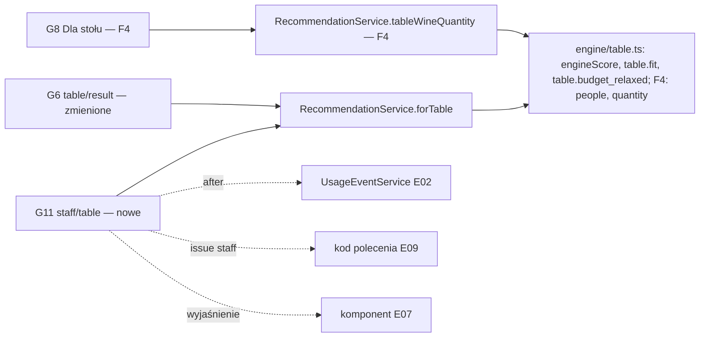

# „Cały stół”: funkcja wyróżniająca i ścieżka kelnera (E08)

## 📝 TLDR
Silnik już liczy jedną butelkę do kilku dań (`recommendForTable`), ale korzysta z tego tylko gość, który sam zeskanuje QR i znajdzie mało widoczny przycisk na G0; kelner ma wyłącznie wyszukiwanie dla jednego dania (G9). **Proponujemy** (zachowanie przyszłe): (1) nowy ekran kelnera **G11 `/r/{slug}/staff/table`** — duże pola wyboru dań, jeden przycisk, odpowiedź w jednym zdaniu: *„Ta butelka: nr 109, Radikon Slatnik. Pasuje do 5 z 6 dań, słabiej do: Comber z jelenia.”* i alternatywy, bez JavaScriptu; (2) nowe reguły silnika — **dopasowanie „n z m”** liczone z surowego wyniku silnika (bez premii sommeliera) i **luzowanie budżetu** stołu jak przy jednym daniu; (3) mocniejsze wejście do „Całego stołu” na G0 i uczciwe wyniki per danie na G6; (4) osobna, bramkowana faza: **ilość dla liczby osób** (*„Dla 6 osób: 3 butelki · 960 zł”*). „Butelka stołu” przypinana przez sommeliera — **odłożona** (szkic na końcu). Powód: D15 — przy stoliku na kilka osób QR zwykle nikt nie skanuje, a kelner jest przy stole w chwili decyzji.

## 📝 Problem
- **Kelner nie ma narzędzia stołu.** Formularz stołu (G5) istnieje, ale jest ścieżką gościa: nie linkuje go ani G9, ani link „Dla obsługi” z G0, wynik G6 nie ma numeru z karty win ani zdania do powiedzenia, a jego wizyty liczyłyby się jako sesje gości (E02). G9 (`packages/app/src/app/(guest)/r/[slug]/staff/page.tsx`) to `<select>` jednego dania i lista win. Dla 4 dań kelner musiałby zrobić 4 wyszukiwania i sam wymyślić kompromis — dokładnie to, co robi `recommendForTable`. D15 (Filip, 2026-10-16): *„Kelner wybiera na telefonie 4 dania i w 5 sekund ma odpowiedź”* (rozmowa z właścicielem; zdania nie ma w briefie — wiersz D15 mówi tylko o „ścieżce kelnera”). „5 sekund” czytamy jako **5 dotknięć bez czekania na JS**, nie jako zmierzony czas: wyszukanie dań na karcie i rozmowa ze stołem zajmują więcej (Q16).
- **Wynik stołu nie mówi tego, co mówi kelner.** G6 (`table/result/page.tsx`) pokazuje paski per danie i `why` z `tableWhy` (`packages/core/src/engine/table.ts`), które nazywa tylko jedno najsłabsze danie; nie ma „pasuje do 3 z 4”.
- **Procent per danie na G6 jest podbity.** `perDish.score` zawiera +3 za parę zatwierdzoną (`table.ts`, pętla `perDish`) i jest wyświetlany wprost — wbrew R02 i AGENTS §7 („Wyświetlany Match Score to zawsze wynik silnika, bez podbijania”). E07 (Q4) przekazuje tę naprawę tutaj.
- **Budżet stołu kończy się pustym ekranem.** `recommendForTable` filtruje budżet twardo i — inaczej niż `recommendForDish` (`docs/RECOMMENDATION_ENGINE.md` §6) — nie luzuje go: „czerwone do 200 zł” w Halce (jedna z opcji formularza; najtańsza czerwona butelka kosztuje 275 zł) albo „do 150 zł” z adresu (najtańsza butelka 165 zł) daje „No bottle fits these filters” (sprawdzone na danych demo). Przy stole z kelnerem pusty ekran to koniec rozmowy.
- **Brak odpowiedzi na „ile?”.** Stół 6 osób pyta o liczbę butelek; wynik podaje cenę jednej.
- **Słabe wejście u gościa.** Na G0 „Pair a bottle for the table” to `Button variant="ghost"` w nagłówku restauracji (`r/[slug]/page.tsx`), a D15 nazywa „Cały stół” funkcją wyróżniającą.
- Dowody: decyzja właściciela (D15) i założenie A03 (`accepted untested`); brak obserwacji przy stolikach (C02). Zdarzenia E02 i nowe zdarzenia stąd zmierzą użycie w pilotażu.

## Cel i zakres
Kelner i gość dostają z tego samego silnika jedną butelkę dla stołu z uczciwym „pasuje do n z m, słabiej do …”, surowymi wynikami per danie i budżetem, który nie kończy się pustym ekranem; po potwierdzeniu założeń (Q3) — także ilość dla liczby osób.

**Poza zakresem:** „butelka stołu” sommeliera (Q9, szkic w „Odłożone”); zmiana wag, progów kompromisu i kolejności rankingu stołu; ilości tego samego dania (Q7); `showUnreviewed` dla stołu (Q14 — bez zmian, ⚠); zmiany `POST /api/v1/recommendations/table` poza wartością `engineVersion` (Q8); zamówienie, POS, PIN kelnera (D03 zostaje); model i wydawanie kodu polecenia (E09 — tu tylko miejsce i moment, Q10); wspólny komponent wyjaśnień i treści istniejących elementów G5/G6/G9 (E07); okazje dla sommeliera (E10).

## Wymagania
- **R1 (surowy wynik per danie)** `TableDishScore` ma nowe pole `engineScore` = `pairingScore(dish, wine).score` (bez +3 i bez limitu 50). `score` (z premią i limitem) zostaje wyłącznie do `overall` i rankingu. Każdy ekran wyświetla procent per danie z `engineScore`.
- **R2 (dopasowanie „n z m”, reguła `table.fit`)** Każda pozycja `TableItem` ma `fit: { fits, of, weaker, compromise }`: `of` = liczba dań w obliczeniu butelki (bez odłożonych deserów), `fits` = liczba dań z `engineScore ≥ TABLE_FIT_THRESHOLD` (70) **i bez odrzuconej pary sommeliera** (odrzucona para zawsze liczy się jako słabsza — silnik obniża ją w rankingu do 50, więc „pasuje” byłoby sprzeczne z R01), `weaker` = pozostałe dania rosnąco po `engineScore`, remis — kolejność wyboru, `compromise` = `overall < COMPROMISE_THRESHOLD` lub `weakest.score < WEAK_DISH_THRESHOLD` (ta sama reguła co `splitSuggested`, ale per pozycja; dla `of = 1` zawsze `false`). `TableDishScore` ma też `rejected: boolean`. Ranking i `overall` bez zmian.
- **R3 (budżet, reguła `table.budget_relaxed`)** Opcja `relaxBudget` (domyślnie `false`): gdy budżet wyklucza wszystkie wina, silnik zdejmuje tylko budżet i zwraca 2 najlepsze pozycje z `notice = budgetNotice(maxPrice, locale)`; `splitSuggested`/`split` liczone z tych pozycji (jak dziś z `top[0]`); `notice` z `recommendForDish` w sekcji kieliszków jest pomijane. Bez luzowania `notice = null`. Budżet porównuje cenę według `serving` stołu (dziś: butelka, chyba że gość wybrał kieliszek). G6 i G11 przekazują `relaxBudget: true`; `/api/v1` nie (bez zmiany zachowania API).
- **R4 (silnik — formalności)** Nowe reguły mają nazwy (`table.fit`, `table.budget_relaxed`; w F4 `table.people_default`, `table.quantity`) — identyfikatory dokumentacyjne (stół nie emituje `Factor`), użyte jako nazwy bloków `describe` w `packages/core/tests/engine.test.ts` i w `docs/RECOMMENDATION_ENGINE.md` §8. Stałe trafiają do `ENGINE_FACTS` (E07). `ENGINE_VERSION` → `wm-rules-1.1.0` w F1, `wm-rules-1.2.0` w F4 (BC §7: nowe reguły = minor).
- **R5 (G11 — formularz)** `/r/{slug}/staff/table` bez logowania (D03): formularz GET z daniami opublikowanego menu (kafel = `<label>` z checkboxem, min. 48 px wysokości, cała etykieta klikalna, sama nazwa dania), budżet na butelkę (radio: dowolny + `budgetOptions('bottle')`), kolor w zwiniętym `<details>`. G11 zawsze liczy butelkę (`serving` z URL ignorowany). Bez JS: zaznaczenie 4 dań i „Pokaż butelkę” = 5 dotknięć do wyniku (bez przewijania i czytania karty — przy karcie 30+ dań dochodzą 2–4 przesunięcia). Skracanie: (a) wiersz kotwic kategorii („Przystawki · Dania główne · Desery”, linki `#…`, działa bez JS; `scroll-padding-top` pod przyklejony pasek, lekcja `sticky-bars-scroll-padding`), (b) pole „Szukaj dania” jako ulepszenie z JS (filtruje kafle po nazwie; stan zaznaczenia zostaje), (c) formularz i kafle wspólne z G5 (`TableDishPicker` w `guest-ui.tsx`), a nie drugi, równoległy markup. „Ostatnio wybierane” nie istnieje (bez cookies i storage, R05); „najczęściej zamawiane” — dopiero z danych E03 (Q16). Formularz niesie ukryte `sid` i `lang` (E02 R3). Powyżej `MAX_TABLE_DISHES` G11 pokazuje widoczny komunikat „Policzyliśmy pierwsze 12 dań” (kolejność karty, więc ucięte są ostatnie — zwykle desery).
- **R6 (G11 — wynik)** Przy ≥ 2 opublikowanych daniach wynik stoi nad formularzem (wybór zachowany, link „Nowy stół” czyści). Kolejność: (0) `notice` budżetu, jeśli jest; (1) `Ta butelka: nr {listNumber} {producent} {nazwa}.` (bez „nr”, gdy brak numeru); (2) linia dopasowania (R12) — pogrubiona, to zdanie kelner czyta stołowi (bez drugiego, sprzecznego „Powiedz: {why}” z `tableWhy`, które nazywa najlepsze i najsłabsze danie innymi słowami); (3) wyniki per danie w % z `engineScore`, pieczęć „Para sommeliera” tylko przy `sommelierPick`; (4) do 2 alternatyw, każda w jednej linii: nr, nazwa, „{fits} z {of}”, cena butelki, link „Wybierz tę” (`prefetch={false}`: prefetch nie może wydać kodu E09 dla niewybranej butelki); (5) „Albo po kieliszku do każdego dania” przy `splitSuggested` silnika, niezależnie od wybranej alternatywy (jak G6); (6) odłożone desery. „Wybierz tę” prowadzi na G11 z tym samym stołem i `wine={id}` — wybrana alternatywa staje się butelką z (1)–(3), a pozostałe pozycje alternatywami (kolejność silnika); wybór robi czysta `pickTableItem(items, wineId)` w `core/src/guest` (strona nie przestawia wyników sama, AGENTS §1.3); `wine` spoza wyniku jest ignorowany. Ten sam stół z `wine=` to kolejne `staff_table_lookup` (z `pickedWineId`).
- **R7** Przełącznik „Jedno danie / Cały stół” na G9 i G11 (linki, `aria-current`), zachowuje preferencje i `lang`; to ten sam `ModeSwitch` z parametrami (hrefy, etykiety), nie jego kopia. Link „Dla obsługi” na G0 (bez `sid`, E02) zostaje na G9; kelner zakłada zakładkę `/staff/table` (instrukcja w runbooku pilotażu) — G0 nie wybiera trybu za niego.
- **R8 (G0)** Gdy `canPairTable(dishes)` (nowa czysta funkcja w `core/src/guest`: ≥ 2 opublikowane dania poza deserami), nad „Pick your dish” stoi karta „Cały stół” (tytuł, zdanie, przycisk główny do G5). Przycisk w nagłówku restauracji zostaje tylko wtedy, gdy karty nie ma (np. menu z samych deserów) — jedno wejście zamiast dwóch obok siebie.
- **R9 (G6)** Linia dopasowania (R12) zamiast `why` na karcie głównej i przy alternatywach; procent per danie z `engineScore`; `notice` budżetu nad kartą zamiast „No bottle fits these filters”, gdy wszystko wykluczył budżet. Przy `showScores = false` G6 nie pokazuje liczb (procent per danie i wiersz „Overall”; paski zostają jako odpowiednik kieliszka z G3) — dziś G6 pokazuje je mimo ustawienia (E07, Q4).
- **R10 (zgodność)** Istniejące adresy G5/G6/G9 działają bez zmian; zmienia się treść odpowiedzi G6 (surowy procent, linia dopasowania, budżet zamiast pustego ekranu), nie adres ani parametry. `POST /api/v1/recommendations/table`: kształt i zachowanie bez zmian, `engineVersion` = bieżąca wersja silnika.
- **R11 (wyjaśnienia, D14, E07 Q15)** Jedno „i” na ekran. G11 (własny ekran) ma własny `Explain` z kluczem `guest.explain.staffTable`; na G6 (i G5 w F4) E08 **nie dodaje drugiego „i”**, tylko zmienia i dopisuje akapity w istniejących `guest.explain.tableResult` / `guest.explain.table`, które pisze i scala E07 (po F1b). Liczby z `ENGINE_FACTS`; bez słowa „AI” (N02).
- **R12 (linia dopasowania, i18n)** Szablony PL/EN w `en.ts`/`pl.ts`: `fits = of ≥ 3` → „Pasuje do wszystkich {of} dań.”; `fits = of = 2` → „Pasuje do obu dań.”; `0 < fits < of` → „Pasuje do {fits} z {of} dań, słabiej do: {weaker}.”; `fits = 0` → „Nie pasuje dobrze do żadnego z {of} dań.”; `of = 1` → „Pasuje do tego dania.” / „Słabiej pasuje do: {X}.”. Przy `fits = of` i `fit.compromise` zamiast „wszystkich” — „Pasuje do wszystkich {of} dań, choć to kompromis.” / „Pasuje do obu dań, choć to kompromis.” (inaczej „pasuje do wszystkich” obok propozycji kieliszków sprzeczne; na danych demo ok. 4% stołów z `fits = of`). Nazwy dań w PL po dwukropku, bez odmiany (jak `tableWhy`), kilka — po przecinku; powyżej 3 — trzy najsłabsze i „i {n} innych”.
- **R13 (zdarzenia, E02)** G11 z ≥ 2 opublikowanymi daniami zapisuje `staff_table_lookup` (źródło `staff`, bez startu sesji gościa) — także przy pustym wyniku (`wineIds: []`); `table_recommendation_viewed` (G6) dostaje `budgetRelaxed`. Katalog w `docs/SCREEN_SPECIFICATION.md`.
- **R14 (F4 — liczba osób, reguła `table.people_default`)** Parametr `people`: liczba całkowita 2–12; inna wartość, pusta (`people=` — opcja „auto”) albo brak = `null`. `null` → `people` = liczba dań w obliczeniu butelki obcięta do 2–12. `TableResult` ma `people` i `peopleSource: 'chosen' | 'default'`.
- **R15 (F4 — ilość, reguła `table.quantity`)** `need = people × TABLE_ML_PER_PERSON` (300 ml); `bottles = ⌊need / bottleSize⌋`, `rest = need − bottles × bottleSize`; gdy `rest > 0`: jeśli wino ma `glassPrice` i `rest ≤ TABLE_MAX_EXTRA_GLASSES (2) × glassPour` → `glasses = ⌈rest / glassPour⌉`, w przeciwnym razie `bottles += 1`; zawsze `bottles ≥ 1`; `total = bottles × bottlePrice + glasses × glassPrice`. `quantity = null`, gdy pozycja jest kieliszkowa (`serving = 'glass'`) albo wino ma `profile.style = 'sweet'` (wina słodkie i wzmacniane podaje się w małych porcjach). Czysta funkcja `tableQuantity(people, wine)`.
- **R16 (F4 — ekrany)** G11 i G5: „Ile osób pije wino?” (radio: auto, 2–8, 10 jako „8+”). G11 i G6: linia `Dla {people} osób: {n} butelki [+ {g} kieliszki] · {total}`, przy `peopleSource = 'default'` z dopiskiem „(przyjęte domyślnie — zmień)”; G6 ma linki 2–8 (bieżący z `aria-current`; 9–12 tylko w tekście). Link G6 → G7 → G8 niesie `people`; G8 „Dla stołu” pokazuje linię ilości z `RecommendationService.tableWineQuantity`. Liczebniki PL: „1 butelka”, „2 butelki”, „5 butelek”, „1 kieliszek”, „2 kieliszki”, „5 kieliszków”. `wine_selected` ze stołu i oba zdarzenia stołu dostają `people`, `peopleSource`.

## Resolved assumptions (autonomous defaults)

| # | Pytanie | Przyjęta odpowiedź | Uzasadnienie |
|---|---|---|---|
| Q1 | Rozbudowa G9 czy nowy ekran? | Nowy ekran **G11** `/r/{slug}/staff/table` („Jak dobieramy wino” z E07 przechodzi na G12) + przełącznik na G9/G11. Odrzucone: „tryb kelnera” na G5 (G5 to ścieżka gościa; potrzeba osobnego `source: 'staff'`, numeru z karty i zdania do powiedzenia). | G9 ma kontrakt jednego dania (`dish=`, `staff_lookup` z `dish_id`); nowa trasa jest addytywna (BC §1). |
| Q2 | Próg „pasuje” i wynik, od którego jest liczony? | `TABLE_FIT_THRESHOLD = 70`, liczony z surowego `engineScore`. ✅ rekomendacja zatwierdzona przez właściciela (Filip, 2026-10-16) (sommelier jako Domain expert, Q06 briefu) | Od 70 `tableWhy` mówi „też dobrze”, więc „pasuje” znaczy w produkcie jedno; surowy wynik, bo „pasuje” to obietnica dla gościa (R02). Zmiana = jedna stała + `engine:matrix`. Dane (3000 losowych stołów 2–6 dań wytrawnych Halki, pary demo, 2026-10-16): próg 70 → butelka główna pasuje do wszystkich dań w 69% stołów, częściowo w 31%; próg 75 → 54% / 45%; próg 80 → 36% / 63%. Przy 70 „n z m” pojawia się rzadko, przy 75–80 często — sommelier decyduje, jak ostro. |
| Q3 | Ile wina na osobę? | **300 ml** (≈ 2 kieliszki po 150 ml), dobranie do 2 kieliszków zamiast kolejnej butelki; cała ilość w **osobnej fazie F4**, która startuje dopiero po potwierdzeniu tej stałej. ✅ rekomendacja zatwierdzona przez właściciela (Filip, 2026-10-16) | Poradniki przyjęć domowych podają ½–⅔ butelki na gościa ([Chowhound](https://www.chowhound.com/1691472/how-many-bottles-wine-buy-dinner-party), [Tasting Table](https://www.tastingtable.com/1640489/how-many-wine-bottles-party/)); w restauracji przyjmujemy ostrożniej 40% butelki — zawyżanie ilości alkoholu podważa zaufanie (duch N01). Wydzielenie F4: G11, `table.fit` i budżet działają bez tej reguły. |
| Q4 | Domyślna liczba osób? | Liczba dań w obliczeniu butelki (2–12), oznaczona „przyjęte domyślnie — zmień”. | Słowa Filipa („stolik zamawia 4 dania”); błąd jest jawny i poprawiany jednym dotknięciem. ✅ rekomendacja zatwierdzona przez właściciela (Filip, 2026-10-16) — ryzyko: para dzieląca 4 dania dostaje „Dla 4 osób: 2 butelki · 680 zł” (wygląda jak dosprzedaż, N01). Rekomendacja: bez domyślnej liczby — ilość pokazywana dopiero po jawnym wyborze liczby osób (chipy 2–8 na G11/G6); `people_default` odpada. Ilość zakłada, że wszyscy piją to samo wino (tekst w „i”). |
| Q5 | Luzowanie budżetu dla stołu? | Tak, na ekranach (G6, G11), jak przy jednym daniu. API bez zmian (Q8). | Spójność z §6 dokumentacji silnika; przy kelnerze „nic poniżej 150 zł, najbliższe to…” jest lepsze niż pusty ekran. |
| Q6 | Wpływ liczby osób na ranking? | Brak — tylko ilość i cena łączna. | Najmniejsza zmiana silnika. |
| Q7 | Dwie osoby z tym samym daniem? | Danie liczy się raz (`parseDishIds` deduplikuje); ilość koryguje `people` (F4). | Licznik per danie wymaga JS albo dodatkowych dotknięć. |
| Q8 | `fit`, `engineScore`, `notice`, ilość w `/api/v1`? | Nie teraz; API bez zmian kształtu i zachowania. | Zmiana `maxPrice` z filtra twardego na miękki w API to zmiana znaczenia (BC §2) — nie robimy jej przy okazji. Pola dodamy osobno, gdy pojawi się konsument. |
| Q9 | „Butelka stołu” przypinana przez sommeliera? | **Odłożona do osobnej specyfikacji** po pilotażu; szkic modelu w „Odłożone”. ✅ rekomendacja zatwierdzona przez właściciela (Filip, 2026-10-16) | Osobno wdrażalna zdolność (panel, migracja, migawka publikacji, nowy tier). Głos sommeliera już wchodzi do stołu (+3 w rankingu, limit 50 dla odrzuconej, pieczęć per danie). Brak dowodu, że sommelier ma na to czas (A04). |
| Q10 | Kod polecenia (E09) na ekranach stołu? | Zgodnie z E09 Q19: G11 wywołuje `issue(…, source: 'staff', context: 'table')` przy renderze **tylko dla butelki z R6(1)**; alternatywa dostaje kod po „Wybierz tę” (`wine=`). Kod stoi obok nazwy butelki. Gość dostaje kod na G8 (E09). G6 bez kodu. Do scalenia E09 F1 — bez kodu. Wymagania wobec E09 (⚠, nie edytujemy): (a) E09 nazywa ten ekran „G10” — ma być G11; (b) limit `MAX_CODES_PER_SESSION_DAY = 30` (E09 R13) obejmuje kelnera, który w jednej zakładce (jeden `sid`) sprawdza kilkanaście stołów na wieczór — po 30. wyniku kod znika bez komunikatu; rekomendacja: wyższy limit albo wyjątek dla `source: 'staff'`; (c) wydanie przy GET i prefetch — dlatego „Wybierz tę” ma `prefetch={false}`. | E09 jest właścicielem modelu; kod = jawny wybór, nie odsłona. |
| Q11 | Procenty na G11 a `showScores`? | G11 zawsze pokazuje % (widok personelu, jak `matchPct` na G9); G6 respektuje `showScores` jak dziś. | Kelner potrzebuje liczby, żeby powiedzieć „słabiej”. |
| Q12 | Limit dań? | `MAX_TABLE_DISHES = 12` (jak `tableRecommendationSchema`); serwis bierze pierwsze 12. | Spójność z API. |
| Q13 | Kolejność faz? | F1 silnik → F2 G11 (kelner) → F3 gość (G0, G6) → F4 ilość (po Q3). | Kelner to wyróżnik (D15); ilość czeka na decyzję. |
| Q14 | `showUnreviewed=false` dla stołu (E07 Q4)? | Bez zmian: stół bierze całą aktywną kartę; E07 opisuje to w A11. ✅ rekomendacja zatwierdzona przez właściciela (Filip, 2026-10-16) | Ograniczenie stołu do win z parą sommeliera przy małej liczbie zatwierdzeń daje puste wyniki; to decyzja produktowa, nie poprawka. Alternatywa: tylko wina z parą do ≥ 1 dania stołu, z pustym stanem. |
| Q15 | Kolejność scalania z E07? | E07 **F1a** (core: test golden, `ENGINE_FACTS`, `ENGINE_VERSION` bez zmian) **przed** E08 F1; E08 F1 dopisuje `tableFitThreshold` do `ENGINE_FACTS` i podnosi wersję. E07 **F1b** (komponent `Explain`, nazewnictwo, G3/G4/G7) przed E08 F2/F3 (G11, G6). Treści G5/G6/G9 pisze E07, E08 je zmienia i dopisuje akapity do tego samego `Explain` (E07 Q15). | AC7 E07 wymaga `wm-rules-1.0.0` w swoim PR; odwrotna kolejność łamie to AC. F1 E08 nie potrzebuje komponentu, więc nie czeka na F1b. |
| Q16 | Kryterium sukcesu pilota D15? | Do ustalenia z właścicielem. ✅ rekomendacja zatwierdzona przez właściciela (Filip, 2026-10-16) Rekomendacja: (1) `staff_table_lookup` ≥ 1 na serwis w lokalu z włączonym G11, (2) udział wyników z `pickedWineId` (kelner wybrał alternatywę), (3) obserwacja z minutnikiem: czas od otwarcia G11 do wyniku dla stołu 4 dań na karcie 30+ dań, (4) po E09 — kody `source: 'staff'`, `context: 'table'`. | „5 sekund” nie da się zmierzyć zdarzeniami serwera (zaznaczanie nie wysyła żądań); E04 R3 wyłącza stół z konwersji. |
| Q17 | Para zatwierdzona przez sommeliera z niskim surowym wynikiem (np. 58%) — czy „pasuje”? | Nie: `fits` liczy surowy `engineScore` (R02), pieczęć zostaje przy daniu; odrzucona para zawsze „słabiej” (R2). ✅ rekomendacja zatwierdzona przez właściciela (Filip, 2026-10-16) (sommelier) | „Pasuje” to obietnica dla gościa; AGENTS §7 każe pokazywać 58% jako 58%. |
| Q18 | Czy ranking stołu ma preferować `fits` nad `overall`? | Nie teraz (poza zakresem). W ok. 4% stołów (próg 70) alternatywa pasuje do więcej dań niż butelka główna; kelner widzi to w „n z m” i może kliknąć „Wybierz tę”. ✅ rekomendacja zatwierdzona przez właściciela (Filip, 2026-10-16) — rekomendacja: obserwować udział `pickedWineId` w pilotażu; > 25% → rozważyć zmianę rankingu osobną spec. | Zmiana rankingu zmienia wyniki stołu (BC §7, major). |

## 📝 Projekt rozwiązania

Strony nadal: parsuj → serwis → renderuj. Próg, ilość, domyślna liczba osób, luzowanie i warunek karty G0 żyją w `core`; teksty w słownikach aplikacji.

**Pliki:**
- `packages/core/src/engine/table.ts`: `engineScore` w `TableDishScore`; stała `TABLE_FIT_THRESHOLD = 70` (F4: `TABLE_ML_PER_PERSON = 300`, `TABLE_MAX_EXTRA_GLASSES = 2`, `TABLE_PEOPLE_MIN = 2`, `TABLE_PEOPLE_MAX = 12`); `tableFit(perDish)`; (F4: `defaultTablePeople`, `tableQuantity`); `recommendForTable(dishes, wines, pairings, prefs, limit = 3, locale = 'en', options: TableOptions = {})` z `TableOptions = { relaxBudget?: boolean; people?: number | null }` — istniejące wywołania bez zmian; luzowanie przez `passesHardFilters(…, ignoreBudget)` jak w `recommend.ts`.
- `packages/core/src/engine/facts.ts` (z E07): `tableFitThreshold` (F4: `tableMlPerPerson`, `tableMaxExtraGlasses`).
- `packages/core/src/engine/scoring.ts`: `ENGINE_VERSION`.
- `packages/core/src/guest/prefs.ts`: `MAX_TABLE_DISHES`, `canPairTable(dishes)`, `pickTableItem(items, wineId)`, (F4) `parsePeople(q)`.
- `packages/core/src/services/guest/recommendation-service.ts`: `forTable(slug, dishIds, prefs, locale?, options?)` przycina do 12 i przekazuje opcje; (F4) `tableWineQuantity(slug, wineId, dishIds, people, locale?)` → `TableQuantity | null` (te same reguły; wino aktywne, ≥ 2 opublikowane dania).
- `packages/core/src/index.ts`: eksporty.
- `packages/app/src/app/(guest)/r/[slug]/staff/table/page.tsx` (nowe, G11); `staff/page.tsx` (przełącznik).
- `packages/app/src/app/(guest)/_components/guest-ui.tsx`: `ModeSwitch` z parametrami, `TableDishPicker` (wspólny z G5), `TableFitLine`, `DishScores` (z `engineScore`); (F4) `TableQuantityLine`, `PeopleChoice` — bez logiki, gotowe teksty i `href`.
- `r/[slug]/page.tsx` (G0 karta), `table/result/page.tsx` (G6); (F4) `table/page.tsx` (G5), `wine/[wineId]/page.tsx`, `selected/[wineId]/page.tsx`.
- `packages/app/src/i18n/en.ts`, `pl.ts`: `guest.staffTable.*`, `guest.tableFit.*`, `guest.landing.tableCard*`, `guest.meta.staffTable`, `guest.explain.staffTable` (G11; G6/G5 — klucze E07 zmieniane, nie dodawane); (F4) `guest.tableQuantity.*`.
- `scripts/smoke.mjs`: G11.

### Model danych
Bez migracji. Typy w `core`:
```ts
// packages/core/src/engine/table.ts
export interface TableDishScore { dish: Dish; score: number; engineScore: number; sommelierPick: boolean; rejected: boolean }
export interface TableFit { fits: number; of: number; weaker: TableDishScore[]; compromise: boolean }
export interface TableItem { /* bez zmian */ fit: TableFit; quantity: TableQuantity | null /* F4 */ }
export interface TableResult { /* bez zmian */ notice: string | null; people: number; peopleSource: 'chosen' | 'default' /* F4 */ }
export interface TableQuantity { people: number; bottles: number; glasses: number; total: number } // F4
```

### Kontrakty
- **Adresy (BC §1, dodanie):** nowa trasa `/r/{slug}/staff/table` z parametrami `dish` (powtarzany) / `dishes`, `wine`, `styles`, `maxPrice`, `lang` (i `sid` z E02); (F4) `people` na `/table`, `/table/result`, `/wine/{id}?table=…`, `/selected/{id}?table=…`, `/staff/table`. Stare adresy działają jak dziś.
- **API (BC §2):** bez zmian poza wartością `engineVersion`.
- **Zdarzenia (katalog E02, `docs/SCREEN_SPECIFICATION.md`):**

| Ekran | Zdarzenie | `dish_id` / `wine_id` | `props` (oprócz `menuVersion`) |
|---|---|---|---|
| G11 (≥ 2 opublikowane dania) | `staff_table_lookup` (nowe) | – / butelka z R6(1) albo `null` | `source: 'staff'`, `dishIds`, `wineIds` (kolejność wyświetlenia), `pickedWineId` (gdy `wine=`), `prefs`, `splitSuggested`, `budgetRelaxed`; F4: `people`, `peopleSource` |
| G6 | `table_recommendation_viewed` | – | dotychczasowe + `budgetRelaxed`; F4: `people`, `peopleSource` |
| G8 ze stołu (F4) | `wine_selected` | – / wino | dotychczasowe + `people` |

G11 bez dań lub z jednym daniem nie zapisuje zdarzenia. Zapis według reguł E02 (`trackUsage` w `after()` jako ostatnia instrukcja przed `return`, `sid` kelnera bez `guest_session_started`). Katalog E02 („`source` tylko w `guest_session_started` i `staff_lookup`”) rozszerzamy o `staff_table_lookup`; G11 dopisujemy do stron objętych R1/AC5 E02 (każdy link niesie `sid`).

### UI/UX
**G11 — telefon kelnera (390 px), bez JS:**
- Top bar: „Wróć” → G0, tytuł „Cały stół”, przełącznik języka; pod nim „Jedno danie / Cały stół”.
- Formularz: dania w siatce 2 kolumn (`grid-cols-[minmax(0,1fr)_minmax(0,1fr)]`, lekcja `css-grid-min-width`), kafel ≥ 48 px, stan przez `has-[input:checked]`, nagłówki kategorii, desery na końcu z dopiskiem „liczone osobno”; „Budżet na butelkę” (radio), `<details>` „Kolor”; przyklejony przycisk „Pokaż butelkę” (lekcja `sticky-bars-scroll-padding`); `SelectionCount` jako ulepszenie z JS.
- Wynik (R6): duży numer z karty i nazwa (serif), kod E09 obok, linia dopasowania pogrubiona, „Powiedz: …”, paski per danie, alternatywy w jednej linii z „Wybierz tę”, ewentualnie „Albo po kieliszku…”; pod spodem „Zmień stół” (formularz z wyborem) i „Nowy stół”.
- Stany: < 2 dania lub `table_needs_two_dishes` (złapany przez `isDomainError`, nie `instanceof`) → komunikat „Zaznacz co najmniej dwa dania” nad formularzem; brak menu → `EmptyState` jak G9; brak wina po filtrach koloru → „Nic nie pasuje — zmień kolor”.

**G0:** karta nad listą dań: *„Kilka dań na stole?”* / *„Dobierzemy jedną butelkę do wszystkich i powiemy uczciwie, do czego pasuje słabiej.”* / przycisk *„Dobierz butelkę do stołu”*. EN: *“Several dishes on the table?”* / *“We’ll find one bottle for all of them and tell you honestly where it’s weaker.”* / *“Find a bottle for the table”*.

**Teksty (PL / EN):** `Pasuje do 5 z 6 dań, słabiej do: Comber z jelenia.` / `Works with 5 of 6 dishes, less so with: Venison loin.`; `Pasuje do wszystkich 4 dań.` / `Works with all 4 dishes.`; `Pasuje do obu dań.` / `Works with both dishes.`; `Nie pasuje dobrze do żadnego z 4 dań.` / `Not a strong match for any of the 4 dishes.`; `Pasuje do tego dania.` / `Works with this dish.`; `Słabiej pasuje do: X.` / `Less of a match for: X.`. F4: `Dla 6 osób: 3 butelki · 960 zł` / `For 6 people: 3 bottles · 960 zł`; `Dla 3 osób: 1 butelka + 1 kieliszek · 384 zł` (Savigny 320 zł + 64 zł); `(przyjęte domyślnie — zmień)` / `(assumed — change)`.

**Wyjaśnienie „i” (`guest.explain.staffTable` i przy linii dopasowania G6; liczby z `ENGINE_FACTS`):** *„Każde danie dostaje własną ocenę dopasowania. Wynik stołu łączy średnią ({tableMeanWeight·100}%, dania główne ×{tableMainsWeight}) z najsłabszym daniem ({tableMinWeight·100}%), żeby butelka nie była świetna do jednego dania i słaba do drugiego. »Pasuje« znaczy co najmniej {tableFitThreshold}%, a para odrzucona przez sommeliera nigdy nie pasuje. Desery liczymy osobno. Para zatwierdzona przez sommeliera ma pieczęć i podnosi wynik stołu o {tableSommelierBonus} pkt (nie procent przy daniu); odrzucona obniża go mocno (najwyżej {tableRejectedCap}%).”* (Nie obiecujemy „pierwszeństwa w kolejności”: stół nie ma poziomów jak lista dania.) Tekst jest akapitem **jednego** „i” ekranu (R11). F4 dopisuje: *„Ilość: ok. {tableMlPerPerson} ml (2 kieliszki) na osobę, jeśli wszyscy piją to samo wino.”* EN odpowiednio. Bez słowa „AI”. Zdanie E07 o premii w procencie na danie znika po F3 (procent jest surowy). `ENGINE_FACTS` dostaje też `tableSommelierBonus` i `tableRejectedCap` (są już w E07 R8).

**Dostępność:** natywne checkboxy i radio w `<label>`, `fieldset` + `legend`, widoczny focus (`has-[input:focus-visible]`), kontrast jak G5.

### Przypadki brzegowe
| Sytuacja | Zachowanie |
|---|---|
| ≥ 2 id w URL, < 2 opublikowane | G11: komunikat nad formularzem (`isDomainError(e, 'table_needs_two_dishes')`), bez zdarzenia; G6: jak dziś. |
| Same desery | Liczone jak dziś (bez odkładania); `of` = liczba deserów; karty na G0 nie ma (R8), przycisk w nagłówku działa. |
| Desery + 1 danie wytrawne | `of = 1`, szablony R12 dla jednego dania; desery w notce. |
| Luzowanie budżetu | 2 pozycje → na G11 jedna alternatywa; `budgetRelaxed: true`. |
| Brak wyniku po filtrach koloru | Pusty stan; `staff_table_lookup` z `wineIds: []`, `wine_id = null`. |
| `wine=` spoza wyniku | Ignorowane (butelka główna silnika). |
| Ponad 12 dań | Pierwsze 12 w kolejności karty, z widocznym komunikatem (R5). |
| Wszystkie dania pasują, ale `compromise` | „…choć to kompromis” + „Albo po kieliszku” (R12). |
| Para odrzucona przez sommeliera | Danie liczy się jako słabsze (R2). |
| Kelner zaznaczył stół w dwóch turach (przystawki, potem dania główne) | Dwa osobne wyniki; „Nowy stół” czyści wybór. Brak pamięci stołu (bez cookies i storage). |
| Połowa stołu pije białe, połowa czerwone | `splitSuggested` + kieliszki; filtr koloru zawęża do jednego koloru, więc kelner zostawia kolor puste. |
| Wino bez numeru na karcie | Zdanie bez „nr”. |
| F4: `people` = 1, 13, `2.5`, `abc`, puste | `null` → domyślna liczba osób. |
| F4: wino bez kieliszka / słodkie / pozycja kieliszkowa | Tylko pełne butelki / brak linii ilości / brak linii ilości. |
| F4: wino nieaktywne w G7/G8 z `people` | Jak dziś („no longer available”), bez linii ilości. |
| E07 F1 nie scalone | E08 F1 czeka (Q15). |
| E02 F1/F3 nie scalone | G11 używa `href` z `guestContext`; kroki zdarzeń trafiają do PR-a po scaleniu E02 (F1 dla `link()`, F3 dla zdarzeń kelnera). |
| E09 F1 nie scalone | G11 bez kodu; slot pusty. |

### Fazy
- **Faza 1 — silnik stołu (PR 1):** `engineScore`, `table.fit`, `table.budget_relaxed` (opcja), `MAX_TABLE_DISHES`, `canPairTable`, `pickTableItem`, serwis, `ENGINE_FACTS`, `wm-rules-1.1.0`, docs silnika. Po **E07 F1a** (core); nie czeka na F1b.
- **Faza 2 — G11 kelner (PR 2):** po E07 F1b (komponent `Explain`) i E02 F1; zdarzenie po E02 F3; kod po E09 F1.
- **Faza 3 — gość (PR 3):** po E07 F1b; G0 karta, G6 (surowy %, linia dopasowania, `notice`).
- **Faza 4 — ilość dla liczby osób (PR 4):** tylko po potwierdzeniu Q3 przez właściciela; `table.people_default`, `table.quantity`, `wm-rules-1.2.0`, G5/G6/G7/G8/G11.

### Plan implementacji

**Faza 1 — silnik stołu**
1. `table.ts`: `engineScore`, `tableFit`, `TableOptions`, luzowanie (`build(ignoreBudget)`), `notice`; testy w `engine.test.ts` w blokach `describe('table.fit')`, `describe('table.budget_relaxed')` (AC1–AC4).
2. `ENGINE_FACTS.tableFitThreshold` (plik `facts.ts` z E07 F1a), `ENGINE_VERSION = 'wm-rules-1.1.0'`; `npm run engine:matrix` + przegląd stołów demo (Ryzyka) w opisie PR.
3. `prefs.ts`: `MAX_TABLE_DISHES`, `canPairTable`, `pickTableItem`; serwis `forTable(…, options)` z przycięciem; testy `core/tests/guest.test.ts`, `services.test.ts` (AC5).
4. Test trasy API: kształt odpowiedzi bez zmian, luzowanie nieaktywne, `engineVersion` nowy (AC6).
5. Docs: `RECOMMENDATION_ENGINE.md` §8 (surowy vs rankingowy wynik per danie, `table.fit`, `table.budget_relaxed`), §6 (stół luzuje budżet na ekranach, API nie), §10; `BACKWARD_COMPATIBILITY.md` §7 (wersja). Bramka: `lint`, `typecheck`, `test`, `build`.

**Faza 2 — G11 kelner**
6. i18n: `guest.staffTable.*`, `guest.tableFit.*` (wszystkie szablony R12), `guest.meta.staffTable`, `guest.explain.staffTable`; test `app/tests/unit/i18n.test.ts` (AC10).
7. Komponenty `TableDishPicker` (wyciągnięty z G5, wspólny), `ModeSwitch` z parametrami, `TableFitLine`, `DishScores` w `guest-ui.tsx`; wiersz kotwic kategorii i pole wyszukiwania (JS).
8. Strona G11 (`guestContext`, `force-dynamic`, `relaxBudget: true`, `serving` ignorowany, `wine=`), przełącznik na G9, wyjaśnienie (E07), kod E09 (gdy scalone). Test SSR w `app/tests/unit/` (AC7–AC9, AC11).
9. Zdarzenie `staff_table_lookup` (po E02 F3): nazwa w `GUEST_EVENT_NAMES`, typ w unii `UsageEvent`, `trackUsage`; E2E na PostgreSQL (AC12).
10. E2E w `app/tests/e2e/home.e2e.test.ts`: ścieżka kelnera bez JS, 390 px (`scrollWidth`) i 1440 px; `scripts/smoke.mjs`: `/r/halka/staff/table?dish=…&dish=…` → 200 i „Works with”. Docs: `SCREEN_MAP.md` (G11), `SCREEN_SPECIFICATION.md` (G11, katalog), `USER_FLOWS.md` §5, `USER_ROLES.md` (kelner), `BACKWARD_COMPATIBILITY.md` §1 (trasa). Bramka + `memory` i `postgres`.

**Faza 3 — gość**
11. G0 karta (`canPairTable`) — SSR (AC13).
12. G6: `DishScores` z `engineScore`, `TableFitLine` zamiast `why`, `notice`, `relaxBudget: true`, wyjaśnienie (E07); prop `budgetRelaxed` (po E02 F2). SSR + E2E bez JS (AC14, AC15). Docs: `SCREEN_SPECIFICATION.md` (G0, G6), `USER_FLOWS.md` §2; usunięcie zdania o premii z tekstu E07 dla G6.

**Faza 4 — ilość (po Q3)**
13. `table.ts`: `defaultTablePeople`, `tableQuantity`, `options.people`, `people`/`peopleSource`/`quantity`; `parsePeople`; `tableWineQuantity` w serwisie; `ENGINE_FACTS`; `wm-rules-1.2.0`; testy (AC16–AC18); docs §8 i BC §1 (`people`), §7.
14. Ekrany: `PeopleChoice` na G5 i G11, `TableQuantityLine` na G6, G11 i G8, `people` w linkach G6 → G7 → G8; propsy zdarzeń; i18n liczebniki (AC19, AC20).

## Kryteria akceptacji
- [x] **AC1 (R1)** Dla pary zatwierdzonej `perDish.engineScore = pairingScore(dish, wine).score`, a `score = min(99, engineScore + 3)`; dla odrzuconej `engineScore` bez limitu 50. *Test silnika.*
- [x] **AC2 (R2)** `tableFit` dla `engineScore` [83, 93, 81, 67] → `{fits: 3, of: 4, weaker: [danie 67]}`; remis w kolejności wyboru; wszystkie ≥ 70 → `weaker: []`; danie z `score` 72 i `engineScore` 69 liczy się jako słabsze; danie z odrzuconą parą i `engineScore` ≥ 70 liczy się jako słabsze; `compromise` = `overall < 76` lub `weakest.score < 64` (równe `splitSuggested` dla pozycji pierwszej). *Test silnika.*
- [x] **AC3 (R2)** Halka: śledź, przegrzebki, sandacz, seler, antrykot, jeleń → pierwsza pozycja `w_radikon`, `fit = {5, 6, [d_venison]}`; tatar, risotto, kaczka, sandacz → `fits = of = 4`; kolejność i `overall` wszystkich pozycji identyczne jak w `wm-rules-1.0.0`. *Test silnika (kolejność przed/po).*
- [x] **AC4 (R3)** Halka, `maxPrice: 150` oraz `styles: ['red'], maxPrice: 200` (opcja formularza): bez opcji → `items = []`, `notice = null` (jak dziś); z `relaxBudget` → 2 pozycje, `notice = budgetNotice(150, locale)`, `splitSuggested` liczone z luzowanej pierwszej pozycji; `maxPrice: 400` → `notice = null`; filtr koloru bez wyników → `[]` i `notice = null`. *Test silnika.*
- [x] **AC5 (Q12, R8)** Serwis przycina 14 dań do 12; `canPairTable` = `true` dla 2 dań wytrawnych, `false` dla 1 wytrawnego z deserami i dla samych deserów. *Testy core.*
- [x] **AC6 (R10)** `POST /api/v1/recommendations/table` ma te same klucze co przed zmianą, przy `maxPrice: 150` zwraca `items: []`; `engineVersion = ENGINE_VERSION`. *Test trasy.*
- [x] **AC7 (R5)** G11 bez JS: 4 kliknięcia kafli i wysłanie formularza (5 interakcji) pokazują wynik; formularz `method="get"` na `/r/{slug}/staff/table`; każdy kafel ≥ 48 px wysokości przy 390 px; brak poziomego przewijania. *E2E (JS wyłączony).*
- [x] **AC8 (R6)** G11 dla stołu 6 dań z AC3 (EN): blok wyniku zaczyna się od „This bottle: No. 109 Radikon Slatnik.”, potem „Works with 5 of 6 dishes, less so with: Venison loin.” (bez „Say: …”), potem paski per danie; najwyżej 2 alternatywy z „n of 6”, linki „Wybierz tę” z `prefetch={false}`; `?wine=` alternatywy czyni ją butelką główną (`pickTableItem`, test jednostkowy w `core`); `?wine=` spoza wyniku nic nie zmienia; formularz i linki niosą `sid` i `lang`. *Test SSR.*
- [x] **AC9 (R1, R6, R01)** Na G11 procent przy daniu = `engineScore`; pieczęć „Para sommeliera” tylko przy `sommelierPick` (approved/modified). *Test SSR (tatar, risotto, kaczka — pary Savigny/Lapierre z danych demo).*
- [x] **AC10 (R12)** Słowniki PL i EN mają te same klucze; szablony dla `fits = of ≥ 3`, `fits = of = 2`, `0 < fits < of`, `fits = 0`, `of = 1` (oba warianty); nazwy dań w PL po dwukropku, bez odmiany; wariant „…choć to kompromis”; powyżej 3 słabszych dań „i {n} innych”. *Test i18n.*
- [x] **AC11 (R7, R10, R11)** G9 ma link „Cały stół” do G11 z preferencjami i `lang`, G11 — „Jedno danie” do G9; `/r/halka/table?dish=…`, `/table/result?dishes=…`, `/staff?dish=…` renderują się jak przed zmianą; G11 ma jedno rozwijane bez JS wyjaśnienie z liczbą 70 z `ENGINE_FACTS` i bez zdania o „pierwszeństwie w kolejności”; G6 nadal ma jedno „i” (liczba `summary` na ekranie = 1); w HTML G11 nie ma słowa „AI”. *SSR + smoke.*
- [x] **AC12 (R13)** G11 z 2+ daniami zapisuje jedno `staff_table_lookup` z `source: 'staff'`, `dishIds`, `wineIds`, bez `guest_session_started`; G11 bez dań — nic; `countGuestSessions` bez zmian. *E2E na PostgreSQL (po E02 F3).*
- [x] **AC13 (R8)** G0 Halki ma kartę „Cały stół” z linkiem do `/r/halka/table` przed nagłówkiem „Pick your dish”. *Test SSR.*
- [x] **AC14 (R9)** G6 pokazuje procent per danie z `engineScore` i linię dopasowania zamiast `why` (karta i alternatywy); przy `showScores = false` brak liczb (procent per danie, „Overall”). *Test SSR.*
- [x] **AC15 (R9)** G6 z `styles=red&maxPrice=200` (i z `maxPrice=150`) pokazuje komunikat budżetu i 2 butelki zamiast „No bottle fits these filters”. *E2E bez JS.*
- [ ] **AC16 (R14)** `parsePeople`: `'4'` → 4; `'1'`, `'13'`, `'2.5'`, `'x'`, `''`, tablica → `null`; brak → `people` = liczba dań bez deserów obcięta do 2–12, `peopleSource: 'default'`; `'5'` → `'chosen'`. *Test core + silnika.*
- [ ] **AC17 (R15)** `tableQuantity`, butelka 750 ml, kieliszek 150 ml z ceną: 2→1+0, 3→1+1, 4→2+0, 5→2+0, 6→2+2, 8→3+1; bez ceny kieliszka: 3→2+0, 6→3+0; kieliszek 125 ml: 3→1+2; `total` = suma cen; wino `sweet` i pozycja `serving: 'glass'` → `null`. *Test silnika.*
- [ ] **AC18 (R15)** Halka, stół 6 dań z AC3, `people` domyślne → `w_radikon`: 3 butelki, 0 kieliszków, 960 zł. *Test silnika.*
- [ ] **AC19 (R16)** G6 z `people=3` pokazuje linię dla 3 osób i linki 2–8 (bieżący z `aria-current`); link do G7 i G8 niesie `people=3`; G8 „Dla stołu” pokazuje tę samą linię; G11 bez `people` pokazuje „(przyjęte domyślnie — zmień)”. *SSR + E2E bez JS.*
- [ ] **AC20 (R16)** Liczebniki PL: „1 butelka”, „2 butelki”, „5 butelek”, „12 butelek”, „22 butelki”, „1 kieliszek”, „2 kieliszki”, „5 kieliszków”. *Test i18n.*

Dokumentacja (kroki 5, 10, 12, 13) — pozycja checklisty PR, nie AC.

## Ryzyka i otwarte pytania
- **Kalibracja (⚠ Q2, Q3):** przed F1 `npm run engine:matrix` i przegląd stołów demo oczami sommeliera. Dziś (`wm-rules-1.0.0`, Halka): tatar + risotto + kaczka + sandacz → Leflaive Mâcon-Verzé 86, wszystkie dania ≥ 81 („wszystkie 4”); śledź + przegrzebki + sandacz + seler + antrykot + jeleń → Radikon Slatnik 73, jeleń 67 („5 z 6”).
- **Zaufanie i odpowiedzialność (F4):** sugestia ilości alkoholu; stała ostrożna, zawsze widoczna i zmienna, słowo „ok.” w wyjaśnieniu, bez zachęt w stylu „weź jeszcze jedną”. Dlatego F4 ma osobną bramkę.
- **Wersja silnika i E07:** E07 F1a musi wejść przed E08 F1 (Q15). Jeśli E09/E10 też podniosą wersję, następną wartość bierze PR scalany później — zapis w PR.
- **Zależności:** E07 F1a (`ENGINE_FACTS`) przed F1; E07 F1b (komponent `Explain`) przed F2/F3; E02 F1 przed F2 (`link()`), E02 F2/F3 przed krokami zdarzeń; E09 F1 przed kodem na G11 (E09 Q19 — jeden kod dla butelki głównej przy renderze, alternatywy po „Wybierz tę”; zapis kodu przy żądaniu GET jest decyzją E09); E10 może czytać `staff_table_lookup` tylko jako konsument (dane w zakresie restauracji, D18).
- **Kontrakty:** BC §1 (nowa trasa, `wine`, `people` — addytywne), §7 (wersja, identyfikatory reguł w docs). API bez zmian (Q8). Wycofanie: usunięcie G11 i nowych linii z UI; parametry ignorowane; wersja silnika zostaje.
- **Wyróżnik niesprawdzony:** narzędzia znane z opisów (Tastevin — parowanie całego posiłku na iPadzie, WhatWine — tryb grupowy, Tipsi — karta na tablecie) parują wiele dań z winami, ale żadne nie pokazuje „pasuje do n z m” ani ilości dla stołu. To przegląd opisów produktów ([TechCrunch o WhatWine](https://techcrunch.com/2014/09/10/whatwine/), [Wine Industry Advisor o Tipsi](https://wineindustryadvisor.com/2015/07/16/tipsi-digital-wine-list-food-pairing)), nie benchmark C04.

### Przegląd krzyżowy 2026-10-16
Niezależny przegląd (staff engineer + product + kelner i sommelier), sprawdzony na kodzie (`table.ts`, `recommend.ts`, `recommendation-service.ts`, G5/G6/G9, trasa API stołu, `prefs.ts`), danych demo (`npm`-owe skrypty tylko do odczytu: 3000 losowych stołów, AC3, AC17, AC18) i E02/E07/E09/E10. „Naprawione” = poprawione w tej specyfikacji, ⚠ = w Resolved assumptions.
- **High: kolizja numerów G10/G11 z E07** — E08 oddawał G10 E07, a E07 oddawał G10 E08. Naprawione zgodnie z decyzją koordynatora: kelner zostaje na **G11**, E07 przenosi „Jak dobieramy wino” na G12; ⚠ E07 i E09 (nazywa ten ekran „G10”) do poprawienia przy scalaniu.
- **High: tekst „i” obiecywał nieprawdę** — „pary sommeliera mają pierwszeństwo w kolejności”; stół nie ma poziomów, para dostaje tylko +3 do wyniku. Naprawione (UI/UX, `tableSommelierBonus`, `tableRejectedCap`).
- **High: dwa „i” na G6** (R11 dodawał własne obok E07) — łamało „jedno na ekran” (E07 Q15). Naprawione: E08 dopisuje akapity do `guest.explain.tableResult` / `table`.
- **High: domyślna liczba osób = liczba dań** daje parze „Dla 4 osób: 2 butelki” i wygląda jak dosprzedaż. ⚠ Q4 (rekomendacja: bez domyślnej ilości).
- **High: limit 30 kodów na `sid`/dzień (E09 R13)** wyczerpie kelner, który jedną zakładką obsługuje cały wieczór. ⚠ Q10 (do E09).
- **Medium: odrzucona para mogła się liczyć jako „pasuje”** (surowy wynik ≥ 70 przy ograniczeniu do 50 w rankingu). Naprawione (R2, `rejected`, AC2); para zatwierdzona z niskim surowym wynikiem — ⚠ Q17.
- **Medium: „Pasuje do wszystkich” obok „Albo po kieliszku”** (ok. 4% stołów z `fits = of`, bo `overall < 76`). Naprawione: `fit.compromise` i wariant zdania (R2, R12).
- **Medium: dwa sprzeczne zdania na G11** („Powiedz: {why}” z `tableWhy` i linia „n z m”). Naprawione: zostaje linia dopasowania (R6).
- **Medium: logika przestawiania `wine=` w stronie** (AGENTS §1.3). Naprawione: `pickTableItem` w `core`.
- **Medium: „5 sekund”** nie jest mierzalne zdarzeniami i pomija szukanie dań (30+ dań = 2–4 przesunięcia, bez wyszukiwania bez JS); G5 ma już ten sam formularz. Naprawione: wiersz kotwic, wyszukiwanie z JS, wspólny `TableDishPicker`, „5 dotknięć” zamiast „5 sekund”, Q16 (kryterium pilota, ⚠).
- **Medium: wydanie kodu przy GET + prefetch** mogło wydać kod dla niewybranej alternatywy. Naprawione: `prefetch={false}` (R6, Q10).
- **Medium: cichy limit 12 dań** — ucięte zostają desery bez słowa. Naprawione: komunikat (R5).
- **Medium: G6 „respektuje `showScores` jak dziś”** było nieprawdą (per-danie procent i „Overall” ignorują ustawienie). Naprawione (R9, AC14).
- **Medium: zależności od E07 po podziale F1a/F1b.** Naprawione (Q15, Fazy, Zależności).
- **Low: przykład budżetu nieosiągalny z formularza** (150 zł; opcje to 200/300/400). Naprawione (Problem, AC4, AC15: czerwone do 200 zł).
- **Low: dwa wejścia do G5 obok siebie na G0** (karta + przycisk w nagłówku). Naprawione (R8). **Low:** R10 mówił „bez zmian” mimo zmiany treści G6 — doprecyzowane. **Low:** źródło cytatu „5 sekund” nie jest w briefie — zaznaczone. **Low:** drugi skok wersji silnika w F4 (1.2.0) bez zmiany wyników — zostaje (BC §7: nowe reguły = minor), do rozważenia przy scalaniu.
- **⚠ bez zmiany treści:** próg 70 (Q2, dane kalibracyjne dopisane), ranking a `fits` (Q18), butelka stołu sommeliera (Q9), `showUnreviewed` (Q14).
- **Poprawne po sprawdzeniu:** ścieżki i nazwy plików, `forTable`/`recommendForTable` sygnatury, luzowanie w `recommendForDish`, `parseDishIds`, limit 12 w schemacie API, API bez `relaxBudget`, najtańsza butelka 165 zł, AC3 (Radikon 73, `fits` 5 z 6, tatar/risotto/kaczka/sandacz → wszystkie ≥ 81), arytmetyka AC17/AC18, numer 109 (`listNumber: 101 + i`), PL „Comber z jelenia”, brak kolizji `table.*` z istniejącymi regułami.

#### Grill
- *Właściciel: „Czy nie szybciej zapytać sommeliera?”* — Sommelier jest jeden i nie stoi przy każdym stole; G11 to jego program win w ręku kelnera (D13). Ale nie obiecujemy 5 sekund: obiecujemy 5 dotknięć i mierzymy czas w pilotażu (Q16).
- *Kelner, piątek 21:00: „Mam 30 dań, nie będę szukał”* — Kotwice kategorii i szukanie (z JS); ostatnio wybierane nie ma (bez storage). Jeśli pilotaż pokaże, że to wąskie gardło: „najczęściej zamawiane” z E03 (osobna spec).
- *Kelner: „Stół zamawia w dwóch turach”* — Dwa osobne wyniki; „Nowy stół” czyści. Pamięć stołu wymagałaby cookies lub konta (R05, D03).
- *Kelner: „Połowa pije białe, połowa czerwone”* — Silnik daje jedną butelkę; przy rozjeździe `compromise` i „Albo po kieliszku do każdego dania”. Dwóch butelek (biała + czerwona) nie dobieramy w tej spec; rekomendacja: zostawić do pilotażu.
- *Sommelier: „Dlaczego 70, a nie 80?”* — Q2: przy 70 w 69% stołów demo „wszystkie”, przy 80 w 36%; decyzja sommeliera.
- *Sommelier: „Zatwierdziłem tę parę, a pisze »słabiej«”* — Q17: „pasuje” to surowy wynik (R02); pieczęć zostaje.
- *Właściciel: „Czy nie wciskamy więcej butelek?”* — Dlatego ilość to osobna faza F4 za bramką Q3 i bez domyślnej liczby osób (Q4 ⚠).
- *Staff engineer: „API pokazuje pusty wynik, ekran dwie butelki”* — Świadome (Q5, Q8): zmiana `maxPrice` w API to zmiana znaczenia (BC §2); pola dodamy, gdy pojawi się konsument.

## 📝 Decisions in play
D15 (realizowane), D03 (kelner bez logowania — zachowane), D13/N02 (bez „AI”), D14 (wyjaśnienia przez E07), D16 (kod przez E09), D18 (zdarzenia w zakresie restauracji), R01 (pieczęć tylko approved/modified), R02 (naprawiane na G6: procent per danie surowy; ilość nie zmienia wyniku), R04 (tylko aktywne wina karty). Żadna decyzja nie jest zastępowana.

## Odłożone: „butelka stołu” sommeliera (szkic dla osobnej specyfikacji)
Sommelier przypina w panelu 1–3 wina jako „butelki stołu”. Model: tabela `table_pick (id uuid, restaurant_id, wine_id, rank smallint, comment text null, comment_translations jsonb not null default '{}', created_by, created_at timestamptz, deleted_at timestamptz null)`, migracja addytywna (BC §3), migawka `published_version.snapshot.tablePicks[]` opcjonalna (stare migawki = brak). Reguła `table.sommelier_pick`: przypięte wino przechodzące filtry z `overall ≥ COMPROMISE_THRESHOLD` idzie na pierwsze miejsce z etykietą „Butelka stołu sommeliera”, bez zmiany `overall` (R02). Uprawnienie `pairings.decide`, zapis przez `SommelierService` z `actor`. Warunek startu: zdarzenia z pilotażu pokażą, że stoły używają G6/G11, a sommelier chce wpływać na wynik stołu.

## Changelog
- 2026-10-16 — draft (om-spec-writing --autonomous), równolegle z E07, E09, E10.
- 2026-10-16 — przegląd niezależnego agenta (15 uwag, przyjęte): surowy procent per danie (`engineScore`, R02), API bez luzowania budżetu, kolejność E07 F1 → E08 F1 i `ENGINE_FACTS`, serwis dla G8, `serving` stołu, split przy luzowaniu, wina słodkie bez ilości, szablony `fits = 0` i `of = 1`, dopisek „przyjęte domyślnie”, ilość jako osobna faza F4, przypadki brzegowe G11, nazwy reguł jako identyfikatory dokumentacyjne, BC §1 dla trasy, `canPairTable` w `core`. Uzgodnienia z sąsiednimi specyfikacjami: ekran kelnera to G11 (G10 = „Jak dobieramy wino” z E07), kod tylko dla butelki głównej (E09 Q19), decyzja o `showUnreviewed` dla stołu (E07 Q4 → Q14).

- 2026-10-16 — przegląd krzyżowy niezależnym agentem (sekcja „Przegląd krzyżowy 2026-10-16”): kelner zostaje na G11, E07 → G12; jedno „i” (R11); podział E07 F1a/F1b (Q15); `compromise`, odrzucone pary i `pickTableItem` (R2, R6); jeden komunikat zamiast „Powiedz” (R6); kotwice, wyszukiwanie i wspólny `TableDishPicker` (R5); `showScores` na G6 (R9); Q16–Q18 i ⚠ przy Q4, Q10.

## Zatwierdzenie
Filip (product owner) 2026-10-16: „Akceptuję rekomendacje we wszystkich decyzjach ⚠” — każda pozycja ⚠ w tej specyfikacji (tabela i Ryzyka) przyjęta zgodnie z rekomendacją.

## Realizacja
- **F1 — silnik stołu** (2026-10-16, gałąź `feat/e08-f1-table-engine`, issue #42; log `.ai/runs/2026-10-16-e08-f1-table-engine.md`): kroki 1–5 planu. `TableDishScore.engineScore` i `rejected`, `tableFit` / `TableItem.fit` (`table.fit`, `TABLE_FIT_THRESHOLD = 70`), `TableOptions.relaxBudget` i `TableResult.notice` (`table.budget_relaxed`), `ENGINE_FACTS.tableFitThreshold`, `ENGINE_VERSION = 'wm-rules-1.1.0'`; `MAX_TABLE_DISHES`, `canPairTable`, `pickTableItem` w `core/src/guest/prefs.ts`; `RecommendationService.forTable(…, locale?, options?)` z przycięciem do 12; schemat API używa `MAX_TABLE_DISHES`. Testy: `engine.test.ts` (`describe('table.fit')`, `describe('table.budget_relaxed')`, `engineScore`), `guest.test.ts`, `services.test.ts`, test trasy API (AC6). Test złoty bez zmiany migawek (migawki nie zawierają wersji silnika). Docs: `RECOMMENDATION_ENGINE.md` §6, §8, §10 (historia wersji, `ENGINE_FACTS`), `BACKWARD_COMPATIBILITY.md` §7, przykłady `engineVersion` w `API_SPECIFICATION.md`. AC1–AC6 spełnione; odstępstwa: luzowanie zwraca `min(limit, BUDGET_FALLBACK_COUNT)` pozycji (przy domyślnym limicie 3 — 2, jak w R3). F2–F4 — do zrobienia.
- **F3 — gość** (2026-10-17, gałąź `feat/e08-f3-guest-whole-table`, issue #44; log `.ai/runs/2026-10-17-e08-f3-guest-whole-table.md`): kroki 11–12 planu. G0: karta „Cały stół” nad „Pick your dish” przy `canPairTable`, przycisk w nagłówku restauracji tylko bez karty (R8). G6: `forTable(…, { relaxBudget: true })` i `notice` nad kartą (R3, R9), `TableFitLine` zamiast `why` na karcie i przy alternatywach (R12), `DishScores` z `engineScore` (R1), bez procentu per danie i wiersza „Overall match” przy `showScores = false` (R9). Jedno „i” na G6: nowy klucz `guest.explain.tableResult` (summary z E07, akapit E08 z liczbami z `ENGINE_FACTS`, wariant bez „%”) — E07 F2 dopisze tu swoje punkty (Q15). Tekst A11 (`admin.explain.publish`) poprawiony: procenty na „Całym stole” respektują ustawienie. Testy: `app/tests/unit/table-guest.test.ts` (SSR: AC13, AC14, AC15, szablony R12 PL/EN, liczby wyjaśnienia), E2E `home.e2e.test.ts` (karta G0, budżet G6), `scripts/smoke.mjs` (G0, G6 6 dań PL/EN, budżet 200/150 zł). Docs: `SCREEN_SPECIFICATION.md` (G0, G6, A11), `USER_FLOWS.md` §2, `USE_CASES.md` (wejście w UC-03). Odstępstwa: `TableFitLine`, `DishScores` i `guest.tableFit.*` powstały w F3 (spec przypisuje je F2, które jeszcze nie weszło) — F2 użyje ich na G11; `budgetRelaxed` w `table_recommendation_viewed` dodane po rebase na E02 F2+F3 (#63) — R13 dla G6 (test `usage-events.test.ts`); pieczęć w nagłówku karty G6 zostaje (zdjęcie to E07 F2, AC11 E07), ale pieczęć przy daniu ma już nazwę `sr-only` zamiast `title`. F2 i F4 — do zrobienia.
- **F2 — G11 kelner** (2026-10-18, gałąź `feat/e08-f2-waiter-table`, issue #43; log `.ai/runs/2026-10-18-e08-f2-waiter-table.md`): kroki 6–10 planu. Nowa trasa `/r/{slug}/staff/table` (G11, publiczna, `force-dynamic`, sesja `source: 'staff'`): formularz GET z kafelkami `TableDishPicker` (wspólny z G5: wariant `rows` dla G5, `tiles` dla G11 — siatka 2 kolumn, kafel ≥ 48 px, wiersz kotwic sekcji, desery „liczone osobno”), `BudgetChoice`/`StyleChoice` (wspólne z G5), pole „Szukaj dania” tylko z JS (`dish-search.tsx`), licznik `SelectionCount`; wynik nad formularzem (komunikat ucięcia do 12 dań, `notice` budżetu, „Ta butelka: nr …”, `TableFitLine` pogrubiona, `DishScores` z `engineScore`, do 2 alternatyw z „Wybierz tę” `prefetch={false}` → `pickTableItem`, kieliszki, desery), „Zmień stolik” / „Nowy stolik”; `serving` z URL ignorowany, `relaxBudget: true`. Kod E09: `issueCodeForPage(…, { source: 'staff', wineId: butelka z (1), serving, dishIds })` — jeden na wynik, alternatywa po „Wybierz tę”; `CodeForWaiter` dostał `labels` i wariant `compact`. Zdarzenie `staff_table_lookup` (`GUEST_EVENT_NAMES`, `UsageEvent`; `wineId` butelki, `pickedWineId`, `budgetRelaxed`, `splitSuggested`). `ModeSwitch` na G9 (link do G11 z preferencjami, `lang`, `sid`). i18n: `guest.staffTable.*`, `guest.meta.staffTable`, `guest.explain.staffTable` (liczby z `ENGINE_FACTS`). Testy: `app/tests/unit/staff-table.test.ts` (SSR: AC7–AC9, AC11, kod, zdarzenia), `i18n.test.ts` (AC10), `usage-events.test.ts` (G11 w AC5 E02), `core/tests/usage-events.test.ts`, E2E `app/tests/e2e/staff-table.e2e.test.ts` (bez JS: 5 dotknięć, kafle ≥ 48 px, brak poziomego przewijania przy 390 i 1440 px; AC12 i kody na PostgreSQL; z JS: prefetch nie wydaje kodu alternatywie), `scripts/smoke.mjs` (G11). Docs: `SCREEN_SPECIFICATION.md` (G11, katalog zdarzeń, G9), `SCREEN_MAP.md`, `USER_FLOWS.md` §5, `USER_ROLES.md`, `BACKWARD_COMPATIBILITY.md` §1. Odstępstwa: (1) PL „Cały stolik” / „Nowy stolik” / „Zmień stolik” zamiast „Cały stół” — ten sam rzeczownik co istniejący `ModeSwitch` („Cały stolik”) i G5/G6; (2) E2E w osobnym pliku `staff-table.e2e.test.ts`, nie w `home.e2e.test.ts` (osobna sesja przeglądarki bez JS); (3) `ModeSwitch` bez parametru etykiet — etykiety są te same na G1/G5/G9/G11; (4) wyjaśnienie stoi pod wynikiem, nad formularzem; pod nazwą butelki jest jej cena; propozycja kieliszków to tekst bez linków (linki na G7 przeniosłyby `sid` kelnera na ekrany gościa); (5) stan „Nic nie pasuje” (kolor bez butelki) nie ma przypadku w danych demo (każdy kolor ma butelkę, a budżet jest luzowany), więc nie ma testu SSR. F4 — do zrobienia.
