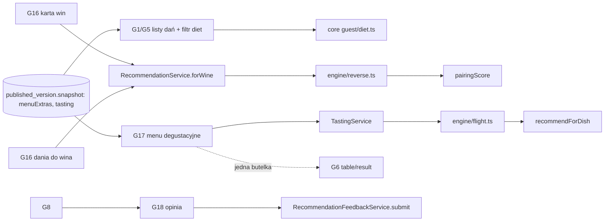

# Doświadczenie gościa: menu degustacyjne, odwrócone parowanie, diety i alergeny, opinia po posiłku, ulubione (E18)

## TLDR
Gość ma dziś dwie ścieżki: „jedno danie” (G1→G3) i „cały stół” (G5→G6), plus ścieżkę kelnera (G9, G11). **Proponujemy** pięć uzupełnień, wszystkie bez kont, bez ciasteczek i bez `localStorage` (stan gościa tylko w URL), każde działa bez JavaScriptu: (1) **menu degustacyjne** — gość wybiera menu (G17, lista) i dostaje spójną sekwencję win po jednym na kurs (G17, sekwencja), liczoną deterministycznie z istniejącego `recommendForDish` plus nowych reguł `flight.*`; do tego link „jedna butelka do całego menu” na istniejący G6; (2) **odwrócone parowanie** — nowa karta win dla gościa (G16, stan „karta”) i ekran „Dania do tego wina” (G16, stan „dania do wina”) oparty na tym samym `pairingScore`; (3) **diety i alergeny** — deklaracja restauracji przy daniu (model, import, edycja w A3), filtry jako linki i formularze GET z zastrzeżeniem, że to deklaracja restauracji, nie porada medyczna; (4) **opinia po posiłku** — jedno dotknięcie „czy wino pasowało?” (G18) powiązane z kodem polecenia i `sid`, bez tekstu wolnego i bez kont; (5) **ulubione** — lista win w parametrze `fav` adresu (G19). Ekrany gościa mają numery z przydziału planu: G16 (karta win i dania do wina, dwa stany jednego ekranu), G17 (menu degustacyjne: lista i sekwencja), G18 (opinia), G19 (ulubione); panel: A24 (tagi diet i `tastingOnly`, sekcja na A3), A25 (menu degustacyjne). Podział na 7 faz (F1–F7), każda osobnym PR-em. **Warunek:** F1, F5 i F7 stosują kontrakt publikacji E13 F1 (migawka v2, `PublishedView`), więc wchodzą po nim. Przed E16 wchodzą wszystkie fazy; E16 poprawi jakość wyników (afinicje dla dań wegetariańskich), ale niczego nie blokuje.

## Resolved assumptions (autonomous defaults)
Poniższe odpowiedzi przyjął agent (właściciel woli mało pytań); do przeglądu przed akceptacją. Pozycje z `❓` opisano też w „Ryzyka i otwarte pytania”.

| # | Pytanie | Przyjęta odpowiedź | Uzasadnienie |
|---|---|---|---|
| Q1 | Kolejność faz? | F1 model diet → F2 filtry → F3 karta win + odwrócone parowanie → F4 ulubione → F5 menu degustacyjne (dane, panel) → F6 menu degustacyjne (gość, silnik) → F7 opinia. F3 nie zależy od F1–F2 i może iść pierwsza. | Alergeny są dla restauracji najczulsze, więc model i przegląd wcześnie; odwrócone parowanie jest najtańsze i widoczne w pilotażu. |
| Q2 | Jak wygląda „dane w opublikowanej migawce”? | **Kontrakt E13 F1** (migawka v2 i jeden `PublishedView`) jest bazą; E18 nie czyta migawki ani `listPublished*` bezpośrednio. Decyzja „w wersji” / „na żywo” dla każdego nowego pola: `dietary` (diety, alergeny, `declared`) — **w wersji**; `tastingOnly` — **w wersji**; menu degustacyjne (`tasting`) — **w wersji**; opinie (`recommendation_feedback`) — **na żywo** (zapis zdarzenia, nie treść karty); `fav`, `diet`, `without` — tylko URL gościa. Nowe sekcje migawki `menuExtras` (tablica `{dishId, declared, diets, allergens, tastingOnly}`) i `tasting` (tablica menu) są opcjonalne, każda czytana niezależnie (brak = domyślna: `declared=false`, `tastingOnly=false`, brak menu), `schema` podnosi do najbliższego wolnego numeru ten z epików E18/E19, który scala się później (kolejność scalania nie wolno zmienić odczytu wersji); wpis w `diffVersions` (E13 R9) i w liczniku niepublikowanych zmian jest obowiązkowy; wersja v1 w diffie ma „brak danych w tej wersji”. | AGENTS §1.3 i plan, ustalenie 1. Deklaracja alergenów nie może trafić do gościa w połowie edycji. To surowsze niż dziś dla nazw dań (czytane na żywo), świadomie. |
| Q3 | Skąd tagi diet i alergeny? | Wyłącznie deklaracja restauracji: formularz w A3 i kolumny importu (`allergens`/`alergeny`, `diet`/`dieta`). **Brak wnioskowania z opisu dania** (drafter tylko dla profilu smaku). Pole `declared` rozróżnia „brak alergenów” od „nie podano”. | Błędne „bez glutenu” z nieudanej heurystyki jest gorsze niż brak filtra. Zgodne z D13: głos restauracji, nie technologii. |
| Q4 | Słownik? | Diety: `vegetarian`, `vegan` (wegańskie spełnia też filtr wegetariański). Alergeny: 14 z rozporządzenia UE 1169/2011 (`gluten, crustaceans, eggs, fish, peanuts, soy, milk, nuts, celery, mustard, sesame, sulphites, lupin, molluscs`). „Bez laktozy”, halal, koszer: poza zakresem. | Zamknięty słownik = testowalny, tłumaczalny (PL/EN w `src/i18n`), bez tekstu wolnego. ❓ czy dodać `pork`/`alcohol` jako tagi religijne. |
| Q5 | Co robi filtr z daniami bez deklaracji? | `diet=` wymaga tagu; `without=` wymaga `declared = true` i braku alergenu. Dania bez deklaracji są ukryte pod filtrem, a ekran mówi ile pominięto. | Brak deklaracji nie może znaczyć „bez alergenu”. |
| Q6 | Zastrzeżenie? | Stały tekst PL/EN przy każdym tagu i filtrze: informacja pochodzi od restauracji, może różnić się od faktycznego składu, nie jest poradą medyczną, przy alergii zapytaj obsługę. Zastrzeżenie dodaje też, że deklaracja nie obejmuje śladów ani zanieczyszczeń krzyżowych w kuchni. Słowa „bezpieczne”, „safe”, „wolne od”, „free” (np. „gluten-free”), „AI” w nowych kluczach słownika gościa są zabronione (test na całych słownikach `guest.*` dla nowych kluczy, nie tylko `guest.diet.*`). Etykiety filtra mają postać „Pomiń dania z: gluten” / „Exclude dishes with: gluten” oraz „Wegetariańskie (deklaracja restauracji)”; nie obiecują braku alergenu. | Odpowiedzialność i zaufanie gościa; D13 (nie obiecujemy więcej niż wiemy). |
| Q7 | Czy zapisujemy filtry diet w zdarzeniach użycia i logach? | **Nie.** `diet`/`without` nie trafiają do `props` zdarzeń (E02), do kodu polecenia ani do logów; zdarzenia nadal niosą `prefsToQuery` bez diet. | Dieta i alergia mogą ujawniać stan zdrowia (RODO art. 9) w połączeniu z `sid`. Zakres E21 potwierdzi. |
| Q8 | Menu degustacyjne: skąd kursy? | Osobna encja `tasting_menu` z listą kursów jako identyfikatorami opublikowanych dań (2–12, kolejność = kolejność kursów). Danie tylko-degustacyjne dostaje flagę `tastingOnly`: nie pokazuje się na G0, G1 ani G5 (strony gościa), ale jest `published`, więc działają G3, G7, G8 i kody. | Restauracje mają kursy, których nie ma à la carte; bez flagi menu à la carte się zaśmieca. **API v1 (BC §2):** `GET /public/restaurants/{slug}/menu` zwraca wszystkie dania jak dotąd, plus nowe pole `tastingOnly: boolean` (zmiana addytywna; żadna istniejąca odpowiedź się nie zmienia, bo flaga domyślnie false); nie filtrujemy dań po stronie API, żeby nie zmienić znaczenia istniejącej odpowiedzi. |
| Q9 | Silnik sekwencji? | Nowy `engine/flight.ts`: kandydaci per kurs z `recommendForDish` z porcją „kieliszek” (limit 4), dobór programowaniem dynamicznym po kursach z karami zdefiniowanymi jako nazwane reguły `flight.*` (powtórzenie wina w sąsiednich kursach, spadek body o ≥ 2, wino słodkie przed kursem wytrawnym). Stałe są propozycją do przeglądu sommeliera (macierz `engine:matrix`). Nie zmienia wyników `pairingScore`. | „Powtórz logikę stołu tam, gdzie ma to sens”: wynik per kurs to surowy `engineScore`; sommelier ponad modelem (bonus za tier jak w `compareItems`). |
| Q10 | Cena zestawu? | Suma cen kieliszków pozycji z sekwencji i łączna objętość (suma `glassPour`), opisane jako „suma kieliszków”. Własna cena „zestawu win” ustawiana przez restaurację: poza zakresem. ❓ | Bez nowego pola cenowego i bez obietnic wobec restauracji. Brak „jednostek alkoholu” (to byłaby porada zdrowotna). |
| Q11 | Kod polecenia dla sekwencji? | Bez nowego kontekstu kodu. Każdy kurs linkuje do G7 (`?dish=`) i dalej G8, gdzie obowiązuje istniejący kod dla jednego wina i dania (`context: 'dish'`). | Kod ma dziś jedno wino (`RecommendationCodeRecord.wineId`); zmiana modelu to osobny temat (E11b/E17). |
| Q12 | Odwrócone parowanie: skąd wynik? | Ten sam `pairingScore` i opublikowane pary (`listPublishedByRestaurant`), nowy czysty `engine/reverse.ts`; próg `MIN_MODEL_SCORE` (62) jak przy daniu; para `rejected` wyklucza danie; `showUnreviewed=false` zostawia tylko pary sommeliera. Dania `tastingOnly` pominięte. | Jeden silnik, jedne reguły, ta sama etykieta „Para sommeliera” tylko dla `approved`/`modified` (AGENTS §7). |
| Q13 | Gdzie gość wybiera wino? | Nowa karta win G16 (stan „karta”) `/r/{slug}/wines` (aktywne wina, filtry stylu, porcji i budżetu z istniejących parametrów `styles`, `serving`, `maxPrice` przez `passesHardFilters`) + link „Z czym to wino smakuje?” na G7. | Gość dziś nigdy nie widzi karty win bez dania; odwrócone parowanie bez wyboru wina nie istnieje. |
| Q14 | Opinia: co zbieramy? | Jedna z trzech odpowiedzi (`match`, `partial`, `miss`) na polecenie (kod), bez tekstu wolnego, bez IP i user-agenta, jeden wiersz na kod (zmiana zdania nadpisuje). Zapis dozwolony tylko z `sid` zgodnym z `sessionId` kodu, kodem `source: 'guest'`, w oknie 24 h od wydania. Każda porażka walidacji to ten sam błąd `code_not_found` (bez wyroczni). | Prywatność i odporność na nadużycia przy najmniejszym modelu. |
| Q15 | Nowa publiczna akcja serwerowa? | Tak: `submitFeedback` w `(guest)/r/[slug]/feedback/actions.ts`, wzorowana na `markCode` (formularz POST bez JS, odrzucenie `Sec-Fetch-Site: cross-site`, błąd przez `domainError()`). Wymaga zgody właściciela (`packages/app/AGENTS.md`; jest na liście wyjątków planu, sekcja „Ustalenia” p. 7). Odstępstwa od `AGENTS.md` §1.3 do zatwierdzenia razem z akcją: zapis bez `actor` użytkownika (aktor to stała `guest`, jak `staff_view` w `markCode`), bez `expectedVersion` (idempotentny upsert, ostatni zapis wygrywa) i bez wiersza w dzienniku decyzji; błędy nadal jako `DomainError`, ciało przez schemat Zod `strictObject`. ❓ | To jedyny sposób na zapis bez JS i bez konta. GET z efektem ubocznym odrzucony (prefetch, podglądy linków). |
| Q16 | Co z opiniami w panelu i dla gości? | Panel: agregat per para (danie, wino) na A6, procent dopiero od `FEEDBACK_MIN_N = 5` opinii, poniżej tylko liczby. Goście nigdy nie widzą cudzych opinii ani ocen. Opinia nie zmienia `matchScore` ani kolejności (silnik deterministyczny, AGENTS §7). Użycie jako etykiety uczenia (E17) tylko jako słaby sygnał. | N01 i zaufanie gościa: żadnego „social proof” w rekomendacji. |
| Q17 | Ulubione? | Tylko wina; parametr `fav` (lista identyfikatorów po przecinku, najwyżej `MAX_FAVOURITES = 10`, nieznane i nieaktywne odrzucane przy odczycie), przełączane linkiem, lista na G19. Link „do udostępnienia” na G19 jest bez `sid`. Ulubione nie trafiają do zdarzeń użycia. | Stan tylko w URL (R05); `sid` w udostępnionym linku mieszałby sesje. |
| Q18 | Wersja silnika? | Nowe pliki nie zmieniają `pairingScore`. **E18 nie zmienia `ENGINE_VERSION`** (plan, ustalenie 5: podnosi go tylko E16 do 1.3.0). `reverse.*` i `flight.*` to nowa warstwa nad `pairingScore`, nie zmiana wyniku reguł; wpis w `docs/RECOMMENDATION_ENGINE.md` opisuje je jako „warstwy bez wersji reguł”, a wygenerowane dla nich zapisy (np. kod polecenia) niosą `engineVersion` bieżącego `pairingScore`. Reguły `flight.*` mają testy w `packages/core/tests/engine.test.ts` (AGENTS §7), a nie tylko w osobnym pliku. Testy sekwencji i odwrócone asertują relacje, nie liczby, żeby przeżyły kalibrację E16. | Unikamy konfliktu scalania w `scoring.ts`, `engine-golden` i dokumentacji. |
| Q19 | Uprawnienia edycji w panelu? | Istniejące `import.manage` (właściciel, GM, sommelier) dla tagów diet, `tastingOnly` i menu degustacyjnych; odczyt opinii: `panel.view`. Bez nowych uprawnień: tabelę `permissions.ts` prowadzi E12, a plan nie przydziela E18 nazw uprawnień; po E12 możliwe osobne uprawnienie (otwarte). | Edycja tłumaczeń dań używa dziś `import.manage` (`actions.ts`, `saveDishTranslations`). |

## Problem
- **Brak ścieżek poza „danie” i „stół”.** Restauracje premium sprzedają menu degustacyjne; gość z menu na 7 kursów dostaje dziś 7 osobnych list win bez spójności (to samo wino dwa razy, kolejność od ciężkiego do lekkiego). G5 liczy jedną butelkę do wielu dań (`recommendForTable`), ale nie sekwencję kieliszków.
- **Gość nie może zacząć od wina.** Aplikacja nie ma karty win dla gościa; G7 wymaga kontekstu dania. Pytanie „co zjeść do tego wina?” nie ma odpowiedzi, choć `pairingScore` liczy ją za darmo.
- **Brak diet i alergenów.** `Dish` (`packages/core/src/domain/types.ts`) nie ma żadnego pola diety ani alergenów; import (`import/mapping.ts`, pola `MENU_FIELDS`) ich nie zna. Gość z alergią lub dietą wegetariańską nie odfiltruje listy, a restauracja nie ma gdzie ich zadeklarować.
- **Brak sygnału „czy wino pasowało”.** Kod polecenia (E09) mówi, co gość wybrał, a import POS (E03) — co zamówił, ale nie, czy to pasowało. Sommelier nie ma informacji zwrotnej o parach.
- **Gość traci wybór, gdy zamknie kartę.** Stan jest tylko w URL (R05), więc nie ma „zapamiętania” wina, które mu się spodobało.
- Dowody: plan E18 (`2026-11-04-product-completion-plan.md`, definicja „produkt gotowy do pokazania”: „menu degustacyjne, odwrócone parowanie, diety, kod dla kelnera, opinia”); decyzja D19 (budujemy bez weryfikacji A01–A06); brak obserwacji gości (A03 `accepted untested`).

## Cel i zakres
Domknąć ścieżkę gościa: pięć funkcji z TLDR, na wspólnym silniku, w stanie URL, bez JavaScriptu, PL/EN, z tokenami `docs/DESIGN_SYSTEM.md`. Przed E16: wszystko wchodzi na `wm-rules-1.2.0`. Od E16: reverse i flight korzystają z `pairingScore`, więc automatycznie z nowych afinicji.

**Poza zakresem:** konta gości, profile gości i dane między restauracjami (R05, D18, N04); wnioskowanie alergenów z opisu dania i jakiekolwiek twierdzenie o bezpieczeństwie medycznym; „bez laktozy”, halal, koszer, pozostałe diety; własna cena zestawu win i jednostki alkoholu; wersja kelnera dla menu degustacyjnego (G11-podobna) i kod polecenia z wieloma winami; opinie z tekstem wolnym, publiczne oceny, zmiana rankingu opiniami (to E17); powiadomienia (e-mail, push) o opinii; eksport CSV tagów (E20 doda kolumny do eksportu); nowe trasy `/api/v1` dla tych funkcji (publiczne menu dostaje tylko dodatkowe pole `tastingOnly`); edycja profili smaku dań (E13).

## Wymagania
- **R1 (dieta, dane).** `Dish` ma `dietary: { declared: boolean; diets: DietTag[]; allergens: Allergen[] }`; `declared = false` znaczy „nie podano”, a wtedy `diets` i `allergens` są puste. Wegańskie danie nie może deklarować `milk`, `eggs`, `fish`, `crustaceans`, `molluscs` (`diet_conflict`).
- **R2 (źródła).** Tagi pochodzą z formularza w A3 (komenda w `core` z `actor`, `expectedVersion` jako odcisk `dietaryVersion(dietary)` wzorowany na `translationsVersion` i `profileVersion` z E13, bo dania nie mają kolumny wersji; `DomainError`) i z kolumn importu menu; kolumna z nieznaną wartością daje ostrzeżenie wiersza, nie odgadnięty tag. Ponowny import: kolumny nie ma = tagi bez zmiany; komórka pusta = bez zmiany (ostrzeżenie `dietary_empty`, jak `translation_empty`), czyli import nie kasuje i nie zdejmuje deklaracji; zmiana deklaracji z importu jest niepublikowaną zmianą. Zdjęcie deklaracji (powrót do `declared = false`) tylko z formularza A3.
- **R3 (migawka, kontrakt E13).** Gość czyta tagi, `tastingOnly` i menu degustacyjne wyłącznie z `PublishedView` (E13 R2); restauracja nigdy nie opublikowana nie ma ujęcia (jak dziś nie ma jej w menu dla gości). Przywracanie wersji (E13 F4) odtwarza te sekcje razem z resztą migawki. Niepublikowane zmiany liczą się do `pendingChanges` i do warunku `nothing_to_publish`.
- **R4 (filtry diet).** `diet=vegetarian,vegan` i `without=gluten,milk,...` są parametrami URL, parsowanymi czystą funkcją w `core` (kanoniczna kolejność, nieznane wartości odrzucone, bez duplikatów); filtry to linki i formularz GET; niosą się w każdym linku gościa jak `sid`.
- **R5 (zastrzeżenie).** Tag lub filtr diety zawsze towarzyszy zastrzeżenie (Q6); etykiety mówią „restauracja deklaruje…”, nigdy „bezpieczne”.
- **R6 (prywatność diet).** Filtry diet nie są zapisywane (zdarzenia, kody, logi, `props`).
- **R7 (karta win).** G16 pokazuje aktywne wina z ceną kieliszka i butelki, numerem z karty (`listNumber`) i filtrami stylu, porcji i budżetu; wino prowadzi do G7 i do G16 w stanie „dania do wina”.
- **R8 (odwrócone parowanie).** `recommendDishesForWine` (czysta, deterministyczna) zwraca dania widoczne w `PublishedView`, `tastingOnly = false` z `engineScore ≥ MIN_MODEL_SCORE` lub z parą sommeliera, bez par `rejected`; kolejność: pary sommeliera (primary, potem rank), wynik malejąco, cena rosnąco, `id`. Etykieta „Para sommeliera” tylko dla `approved`/`modified`; wyświetlany wynik zawsze surowy.
- **R9 (filtry w odwróconym).** Filtry diet z R4 stosują się do G16.
- **R10 (menu degustacyjne, dane).** `tasting_menu` (nazwa, opis, cena menu opcjonalna, kursy 2–12, status, kolejność, tłumaczenia PL/EN); komendy w `core`, ekran panelu A25, publikacja przez migawkę (R3).
- **R11 (sekwencja).** `recommendFlight` zwraca po jednym winie na kurs (porcja: kieliszek), do 2 alternatyw, z regułami `flight.no_repeat`, `flight.progression`, `flight.sweet_order`; kurs bez wina na kieliszek jest pokazany z komunikatem, nie pomijany; wyświetlany wynik per kurs to surowy `engineScore`; jest łączna objętość i suma cen kieliszków.
- **R12 (jedna butelka).** G17 linkuje do istniejącego G6 z dosłownie kursami menu jako `dishes=` (bez nowej logiki).
- **R13 (opinia).** `RecommendationFeedbackService.submit` zapisuje `match|partial|miss` dla kodu `source: 'guest'` tej sesji (`sid`) w oknie 24 h, idempotentnie (jeden wiersz na kod); każda inna sytuacja to `code_not_found`. Wyjątki od §1.3: patrz Q15.
- **R14 (opinia, odczyt).** Panel widzi agregat per para na A6 (próg `FEEDBACK_MIN_N = 5`); gość nie widzi opinii; opinia nie wpływa na wynik ani kolejność.
- **R15 (ulubione).** `fav=` do 10 identyfikatorów win; link przełączający; G19 pokazuje aktywne wina z ceną, link do G7 i link do udostępnienia bez `sid`; nieaktywne wina są pomijane z informacją.
- **R16 (stan i JS).** Żadnych cookies ani `localStorage`; każda strona i akcja działają bez JS; JS wolno tylko jako dodatek (np. „Skopiuj link”, wzorzec `useSyncExternalStore`, lekcja `script-only-ui-use-sync-external-store`).
- **R17 (język).** Teksty z `src/i18n/en.ts` i `pl.ts`; w interfejsie gościa brak słowa „AI”; nazwy tagów PL/EN.
- **R18 (zdarzenia).** Dopisujemy nazwy do `GUEST_EVENT_NAMES` (nie zmieniamy istniejących): `tasting_viewed`, `wine_dishes_viewed`, `wine_list_viewed`, `feedback_viewed`; `props` tylko z identyfikatorami z bazy (R8 specyfikacji E02).
- **R19 (dokumentacja).** Zmiana `docs/DATA_MODEL.md`, `SCREEN_SPECIFICATION.md`, `SCREEN_MAP.md`, `USER_FLOWS.md`, `RECOMMENDATION_ENGINE.md`, `API_SPECIFICATION.md` (pole `tastingOnly` w publicznym menu), `BACKWARD_COMPATIBILITY.md` §1 (nowe parametry URL `diet`, `without`, `fav`; nowe adresy gościa) i §3 (nowe kolumny i tabele) i `.ai/docs/app-details.md` (nowa publiczna akcja) w tych samych PR-ach co kod.

## Kryteria akceptacji
Adnotacja w nawiasie: typ testu. „UI” = ekran przy 390 px i 1440 px, bez poziomego przewijania i błędów konsoli.

**F1 — model diet i alergenów**
- [ ] AC1 Danie bez deklaracji ma `declared = false` i puste listy; zapis tagów z `diets: ['vegan']` i `allergens: ['milk']` zwraca `diet_conflict`; zapis poprawny przechodzi z `actor` i `expectedVersion` (unit `core`, kontrakt repozytoriów pamięć + PostgreSQL).
- [ ] AC2 Import menu z kolumną „Alergeny” (np. `gluten, mleko`) i „Dieta” mapuje wartości PL i EN na słownik; nieznana wartość daje ostrzeżenie wiersza i brak tagu (unit `core/import`, test z plikiem CSV i XLSX).
- [ ] AC3 Zmiana tagów dania jest „niepublikowaną zmianą” w A11 i pozycją w diffie wersji (E13); po publikacji gość widzi nowe tagi (przez `PublishedView`), przed nią stare; przywrócenie wersji (E13 F4) przywraca stare tagi (unit serwisu publikacji + integracyjny `test:db`).
- [ ] AC4 Wersja bez sekcji `menuExtras` i `tasting` (v1 i v2 z E13) jest czytana jako brak deklaracji i brak menu degustacyjnych bez błędu, a `diffVersions` pokazuje dla niej „brak danych w tej wersji” (unit `readSnapshot` i `diffVersions`).
- [ ] AC5 A3 (sekcja A24) pokazuje formularz tagów z `import.manage`; rola `waiter` i brak sesji nie mogą zapisać (unit akcji: `authorizeAction`; e2e A3 bez JS).

**F2 — filtry gościa**
- [ ] AC6 `parseDietFilter` odrzuca nieznane wartości, deduplikuje i zapisuje w kanonicznej kolejności; `dietToQuery` ∘ `parseDietFilter` to tożsamość dla poprawnych wartości (unit `core`).
- [ ] AC7 G1 z `without=gluten` pokazuje tylko dania z `declared = true` bez glutenu i zdanie „pominięto n dań bez deklaracji”; z `diet=vegetarian` także dania wegańskie (unit strony przez `prerender`, lekcja `ssr-page-tests-with-prerender`).
- [ ] AC8 Filtr nosi się w linkach G1→G3→G7→G8 i G5→G6 oraz w przełączniku języka (unit `hrefWith`/`langHref`, e2e bez JS).
- [ ] AC9 Zastrzeżenie jest na G1, G3 i G5 przy aktywnym filtrze i przy każdym tagu; żaden ciąg w `guest.diet.*` nie zawiera „bezpieczn”, „safe”, „AI” (unit słowników PL i EN).
- [ ] AC10 `diet` i `without` nie występują w `props` żadnego zdarzenia ani w kodzie polecenia (unit `usage-events`, `recommendation-code`).
- [ ] AC11 UI: filtr w `details` działa bez JS, cel dotyku zgodny z `DESIGN_SYSTEM.md` §4, `npm run check:design` zielone (UI + check).

**F3 — karta win i odwrócone parowanie**
- [ ] AC12 `recommendDishesForWine` jest deterministyczna (ta sama lista dla tablic w dowolnej kolejności), pomija pary `rejected` i dania `tastingOnly`, stosuje próg 62 i kolejność z R8 (unit `core`).
- [ ] AC13 Para `approved`/`modified` ma „Parę sommeliera” i tylko ona; z `showUnreviewed=false` lista zawiera tylko pary sommeliera (unit strony G16).
- [ ] AC14 Na danych demo (Halka) dla każdego aktywnego wina G16 ma co najmniej jedno danie albo komunikat pusty, a żadne wino czerwone o wysokich taninach nie ma na górze dania rybnego (test relacyjny, nie liczbowy; przegląd `engine:matrix`).
- [ ] AC15 G16 filtruje po `styles`, `serving`, `maxPrice` (te same funkcje co G3) i prowadzi do G7 i do G16 (stan „dania do wina”); wino nieaktywne i obce (inna restauracja) daje 404 (unit + e2e).
- [ ] AC16 Po F2: filtry diet działają na G16 (unit strony).
- [ ] AC17 UI G16 (oba stany) bez JS; `smoke.mjs` sprawdza oba stany G16 w `memory` i `postgres`.

**F4 — ulubione**
- [ ] AC18 `parseFavourites` zwraca do 10 unikalnych identyfikatorów; `toggleFavourite` dodaje i usuwa; 11. wino nie jest dodawane (unit `core`).
- [ ] AC19 Serce na G3, G7 i G16 jest linkiem przełączającym i zachowuje resztę adresu (dania, tryb, filtry, `sid`); `fav` niesie się w linkach (unit `hrefWith`, e2e bez JS).
- [ ] AC20 G19 pomija wina nieaktywne i nieznane z informacją; link do udostępnienia nie zawiera `sid` (unit strony).

**F5 — menu degustacyjne: dane i panel**
- [ ] AC21 Menu z mniej niż 2 lub więcej niż 12 kursami albo z daniem spoza restauracji jest odrzucane (`ValidationError`); kurs na danie niepublikowane jest pomijany przy odczycie, a menu z mniej niż 2 kursami przestaje być widoczne (unit serwisu, kontrakt repozytoriów).
- [ ] AC22 Danie `tastingOnly` nie pojawia się na G0, G1 ani G5, ale otwiera się na G3 i G7 i dostaje kod; `GET /api/v1/public/restaurants/{slug}/menu` zwraca je z `tastingOnly: true`, a dla wszystkich dań sprzed zmiany odpowiedź różni się wyłącznie dodatkowym polem `tastingOnly: false` (unit + test trasy w `app/tests/unit`, test kształtu odpowiedzi względem zapisanego wzorca).
- [ ] AC23 Menu degustacyjne i `tastingOnly` są w migawce; zmiana jest „niepublikowaną zmianą”; edycja wymaga `import.manage` (unit + `test:db`).
- [ ] AC24 A25 (lista, edycja, kolejność kursów strzałkami „w górę/w dół” bez JS) i tłumaczenia PL/EN nazwy i opisu (e2e bez JS).

**F6 — menu degustacyjne: gość**
- [ ] AC25 `recommendFlight`: po jednym winie na kurs, brak tego samego wina w sąsiednich kursach, gdy istnieje alternatywa w limicie kandydatów; wino słodkie nie poprzedza kursu wytrawnego, gdy istnieje alternatywa; deterministyczna (unit `core`, relacje, nie liczby).
- [ ] AC26 Para sommeliera `primary` wygrywa z lepiej punktowanym winem silnika, jeśli kara reguł `flight.*` nie przekracza bonusu tieru; każdy kurs pokazuje surowy `engineScore` i pieczęć tylko dla `approved`/`modified` (unit `core`).
- [ ] AC27 Kurs bez wina na kieliszek pokazuje komunikat i nie jest pomijany; suma cen kieliszków i łączna objętość zgadzają się z wybranymi winami (unit `core` + strony).
- [ ] AC28 G17 (lista i sekwencja) działa bez JS; G17 niesie preferencje i `diet`/`fav`/`sid`; każdy kurs linkuje do G7 z `dish=`; link „jedna butelka do całego menu” prowadzi do G6 z `dishes=` kursów (unit strony, e2e bez JS).
- [ ] AC29 `npm run engine:matrix` rozszerzone o sekwencje dla menu demo; przegląd wyników oczami sommeliera zapisany w logu przebiegu; wpis `flight.*` w `docs/RECOMMENDATION_ENGINE.md` (przegląd).

**F7 — opinia po posiłku**
- [ ] AC30 `submit` zapisuje opinię tylko dla kodu `source: 'guest'`, z zgodnym `sid`, do 24 h od wydania; w każdym innym przypadku `code_not_found`, bez rozróżnienia przyczyn; drugi zapis nadpisuje (unit `core`, kontrakt repozytoriów, `test:db`).
- [ ] AC31 Akcja `submitFeedback` odrzuca `Sec-Fetch-Site: cross-site`, przekierowuje z zaufanych części (jak `markCode`) i działa bez JS (unit akcji, e2e bez JS).
- [ ] AC32 G8 pokazuje link do G18 tylko gdy kod został wydany dla gościa; G18 nie ma pola tekstowego, nie zapisuje IP ani user-agenta (unit strony, przegląd schematu tabeli).
- [ ] AC33 A6 pokazuje liczby per para, a procent dopiero od 5 opinii; goście nie widzą opinii; `matchScore` i kolejność niezmienione (unit strony A6, `engine-golden` bez diff).
- [ ] AC34 Zapis nie rejestruje diet ani alergenów; `recommendation_feedback` ma tylko `id`, `restaurant_id`, `code_id`, `rating`, znaczniki czasu (`schema:check`).

**Wspólne (każda faza)**
- [ ] AC35 `npm run lint`, `typecheck`, `test`, `build` (z `check:boundaries` i `check:design`) zielone; `test:db` przy zmianach `db`, portów i serwisów; strony i API sprawdzone w `DATA_SOURCE=memory` i `postgres`; `scripts/smoke.mjs` rozszerzony o nowe strony.

## Projekt rozwiązania

Strony: parsuj → serwis → renderuj. Diety, sekwencja, odwrócone parowanie i reguły opinii żyją w `core`; teksty w słownikach aplikacji.

### Pliki (zweryfikowane w kodzie)
**`packages/core`**
- `src/domain/types.ts`: `DietTag`, `Allergen`, `DishDietary`, `Dish.dietary`, `Dish.tastingOnly`, `TastingMenu`, `FeedbackRating`, `GUEST_EVENT_NAMES` (dopisanie nazw).
- `src/guest/diet.ts` (nowy): `DIET_TAGS`, `ALLERGENS`, `parseDietFilter`, `dietToQuery`, `withDietToggled`, `withAllergenToggled`, `dishPassesDiet`, `parseFavourites`, `toggleFavourite`; eksport w `src/index.ts`. Wzorzec: `guest/prefs.ts` (`parseGuestPrefs`, `prefsToQuery`, `with*`).
- `src/engine/reverse.ts` (nowy), `src/engine/flight.ts` (nowy): korzystają z `pairingScore` (`engine/scoring.ts`), `recommendForDish`, `passesHardFilters`, `MIN_MODEL_SCORE` (`engine/recommend.ts`).
- `src/services/publishing/snapshot.ts` i `published-view.ts` (z E13 F1, zależność): E18 dopisuje sekcje `menuExtras` i `tasting` do `readSnapshot`, `diffVersions` i licznika zmian; `i18n/content.ts` bez zmian.
- `src/services/guest/recommendation-service.ts`: `forWine(slug, wineId, filter, locale)`; `wineList(slug, prefs, locale)`.
- `src/services/catalog/catalog-service.ts`: `publishedMenu` (po E13 F1 oparte na `PublishedView`) zwraca dania z polem `tastingOnly`; G0/G1/G5 pomijają je czystą funkcją z `guest/diet.ts`, API je zwraca z flagą; nowy `TastingService` (odczyt dla gościa, komendy dla panelu) w `src/services/tasting/`.
- `src/services/recommendations/recommendation-feedback-service.ts` (nowy, wzorzec: `recommendation-code-service.ts`); agregat do `services/analytics/analytics-service.ts` (`pairingFeedback`).
- `src/services/publishing/publish-service.ts`: `preview()` i `publish()` liczą nowe zmiany; `PublishPreview` dostaje `pendingMenuExtras`.
- `src/ports/repositories.ts` (+ `ports/`): (bez nowej metody `PublishRepository`: odczyt idzie przez `PublishedView` z E13), `TastingMenuRepository` (+ zapisy z `expectedVersion`), `RecommendationFeedbackRepository`, metoda zapisu tagów dania; **każda nowa metoda = przypadek w `testing/repository-contract.ts`/`write-contract.ts` + implementacja w `memory/memory-repositories.ts` i w `packages/db/src/repositories/index.ts`.**
- `src/import/mapping.ts`: synonimy `allergens` i `diet` (PL/EN) w `SYNONYMS.menu`, wartości do słownika; `import/types.ts` (`MENU_FIELDS`); `ports/import.ts` (`dishUpdates` o `dietary`).
- `src/validators/`: schematy Zod `strictObject` dla tagów, menu degustacyjnego, opinii.

**`packages/db`** (migracje w jednym przebiegu z encjami; `npm run db:migration:create`; po niej cztery snapshoty i `npm run schema:check -w @wine-match/db`, lekcje `postgres-without-docker`, `schema-check-snapshot-per-database`)
- `entities/catalog/dish.ts`: kolumny `dietary` (jsonb not null z wartością domyślną `{"declared":false,"diets":[],"allergens":[]}`) i `tasting_only` (boolean not null default false): wyłącznie addytywne (expand, BC §3), `down` usuwa kolumny (dane deklaracji znikają: w produkcji po pierwszym użyciu wycofanie to poprzedni obraz aplikacji, schemat zostaje).
- `entities/publishing/published-version.ts`: `PublishedSnapshot` (po E13 F1 typ leży w `core/src/services/publishing/snapshot.ts`) o opcjonalne `menuExtras` i `tasting` (tablice, nie obiekty kluczowane przez klienta; lekcja `client-chosen-keys`); bez migracji danych starszych wersji (czytane z domyślnymi).
- Nowe encje: `tasting_menu` (jsonb `courses` z identyfikatorami dań bez FK, jak `recommendation_code.dish_ids`; indeks `(restaurant, status)`), `recommendation_feedback` (`code` FK do `recommendation_code.id` z `on delete cascade`, żeby retencja kodów (E21) usuwała także opinie, unikalne; `rating` enum; znaczniki czasu). Migracje: `Migration2026110xxxxxx_dish_dietary_and_tasting.ts`, `…_recommendation_feedback.ts`.

**`packages/app`**
- `src/server/guest-page.ts`: `GuestLinkState` o `diet`, `without`, `fav`; `hrefWith` zapisuje je w ustalonej kolejności przed `lang` i `sid`; `guestContext` je parsuje; `langHref` zachowuje je już dziś (kopiuje całe zapytanie poza `lang` i `sid`).
- Strony gościa (nowe): `r/[slug]/wines/page.tsx` (G16), `r/[slug]/wine/[wineId]/dishes/page.tsx` (G16), `r/[slug]/tasting/page.tsx` (G17), `r/[slug]/tasting/[menuId]/page.tsx` (G17), `r/[slug]/favourites/page.tsx` (G19), `r/[slug]/feedback/page.tsx` i `feedback/actions.ts` (G18). Zmienione: `menu/page.tsx` (G1), `table/page.tsx` (G5), `page.tsx` (G0: karty „Menu degustacyjne” i „Karta win”, gdy dane istnieją), `dish/[dishId]/wines/page.tsx` (G3, serce), `wine/[wineId]/page.tsx` (G7, link do G16, serce), `selected/[wineId]/page.tsx` (G8, link do G18).
- `(guest)/_components/guest-ui.tsx`: `DietFilter` (`details` + linki + formularz GET), `DietNotice`, `FlightCourse`, `FavouriteLink`, `ShareLinkField` (tylko tekst; przycisk „Skopiuj” jako dodatek JS); bez nowych kolorów, rozmiarów i promieni (ratchet `scripts/check-design.mjs`).
- Panel: `(admin)/admin/[slug]/menu/[dishId]/page.tsx` (A3, formularz tagów i `tastingOnly`), `[slug]/actions.ts` (`saveDishDietary`, akcje A25; `act(form, 'import.manage', …)`, `revalidatePath(…, 'layout')`), nowa strona `[slug]/tasting` poza `(lists)` (A25; formularze bez JS, kolejność kursów przyciskami), `pairings/[dishId]` (A6, agregat opinii), `publish` (A11, nowa linia zmian), `import/` (podgląd wierszy o kolumny tagów).
- `src/i18n/en.ts`, `pl.ts`: `guest.diet.*`, `guest.tasting.*`, `guest.wineList.*`, `guest.wineDishes.*`, `guest.favourites.*`, `guest.feedback.*`, `guest.meta.*`, wyjaśnienia „Jak to działa” (D14) dla G17 i G16 (komponent `Explain`).
- `scripts/smoke.mjs`: G16–G19; `tests/e2e/guest-experience.e2e.test.ts` (bez JS, lekcja `e2e-without-javascript`); testy w `tests/unit` i `packages/core/tests` (`diet.test.ts`, `reverse.test.ts`, `flight.test.ts`, `recommendation-feedback.test.ts`).

### Dane demo
`core/src/demo/halka.ts`: tagi diet i alergenów dla `DISHES` (zadeklarowane, tylko część dań, żeby pokazać „pominięto n dań”), jedno menu degustacyjne z 5–6 kursami (w tym dania `tastingOnly`) i pary dla nich; seeder `db/src/seeders/DemoSeeder.ts`.

### Ekrany
| Id | Adres | Zmiana |
|---|---|---|
| G17 (lista) | `/r/{slug}/tasting` | nowy: lista menu degustacyjnych (jedno menu → przekierowanie 307 na sekwencję z zachowaniem `sid`) |
| G17 (sekwencja) | `/r/{slug}/tasting/{menuId}` | nowy: kursy, wino na kurs, alternatywy, suma kieliszków, „jedna butelka” → G6 |
| G16 (karta) | `/r/{slug}/wines` | nowy: karta win dla gościa |
| G16 (dania do wina) | `/r/{slug}/wine/{wineId}/dishes` | nowy: dania do wina |
| G19 | `/r/{slug}/favourites` | nowy: ulubione z `fav` |
| G18 | `/r/{slug}/feedback?code=` | nowy: trzy przyciski opinii |
| G1, G3, G5, G7, G8, G0 | — | filtr diet, serce, linki do nowych ekranów |
| A25 | `/admin/{slug}/tasting` | nowy: menu degustacyjne |
| A24 (sekcja na A3), A6, A8, A11 | — | tagi diet i `tastingOnly` (A24);  agregat opinii; kolumny tagów; nowa linia zmian |

**Zależności:** E18 wymaga **E13 F1** (kontrakt `PublishedView` i migawka v2; już wykorzystywane wyżej), E16 (częściowo) i E11b (F7). **G15 (strona zawieszonej restauracji) należy do E14 F1**, E18 jej nie tworzy; strony G16–G19 są nowymi widokami lub sekcjami ścieżki gościa i w razie potrzeby mogą zostać stanami istniejących ekranów (przydział identyfikatorów wg planu). Listy z G16 i G17 **nie są logowane jako ekspozycje** E17 (`recommendation_exposure`).

### Przypadki brzegowe
- `without=` z nieznanym alergenem: odrzucony, reszta działa; wszystkie 14 zaznaczone: zwykle pusta lista z komunikatem „żadne danie nie ma deklaracji spełniającej filtr”.
- Wszystkie dania menu degustacyjnego `tastingOnly` i `without=` — kursy bez deklaracji są oznaczone, menu pozostaje widoczne (filtr diet nie ukrywa kursów menu, bo kolejność jest ustalona przez restaurację; tagi przy kursach).
- Menu degustacyjne z kursem na danie ukryte po publikacji: kurs pomijany; menu z < 2 kursami niewidoczne; `tasting` w migawce trzyma identyfikatory, nie kopie dań.
- Kod polecenia niewydany (prefetch, limit 30 na sesję i dzień): G8 bez linku do G18; G18 bez poprawnego kodu to ten sam ekran „nie znaleziono”.
- `fav` z identyfikatorem wina innej restauracji: odrzucone przy odczycie (zakres `restaurantId`); duplikaty i > 10: przycięte.
- Odświeżenie G8 bez `sid` tworzy nową sesję (znane z E09) i nowy kod; opinia dotyczy kodu z bieżącego `sid`.
- Wino bez kieliszka w sekwencji: kandydaci tylko z `glassPrice !== null` (jak `servingsFor`), kurs bez kandydata ma komunikat.
- To samo danie w dwóch kursach jednego menu: odrzucane przez walidację (unikalne identyfikatory kursów); ❓ patrz ryzyka.

### Fazy
| Faza | Zakres | Ryzyko | AC | Weryfikacja |
|---|---|---|---|---|
| F1 | model diet i alergenów: typy, migracja `dish`, migawka (`menuExtras`), publikacja, import (kolumny), A3, A11, dane demo | `risk-high` (migracja, zmiana publikacji, dane o alergenach) | AC1–AC5, AC35 | lint, typecheck, unit, `test:db`, build, e2e A3 bez JS, A3/A11 przy 390 i 1440 px, `schema:check` |
| F2 | filtry gościa i zastrzeżenie: `guest/diet.ts`, `hrefWith`, G1, G3, G5, G0, słowniki | `risk-medium` | AC6–AC11, AC35 | lint, typecheck, unit (strony przez `prerender`), build, e2e bez JS, UI 390/1440 px, `check:design` |
| F3 | karta win G16, odwrócone parowanie G16, `engine/reverse.ts`, link na G7, filtr diet (jeśli F2 jest) | `risk-medium` (nowe wyniki silnika; deterministyczne) | AC12–AC17, AC35 | lint, typecheck, unit, `engine:matrix` (przegląd), build, smoke `memory`/`postgres`, UI 390/1440 px |
| F4 | ulubione: `fav`, serce, G19, link bez `sid` | `risk-low` | AC18–AC20, AC35 | lint, typecheck, unit, build, e2e bez JS, UI 390/1440 px |
| F5 | menu degustacyjne — dane: `tasting_menu`, `tastingOnly`, serwis, migawka, A25, publiczne menu API (nowe pole `tastingOnly`) | `risk-high` (migracja, publikacja, kontrakt API) | AC21–AC24, AC35 | jak F1 + test trasy API menu + `BACKWARD_COMPATIBILITY.md` §2 |
| F6 | menu degustacyjne — gość: `engine/flight.ts`, G17, `Explain` | `risk-medium` (reguły silnika) | AC25–AC29, AC35 | lint, typecheck, unit, `engine:matrix` + przegląd sommeliera, `engine-golden` bez diff istniejących migawek, build, e2e bez JS, UI 390/1440 px |
| F7 | opinia: tabela, serwis, akcja publiczna, G18, A6, link na G8 | `risk-high` (nowa publiczna akcja zapisu, prywatność) | AC30–AC34, AC35 | lint, typecheck, unit, `test:db`, build, e2e bez JS, UI 390/1440 px; wymaga zgody właściciela (Q15) i QA reviewera (`SDLC.md`) |

Kolejność scalania wewnątrz fazy: `core` i migracja, potem UI (plan E11–E22). F5 przed F6; F2 po F1; F4 po F3 (serce na G16, stan „karta”). F7 po domknięciu E11b (kody). Przed E16 wchodzą wszystkie fazy; po scaleniu E16 uruchomić ponownie `engine:matrix` dla G16 i G17 i zaktualizować tylko testy relacyjne, jeśli któraś padnie.

## Ryzyka i otwarte pytania
- **Odpowiedzialność za alergeny (high).** Nawet z zastrzeżeniem błędna deklaracja restauracji może zaszkodzić gościowi. Łagodzenie: tylko deklaracja z A3/importu, migawka i publikacja, zastrzeżenie, zakaz sformułowań o bezpieczeństwie. ❓ Czy zastrzeżenie wymaga zatwierdzenia prawnego przed pilotażem (spec nie rozstrzyga; poza kompetencją agenta).
- **Dane zdrowotne (RODO art. 9).** `without=gluten` w adresie może być widoczne w logach dostępu serwera/proxy (nie sprawdzono konfiguracji wdrożenia, E11); `Referrer-Policy` ma `strict-origin-when-cross-origin` (`next.config.ts`). ❓ E21: czy logi proxy usuwają zapytanie? Do ustalenia, nie założone.
- **Publiczna akcja zapisu (Q15).** Nowa akcja bez logowania wymaga zgody właściciela (`packages/app/AGENTS.md`). Ryzyko nadużyć: zawyżanie opinii ograniczone do liczby wydanych kodów i do `sid`, ale kto zna adres z `sid` może oddać głos. Limitów żądań nie ma w całym produkcie (ticket z E09) — E21.
- **Retencja opinii.** Politykę retencji definiuje E21 (plan, ustalenie 4) dla `guest_interaction`, `recommendation_code` i opinii; E18 dostarcza tylko mechanizm (`created_at`, kaskada z kodu) i zgłasza E21 tabelę `recommendation_feedback` do polityki. Do czasu E21 brak automatycznego usuwania.
- **Zgodność z E16.** Wspólne pliki: `engine/scoring.ts` (`ENGINE_VERSION`), `docs/RECOMMENDATION_ENGINE.md` (historia wersji), `tests/engine-golden`, `engine:matrix`. E18 dodaje tylko nowe pliki i nowe reguły (`reverse.*`, `flight.*`) bez zmiany wag; testy relacyjne zamiast liczbowych; kto scala później, rozwiązuje wpis w historii wersji (Q18).
- **Jakość dań wegetariańskich.** Afinicje dla dań wege to zakres E16; do tego czasu odwrócone parowanie i sekwencja dla dań bezmięsnych mogą być słabsze. Nie blokuje.
- **`tastingOnly` i publiczne API (Q8).** Publiczne menu przestaje zawierać takie dania — zmiana wartości dla klientów API tylko dla nowych flag; sprawdzić `BACKWARD_COMPATIBILITY.md` §2 przed F5. Alternatywa: flaga w odpowiedzi API (nie robimy).
- **Stałe `flight.*` (Q9).** Kary i bonusy to propozycja agenta; sommelier (Domain expert, Q06 briefu) powinien przejrzeć wyniki z `engine:matrix` dla menu demo przed zatwierdzeniem F6. Nie sprawdzono, jak restauracje faktycznie układają zestawy win (A01 niezweryfikowane).
- **Dopasowanie z E13.** E13 edytuje profile dań w A3 i buduje historię publikacji z przywracaniem: E18 stosuje kontrakt publikacji E13 (Q2): przywracanie wersji odtwarza `menuExtras` i `tasting` razem z migawką. A3 dostaje dwa osobne formularze (profil smaku: E13 A19; tagi diet: A24) z osobnymi odciskami (`profileVersion`, `dietaryVersion`), żeby zapis jednego nie unieważniał drugiego. Kolejność scalania: E13 F1 przed E18 F1, F5, F7; E18 F2–F4 i F6 mogą iść bez E13, jeśli czytają przez dzisiejsze `listPublished*` i F1 je później przepnie (ryzyko podwójnej pracy; rekomendacja: czekać na E13 F1).
- **Dopasowanie z E20.** E20 (OCR, eksport CSV, redirect sluga, wiele kodów #89, czyszczenie `itemName` #90) dotyka `import/mapping.ts` i pól importu menu; F1 dodaje tylko kolumny `allergens` i `diet` (synonimy, kształt jak kolumny tłumaczeń z BC §6) i nie zmienia istniejących synonimów ani `DEFAULT_ORDER`. Eksport tagów należy do E20. Wiele kodów na jedną sesję (#89) dotyka `recommendation_code_choice_unique` i `source`/`sid` używanych przez G18: opinia jest wiązana z kodem po `id`, więc przeżyje zmianę, o ile #89 nie zmieni semantyki „jeden kod na wybór”; do sprawdzenia przy F7.
- **Dopasowanie z E19.** E19 może dodać priorytet „wina do sprzedania” do `recommendForDish`; `flight.*` i `reverse.*` go odziedziczą, więc muszą testować, że wino poniżej `MIN_MODEL_SCORE` nie trafia do sekwencji ani do listy dań do wina niezależnie od priorytetu, a pieczęć „Para sommeliera” zostaje tylko dla `approved`/`modified`. Dostępność win (`wine.active`) jest „na żywo” (E13 Q2), więc G16 i G19 czytają ją na żywo.
- **Dopasowanie z E12.** Dziś edycja tagów to `import.manage`; po E12 (role) rozważyć osobne uprawnienie. Kelner z PIN-em (E12) mógłby dostać menu degustacyjne w widoku G11 — poza zakresem tej specyfikacji.
- **Dopasowanie z E17.** Opinie to słabe, samowybrane etykiety (głosują zadowoleni i zdenerwowani); E17 musi to uwzględnić. Listy z G16 i G17 nie są ekspozycjami E17 (potwierdzone w specyfikacji E17, R-5).
- **❓ Otwarte (domyślne odpowiedzi w tabeli):** tagi religijne (`pork`, `alcohol`) w słowniku (Q4); własna cena zestawu win i półporcje w menu degustacyjnym (Q10); dwa razy to samo danie w jednym menu (zabronione dziś; degustacje rzadko powtarzają danie); czy G0 ma pokazywać karty „Menu degustacyjne” i „Karta win” zawsze, czy tylko gdy dane istnieją (przyjęto: tylko gdy istnieją, przez regułę w `core` w stylu `canPairTable`).
- **Nieznane:** wartości `DESIGN_SYSTEM.md` dla ikon serca i celu dotyku nie zostały tu sprawdzone w szczegółach (czytano spis treści); do potwierdzenia przy F2/F4 przez `npm run check:design` i przegląd.

**Przegląd niezależny 2026-11-04** (agent bez udziału w pisaniu):
- Zmieniono: numery ekranów G13–G18 i A15 na przydział planu (G13 należy do E12, G14 do E21, G15 do E14 F1 (E15 tylko używa), A15 do E12): G16 karta win i dania do wina, G17 menu degustacyjne, G18 opinia, G19 ulubione, A24 tagi, A25 menu degustacyjne.
- Kontrakt publikacji: własne klucze migawki i odczyt `publishedMenuExtras` zastąpione kontraktem E13 F1 (`PublishedView`, `readSnapshot`, `diffVersions`, licznik zmian, „w wersji”/„na żywo” dla każdego pola); dopisana zależność od E13 F1.
- BC: `tastingOnly` w API v1 jako pole dodatkowe zamiast filtrowania dań (zmiana znaczenia odpowiedzi); nowe parametry URL i kolumny do `BACKWARD_COMPATIBILITY.md`.
- Silnik: usunięta możliwość podniesienia `ENGINE_VERSION` przez E18 (tylko E16); testy `flight.*` w `engine.test.ts`.
- Zaufanie gościa: zakaz „free”/„gluten-free”, dopisek o śladach i krzyżowym zanieczyszczeniu, etykiety filtrów mówiące o deklaracji; import nie kasuje deklaracji.
- Wyjątki od §1.3 dla `submitFeedback` (aktor `guest`, brak `expectedVersion`) wpisane jawnie do zgody właściciela; kaskada opinii z kodu pod retencję E21.
- Otwarte: zgoda właściciela na `submitFeedback`; przegląd prawny zastrzeżenia o alergenach; wpływ E19 priorytetu na sekwencję i odwrócone parowanie; kolejność `schema` z E19; plan nie wymienia E13 w „Zależy od” E18 (do poprawienia w planie).

- **Decyzje właściciela (2026-11-04):** pytania do właściciela z tej specyfikacji rozstrzygnięto przez delegację; zob. plan `2026-11-04-product-completion-plan.md`, sekcja „Decyzje podjęte”. Przyjęto domyślne rekomendacje; faza wymagająca zewnętrznej decyzji (prawnik, księgowa, spike) czeka na nią.

## Realizacja
(Uzupełnia agent po implementacji: commity, logi przebiegów, odstępstwa od projektu.)
