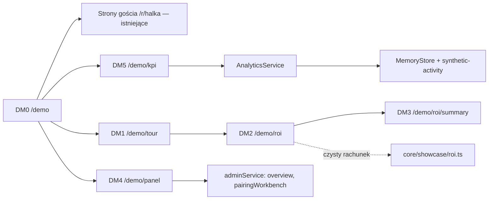

# Demo sprzedażowe i kalkulator zwrotu (E22)

## TLDR
Produkt jest zbudowany, ale nie ma czego pokazać restauracji bez logowania i bez prawdziwych danych: dashboard KPI na danych demo mówi „Nothing has been recorded yet”, panel sommeliera wymaga konta z publicznym hasłem, a liczby z `PRODUCT_CONCEPT` §5 („+5 pp, +10 zł na gościa”) istnieją tylko w zdaniu. **Proponujemy** (stan przyszły): (1) publiczne demo tylko do odczytu fikcyjnej restauracji Halka: przewodnik po 5 krokach (gość, cały stół, kelner, panel sommeliera, KPI) otwierany linkiem, bez logowania i danych osobowych, z **wyraźnie syntetycznymi** danymi sprzedaży i użycia; (2) kalkulator zwrotu dla właściciela restauracji z edytowalnymi domyślnymi założeniami zespołu (+5 pp, +10 zł), wzorem na stronie i wersją do druku / „Zapisz jako PDF”; (3) krótka strona „Jak to działa dla restauracji” o pozycjonowaniu sommelier-first (D13), bez słowa „AI”. Wszystko to **założenia własne zespołu (D19)**, nigdy wynik pomiaru. Demo działa na osobnej instancji (pamięć + `ALLOW_DEMO_DATA`), nie na produkcji z prawdziwymi restauracjami. Cztery fazy; pierwsza (kalkulator) nie czeka na E19 ani E15.

## Resolved assumptions (autonomous defaults)

| # | Pytanie | Przyjęta odpowiedź | Uzasadnienie |
|---|---|---|---|
| Q1 | Gdzie działa demo? | Na **osobnej instancji** (`DATA_SOURCE=memory`, `ALLOW_DEMO_DATA=true`, własna domena i `PUBLIC_BASE_URL` https), nie na produkcji z `postgres`. Odrzucone: restauracja demo w bazie produkcyjnej. | `DemoSeeder` odmawia zapisu obok prawdziwych restauracji (E11 R5, Q10), a E11 wprost dopuszcza „publiczną instalację demo” (sekcja przypadków brzegowych). Zero ryzyka mieszania danych. |
| Q2 | Jak włączyć? | Jedna zmienna `SHOWCASE_MODE=off\|calculator\|demo` (domyślnie `off`, inna wartość = błąd konfiguracji). `calculator`: tylko kalkulator i „tour”, dozwolone na każdym źródle danych (nie czytają żadnych danych). `demo`: dodatkowo przewodnik, panel i KPI; wymaga `DATA_SOURCE=memory` **i** `ALLOW_DEMO_DATA=true`, inaczej start kończy się kodem 1. | Konfiguracja decydująca o widoczności zawodzi zamykająco (AGENTS §1.6). Kalkulator bez danych może stać też przy produkcji. |
| Q3 | Fikcyjna restauracja? | **Halka** (dane z `core/src/demo/halka.ts`, już opisane jako fikcyjne: „All names, prices and people are invented”). Dodatkowo stały pasek „Dane demonstracyjne” na każdej stronie gościa i `/demo`. | D05; bez drugiego zbioru dań i win do utrzymania. Producenci win to prawdziwe posiadłości jako „realistyczne wpisy” (komentarz w pliku): nie sugerujemy partnerstwa, nota na stronie. |
| Q4 | Skąd syntetyczne KPI? | Deterministyczny generator w `core` zasila `MemoryStore` (`salesLines`, `guestInteractions`) **tylko** w trybie `demo`; wartości liczą **prawdziwe** `AnalyticsService` i `computeSalesKpis`, a panel pokazuje te same komponenty co A1 (`SalesKpis`, `UsageKpis`, `PairingPerformanceSection`). | Pokazujemy dokładnie ten ekran, który dostanie klient; brak drugiej ścieżki liczenia. Zdarzenia usera nie mogą wypchnąć danych syntetycznych (limit 10 000 w pamięci), więc w `demo` zapis zdarzeń gości jest wyłączony (Q9). |
| Q5 | „Tylko do odczytu” — jak? | W trybie `demo` **konta demo nie są ładowane do pamięci (R9), a logowanie jest wyłączone** (`/admin/login` i `POST /api/v1/auth/login` odmawiają z komunikatem „demo tylko do odczytu”, link do `/demo/panel`). Bez sesji żadne z trzech drzwi (layout, akcja, `handle()`) nie przepuści zapisu. Panel w demo to osobne strony `/demo/panel`, nie `/admin`. | Publiczne hasło `demo-halka-2026` na publicznym adresie pozwalałoby każdemu zmieniać karty. Strony tylko do odczytu zamiast „konta gościa” w panelu: brak nowej roli i brak ryzyka eskalacji. |
| Q6 | Model kalkulatora? | Wejścia: gości miesięcznie `C`, odsetek gości zamawiających wino `a0` (przybliżenie Wine Attach Rate), średnia wartość wina na gościa zamawiającego wino `s` (zł), marża na winie `m`. Założenia: zmiana odsetka `Δa` (domyślnie +5 pp), zmiana wartości `Δs` (domyślnie +10 zł **na gościa zamawiającego wino**), cena planu `P`. Wzór: `a1 = clamp(a0+Δa, 0, 100%)`, `s1 = max(0, s+Δs)`, `ΔPrzychód = C·(a1·s1 − a0·s)` (= `C·(a1−a0)·s + C·a1·(s1−s)`, tożsamość algebraiczna: `a1·s1 − a0·s = (a1−a0)·s + a1·(s1−s)`), `ΔMarża = m·ΔPrzychód`, `Wynik po opłacie = ΔMarża − P` (**nie „zysk netto”**: to dodatkowa marża brutto z wina minus cena planu, bez kosztów wdrożenia, czasu personelu ani innych skutków). Model zakłada, że **cała** zmiana odsetka i wartości wynika z produktu, bez sezonowości i okresu rozruchu: to założenie, nie dowód przyczynowości, i strona to mówi. | Przy gościach z koncepcji (C = 1 500) i placeholderach a0 = 30%, s = 150 zł: 0,05·1 500·150 + 0,35·1 500·10 = 11 250 + 5 250 = **16 500 zł** przychodu miesięcznie, czyli „kilkanaście tysięcy” z §5 (liczby z §5 są tylko jednym z możliwych rozkładów na dwa efekty). Odczytanie „+10 zł na gościa” jako dopłaty dla kupującego jest jedną z dwóch możliwości (Q7). |
| Q7 | Czy „+10 zł” dotyczy każdego gościa? | **Wymaga decyzji właściciela (domyślnie:)** nie: tylko gości zamawiających wino. `PRODUCT_CONCEPT` §5 mówi „średniej wartości wina na gościa”, a KPI „Wine revenue per guest” dzieli przez **wszystkich** gości (covers), więc literalne czytanie to +10 zł na każdego gościa (dla C = 1 500: 15 000 zł z samej wartości, nie 5 250 zł). Przyjęliśmy wariant ostrożniejszy, ale odbiega on od brzmienia koncepcji i od definicji KPI. | Ostrożniejsza liczba w materiale sprzedażowym; spójność z koncepcją jest tu słabsza, niż sugerowała wcześniejsza wersja. Przy zmianie interpretacji zmieniają się AC3 i wzór. Ryzyko opisane niżej. |
| Q8 | Wartości domyślne? | C = 1 500 (z §5, jedyna liczba źródłowa), a0 = 30%, s = 150 zł, m = 60%, P = 790 zł (Professional, A02/D07), Δa = +5 pp, Δs = +10 zł. Każda ma oznaczone pochodzenie: „z koncepcji produktu” (C, Δa, Δs, P) albo „wartość robocza zespołu” (a0, s, m). | D19: własne założenia, nieweryfikowane. Wartości robocze nie mają źródła, więc strona to mówi; właściciel może je zmienić w jednym pliku. |
| Q9 | Liczniki odwiedzin demo? | Tylko **prywatnościowe**: jedna linia `logger.info('showcase_view', { page })` na odsłonę (sama nazwa strony: bez IP, user-agenta, parametrów, identyfikatora). Zapis zdarzeń gości (`UsageEventService`) wyłączony w `demo`. Brak CRM i brak zapisu kalkulatora. | Poza zakresem E22: analityka odwiedzających. Liczby operator odczyta z logów (`grep`/`wc`), bez nowej tabeli i bez ciasteczek. |
| Q10 | PDF? | **Widok do druku** `/demo/roi/summary` (A4, `@media print`) i przycisk „Drukuj / Zapisz jako PDF” (okno druku przeglądarki). Odrzucone: generowanie PDF na serwerze. | Nowa biblioteka PDF wymaga osobnej specyfikacji (AGENTS §1.1) i nic nie daje ponad zapis z przeglądarki; zero zasobów zewnętrznych. |
| Q11 | Stan kalkulatora? | W parametrach URL (formularz `GET`), bez JavaScriptu; link do wyniku można wysłać restauracji i otwiera się z tymi samymi liczbami. Zero cookies i `localStorage`. | Konwencja stron gościa (AGENTS §1.4); „podsumowanie” to ta sama strona z innym układem. Nic nie jest zapisywane po stronie serwera. |
| Q12 | Czyje „słowa właściciela” na stronie „Jak to działa”? | Właściciela produktu (Filip): treść wzięta z D13, D14 i `PRODUCT_CONCEPT` §2, §8, **bez słowa „AI”** (test na HTML całego `/demo`). Treść do recenzji Filipa przed `approved`. | N02 obejmuje pozycjonowanie, nie tylko interfejs gościa; jeden test wszędzie jest prostszy. |
| Q13 | Języki? | PL i EN, jak reszta (D11), słowniki `en.ts`/`pl.ts`; `?lang` przez `proxy.ts`. Treść PL jest wiodąca. | Pierwsi klienci są w Polsce; spójność z E-poprzednimi. |
| Q14 | Układ? | Nowa grupa tras `(showcase)` z własnym layoutem głównym (desktop-first, shadcn jak panel, druk), prefiks `/demo`; kroki przewodnika prowadzą do istniejących stron `/r/halka/...` (mobile). | Strony właściciela potrzebują szerokiego układu, którego `(guest)` (kolumna 480 px) nie daje; trzeci layout główny nie narusza zakazu `src/app/layout.tsx`. Ostrzeżenie w Ryzykach. |

## Problem
- **Nie ma czego pokazać bez konta.** Restauracja, która dostanie link, nie zobaczy panelu ani KPI: A1 w trybie `memory` pokazuje puste stany (`SalesKpis` → `m.emptyTitle`, `UsageKpis` → brak danych), bo zestaw demo (`buildDemoDataset`) nie zawiera sprzedaży ani zdarzeń (`MemoryStore.salesLines` jest puste; komentarz: „the demo data has none”). Panel wymaga sesji; konta demo mają publiczne hasło i nie wolno ich trzymać na prawdziwej instalacji (README).
- **Liczby zwrotu nie mają miejsca.** `PRODUCT_CONCEPT` §5 uzasadnia cenę zdaniem o +5 pp i +10 zł; D19 mówi, że te założenia przedstawiamy restauracjom, ale nie ma narzędzia, w którym właściciel wpisze własne liczby. Wine Attach Rate w produkcie jest liczony **per rachunek** (§6, E03 Q7), a założenie z §5 mówi o gościach: kalkulator musi to powiedzieć, nie ukrywać.
- **Pozycjonowanie sommelier-first (D13) nie jest nigdzie opowiedziane** dla właściciela: „Jak to działa” (G12, D14) jest dla gościa.
- Dowody: brak obserwacji sprzedażowych (A01, A02, A05 `accepted untested`); to jest materiał pokazowy, nie dowód.

## Cel i zakres
Dowieźć link, który można wysłać restauracji: przejście przez produkt (demo tylko do odczytu), kalkulator z jawnymi założeniami i wydrukiem oraz krótki opis idei, wszystko bez logowania, danych osobowych i zewnętrznych usług.

**Poza zakresem:** zbieranie kontaktów i CRM (formularz „umów demo”, e-mail do zespołu); strona marketingowa (cennik publiczny, blog, SEO); analityka odwiedzających poza prywatnościowymi liczbami z Q9; generowanie PDF na serwerze; kalkulator z wynikami z POS klienta (import sprzedaży to E03); zapis scenariuszy; konta „gościa” w panelu; demo na danych prawdziwej restauracji; plany i ceny pobierane z rozliczeń (E15, faza F4 tylko odczyt katalogu); nowy zestaw dań i win.

## Wymagania
- **R1 (konfiguracja)** `parseEnv` czyta `SHOWCASE_MODE` (`off` domyślnie, `calculator`, `demo`). `demo` bez `DATA_SOURCE=memory` albo bez `ALLOW_DEMO_DATA=true` zgłasza błąd (kod 1, komunikat nazywa zmienną); w produkcji `demo` podlega też R4 z E11 (https). Wszystkie strony `/demo/*` w trybie niższym niż wymagany odpowiadają **404**.
- **R2 (kalkulator, `core`)** Czyste funkcje w `core/src/showcase/roi.ts`: `parseRoiInputs(raw)` (każde pole to napis zgodny z `^-?\d+([.,]\d+)?$` (przecinek polski dozwolony, **bez notacji wykładniczej**) i leży w zakresie: C 1–200 000, a0 i m 0–100%, s 0–5 000 zł, Δa −100…+100 pp, Δs −1 000…+1 000 zł, P 0–50 000 zł; niepoprawne lub brak = wartość domyślna z `ROI_DEFAULTS`, lista pól zastąpionych do pokazania; klucze z URL czytane przez `Map`/`Object.fromEntries`, nie zwykły obiekt: `__proto__`), `computeRoi(inputs)` według wzoru z Q6, z krokami pośrednimi (`attachEffect = C·(a1−a0)·s` z **efektywną** zmianą odsetka po obcięciu, `spendEffect = C·a1·(s1−s)`, przychód, marża, wynik po opłacie, punkt zwrotu `P/m` zł przychodu i `P/(m·s)` dodatkowych gości zamawiających wino przy dzisiejszym `s`; `null`, gdy `m = 0` lub `s = 0`). Wynik ujemny pokazany, nie ukrywany; zaokrąglenie do 1 zł dopiero przy wyświetlaniu.
- **R3 (uczciwe etykiety)** Każda liczba na `/demo/roi` i w podsumowaniu ma przy sobie pochodzenie: „założenie zespołu” (domyślna lub wpisana) albo „wynik wzoru”, nigdy „wynik”, „zmierzone”, „gwarantowane”. Stały blok „Czym to jest”: założenia własne zespołu Wine Match, niezweryfikowane z danymi restauracji; bez obietnicy wyniku; zdanie „Zakładamy, że cała zmiana wynika z Wine Match; nie uwzględniamy sezonowości, rozruchu ani kosztów po stronie restauracji”. Wynik po opłacie nazywany „Dodatkowa marża po opłacie za plan (założenie)”, nigdy „zysk”. Wzór wypisany w całości (wyrażenia i podstawione liczby) pod wynikiem. Przy odsetku zamawiających wino zdanie: „Wine Attach Rate w produkcie liczymy per rachunek; tu przybliżamy go odsetkiem gości”.
- **R4 (formularz)** `/demo/roi` to formularz `GET` (pola numeryczne z etykietami i jednostkami, wartości domyślne widoczne jako „domyślnie: …”, przycisk „Przywróć domyślne” jako link) z wynikiem nad lub obok formularza; działa bez JavaScriptu; strona ma jeden `h1`, wynik w `aria-live="polite"` tylko przy JS, bez błędów konsoli.
- **R5 (druk)** `/demo/roi/summary?…` (te same parametry) to układ A4: nagłówek „Podsumowanie założeń: kalkulator zwrotu Wine Match”, data wydruku w polu na stronie (z parametru nieobowiązkowego `d`, nie z zegara serwera), tabela wejść i założeń z oznaczeniem pochodzenia, wzór i kroki, notatka „założenia, nie pomiary”, przycisk „Drukuj / Zapisz jako PDF” (komponent kliencki tylko dla `window.print()`), `@media print` ukrywa nawigację i przyciski; mieści się na dwóch stronach A4.
- **R6 (przewodnik, DM0)** `/demo` to strona startowa: tytuł „Demo: fikcyjna restauracja Halka”, pięć kroków z opisem „co zobaczysz” i linkiem: (1) gość wybiera danie → `/r/halka/dish/{id}/wines` (danie z parą sommeliera), (2) cały stół → `/r/halka/table`, (3) kelner → `/r/halka/staff/table`, (4) panel sommeliera → `/demo/panel`, (5) KPI → `/demo/kpi`. Linki niosą `lang`; bez `sid`. Pasek „Dane demonstracyjne” z linkiem „Wróć do przewodnika” na stronach gościa w trybie `demo`.
- **R7 (panel tylko do odczytu, DM4)** `/demo/panel` pokazuje kartę win i dań Halki z decyzjami sommeliera (status, rola, komentarz) przez te same serwisy odczytu co A6 (`adminService.overview`, `pairingWorkbench`), bez przycisków zapisu i bez linków do `/admin`. Etykieta „Para sommeliera” tylko przy `approved`/`modified`; wynik silnika bez podbijania (R02).
- **R8 (KPI syntetyczne, DM5)** `/demo/kpi` renderuje te same komponenty co A1 (sprzedaż, użycie, skuteczność par) z danych wygenerowanych w `core/src/demo/synthetic-activity.ts`: deterministyczny generator (ziarno, bez `Math.random`, czas przez parametr `asOf`), 56 dni wstecz od `asOf`, check ids z prefiksem `DEMO-`, brak danych osobowych. Stały baner: „Dane syntetyczne: wygenerowane na potrzeby pokazu, nie z żadnej restauracji”. Odsetek wina w oknie bieżącym wyższy niż w poprzednim o kilka pp to ilustracja kierunku założenia, **opisana** przy tej karcie jako wartość pokazowa; baner „Dane syntetyczne” jest stały (przyklejony) i widoczny przy przewijaniu, a strona nie używa słów „wzrost dzięki”, „efekt wdrożenia” ani „rezultat” (test na HTML). Czy w ogóle pokazywać syntetyczny wzrost, to decyzja właściciela (Q15).
- **R9 (tylko odczyt, bez kont)** W trybie `demo` **konta demo w ogóle nie są ładowane**: `MemoryStore` powstaje z zestawu z `users: []` (dziś `MemoryStore.from(buildDemoDataset(...))` ładuje `DEMO_USERS` z publicznym hasłem), więc nie istnieje użytkownik, na którego można się zalogować, niezależnie od blokady trasy; dodatkowo logowanie jest wyłączone (Q5). Hasło demo nie pojawia się w żadnym HTML, komunikacie ani w odpowiedzi API instancji `demo` (test na HTML `/demo/*`, `/admin/login`, odpowiedzi 403). `shouldRecord` zwraca `false` (brak zdarzeń gości), strony `/demo/*` nie wołają żadnej komendy serwisu. Publiczne strony gościa i kelnera (`/r/halka/...`) nadal zapisują do pamięci procesu **kody rekomendacji** (`RecommendationCodeService.issue`, `markCode`) oraz, po E18, opinie (`submitFeedback`): w trybie `demo` zapis opinii jest wyłączony, a kody są ograniczone istniejącym limitem `MAX_MEMORY_RECOMMENDATION_CODES = 10 000` (najstarsze znikają) i znikają z procesem; to jedyny dopuszczalny zapis, dlatego opis „tylko do odczytu” dotyczy panelu i KPI, nie stron gościa (uczciwie na P0). Dane syntetyczne trafiają do `MemoryStore` wyłącznie w trybie `demo`; tryby `off` i `calculator` zachowują dzisiejsze puste dane sprzedaży. **Zależność od E12 F5:** guard PIN na G9/G11/`markCode` musi w trybie `demo` przepuszczać widok kelnera bez PIN-u (inaczej krok 3 przewodnika nie działa), a E12 nie może dodać publicznego PIN-u demo (`DEMO_PIN`) do instancji `demo`.
- **R10 (strona „Jak to działa dla restauracji”, DM1)** `/demo/tour`: krótka (do ~400 słów PL), sekcje: „Sommelier ma ostatnie słowo”, „Gość dostaje wino z Twojej karty”, „Kelner nie musi zgadywać”, „Widzisz, co się sprzedaje”, „Czego nie robimy” (żadnych płatnych pozycji, N01; bez zewnętrznych usług przy zapytaniu, N03). Link do G12 (`/r/halka/how-it-works`) jako „Jak liczymy dopasowanie”. Bez słowa „AI” i bez „sztucznej inteligencji” w całym HTML.
- **R11 (zasoby i prywatność)** Brak zewnętrznych fontów, skryptów i obrazów; brak cookies i `localStorage`; kalkulator niczego nie zapisuje po stronie serwera; strony `/demo/*` mają `Cache-Control: private, no-store` jak pozostałe strony dynamiczne i `robots: noindex`.
- **R12 (zgodność)** Istniejące adresy działają bez zmian; `proxy.ts` zyskuje `/demo/:path*` w `matcher` (język), reszta bez zmian. Brak zmian w `/api/v1` i w schemacie bazy.
- **R13 (i18n)** Teksty `showcase.*` w `en.ts` i `pl.ts` z tymi samymi kluczami; formatowanie kwot przez `formatPrice`.
- **R14 (docs)** `docs/SCREEN_MAP.md` (DM0–DM5, uprawnienia: publiczne), `docs/SCREEN_SPECIFICATION.md`, `docs/USER_FLOWS.md`, `README.md` (zmienna, adresy, uruchomienie demo), `.env.example`, `docs/DEPLOYMENT.md` (instancja demo), `BACKWARD_COMPATIBILITY.md` §4 (nowa zmienna, nowe trasy), `scripts/smoke.mjs` (nowe adresy).

## Kryteria akceptacji
- [ ] **AC1 (R1)** `parseEnv`: `SHOWCASE_MODE` brak = `off`; `calculator` z `postgres` przechodzi; `demo` z `postgres` albo bez `ALLOW_DEMO_DATA=true` → `ConfigError` z nazwą zmiennej; `demo` w produkcji bez https → błąd (R4 E11); wartość spoza listy → błąd. *Test jednostkowy `core/tests/env.test.ts`.*
- [ ] **AC2 (R1)** Przy `off` wszystkie `/demo/*` dają 404; przy `calculator` 404 dają `/demo`, `/demo/panel`, `/demo/kpi`, a `/demo/roi`, `/demo/roi/summary`, `/demo/tour` 200. *Test tras (`app/tests/unit/routes.test.ts`) + smoke.*
- [ ] **AC3 (R2, Q6)** `computeRoi` dla wartości domyślnych: `ΔPrzychód = 16 500`, efekt odsetka 11 250, efekt wartości 5 250, `ΔMarża = 9 900`, `Wynik po opłacie = 9 110`, punkt zwrotu `790/0,6 = 1 316,67` zł i `790/(0,6·150) = 8,78` gościa. *Test jednostkowy `core`.*
- [ ] **AC4 (R2)** `computeRoi`: `a0 = 98%`, `Δa = +5` → `a1 = 100%`; `Δa = −5`, `Δs = 0` → ujemny przychód i ujemny zysk bez wyjątku; `a0 = 30%`, `Δa = −50` → `a1 = 0` (nie ujemne), `Δs = −1 000` przy `s = 150` → `s1 = 0`; `attachEffect` używa efektywnej zmiany odsetka (dla `a0 = 98%`, `Δa = +5` → 2 pp); `m = 0` lub `s = 0` → punkt zwrotu `null` (bez dzielenia przez zero); `C = 0` → wszystkie kwoty 0. *Test jednostkowy.*
- [ ] **AC5 (R2)** `parseRoiInputs`: `'1500'` → 1500; dla pola C (`customers`) `'-5'`, `'abc'`, `''`, tablica, `'1e3'`, `'1e9'`, `'__proto__'` → wartość domyślna i pole na liście `replaced`; dla Δa `'-5'` → −5 (ujemne dozwolone); liczby z przecinkiem polskim (`'12,5'`) akceptowane; klucze nieznane pominięte; klucz `__proto__` w zapytaniu nie zmienia prototypu. *Test jednostkowy.*
- [ ] **AC6 (R3)** HTML `/demo/roi` zawiera przy każdej z siedmiu liczb wejściowych oznaczenie pochodzenia, blok „Czym to jest”, wzór z podstawionymi liczbami i nie zawiera słów „zmierzon”, „gwarantowan”, „wynik pilotażu”. *Test SSR (`prerender`, lekcja `ssr-page-tests-with-prerender`).*
- [ ] **AC7 (R4)** `/demo/roi?customers=…` (adres z parametrami) odtwarza te same liczby po odświeżeniu; wysłanie formularza bez JavaScriptu zmienia wynik; formularz ma `method="get"`; każde pole ma `<label>`. *E2E bez JS (agent-browser, lekcja `e2e-without-javascript`).*
- [ ] **AC8 (R5)** `/demo/roi/summary` w emulacji druku (`emulateMedia print`): nawigacja i przyciski niewidoczne, tabela i wzór widoczne, wydruk ≤ 2 strony A4; przycisk „Drukuj” istnieje tylko z JS. *E2E + zrzut do PR.*
- [ ] **AC9 (R6)** `/demo` ma pięć kroków z działającymi linkami (każdy 200, `lang` zachowany, brak `sid`); strona gościa `/r/halka` w trybie `demo` pokazuje pasek „Dane demonstracyjne”, w trybie `off` go nie ma. *Test SSR + smoke.*
- [ ] **AC10 (R7)** `/demo/panel` pokazuje dania Halki z pieczęcią „Para sommeliera” tylko przy parach `approved`/`modified`, nie zawiera `<form>`, przycisków zapisu ani linków `/admin`. *Test SSR.*
- [ ] **AC11 (R8)** `buildSyntheticActivity(dataset, asOf)` jest deterministyczne (dwa wywołania identyczne), zawiera ≥ 30 rachunków z jedzeniem w każdym z dwóch 28-dniowych okien, check ids z prefiksem `DEMO-`, brak pól osobowych, liczba zdarzeń użycia < 10 000; przez `computeSalesKpis` odsetek okna bieżącego > poprzedniego. *Test jednostkowy `core`.*
- [ ] **AC12 (R8)** `/demo/kpi` pokazuje Wine Attach Rate z „N z M rachunków”, cztery kwoty, użycie i tabelę skuteczności par oraz baner „Dane syntetyczne”; wartości zgodne z `AnalyticsService` dla tego samego `asOf`. *Test SSR + porównanie z serwisem.*
- [ ] **AC13 (R9)** W trybie `demo`: kontener nie zawiera żadnego użytkownika (`authRepository` zwraca brak dla `DEMO_USERS`); `POST /api/v1/auth/login` → 403 `showcase_read_only` (także z prawidłowymi danymi demo), `/admin/login` pokazuje komunikat bez hasła; HTML `/demo/*`, `/admin/login` i odpowiedzi 403 nie zawierają wartości `DEMO_PASSWORD`; strona gościa nie zapisuje zdarzeń (`guestInteractions` bez zmian po 3 odsłonach); `submitFeedback` (jeśli istnieje po E18) odmawia; w trybach `off`/`calculator` `salesLines` puste. *Test tras + test kontenera.*
- [ ] **AC14 (R10, N02)** HTML wszystkich stron `/demo/*` i słowniki `showcase.*` (PL i EN) nie zawierają `\bAI\b` ani „sztuczn”; strona `/demo/tour` ma 5 sekcji z R10, link do G12. *Test SSR + test słowników.*
- [ ] **AC15 (R11)** `/demo/*` nie ustawia cookies, nie ładuje zasobów spoza własnej domeny (żądania sieciowe), ma `noindex`; `npm run build` bez zmiennych środowiskowych przechodzi. *E2E (lista żądań) + `next build`.*
- [ ] **AC16 (R9, Q9)** Odsłona `/demo/roi` zapisuje jedną linię logu `showcase_view` z polem `page` i bez innych pól; żadnych zapisów do bazy. *Test jednostkowy z atrapą `logger`.*
- [ ] **AC17 (R13)** Słowniki PL i EN mają te same klucze `showcase.*`; PL poprawnie odmienia „gość/gości” dla 1, 2, 5, 22. *Test `i18n.test.ts`.*
- [ ] **AC18 (UI)** Strony DM0–DM5 przy 390 px i 1440 px: bez poziomego przewijania (`scrollWidth`), bez błędów w konsoli, fokus widoczny, kontrast z tokenów (lekcja `axe-in-jsdom-limits`). *Zrzuty + E2E.*
- [ ] **AC19 (F4, E15)** Gdy katalog planów z E15 istnieje, lista „Plan” w kalkulatorze bierze ceny z niego, a przy braku — z `ROI_PLAN_FALLBACK` (390 / 790 zł); zmiana ceny w katalogu zmienia wynik. *Test jednostkowy.*

Dokumentacja (R14) — pozycja checklisty PR, nie AC.

## Projekt rozwiązania

### Pliki i moduły (zweryfikowane w kodzie; nowe oznaczone)
- `packages/core/src/showcase/roi.ts` (nowy): `ROI_DEFAULTS`, `parseRoiInputs`, `computeRoi`; wzorować na stylu `sales-kpis.ts` (czyste funkcje, brak I/O). `packages/core/src/showcase/index.ts` eksportowany z `src/index.ts`. Testy: `packages/core/tests/roi.test.ts`.
- `packages/core/src/demo/synthetic-activity.ts` (nowy): `buildSyntheticActivity(dataset, asOf)` zwraca `SalesRecord[]` (typ z `services/sales/types.ts`) i `GuestInteractionInput[]` (z `ports/repositories.ts`); ziarno stałe, generator liniowy (nie `Math.random`; reguła o silniku dotyczy `engine/`, ale determinizm jest potrzebny testom). Nie dotyka `buildDemoDataset`, więc `engine:matrix` i testy złote bez zmian.
- `packages/core/src/config/env.ts`: pole `showcaseMode` i reguły R1 (schemat Zod jak `ALLOW_DEMO_DATA`); testy w `core/tests/env.test.ts`.
- `packages/app/src/server/container.ts` (gałąź `memory`, dziś `MemoryStore.from(buildDemoDataset({ ids: 'uuid' }))`): w trybie `demo` zestaw trafia do `from(...)` z `users: []` (R9), a po nim dopisanie wygenerowanych wierszy do `store.salesLines` i `store.guestInteractions`. `env()` w `src/server/env.ts` zwraca `showcaseMode`.
- `packages/app/src/server/usage-events.ts`: `shouldRecord` zwraca `false` w trybie `demo` (jedno miejsce dla wszystkich stron gościa).
- Logowanie: `src/app/api/v1/auth/login/route.ts` i akcja `admin/auth-actions.ts` odmawiają w `demo` (`DomainError`-owy kod `showcase_read_only`, mapowanie na 403 w `guarded()`); `admin/login/page.tsx` pokazuje komunikat.
- `packages/app/src/proxy.ts`: `matcher` dopisuje `/demo/:path*`; reszta bez zmian (język w `x-wine-lang`).
- `packages/app/src/app/(showcase)/layout.tsx` (nowy, layout główny: `lang`, fonty `@fontsource-variable/bodoni-moda` i `hanken-grotesk` jak panel, `@wine-match/ui/styles.css`, `robots: noindex`); `demo/page.tsx` (DM0), `demo/tour/page.tsx` (DM1), `demo/roi/page.tsx` (DM2), `demo/roi/summary/page.tsx` (DM3), `demo/panel/page.tsx` (DM4), `demo/kpi/page.tsx` (DM5). Strony `force-dynamic`, na starcie `showcaseGate(mode)` (404 poza trybem), na końcu `logShowcaseView(page)`.
- Komponenty: `SalesKpis`, `UsageKpis`, `PairingPerformanceSection`, `Kpi` z `(admin)/admin/_components` i `[slug]/(lists)` są czystymi komponentami na propsach (komentarz w `sales-kpis.tsx`: „Props only”) — **ale** leżą w grupie `(admin)`; F3 przenosi je do wspólnego `src/app/_shared/` (bez zmiany zachowania; A1 importuje stąd), zamiast importować między grupami tras. Link „Import sales” znika przy `canImport=false` (już obsłużone propem).
- `(guest)/layout.tsx`: pasek „Dane demonstracyjne” (komponent w `_components/demo-ribbon.tsx`) tylko gdy `env().showcaseMode === 'demo'`.
- i18n: `src/i18n/en.ts`, `pl.ts` — sekcja `showcase` (kalkulator, tour, przewodnik, paski); komponent `DemoNotice` wspólny dla DM2–DM5.
- `scripts/smoke.mjs`: wariant `--showcase <url>` (GET `/demo`, `/demo/roi`, `/demo/roi/summary`, `/demo/tour`, w `demo` także `/demo/panel`, `/demo/kpi`; wymaga treści „założenie”, braku „AI”).
- `docs/`, `README.md`, `.env.example`, `docs/DEPLOYMENT.md` (R14).

### Model danych i migracje
Brak zmian schematu i migracji; demo jest wyłącznie w pamięci procesu (`memory`). `/api/v1`: brak nowych tras. Kalkulator niczego nie zapisuje.

### Ekrany (ID dopisane do `SCREEN_MAP.md`; prefiks DM (demo): G i A są zajęte, P1–P6 należą do E14, a D0–D5 myliłyby się z decyzjami D01–D19)
| ID | Adres | Treść | Dostęp |
|---|---|---|---|
| DM0 | `/demo` | przewodnik 5 kroków | publiczny (tryb `demo`) |
| DM1 | `/demo/tour` | „Jak to działa dla restauracji” | publiczny (`calculator`, `demo`) |
| DM2 | `/demo/roi` | kalkulator, wzór, założenia | publiczny (`calculator`, `demo`) |
| DM3 | `/demo/roi/summary` | wersja do druku / PDF | publiczny (`calculator`, `demo`) |
| DM4 | `/demo/panel` | karta i decyzje sommeliera, tylko odczyt | publiczny (`demo`) |
| DM5 | `/demo/kpi` | KPI na danych syntetycznych | publiczny (`demo`) |

### Fazy (każda osobnym PR-em; kolejność: F1 → F2 → F3 → F4)

| Faza | Zakres | Ryzyko | AC | Zależność |
|---|---|---|---|---|
| **F1 — kalkulator** | `showcase/roi.ts`, `SHOWCASE_MODE` (`off`/`calculator`), layout `(showcase)`, DM2 i DM3, i18n, noindex, licznik `showcase_view`, smoke, docs | `risk-low` (czysty rachunek, nowe trasy za flagą; zmiana `env.ts` i `proxy.ts` wąska) | AC1 (część `calculator`), AC2, AC3–AC7, AC8, AC15, AC16, AC17, AC18 (DM2, DM3) | **żadna**; może wejść od razu po akceptacji |
| **F2 — tour i przewodnik** | DM1, DM0, tryb `demo` w `parseEnv`, pasek „Dane demonstracyjne”, wyłączone zdarzenia gości i logowanie, instancja demo w `DEPLOYMENT.md` | `risk-high` (SDLC: logowanie i sesje, publicznie dostępna instancja; według SDLC.md dotyk uwierzytelniania to `risk-high`, więc QA reviewer albo wyjątek właściciela) | AC1 (reszta), AC9, AC13, AC14, AC18 (DM0, DM1) | E11 (R4/R5, instancja z https); treść kroków 1–3 używa dziś istniejących G3, G5, G11 |
| **F3 — panel i KPI** | `synthetic-activity.ts`, zasilenie `MemoryStore` w `demo`, przeniesienie komponentów KPI do `_shared`, DM4, DM5 | `risk-medium` (refaktor współdzielonych komponentów A1 + generator danych) | AC10, AC11, AC12, AC18 (DM4, DM5) | E04 (KPI, zbudowane); po F2 |
| **F4 — spięcie z E19 i E15** | ceny planów z katalogu E15 (`ROI_PLAN_FALLBACK` zostaje), kroki przewodnika o dostępności win, „winach do sprzedania” i brandingu z E19 | `risk-low` | AC19 + AC9 rozszerzone o nowe kroki | **E15** (katalog planów), **E19** (ekrany operacji) |

**Co może wejść wcześniej niż E19 i E15:** F1, F2 i F3 w całości — nie czytają niczego z rozliczeń ani z operacji restauracji; plan (390/790 zł) i opis planów pochodzą na razie ze stałych z `PRODUCT_CONCEPT` §5. F4 to tylko dopięcie. Przewodnik w F2/F3 jest napisany tak, by nowy krok dodawało się jednym wpisem w tablicy kroków.

### Weryfikacja per faza (zgodnie z AGENTS §6.1)
Każda faza: `npm run lint`, `npm run typecheck`, `npm test`, `npm run build`, `npm run secrets:scan`, `npm run check:boundaries`; strony `(showcase)` w trybach `DATA_SOURCE=memory` (`SHOWCASE_MODE=demo` i `calculator`) oraz `postgres` (`calculator`, `demo` ma odmówić startu: kod 1 — sprawdzić ręcznie i testem). UI: P-ekrany przy **390 px i 1440 px**, bez poziomego przewijania i błędów w konsoli, także z wyłączonym JS (kalkulator); zrzuty druku A4 w opisie PR (F1). `npm run test:db` nie jest wymagane (brak zmian w `db`). `npm run engine:matrix` nie jest wymagane (silnik bez zmian); F3 dołącza test, że `buildDemoDataset` jest bez zmian.

### Kolejność prac w obrębie fazy
F1: (1) `roi.ts` + testy AC3–AC5 → (2) `env.ts` + testy AC1 → (3) layout i DM2 + i18n → (4) DM3 i druk → (5) smoke i docs. F2: (1) `env.ts` tryb `demo` → (2) blokada logowania i `shouldRecord` + testy AC13 → (3) pasek w `(guest)` → (4) DM1 → (5) DM0. F3: (1) generator + testy AC11 → (2) zasilenie kontenera → (3) przeniesienie komponentów (PR zielony przed zmianą P-ekranów) → (4) DM5 → (5) DM4.

### Przypadki brzegowe
- **Migawka Halki i E13 F1:** demo Halka wymaga opublikowanej migawki w wersji **v2 lub nowszej** z nowymi sekcjami z E13 F1 (`PublishedView`; także `menuExtras`/`tasting` z E18, o ile krok przewodnika ich używa); migawka v1 nie wystarcza, bo część ścieżek gościa czyta dane przez `PublishedView` i dla v1 pokazałaby braki. Zasilenie danych demo (`buildDemoDataset`) musi publikować Halkę w v2 po scaleniu E13 F1. **G15** (strona zawieszonej restauracji, E14) nie używa brandingu Halki ani żadnego logo; w trybie `demo` nie powinna być osiągalna, a gdyby była, pokazuje motyw domyślny.
- **Nieistniejące dane w trybie `calculator` na produkcji:** `/demo`, `/demo/panel`, `/demo/kpi` → 404, nie 500 ani puste ekrany; `/demo/roi` nie dotyka bazy.
- **Restart instancji demo:** dane syntetyczne generują się od nowa z tym samym ziarnem, okno liczone od `asOf` (zegar procesu); liczby w oknie przesuwają się o dni, ale proporcje są stałe.
- **Link z parametrami od restauracji:** wartości spoza zakresu zastępowane domyślnymi i wymienione w komunikacie „zamieniliśmy: …”; nic nie jest zapisywane.
- **Drukowanie bez JS:** przycisk „Drukuj” nie istnieje; zdanie „Użyj Ctrl/Cmd+P” zawsze widoczne.
- **Powtórne użycie `demo-halka-2026`:** w trybie `demo` hasło nie loguje; na instancji z prawdziwymi danymi `demo` nie wystartuje (R1).

## Ryzyka i otwarte pytania
- **Niezweryfikowane liczby (D19, A02, A05):** a0 = 30%, s = 150 zł, m = 60% to wartości robocze bez źródła; C = 1 500, +5 pp i +10 zł pochodzą z koncepcji (też niezweryfikowanej). Strona to mówi (R3); właściciel powinien rozważyć wymianę wartości roboczych na dane z rozmów (C03, C05) — jedno miejsce (`ROI_DEFAULTS`).
- **Przybliżenie per gość a KPI per rachunek (otwarte):** Wine Attach Rate w produkcie to rachunki, nie goście (§6, E03 Q7). Kalkulator używa odsetka gości; stolik 4-osobowy z jedną butelką daje inny obraz. Rozważyć w F1 dodatkowe pole „średnia liczba gości na rachunek” (domyślnie 1 = bez zmiany wyniku). **Nie dodano**, żeby nie komplikować; do decyzji.
- **Interpretacja „+10 zł na gościa” (Q7):** po stronie „każdy gość” wynik dla C = 1 500 byłby 15 000 zł z samej wartości zamiast 5 250 zł. Przyjęliśmy wariant ostrożniejszy; przy zmianie interpretacji zmieniają się AC3 i tekst wzoru.
- **Trzeci layout główny (Q14):** AGENTS §1.4 zakazuje `src/app/layout.tsx`, nie grupy `(showcase)`, ale reguła „osobne layouty główne `(guest)` i `(admin)`” wymaga aktualizacji (`.ai/docs/architecture-rules.md` §1.4, `SCREEN_MAP.md`) i zgody właściciela.
- **Przenoszenie komponentów KPI (F3):** `check:boundaries` pilnuje pakietów, nie grup tras; mimo to import `(showcase)` → `(admin)` byłby zapachem. `_shared` to najmniejsza zmiana, ale dotyka A1 (testy `sales-kpis.test.ts`, `usage-kpis.test.ts`, `pairing-performance.test.ts` muszą zostać zielone bez zmian).
- **Limit pamięci 10 000 zdarzeń:** generator musi się zmieścić z zapasem (AC11); zapis zdarzeń gości w `demo` jest wyłączony właśnie po to, by nic nie wypychało danych (Q4).
- **Wina to prawdziwi producenci** (komentarz w `halka.ts`): ryzyko skojarzenia z partnerstwem; nota „fikcyjna restauracja, wpisy na karcie win ilustracyjne” na DM0.
- **Mieszanie z prawdziwymi restauracjami:** chronią R1 (fail-closed), brak zapisu do bazy i osobna instancja; nie istnieje ścieżka, którą `demo` czytałoby z `postgres`. Test AC1 to pilnuje. Zależność od E11: do czasu wdrożenia instancji demo F2 działa lokalnie.
- **Kolizje z innymi epikami (stwierdzone):** E15 może mieć własną stronę cennika i katalog planów (F4 czyta tylko katalog); E19 zmienia G0/branding, więc pasek demo musi się układać z brandingiem restauracji; E12 (PIN kelnera) może zmienić dostęp do G11 w kroku 3 przewodnika (kroki trzeba sprawdzić po jego scaleniu); E21 (zgodność/RODO) powinien potwierdzić, że licznik logu bez danych osobowych nie wymaga zgody. Prefiks ekranów `P` może kolidować z E15, jeśli przyjmie ten sam (do uzgodnienia przy akceptacji).
- **Niewiadome (nie sprawdzone w kodzie):** czy `adminService.overview` i `pairingWorkbench` dają wszystko dla DM4 bez zapytań wymagających sesji (serwis nie sprawdza uprawnień — sprawdzają je strony; do potwierdzenia w F3); jak `guarded()` mapuje nowy kod domenowy na 403 (do sprawdzenia w F2); czy `after()` w Next.js 16 działa w trybie `memory` na instancji demo tak samo (E02 zakłada tak).
- **Treść „słów właściciela” (Q12)** wymaga przeczytania przez Filipa; liczba słów i ton to propozycja.
- **Pytania do właściciela (domyślne odpowiedzi w tabeli):** Q2 (jedna zmienna z trzema trybami), Q7 (interpretacja +10 zł), Q8 (wartości robocze), Q12 (autor treści tour).

- **Przegląd niezależny 2026-11-04**
  - Zmieniono: identyfikatory ekranów P0–P5 kolidowały z E14 (P1–P6): teraz DM0–DM5 (plan zaktualizowany; `D0–D5` z planu myliłoby się z decyzjami D01–D19); demo nie ładuje kont demo (publiczne hasło `DEMO_PASSWORD` nie może istnieć na publicznej instancji, sama blokada trasy to jedna warstwa); doprecyzowano, że strony gościa nadal zapisują kody (ograniczone limitem) i że „tylko do odczytu” dotyczy panelu i KPI; zależność od E12 F5 (guard PIN na widoku kelnera) i E18 (`submitFeedback`); model ROI: `a1` obcięte też od dołu, `s1 ≥ 0`, efekt odsetka z efektywnej zmiany po obcięciu, „zysk netto” zamienione na „dodatkowa marża po opłacie”, założenie pełnej przypisywalności zapisane; parsowanie liczb bez notacji wykładniczej i przez `Map`; Q7 przyznaje, że odbiega od brzmienia §5 i definicji KPI per gość; F2 z `risk-medium` na `risk-high` (SDLC: uwierzytelnianie); AC5 per pole.
  - Zgadnięte (każda liczba w kalkulatorze to założenie): a0 = 30%, s = 150 zł, m = 60% (robocze, bez źródła), C = 1 500, +5 pp, +10 zł, P = 790 zł (z koncepcji, niezweryfikowane), 56 dni i 30 rachunków generatora.
  - D19, N01–N03: zachowane (liczby oznaczone jako założenia, brak „AI”, brak płatnych pozycji, brak LLM). Otwarte: Q7 (interpretacja), Q15 (syntetyczny wzrost na KPI), przybliżenie gość/rachunek, trzeci layout (zgoda właściciela, plan pkt 7), działanie widoku kelnera po E12 F5.
- **Q15 (otwarte, decyzja właściciela)** Czy demo ma pokazywać syntetyczny wzrost odsetka wina między oknami (R8)? Ryzyko: odbiorca czyta to jako wynik. Domyślnie tak, z przyklejonym banerem i opisem; bezpieczniejsza wersja to oba okna o podobnym poziomie.

- **Decyzje właściciela (2026-11-04):** pytania do właściciela z tej specyfikacji rozstrzygnięto przez delegację; zob. plan `2026-11-04-product-completion-plan.md`, sekcja „Decyzje podjęte”. Przyjęto domyślne rekomendacje; faza wymagająca zewnętrznej decyzji (prawnik, księgowa, spike) czeka na nią.

## Realizacja
(Uzupełnia agent po implementacji: commity, log przebiegu, odstępstwa od projektu.)
