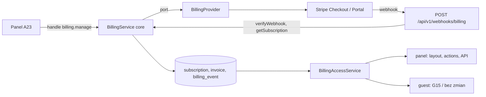

# Subskrypcje i rozliczenia: plany, trial, Stripe, zawieszenie (E15)

## TLDR
Produkt jest B2B2C: płaci restauracja, gość nie płaci (D02, R05), ale dziś nie ma planów, trialu, płatności ani skutków braku płatności; zakres planów z `docs/PRODUCT_CONCEPT.md` §5 (Essential, Professional, Group) istnieje tylko jako tekst, a decyzja D07 ma status `proposal`. **Proponujemy** (stan przyszły): (1) plany z uprawnieniami (liczba lokali, kont, funkcje) jako **dane**, nie stałe w kodzie, ceny konfigurowalne (390–790 zł z briefu to hipotetyczne wartości startowe właściciela, A02); (2) 14-dniowy trial bez karty, lokalny; (3) **Stripe** jako domyślny dostawca przez port `BillingProvider` w `core` i adapter w `app`: płatność wyłącznie przez Stripe Checkout i Customer Portal (dane karty nigdy nie dotykają naszych serwerów); (4) lokalne lustro stanu subskrypcji i faktur utrzymywane z webhooków (weryfikacja podpisu, idempotencja, ponowne pobranie obiektu od dostawcy); (5) czysta funkcja stanu dostępu `full | grace | suspended` i jasna polityka: panel zawieszonej restauracji jest tylko do odczytu i do rozliczeń, strony gościa pokazują neutralną stronę „rekomendacje chwilowo niedostępne” (G15 wprowadzona przez E14 F1, ta sama co przy wstrzymaniu lokalu przez administratora), nigdy 404 ani wzmianki o płatności; (6) widok subskrypcji w panelu restauracji i w panelu administratora systemu (E14). Wszystko za przełącznikiem `BILLING_ENFORCEMENT` (jawny w produkcji), istniejące restauracje dostają subskrypcję `complimentary`, więc wdrożenie niczego nie zawiesza. Siedem faz, każda osobnym PR-em, wszystkie dotykające pieniędzy lub dostępu mają `risk-high`.

## Resolved assumptions (autonomous defaults)

Właściciel przejrzy tabelę; zmiana odpowiedzi zmienia tylko wskazane fazy. ⚠ = wymaga wyraźnej zgody właściciela, bo zmienia regułę z `AGENTS.md`.

| # | Pytanie | Przyjęta odpowiedź | Uzasadnienie |
|---|---|---|---|
| Q1 | Dostawca płatności? | **Stripe** (Checkout + Customer Portal + Billing). Odrzucone: (a) **Paddle / Lemon Squeezy** (merchant of record): zdejmują VAT, ale to oni są sprzedawcą na fakturze, a właściciel traci fakturę własnej firmy i kontrolę nad relacją z klientem; (b) **polskie PSP** (Przelewy24, Tpay, PayU): brak hostowanego portalu i silnika subskrypcji, musielibyśmy sami zbudować odnowienia, ponowienia i portal (czyli przechowywać tokeny i zarządzać cyklem płatności, więcej ryzyka niż wartości); (c) **faktura przelewem w własnym systemie księgowym** bez dostawcy: zero automatyzacji stanu, poza zakresem (patrz „Poza zakresem”). | Plan E-plan Q2 rekomenduje Stripe; ma tryb testowy, zegary testowe, hostowany Checkout i portal, więc żadne dane karty nie są nasze. Port czyni zmianę dostawcy kosztem jednego adaptera. |
| Q2 | Kto jest klientem rozliczeniowym? | **Organizacja** z E14 (`organization_id`), jedna bieżąca subskrypcja na organizację; restauracja dziedziczy stan swojej organizacji. Cena Group liczona za lokal (`quantity` = liczba lokali). D02 mówi „subskrypcja per lokal”; dla jednego lokalu organizacja = lokal. | Grupa i hotel (plan Group) płacą jedną fakturą za wiele lokali; model per restauracja uniemożliwiłby to. **Zależność (E14 istnieje: `2026-11-04-platform-admin-and-multi-venue.md`):** encja `organization` i `restaurant.organization_id` (nullable) pochodzą z E14 F4. Każdy lokal musi mieć podmiot rozliczeniowy, więc migracja F2 tego epiku zakłada dla każdego lokalu bez organizacji organizację `kind = 'single'` (kolumna z E14 F4) i przypisuje ją; po E15 `createRestaurant` (E14 F3) zakłada `single` i startuje trial. Lokal w `group` rozlicza organizacja grupy; przeniesienie lokalu z `single` do `group` jest zablokowane w E14, dopóki nie ma reguły rozliczeniowej (otwarte, Ryzyka). |
| Q3 | Jakie plany i limity? | Dane w tabeli `plan`, start z `PRODUCT_CONCEPT` §5: **Essential** (1 lokal, 5 kont, do 60 win, bez importu sprzedaży), **Professional** (1 lokal, 15 kont, bez limitu win, import sprzedaży i KPI przychodowe, sezonowe karty), **Group** (wiele lokali = `quantity`, bez limitu kont, API, wspólna karta; cena na wycenę, ustawiana przez administratora). Liczby kont i win to nasze propozycje, nie dane z briefu. **Nigdy nie bramkujemy ścieżki gościa i kelnera** (rekomendacje, cały stół G5/G6/G11, G9, kody): to sedno wartości (D13, D15) i zaufania (N01); bramkujemy panel i konta. Odstępstwo od `PRODUCT_CONCEPT` (tam widok kelnera jest w Professional). | Uprawnienia jako dane = zmiana oferty bez wdrożenia (A02 niezweryfikowane, D19). Gość z zablokowaną ścieżką przy stoliku to gorszy produkt niż utracona dopłata. |
| Q4 | Ceny? | Konfigurowalne: `plan_price` (plan, okres `month`/`year`, kwota w groszach, PLN, `provider_price_id`). Wartości seed: 390 i 790 zł **netto** miesięcznie jako **hipotetyczne** (A02, D07 `proposal`); właściciel zmienia je bez kodu. **Źródłem prawdy o kwocie jest obiekt Price w Stripe** (niezmienny); lokalna kwota to lustro do wyświetlania, odświeżane akcją „Synchronizuj ceny”. Zmiana ceny = nowy Price w Stripe i nowy wiersz `plan_price`; istniejące subskrypcje zostają na starej cenie (grandfathering). | Lokalna kwota rozjechana z kwotą Stripe oznaczałaby, że pokazujemy inną cenę niż pobieramy; Checkout używa wyłącznie `provider_price_id`. Netto/brutto: B2B, niezweryfikowane (Ryzyka Q-a). |
| Q5 | Trial? | **14 dni, bez karty, lokalny** (wiersz `subscription` ze `status = trialing`, bez obiektu w Stripe), raz na organizację, uprawnienia planu Professional, start przy utworzeniu organizacji `single` lub `group` (E14 F3/F4 wołają `BillingService.startTrial`; do czasu E15 F2 lokale bez subskrypcji nie są bramkowane). Po upływie bez subskrypcji: `suspended`. Wykupienie w trakcie trialu: Checkout z `subscription_data.trial_end` = pozostały czas (dostawca wymaga minimalnego odstępu, wartość niezweryfikowana: Ryzyka). | Brak karty obniża próg wejścia przy pilotażu; lokalny trial nie wymaga klienta w Stripe przed decyzją restauracji i jest w pełni testowalny bez sieci. |
| Q6 | Okres karencji? | `BILLING_GRACE_DAYS` = **14 dni** od pierwszej nieudanej płatności (`past_due_since`). W karencji wszystko działa; właściciel i GM widzą baner. Harmonogram ponowień w Stripe ustawia operator tak, by mieścił się w 14 dniach (niezweryfikowane: Ryzyka). | Restauracja bez wiedzy o wygasłej karcie nie traci serwisu w sobotę; 14 dni to typowe okno ponowień. |
| Q7 | Co widzi zawieszona restauracja (panel)? | `suspended` = logowanie działa, wszystkie **odczyty** w panelu działają (dane należą do restauracji), wszystkie **zapisy** są odrzucane centralnie kodem `subscription_suspended`, poza ścieżką rozliczeń i wylogowaniem. Różnica wobec E14: lokal wstrzymany przez administratora (`restaurant.status`) zamyka panel także dla odczytu (403 `restaurant_suspended`); status oceniany jest pierwszy. Właściciel dostaje ekran rozliczeń z przyciskiem płatności, sommelier komunikat „konto zawieszone, skontaktuj się z właścicielem”. | Zablokowany dostęp do własnych danych (karta win, import) byłby nadużyciem i problemem RODO (E21); zapis jest tym, za co płaci. |
| Q8 | Polityka stron gościa przy zawieszeniu? | Zawieszona restauracja: **każda** trasa `/r/{slug}/…` (G0–G12, w tym kelner) pokazuje jedną neutralną stronę **G15**, **tę samą, którą E14 F1 wprowadza dla lokalu wstrzymanego przez administratora** (HTTP 200, `noindex`, `no-store`): nazwa restauracji, bez wzmianki o płatności i bez „AI” (N02), z języka `lang`, bez JS, bez 404 (wydrukowane QR nie mogą prowadzić w nicość). Bramka jest jedna (`restaurantAvailability` z E14 R5): E15 dokłada do niej drugi powód (`accessState = suspended`), nie wprowadza drugiej strony ani drugiego kodu HTTP. Pierwszeństwo: status lokalu (E14) przed subskrypcją. Brak zdarzeń użycia i kodów w tym stanie. Trial, aktywna i karencja: gość bez żadnej zmiany. Wznowienie jest natychmiastowe po webhooku (brak cache między żądaniami). Publiczne API (`/dishes/{id}/recommendations`, `/public/restaurants/{slug}/menu`, `/recommendations/table`) zawieszonej restauracji: 403 `restaurant_unavailable` (ten sam kod co w E14). | Karencja 14 dni daje bufor, więc gość widzi uszkodzoną usługę dopiero po dwóch tygodniach braku płatności; strona neutralna to najmniejsza szkoda dla zaufania do restauracji. Alternatywa „menu bez rekomendacji” odrzucona: gość bez wina w karcie pokazuje restaurację gorzej niż uczciwy komunikat. |
| Q9 | Jak utrzymujemy lustro? | Webhook jest **wyzwalaczem**: po weryfikacji podpisu bierzemy tylko typ zdarzenia i identyfikator obiektu, a **bieżący stan pobieramy od dostawcy** (`getSubscription`, `getInvoice`) i stosujemy jako migawkę. Idempotencja: tabela `billing_event` z unikalnym `provider_event_id`, zapis w jednej transakcji z blokadą wiersza subskrypcji; błąd = rollback i 5xx (dostawca ponawia). Brak okresowego zadania; „Odśwież od dostawcy” na żądanie (administrator systemu i właściciel). | Pobranie świeżego stanu eliminuje problem kolejności zdarzeń i zdarzeń podrobionych w treści; migawka zastosowana dwa razy to brak zmiany. Brak schedulera w E11. |
| Q10 | Faktury? | Faktury wystawia i hostuje Stripe; my **lustrujemy** `invoice` (numer, status, kwota, daty, `hosted_invoice_url`, `invoice_pdf`) i pokazujemy listę w panelu; Checkout zbiera adres rozliczeniowy i NIP (`tax_id_collection`). VAT: stała stawka 23% na Price (cena netto, `tax_behavior` zewnętrzny), nie Stripe Tax. **Czy faktura Stripe spełnia wymogi polskiej faktury VAT i KSeF (numeracja, e-faktura), tego nie weryfikowaliśmy** — decyzja właściciela z księgową (Ryzyka Q-b). Faktury poza dostawcą są poza zakresem. | Stripe daje numerację ciągłą, dane nabywcy i PDF; reszta to kwestia księgowa i prawna, nie kodu. |
| Q11 | Uprawnienia do rozliczeń? | Nowe `billing.view` (owner, manager) i `billing.manage` (**tylko owner**): checkout, portal, odświeżenie. Odstępstwo: dziś owner i manager mają identyczne uprawnienia (`docs/USER_ROLES.md`). Administrator systemu: `platform.billing.view` / `platform.billing.manage` (rozszerzenie listy `platform.*` z E14 R2, staff ma je automatycznie). `billing.view` jest nazwą spoza listy w planie (plan: `billing.manage`), dopisaną tu. ⚠ | Pieniądze: jeden decydent; GM zobaczy stan i faktury, ale nie zmieni metody płatności. E12 może zmienić role; mapowanie zostaje tabelą w `permissions.ts`. |
| Q12 | Włączenie egzekwowania i istniejące restauracje? | `BILLING_ENFORCEMENT=off|on`, **jawne w produkcji** (brak = start kończy się kodem 1, jak `DATA_SOURCE`). Migracja nadaje każdej istniejącej organizacji subskrypcję `complimentary` (tryb bez dostawcy, pełny dostęp, bez wygasania). Demo/dev/pamięć: domyślnie `off`, a Halka jest `complimentary`. | Pilotaże nie mogą stracić dostępu przy wdrożeniu; włączenie to osobna, odwracalna decyzja właściciela. |
| Q13 | SDK czy własny klient HTTP? | Oficjalne **`stripe` (Node SDK)** tylko w `packages/app/src/server/billing/`, wersja dokładnie przypięta, wydanie ≥ 14 dni (konkretny numer wybiera implementator po `npm view`; nie weryfikowaliśmy). Uzasadnienie: `webhooks.constructEvent` (weryfikacja podpisu z tolerancją czasu), przypięta wersja API, typy. Odrzucone: własny `fetch` (4 wywołania, ale podpis webhooka to kod bezpieczeństwa, którego nie piszemy sami). | Powierzchnia styku z dostawcą jest mała i za portem; SDK nie wchodzi do `core` ani `db` (check:boundaries). |
| Q14 | Powiadomienia e-mail? | Nie budujemy poczty. Powiadomienia o nieudanej płatności, końcu trialu dla subskrypcji w Stripe i faktury wysyła Stripe (ustawienie operatora); u nas baner i ekran rozliczeń. Trial lokalny: baner od 3 dni przed końcem. | W repozytorium nie ma żadnej biblioteki poczty (sprawdzone); mailer to osobna decyzja (E12 zaproszenia mogą ją wnieść). |
| Q15 | Wyjątki od reguł `AGENTS.md` ⚠ | (a) **Webhook czyta surowe ciało** (podpis liczy się z dokładnych bajtów), więc nie przez `parseBody`: nowa `readRawBody(req, maxBytes)` obok `parseBody`, po weryfikacji dane wchodzą przez schemat Zod `strictObject` normalizowanego zdarzenia. (b) **Wyszukanie subskrypcji po identyfikatorze dostawcy** (`providerSubscriptionId`, `providerCustomerId`) bez `restaurantId`/`organizationId`: jak wyszukanie restauracji po slugu, dozwolone tylko po zweryfikowanym podpisie. (c) **Zapis z webhooka bez `expectedVersion`** (monotoniczność daje świeża migawka i blokada wiersza); aktor `{ id: 'system:billing', name: 'Billing provider' }`. Komendy administratora (przedłużenie trialu, nadpisanie limitów) mają `expectedVersion`. | Bez tych trzech wyjątków webhook nie może istnieć; każdy jest zawężony i opisany w teście strukturalnym (AC17). |
| Q16 | Zrzuty danych po rezygnacji? | Po `canceled`/końcu trialu restauracja jest `suspended`, dane zostają **bez usuwania**; okres przechowywania i usunięcie to decyzja E21 (RODO). | Trwałe usunięcie jest nieodwracalne i poza zakresem. |

## Problem
- **Brak modelu przychodu w kodzie.** `docs/PRODUCT_CONCEPT.md` §5 opisuje trzy plany; D07 („Plany Essential 390 zł, Professional 790 zł, Group”) ma status `proposal`, A02 (restauracja zapłaci 390–790 zł miesięcznie) jest `accepted untested`. W kodzie nie ma `plan`, `subscription` ani `invoice`; sprawdzone: `grep` po `packages/*/src` nie zwraca żadnej encji rozliczeniowej, a `restaurant.status` (`onboarding | active | paused | archived`, `packages/db/src/entities/restaurants/restaurant.ts`) **nie wychodzi poza `db`**: typ domenowy `Restaurant` (`core/src/domain/types.ts`) nie ma pola `status`, więc nic dziś nie egzekwuje „paused”; egzekwuje to dopiero E14 F1 (plan: ustalenie 2), a ten epik używa tego samego mechanizmu.
- **Dostęp nie zależy od niczego.** Panel i gość są dostępne zawsze, jeśli restauracja istnieje (`requireAccess` sprawdza tylko członkostwo, `catalogService.publishedMenu` tylko istnienie).
- **Brak kontroli limitów.** Plan Group „wiele lokali”, „role i uprawnienia”, „API” oraz „do 60 win” w Essential nie mają odpowiednika w kodzie.
- **Pieniądze są najbardziej ryzykowną częścią produktu:** błąd w webhooku daje albo darmowy dostęp, albo zawieszenie płacącego klienta w sobotę wieczorem przy wydrukowanych kodach QR. Dlatego spec jest `risk-high` (plan domknięcia, SDLC: pieniądze).
- Dowody: kod i dokumenty zespołu; brak jakiegokolwiek potwierdzenia ceny przez klienta (A02, C05), więc ceny są danymi, nie stałymi.

## Cel i zakres
Restauracja (organizacja) ma plan, trial, płaci przez hostowany Stripe Checkout, zarządza płatnością w Customer Portal, a stan jej subskrypcji w naszej bazie jest zawsze zgodny ze Stripe; brak płatności prowadzi przewidywalnie przez karencję do zawieszenia z jasną polityką dla panelu i gości; administrator systemu widzi i koryguje stan; limity i funkcje planu są egzekwowane.

**Poza zakresem:** rozliczenia za użycie i za wynik (np. prowizja od Wine Attach Rate), fakturowanie poza dostawcą (własny system księgowy, KSeF), obsługa zwrotów, sporów i not korygujących (tylko w panelu Stripe; lustro pokazuje status faktury), podatki spoza PL i klienci indywidualni, płatności gości (R05), mailer, kody rabatowe i cennik roczny w UI (model danych je dopuszcza, UI nie), importerzy i płatne pozycje (N01), zmiana silnika, integracje POS (N04), usuwanie danych po rezygnacji (E21).

## Wymagania
- **R1 (plany jako dane)** Tabele `plan` (kod unikalny, nazwa PL/EN, `entitlements`: `{ maxVenues: number | 'quantity', maxUsers: number | null, maxWines: number | null, features: string[] }`, aktywny, kolejność) i `plan_price`. Funkcja czysta `entitlementsFor(subscription, plan)`: nadpisania administratora (`entitlement_overrides`) wygrywają; nieznana funkcja = brak; `null` = bez limitu. Katalog funkcji (`BILLING_FEATURES` w `core`): `sales_import`, `seasonal_menus` (E13), `multi_venue` (E14), `api_access`.
- **R2 (stan subskrypcji)** `subscription`: `status` (`trialing | active | past_due | unpaid | canceled | incomplete | complimentary`), tryb źródła (`trial | provider | complimentary`), `trial_ends_at`, `current_period_end`, `cancel_at_period_end`, `past_due_since`, `quantity`, identyfikatory dostawcy (null dla trialu i `complimentary`), `version`. Mapowanie każdego statusu Stripe na lokalny jest tabelą w kodzie; status nieznany nie jest stosowany, zdarzenie dostaje wynik `ignored_unknown_status`, błąd w `logger`.
- **R3 (stan dostępu)** Czysta `accessState(subscription, now, graceDays)` → `full | grace | suspended`; czas z `Clock`, nigdy z `Date.now()` w `core`. Reguły: `trialing` pełny do `trial_ends_at` (wyłącznie), potem `suspended`; `active` pełny (także z `cancel_at_period_end`, do `current_period_end`); `past_due` w `grace` do `past_due_since + graceDays`, potem `suspended`; `unpaid`, `canceled`, `incomplete` → `suspended`; `complimentary` pełny. `BILLING_ENFORCEMENT=off` → zawsze `full`.
- **R4 (port dostawcy)** `BillingProvider` w `core/src/ports/billing.ts`: `createCheckoutSession`, `createPortalSession`, `getSubscription`, `getInvoice`, `getPrice`, `verifyWebhook(rawBody, signature)` → `{ id, type, objectType, objectId }`. Adaptery: `FakeBillingProvider` (w `core`, deterministyczny, rejestruje wywołania, własny podpis testowy; CI nigdy nie wychodzi do sieci) i `StripeBillingProvider` (w `app/src/server/billing/`, SDK wstrzykiwany do konstruktora, więc testy używają atrapy klienta). Wybór: `BILLING_PROVIDER=stripe|fake`.
- **R5 (webhook)** `POST /api/v1/webhooks/billing`: bez sesji i CSRF, tylko podpis; zdarzenia obsługiwane: `checkout.session.completed`, `customer.subscription.created|updated|deleted`, `invoice.finalized|paid|payment_failed`; inne zapisane jako `ignored`. Zawsze szybka odpowiedź 200 przy zdarzeniu już przetworzonym; 400 przy złym podpisie (bez zapisu); 5xx przy błędzie przejściowym. Powiązanie z organizacją po `subscription_data.metadata` ustawionych przy tworzeniu Checkout, nigdy po treści zdarzenia.
- **R6 (Checkout i portal)** `POST /api/v1/restaurants/{slug}/billing/checkout {planCode, interval}` → `{ url }` i `.../billing/portal` → `{ url }` (`handle` z `billing.manage`, CSRF); formularze panelu przez akcje serwerowe z tymi samymi sprawdzeniami. Adresy powrotu zawsze z `PUBLIC_BASE_URL`, nigdy z nagłówków żądania. Do dostawcy trafiają tylko: id ceny, nasze identyfikatory, e-mail właściciela, język. Powrót `?checkout=success` **niczego nie zmienia**: stan pochodzi z webhooka.
- **R7 (egzekwowanie)** Jedna usługa `BillingAccessService.stateForRestaurant(restaurantId)` (wynik memoizowany tylko w obrębie żądania). Wołają ją: layout panelu, `authorizeAction`, `handle()` dla zapisów (z jawnym wyjątkiem `billing: true` dla tras rozliczeń i logowania), `guestContext`/`publishedMenu` dla gości, trasy publicznego API. Zapis w stanie `suspended` → `DomainError subscription_suspended` → HTTP 402.
- **R8 (limity i funkcje)** `assertCanAdd('venue' | 'user' | 'wine')` i `assertFeature(name)`: `ValidationError plan_limit_reached` (z `fields`) i `feature_not_in_plan` (HTTP 403). Spadek planu poniżej bieżącej liczby niczego nie usuwa, tylko blokuje dodawanie i pokazuje ostrzeżenie. Import hurtowy (np. 200 win do planu z limitem 60) jest odrzucany w całości przy potwierdzeniu (`plan_limit_reached` z liczbami), nie częściowo. Flaga `api_access` jest tylko zarezerwowana: kluczy API nie ma w kodzie (`docs/API_SPECIFICATION.md`), więc nic jej dziś nie bramkuje.
- **R9 (ekrany)** A23 „Rozliczenia” w panelu restauracji; G15 „Rekomendacje niedostępne” dla gościa (strona z E14 F1, tu tylko drugi powód); SA-B1/SA-B2 w panelu administratora (E14). Identyfikatory z tabeli przydziału w planie. PL i EN, słowniki `i18n`, stany z `EmptyState`/`ErrorMessage`.
- **R10 (administrator systemu)** Lista organizacji ze stanem i dostępem; szczegół z osią czasu zmian i fakturami; akcje: przedłuż trial (maks. +30 dni, `expectedVersion`), nadaj/odbierz `complimentary`, nadpisz limity, odśwież od dostawcy, synchronizuj ceny; każda zapisuje wpis `subscription_change` z aktorem **oraz** wpis `audit_log` z E14 (akcje `billing.trial_extended|complimentary_set|complimentary_unset|limits_overridden|prices_synced|refreshed`, w jednej transakcji), żeby P6 pokazywało komplet działań administratora.
- **R11 (sekrety i konfiguracja)** Zmienne: `BILLING_ENFORCEMENT`, `BILLING_PROVIDER`, `STRIPE_SECRET_KEY`, `STRIPE_WEBHOOK_SECRET`, `BILLING_GRACE_DAYS` (14), `BILLING_TRIAL_DAYS` (14), `ALLOW_BILLING_TEST_MODE`. Wyłącznie przez `env()`, walidacja w `parseEnv` zamykająco: produkcja bez `BILLING_ENFORCEMENT` = błąd; `on` + `stripe` bez kluczy = błąd z listą braków; klucz testowy (`sk_test_`) w produkcji bez `ALLOW_BILLING_TEST_MODE=true` = błąd; `fake` w produkcji bez `ALLOW_DEMO_DATA=true` = błąd. Wzorce `sk_live_`, `sk_test_`, `rk_`, `whsec_` dopisane do `redact.ts` i `scripts/secret-scan.mjs` (dziś nie ma ich w żadnym z nich: sprawdzone grepem).
- **R12 (audyt)** Append-only `subscription_change` (z, na, aktor, `provider_event_id`, czas), oraz `billing_event` (id zdarzenia dostawcy, typ, wynik). **Bez surowego ładunku** (zawiera e-mail i adres): minimalizacja danych.
- **R13 (idempotencja i ilość)** Checkout dla organizacji, która ma już subskrypcję od dostawcy w stanie innym niż `canceled`, jest odrzucany (409 `already_subscribed`); podwójne kliknięcie nie tworzy dwóch subskrypcji (wywołanie `createCheckoutSession` z kluczem idempotencji z `organization_id` + `plan_price_id` + okno 1 h). `checkout.session.completed` dla organizacji, która już ma inną subskrypcję dostawcy, nie nadpisuje jej: wynik `ignored_duplicate_subscription`, błąd w `logger`, do ręcznej decyzji administratora. Zmiana liczby lokali Group (E14) wywołuje `BillingProvider.updateQuantity(subscriptionId, quantity)` (nowa metoda portu, idempotentna), a niepowodzenie nie cofa dodania lokalu: ustawia flagę `quantity_out_of_sync` widoczną w SA-B2 i na A23.

## Kryteria akceptacji
Typ testu w nawiasie: unit = Vitest w `core`/`app`, contract = `repositoryContract`/kontrakt dostawcy, db = `npm run test:db`, e2e = `test:e2e`, manual = krok opisany.

**Domena (F1)**
- [ ] AC1 — `accessState` dla tabeli przypadków (każdy status; granice: `now = trial_ends_at` → `suspended`; `now = past_due_since + 14 d` → `suspended`, minutę wcześniej `grace`; `cancel_at_period_end` aktywny do końca okresu; `BILLING_ENFORCEMENT=off` → `full`) (unit).
- [ ] AC2 — `entitlementsFor`: nadpisanie wygrywa, nieznana funkcja odrzucona, `null` bez limitu, `maxVenues: 'quantity'` czyta `quantity` (unit).
- [ ] AC3 — Każdy status Stripe z dokumentacji API ma wpis w tabeli mapowania; nieznany status nie zmienia stanu i daje `ignored_unknown_status` (unit).
- [ ] AC4 — `FakeBillingProvider` i `StripeBillingProvider` (z atrapą klienta) przechodzą wspólny test kontraktu portu; żaden test w CI nie otwiera gniazda sieciowego (unit + blokada `fetch`/`http` w setupie testów).
- [ ] AC5 — Zastosowanie tej samej migawki dwa razy: jeden wpis `subscription_change`, `version` bez zmiany (unit + contract).
- [ ] AC6 — Przedłużenie trialu z nieaktualnym `expectedVersion` → `VersionConflictError` (409) z komunikatem ogólnym, nie o „pairing” (dziś `errors.ts` ma tekst o parowaniu: dodać wariant) (unit).
- [ ] AC7 — `billing.view`: owner, manager; `billing.manage`: tylko owner; sommelier i waiter nic (unit na tabeli, `docs/USER_ROLES.md` zgodne).

**Baza (F2)**
- [ ] AC8 — Migracja tworzy `plan`, `plan_price`, `subscription`, `subscription_change`, `billing_event`, `invoice`; `schema:check` zgodne, snapshoty odświeżone; ograniczenia: unikalne `provider_event_id`, `provider_subscription_id`, jedna bieżąca subskrypcja na organizację (db).
- [ ] AC9 — Po migracji na bazie z istniejącymi restauracjami: każdy lokal bez organizacji dostaje organizację `kind = 'single'`, każda organizacja ma subskrypcję `complimentary`, `accessState = full`; ponowne uruchomienie backfillu niczego nie dubluje (db, test migracji z danymi, także dla lokalu już należącego do grupy z E14).
- [ ] AC10 — `PgBillingRepository` i wersja w pamięci przechodzą ten sam `billingContract`; zapytania z `organizationId`, wyjątek wyszukania po id dostawcy jest jedynym bez zakresu (contract + db).
- [ ] AC11 — Dwa równoległe zastosowania zdarzenia o tym samym `provider_event_id`: jedno stosuje, drugie to no-op; oba kończą się powodzeniem (db, współbieżność).

**Dostawca, webhook, Checkout (F3)**
- [ ] AC12 — Webhook: brak lub zły podpis → 400 `invalid_signature` i brak zapisu; poprawny → 200; podpis liczony z surowych bajtów (przeserializowany JSON się nie weryfikuje); ciało > 1 MB odrzucone (unit z `FakeBillingProvider`).
- [ ] AC13 — Webhook nie wymaga sesji ani CSRF i przechodzi `isCrossSite` bez `Origin`; żadna inna trasa publiczna niż webhook nie czyta surowego ciała (test strukturalny po plikach tras; wzorzec istniejącego testu strukturalnego w repozytorium nie został znaleziony przy przeglądzie, więc test powstaje od zera w F3).
- [ ] AC14 — Zdarzenie `invoice.payment_failed` → `past_due` z `past_due_since`; `invoice.paid` → `active`, `past_due_since = null`; `customer.subscription.deleted` → `canceled`; stan bierze się z migawki od dostawcy, nie z treści zdarzenia (unit: treść zdarzenia fałszuje status, migawka mówi inaczej, wygrywa migawka).
- [ ] AC15 — Checkout/portal: 403 dla manager, sommelier i spoza organizacji; 200 `{ url }` dla owner; rejestr wywołań fake zawiera tylko id ceny, nasze id, e-mail, język (brak pól karty); portal bez klienta → 409 `no_billing_customer` (unit).
- [ ] AC16 — Adresy powrotu nie zależą od `Host`/`Origin` w żądaniu (test z wrogim nagłówkiem) (unit).
- [ ] AC17 — Env: produkcja bez `BILLING_ENFORCEMENT`, `on`+`stripe` bez kluczy, `sk_test_` w produkcji bez zgody, `fake` w produkcji bez `ALLOW_DEMO_DATA` → start z kodem 1 i listą problemów; poprawna konfiguracja startuje (`env.test.ts`, `boot:check`).
- [ ] AC18 — Sekrety: wartości `sk_live_…`, `whsec_…` w tekście błędu i w polu `stripeSecretKey` są zredagowane w logu; `secrets:scan` wykrywa je w pliku testowym i nie wypisuje wartości (unit na `redact`, test skanera).
- [ ] AC19 — Nowa zależność `stripe`: wersja dokładna, wydanie ≥ 14 dni, `audit:gate` zielony, import tylko w `app/src/server/billing/` (`check:boundaries`).

**Egzekwowanie i gość (F4)**
- [ ] AC20 — `suspended`: każda akcja serwerowa i trasa API z `write: true` zwraca `subscription_suspended` (HTTP 402); test strukturalny wylicza wszystkie wywołania `handle({ write: true })` i `authorizeAction` i wymaga, by każde było objęte bramką albo miało jawny wyjątek `billing: true` (unit).
- [ ] AC21 — `suspended`: odczyty panelu (A1–A14) działają, ścieżka rozliczeń i wylogowanie działają, owner widzi A23, sommelier widzi komunikat bez przycisków płatności (e2e).
- [ ] AC22 — `grace`: wszystkie zapisy działają, baner „płatność nie powiodła się” widzi owner i manager, sommelier nie; w dniu granicy `suspended` (e2e ze sterowanym zegarem `Clock`).
- [ ] AC23 — Gość, restauracja `suspended`: G0, G1–G9, G11, `staff`, `how-it-works` pokazują G15, bez 404, z `lang`, bez JS, treść nie zawiera „AI”, „płatność”, „subskrypcja”; brak zapisu zdarzeń użycia i kodów polecenia (unit przez `prerender` wg lekcji `ssr-page-tests-with-prerender`, e2e bez JS).
- [ ] AC24 — Regresja: HTML G0/G3/G6/G9 aktywnej restauracji jest identyczny przy `BILLING_ENFORCEMENT=on` i `off` (unit, porównanie).
- [ ] AC25 — Publiczne API zawieszonej restauracji: 403 `restaurant_unavailable`; aktywnej: bez zmian; `docs/API_SPECIFICATION.md` i `BACKWARD_COMPATIBILITY.md` §2 zaktualizowane (unit).
- [ ] AC26 — Wznowienie: po `invoice.paid` następne żądanie gościa i panelu widzi `full` bez restartu (e2e z fake).
- [ ] AC27 — `BILLING_ENFORCEMENT=off`: nic nie jest bramkowane, A23 zwraca 404, webhook 404 (smoke).

**Ekrany rozliczeń (F5)**
- [ ] AC28 — A23: plan, status po polsku/angielsku, koniec trialu lub okresu, flaga rezygnacji, zużycie limitów (lokale x/y, konta x/y), lista faktur z odnośnikami dostawcy; brak danych karty; parytet PL/EN (`admin-i18n`); 390 px i 1440 px bez poziomego przewijania i błędów w konsoli (manual + unit).
- [ ] AC29 — Powrót `?checkout=success` bez zmiany stanu pokazuje „Przetwarzamy płatność” i nie zmienia dostępu; po webhooku widok się aktualizuje (unit).

**Administrator systemu (F6)**
- [ ] AC30 — SA-B1/SA-B2 dostępne tylko z `platform.billing.view`; owner restauracji dostaje 403; lista nie zdradza danych innej organizacji w odpowiedzi restauracyjnej (unit, e2e).
- [ ] AC31 — Akcje administratora zapisują `subscription_change` z aktorem; nieaktualne `expectedVersion` → 409; przedłużenie trialu > 30 dni → 422 (unit + db).

**Limity (F7)**
- [ ] AC32 — Dodanie lokalu/konta/wina ponad limit → `plan_limit_reached` z `fields`; spadek planu poniżej stanu niczego nie usuwa, blokuje dodawanie i pokazuje ostrzeżenie (unit + e2e).
- [ ] AC33 — `sales_import` wyłączony: A13 pokazuje stan „nie w planie”, trasa importu sprzedaży 403 `feature_not_in_plan`; **żadna** trasa gościa ani kelnera nie wywołuje `assertFeature` (test strukturalny) (unit).

- [ ] AC35 — (R13, F3/F7) Checkout dla organizacji z aktywną subskrypcją dostawcy → 409 `already_subscribed`; dwa równoległe `checkout.session.completed` dla tej samej organizacji dają jedną subskrypcję i jeden wynik `ignored_duplicate_subscription`; zmiana liczby lokali woła `updateQuantity` raz, a błąd dostawcy ustawia `quantity_out_of_sync` bez cofnięcia dodania lokalu (unit z fake).
- [ ] AC36 — (R10, F6) Każda akcja administratora z R10 zapisuje także wpis `audit_log` w tej samej transakcji (wymuszony błąd wstawienia audytu cofa zmianę subskrypcji) (db).

**Z prawdziwym Stripe (poza CI)**
- [ ] AC34 — W trybie testowym (klucze testowe, zegary testowe Stripe): Checkout testową kartą → `active`; karta z nieudanym obciążeniem → `past_due` → po 14 dniach (zegar) `suspended`; portal: zmiana karty → `active`; rezygnacja → `canceled` po okresie; wynik zapisany w logu przebiegu (manual, `docs/DEPLOYMENT.md`: adres webhooka i sekret).

## Projekt rozwiązania

**Pliki (zweryfikowane czytaniem kodu).**
- `core`: `src/services/billing/` (`access.ts` czyste `accessState`/`entitlementsFor`, `status-map.ts`, `billing-service.ts`, `billing-access-service.ts`), `src/ports/billing.ts` (port dostawcy i repozytorium), `src/memory/` (repozytorium w pamięci i `FakeBillingProvider`), `src/testing/billing-contract.ts`, `src/validators/billing/*.schema.ts` (`strictObject`), `src/auth/permissions.ts` (`Permission` rośnie o `billing.view`, `billing.manage`; tabela `MATRIX` jedna), `src/config/env.ts` (nowe pola `AppEnv`), `src/logging/redact.ts`, `src/errors.ts` (`VersionConflictError` z komunikatem ogólnym), `src/index.ts`. Serwis wzorowany na `SalesKpiService`; zależności `Pick<Repositories, …> & { clock, idGenerator }` jak `PublishService`.
- `db`: `src/entities/billing/*.ts` (`defineEntity`, `p.decimal`/`int` dla groszy, `timestamptz`), rejestracja w `ENTITIES`, `src/repositories/billing.ts`, migracja + backfill `complimentary`, seed planów i cen (idempotentny), snapshoty `schema:check` dla każdej nazwy bazy (lekcja `schema-check-snapshot-per-database`), `docs/DATA_MODEL.md`.
- `app`: `src/server/billing/stripe-provider.ts` (jedyne miejsce z SDK; wersja API przypięta stałą), rejestracja w `container.ts` (scoped; dostawca wybierany przez `BILLING_PROVIDER`), `src/server/api-auth.ts` (`readRawBody`, opcja `billing: true`, mapowanie 402 w `fromDomainError`), `src/server/auth.ts` (`requireAccess`/`authorizeAction` wołają bramkę), `src/server/guest-page.ts` (bramka w `guestContext`), trasy `api/v1/webhooks/billing`, `api/v1/restaurants/[slug]/billing/{checkout,portal}`, strony `(admin)/admin/[slug]/billing`, `(guest)/r/[slug]/_components/unavailable.tsx`, `src/i18n/{en,pl}.ts`, `scripts/smoke.mjs`, `.env.example`, `next.config.ts` (przekierowanie do domeny Stripe to nawigacja, nie zasób: bez CDN i bez stripe.js, więc `AGENTS.md` §7 „bez zewnętrznych zasobów” zachowane).
- `scripts/`: `secret-scan.mjs` (wzorce Stripe), `check-boundaries.mjs` (SDK tylko w `app/src/server/billing`).
- Dokumentacja razem z kodem: `docs/API_SPECIFICATION.md`, `DATA_MODEL.md`, `SCREEN_SPECIFICATION.md`, `SCREEN_MAP.md`, `USER_ROLES.md`, `BACKWARD_COMPATIBILITY.md` §2–§5, `docs/DEPLOYMENT.md` (E11: adres webhooka, sekrety w `deploy/app.env`).

**Model danych (skrót).** `plan(id, code, name_pl, name_en, entitlements jsonb, active, sort)`, `plan_price(id, plan_id, interval, currency 'PLN', amount_minor, provider_price_id unique, active)`, `subscription(id, organization_id, plan_id, plan_price_id null, status, mode, provider_customer_id null, provider_subscription_id null unique, quantity, trial_ends_at, current_period_end, cancel_at_period_end, past_due_since, entitlement_overrides jsonb, version, created_at, updated_at)`, `subscription_change(id, subscription_id, at, actor_id, actor_name, from_status, to_status, kind, provider_event_id null)`, `billing_event(id, provider, provider_event_id unique, type, outcome, received_at)`, `invoice(id, subscription_id, provider_invoice_id unique, number, status, amount_total_minor, currency, issued_at, paid_at, hosted_url, pdf_url)`. Kwoty w groszach jako liczby całkowite (nie `float`). Migracja addytywna; `down` tylko dev/test, w produkcji wycofanie = poprzedni obraz (jak E09).

**Kolejność w webhooku.** weryfikacja podpisu → `INSERT billing_event … ON CONFLICT DO NOTHING` w transakcji (konflikt = 200) → blokada wiersza subskrypcji → `getSubscription`/`getInvoice` od dostawcy → `applyProviderSubscription` (czysta zmiana + wpis `subscription_change`) → commit. Wyjątek przejściowy: rollback, 5xx.

**Fazy (każda osobnym PR-em; kolejność scalania: core, db, app, UI).**

| Faza | Zakres | Ryzyko | AC | Jak sprawdzamy |
|---|---|---|---|---|
| F1 | Domena w `core`: plany, `accessState`, port, `FakeBillingProvider`, usługi, uprawnienia, kontrakt w pamięci. Bez migracji i bez zmiany zachowania aplikacji. Po E14 F1 (status i bramka gościa) | risk-high | AC1–AC7 | `npm run lint`, `typecheck`, `test`, `build`; przegląd drugiej osoby (pieniądze) |
| F2 | Encje, migracja, backfill organizacji `single` i `complimentary`, `PgBillingRepository`, seed planów. **Po scaleniu E14 F4** (tabela `organization`; plan: migracje E14 przed E15) | risk-high (migracja, pieniądze) | AC8–AC11 | `npm run test:db`, `schema:check` dla każdej bazy, test migracji z danymi |
| F3 | Adapter Stripe, webhook, trasy checkout i portal, idempotencja i `updateQuantity` (R13), env, redakcja i skan sekretów, zależność `stripe`, `BILLING_ENFORCEMENT` jeszcze bez bramek | risk-high (pieniądze, sekrety) | AC12–AC19, AC35 | testy z fake i atrapą SDK, `boot:check`, `secrets:scan`, `audit:gate`; ręcznie AC34 w trybie testowym |
| F4 | Bramki: panel, akcje, API, gość G15, publiczne API, baner karencji. Włączane tylko `BILLING_ENFORCEMENT=on` | risk-high (dostęp, kontrakty) | AC20–AC27 | testy strukturalne tras, e2e z JS i bez, `next build`, `DATA_SOURCE=memory` i `postgres`, `smoke`, ekrany 390/1440 px |
| F5 | A23 w panelu: stan, faktury z lustra, przyciski do Checkout i portalu | risk-high (pieniądze, UI) | AC28–AC29 | unit stron przez `prerender`, przegląd ekranów przy 390 i 1440 px, bez JS |
| F6 | Panel administratora systemu (E14): lista, szczegół, akcje (z wpisem `audit_log`), synchronizacja cen. Po scaleniu E14 F2 | risk-high (zmiana dostępu) | AC30–AC31, AC36 | unit, e2e, `test:db` |
| F7 | Egzekwowanie limitów i funkcji w punktach E12 (zaproszenia), E14 (nowy lokal), E13/E20 (wina, import sprzedaży) | risk-high (limity, zakres danych) | AC32–AC33 | unit, e2e, test strukturalny gościa |

Kolejność pracy: F1 → F2 → F3 → F4 → F5 → F6 → F7; F5 i F6 mogą równolegle po F4. Włączenie egzekwowania w produkcji (`BILLING_ENFORCEMENT=on`) to decyzja właściciela po AC34 i próbie na restauracji pilotażowej, nie część żadnego PR-a. Każdy PR: `secrets:scan`, aktualizacja `docs/`, log w `.ai/runs/`, `risk-high` = przegląd drugiej osoby i QA lub wyjątek właściciela (SDLC).

## Ryzyka i otwarte pytania
- **Zależność od E12 i E14 (specyfikacje istnieją: `2026-11-04-staff-accounts-and-roles.md` i `2026-11-04-platform-admin-and-multi-venue.md`; uzgodnienie: E14 F1 tworzy G15 i `restaurantAvailability`, E15 tylko z nich korzysta i dokłada drugi powód, a tabelę uprawnień prowadzi E12).** Z E14: `organization` (F4), `kind`, `platform.*`, `audit_log`, strona i bramka G15 (F1), P-ekrany; z E12: `InvitationService` (limit `maxUsers`) i `team.manage`. Rozstrzygnięty konflikt modelu „restauracja = klient”: klientem jest organizacja, a pojedynczy lokal dostaje organizację `single` (Q2). **Otwarte:** reguła rozliczeniowa przy przenoszeniu lokalu z `single` do grupy (zachowanie tymczasowe: zablokowane w E14); decyzja właściciela.
- **Q-a Netto czy brutto?** 390 i 790 zł z briefu: brak informacji. Domyślnie netto + 23% VAT (B2B). Ma wpływ na `plan_price` i treść Price w Stripe.
- **Q-b Faktura VAT i KSeF (decyzja właściciela z księgową).** Czy faktura Stripe (numeracja ciągła, NIP nabywcy, PDF) wystarcza jako polska faktura VAT, czy operator wystawia fakturę we własnym systemie na podstawie płatności Stripe i wysyła do KSeF (obowiązek e-faktur w Polsce wchodził etapami od 2026: nie zweryfikowaliśmy zakresu, terminów ani czy Stripe wspiera KSeF). To nie blokuje F1–F4 ani webhooków, blokuje włączenie egzekwowania dla płacących klientów.
- **Metody płatności.** Karta na pewno; SEPA Direct Debit i BLIK przy cyklicznych płatnościach niezweryfikowane. Grupy i hotele mogą chcieć faktury przelewem (`send_invoice` w Stripe): domyślnie obsługiwane ręcznie przez operatora w panelu Stripe; lustro działa tak samo.
- **Wartości niezweryfikowane u dostawcy:** minimalny odstęp `trial_end` w Checkout (zdaje się 48 h), harmonogram ponowień Stripe a okno 14 dni, najnowsza wersja API i SDK (po `npm view` przy F3), zachowanie Checkout przy pierwszej płatności z kartą wymagającą 3DS. Każde sprawdzić w F3 i zapisać w logu.
- **Wyjątki od `AGENTS.md` (Q15) wymagają zgody właściciela przed F3:** `readRawBody`, wyszukanie po id dostawcy bez zakresu tenanta, zapis webhooka bez `expectedVersion`. Przy odmowie: webhook nie może powstać, dostawca musiałby być odpytywany (okresowe zadanie, brak schedulera w E11).
- **Zablokowany lub przeterminowany klucz Stripe (awaria po naszej stronie)** nie może zawieszać płacących: błąd wywołania dostawcy nie zmienia stanu lokalnego; zawieszenie wynika wyłącznie z już zapisanych dat. Test w AC14/AC26.
- **Błąd bramki dostępu jest wrażliwy z obu stron:** fałszywe `suspended` odcina płacącego klienta od wydrukowanych QR, fałszywe `full` daje darmowy dostęp. Dlatego `off` jest domyślne poza produkcją, `on` jawne, brak odczytu subskrypcji (błąd bazy) przy `on` w panelu zawodzi do 5xx, a **na stronach gościa do dostępnego** (lepiej darmowy serwis niż pusta strona przy stoliku): decyzja do potwierdzenia, bo przeczy „fail closed”.
- **Nakładanie się z innymi epikami.** E21: ewentualny CSP (`form-action`) musi dopuścić przekierowanie na domeny Stripe; retencja i usuwanie danych po rezygnacji (Q16); kopie zapasowe tabel rozliczeniowych. E14: lista organizacji, ID ekranów administratora, sposób tworzenia organizacji (start trialu). E12: limit kont (`maxUsers`) wymaga punktu zaproszeń. E13: flaga `seasonal_menus`. E19/E22: kalkulator zwrotu (E22) pokazuje ceny z `plan_price`, nie własnych stałych; `branding` ewentualnie nowa flaga. E11: runbook (adres webhooka, `deploy/app.env`, brak schedulera). E20: eksport CSV pozostaje dozwolony w `suspended` (odczyt).
- **Ceny i plany są hipotezą (A02, D19):** model danych ma to udźwignąć bez migracji; ekran A23 i E22 nie mogą prezentować liczb jako zmierzonych.
- **Niezweryfikowane:** czy `VersionConflictError` i HTTP 402 nie kolidują z istniejącym mapowaniem w klientach `/api/v1` (nowy kod, więc addytywnie wg BC §2, ale status 402 jest nowy dla kontraktu).

- **Przegląd niezależny 2026-11-04**
  - Zmienione: identyfikatory ekranów wg planu (A15 -> **A23**, G13 -> **G15**); usunięta niezgodność z E14: jedna bramka niedostępności wobec gościa (E14 `restaurantAvailability`), jedna strona G15 (HTTP 200 `noindex`) i jeden kod API 403 `restaurant_unavailable` zamiast własnej wersji; doprecyzowane pierwszeństwo statusu lokalu przed subskrypcją i różnica odczyt/zapis; nieaktualne „spec E14 nie istnieje” zastąpione uzgodnieniem; rozwiązany brak podmiotu rozliczeniowego dla lokalu bez organizacji (organizacje `single`, backfill w AC9); dopisane R13 (idempotencja Checkout, `already_subscribed`, duplikat subskrypcji, `updateQuantity` przy zmianie liczby lokali) i AC35, wpis `audit_log` dla akcji administratora (AC36), odrzucanie hurtowego importu ponad limit, uwaga o `api_access` bez przedmiotu, kolejność faz względem migracji E14 (F2 po E14 F4); AC13 oznaczone jako test od zera (przywołany `agent-guardrails` nie znaleziony w repozytorium); nazwa `billing.view` oznaczona jako spoza planu.
  - Zweryfikowane w kodzie: `restaurant.status` tylko w `db`; `VersionConflictError` ma komunikat o parowaniu (AC6 słuszne); `fromDomainError` ma `default` 400, więc 402 i nowe kody wymagają dopisania; brak wzorców `sk_`/`whsec` w `redact.ts`; `ALLOW_DEMO_DATA` i `DATA_SOURCE` w `env.ts`; istnieją `admin-i18n.test.ts` i lekcje `ssr-page-tests-with-prerender`, `schema-check-snapshot-per-database`. Niezweryfikowane (zależą od dostawcy, spec słusznie je oznacza): wersja SDK i API Stripe, minimalny odstęp `trial_end`, harmonogram ponowień, obsługa KSeF.
  - Otwarte: zgoda właściciela na trzy wyjątki Q15 (plan, sekcja 7), na zależność `stripe`, decyzja fail-open na stronach gościa przy błędzie odczytu subskrypcji (obecnie sprzeczna z „fail closed”), brak okresowego uzgadniania z dostawcą po wyczerpaniu ponowień webhooka (propozycja: polecenie operatora `billing:reconcile`, dry-run domyślnie, poza zakresem tego szkicu), retencja `billing_event`, `subscription_change` i faktur (wpis w E21 Q10, faktury: okres księgowy do potwierdzenia).

## Realizacja
(Uzupełnia agent po implementacji: commity, logi przebiegu, odstępstwa od projektu.)
