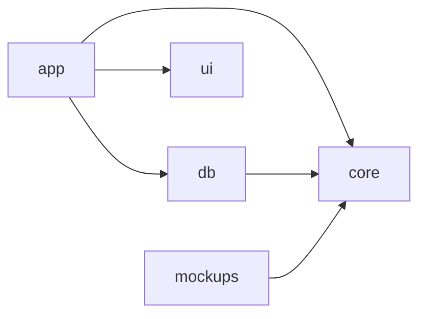

# Wine Match

Platforma B2B2C dla restauracji: gość skanuje QR kod, wybiera danie i widzi najlepiej pasujące wina **z karty tej restauracji**, z ceną kieliszka lub butelki i krótkim „dlaczego”. Sommelier zachowuje pełną kontrolę nad rekomendacjami, a restauracja widzi, jak rośnie sprzedaż wina (Wine Attach Rate).

Rekomendacje liczy własny, deterministyczny silnik dopasowań (reguły sommelierskie i scoring). Normalne korzystanie z aplikacji nie wywołuje żadnego płatnego API LLM.

## Uruchomienie

Wymagania: **Node.js ≥ 22.17** i **npm ≥ 11.6** (npm 10 dołączany do Node 22 nie instaluje Vitest 5 — zaktualizuj go: `npm install -g npm@11`). PostgreSQL ≥ 16 jest potrzebny tylko w trybie `DATA_SOURCE=postgres` i do testów bazy.

```bash
npm install
cp .env.example .env          # domyślnie DATA_SOURCE=memory: dane demo bez bazy
npm run dev                   # http://localhost:3000 → /r/halka
```

Z bazą danych:

```bash
# w .env: DATA_SOURCE=postgres, DATABASE_URL=postgres://…/winematch
npm run db:migrate            # schemat z migracji
npm run db:seed               # restauracja demo Halka
npm run dev
```

| Polecenie | Opis |
|---|---|
| `npm run dev` | aplikacja Next.js |
| `npm run dev:mockups` | statyczne, klikalne mockupy (Vite) |
| `npm run build` | sprawdzenie granic pakietów, build mockupów i aplikacji (z typecheckiem) |
| `npm start` | uruchomienie zbudowanej aplikacji |
| `npm run lint` | `oxlint`: brak `any`, pustych `catch`, `console.*`, ograniczenia importów między pakietami |
| `npm run typecheck` | TypeScript 7 we wszystkich pakietach |
| `npm test` | testy jednostkowe: silnik, serwisy, kontrakt repozytoriów |
| `npm run test:db` | testy integracyjne na PostgreSQL (tworzą bazę `<nazwa>_test`) |
| `npm run check:boundaries` | granice między pakietami |
| `npm run audit:gate` | audyt zależności produkcyjnych: wysokie i krytyczne blokują, wyjątki tylko jawne i z terminem |
| `npm run boot:check` | start zbudowanej aplikacji bez bazy (po `npm run build`): zła konfiguracja zatrzymuje serwer, demo tylko świadomie, ogólne 500 bez sekretów |
| `npm run smoke` | smoke test uruchomionej aplikacji (`npm start` w drugim terminalu): 155 sprawdzeń stron gościa, panelu, logowania, uprawnień, importu, QR i API; loguje się kontem demo; niczego nie zmienia w danych |
| `npm run user:create` | tworzy konto do panelu (patrz niżej) |
| `npm run engine:matrix` | przegląd kalibracji silnika: najlepsze wina dla każdego dania demo |
| `npm run db:migration:create` | nowa migracja z różnicy encje ↔ baza |
| `npm run db:migrate` / `npm run db:seed` | migracje / dane demo |

**Logowanie do panelu.** Dane demo (po `npm run db:seed` albo w trybie `memory`) zawierają trzy konta ze wspólnym, **publicznym** hasłem `demo-halka-2026`: `marta@halka.pl` (Wine Director), `tomasz@halka.pl` (General Manager, tylko podgląd pairingów), `kelner@halka.pl` (kelner — bez dostępu do panelu). Konta demo nie mogą istnieć na prawdziwej instalacji. Prawdziwe konta:

```bash
USER_PASSWORD='długie hasło, min. 12 znaków' npm run user:create -- \
  --email jan@example.com --name "Jan Kowalski" --role sommelier --restaurant halka
```

Ciasteczko sesji jest w produkcji `Secure`. Żeby uruchomić build produkcyjny lokalnie po http (`npm run build && npm start`), ustaw `AUTH_COOKIE_SECURE=false` (jest w `.env.example`); nigdy na publicznym serwerze.

**Konfiguracja jest walidowana przy starcie** (`packages/core/src/config/env.ts`) i zawodzi zamykająco: błędna lub brakująca wartość zatrzymuje serwer (kod 1) z komunikatem wymieniającym każdy problem, zamiast po cichu uruchomić dane demo. W produkcji (`npm start`, `NODE_ENV=production`) **`DATA_SOURCE` musi być ustawione jawnie**, a `DATA_SOURCE=memory` (dane demo i konta z publicznym hasłem) wymaga świadomego `ALLOW_DEMO_DATA=true`. Żeby lokalnie uruchomić zbudowaną aplikację na danych demo: `DATA_SOURCE=memory ALLOW_DEMO_DATA=true AUTH_COOKIE_SECURE=false npm start`. `npm run build` nie potrzebuje ani środowiska, ani bazy.

**Logi** to jedna linia JSON na wpis (`LOG_LEVEL`), z redakcją sekretów: kluczy (`password`, `token`, `cookie`, `authorization`, `hash`, …) oraz wzorców w tekście błędów (skrót hasła, JWT, `Bearer`, ciasteczko sesji, adres bazy z hasłem). Klient nigdy nie dostaje śladu stosu.

Konfiguracja jest w jednym pliku `.env` w katalogu głównym; aplikacja, CLI migracji i testy bazy wczytują go same, a zmienne ustawione w środowisku mają pierwszeństwo.

Adresy po uruchomieniu (restauracja demo `halka`):

| Ekran | Adres |
|---|---|
| Landing, lista dań | `/r/halka`, `/r/halka/menu` |
| Szczegóły dania, rekomendacje, filtry | `/r/halka/dish/{id}`, `/r/halka/dish/{id}/wines`, `…/wines?sheet=filters` |
| Szczegóły wina, potwierdzenie | `/r/halka/wine/{id}?dish={id}`, `/r/halka/selected/{id}?serving=glass` |
| Cały stolik | `/r/halka/table`, `/r/halka/table/result?dish={id}&dish={id}` |
| Widok kelnera | `/r/halka/staff` |
| Logowanie | `/admin/login` |
| Import (po zalogowaniu) | `/admin/halka/import/menu`, `/admin/halka/import/wines` (`?job=` to podgląd) |
| Setup i kod QR | `/admin/halka/setup`, `/admin/halka/qr` |
| Panel (po zalogowaniu) | `/admin/halka` (dashboard), `/menu`, `/menu/{id}`, `/wines`, `/wines/{id}`, `/pairings/{id}` (decyzje sommeliera), `/review`, `/publish` |
| API publiczne | `GET /api/v1/dishes/{id}/recommendations?restaurant=halka`, `POST /api/v1/recommendations/table`, `GET /api/v1/public/restaurants/halka/menu` |
| API panelu (sesja + `X-CSRF-Token`) | `POST /api/v1/auth/login`, `POST /auth/logout`, `GET /auth/me`, `GET /restaurants/{slug}/pairings`, `PATCH/DELETE /pairings/{id}?restaurant=` (`If-Match`), `POST /pairings`, `POST /restaurants/{slug}/pairings/bulk-decision`, `PATCH /wines/{id}`, `POST /restaurants/{slug}/publish`, `POST /imports/menu\|wines`, `GET/DELETE /imports/{id}`, `PATCH /imports/{id}/rows`, `POST /imports/{id}/confirm`, `GET /restaurants/{slug}/qr?format=svg\|png` |

## Architektura

### Stos

| Obszar | Technologia |
|---|---|
| Aplikacja | Next.js 16 (App Router, Turbopack), React 19 |
| Język | TypeScript 7 (natywny kompilator) |
| Dane | PostgreSQL + MikroORM 7 (encje `defineEntity`, migracje, seedery, pula połączeń) |
| Dependency Injection | Awilix 13 |
| CSS | Tailwind CSS 4 — strony gościa; shadcn/ui (na Tailwind) — panel |
| Testy | Vitest 5 |
| Monorepo | npm workspaces |

### Pakiety

```
packages/
├─ core      domena, silnik dopasowań, porty repozytoriów, serwisy, dane demo
├─ db        MikroORM: encje, konfiguracja, migracje, seedery, repozytoria PostgreSQL
├─ ui        komponenty shadcn/ui, komponenty marki (MatchGlass), motyw panelu
├─ app       Next.js: strony gościa, panel, REST API, kontener DI
└─ mockups   statyczne mockupy do pokazów (korzystają z silnika z core)
```



Kierunek zależności jest jednokierunkowy i sprawdzany automatycznie (`scripts/check-boundaries.mjs`, część `npm run build`):

| Pakiet | Może importować | Nie może importować |
|---|---|---|
| `core` | nic z projektu | React, Next.js, MikroORM, `pg`, Awilix, `node:*` |
| `db` | `core`, MikroORM | React, Next.js, Awilix, `ui`, `app` |
| `ui` | React, Radix, Tailwind | `core`, `db`, `app`, Next.js |
| `app` | wszystko | w `src/app`: `db` i MikroORM (dane tylko przez serwisy); na stronach gościa: shadcn |

Pakiety wewnętrzne eksportują źródła TypeScript bez kroku build; Next.js kompiluje je przez `transpilePackages`.

### Warstwy i przepływ żądania

```
Żądanie HTTP (strona gościa / panel / REST)
  │
  ▼
app: komponent serwerowy lub route handler
  │  parsuje wejście, rozwiązuje serwis z zakresu żądania (Awilix)
  ▼
core: serwis aplikacyjny (RecommendationService, CatalogService)
  │  ładuje dane przez porty, decyzje deleguje do silnika
  ├──► core: silnik (pairingScore, recommendForDish, recommendForTable) — czyste funkcje
  ▼
port repozytorium (core/src/ports)
  ├─ DATA_SOURCE=memory   → core/src/memory  (dane demo Halka)
  └─ DATA_SOURCE=postgres → db/src/repositories (MikroORM, EntityManager per żądanie)
```

**Porty i adaptery.** Serwisy znają tylko interfejsy repozytoriów. Ta sama logika działa na danych demo w pamięci (rozwój bez bazy, testy jednostkowe) i na PostgreSQL. Obie implementacje przechodzą ten sam test kontraktu (`core/src/testing/repository-contract.ts`), a test integracyjny potwierdza, że dla wszystkich dań demo rekomendacje z bazy są identyczne z wynikiem silnika.

**Import i QR.** Menu i kartę win wgrywasz jako CSV (UTF-8 lub Windows-1250, `,` `;` lub tabulator), Excel (`.xlsx`) albo PDF z tekstem. Nagłówki mogą być po polsku lub angielsku; ceny typu `58,50 zł` są rozumiane. Najpierw widzisz **podgląd z kontrolą każdego wiersza** (błędy, ostrzeżenia, istniejące pozycje), poprawiasz, zaznaczasz, dopiero potem zatwierdzasz: zapis jest atomowy i działa raz. Nowe dania są szkicami (idą do gości po publikacji), nowe wina są od razu na liście, a silnik przygotowuje propozycje pairingów do przeglądu. Plik nie jest przechowywany. PDF to tylko tekst (bez tabel i bez OCR skanów), więc zawsze sprawdź każdy wiersz. Kod QR prowadzi pod `PUBLIC_BASE_URL/r/{slug}`: **ustaw `PUBLIC_BASE_URL` przed drukiem**, a zmiana adresu restauracji (slug) unieważnia wydrukowane kody.

**Uwierzytelnianie i uprawnienia.** Własne, minimalne uwierzytelnianie bez zewnętrznych zależności: hasła skrótem scrypt, sesja jako losowy token w ciasteczku httpOnly (w bazie tylko jego SHA-256), blokada konta na 15 minut po 5 nieudanych próbach, jedna odpowiedź dla złego hasła, nieznanego i zablokowanego konta. Uprawnienia ról są w jednej tabeli (`core/src/auth/permissions.ts`): GM i Owner prowadzą biznes, ale **decyzje o pairingach podejmuje tylko Sommelier**, dzięki czemu etykieta „Sommelier recommendation” zawsze oznacza jego decyzję. Każde drzwi sprawdzają sesję i uprawnienie same (layout panelu, akcje serwerowe, route handlery API z tokenem CSRF), a w historii decyzji jest zalogowany użytkownik.

**Zapisy i publikacja.** Sommelier zmienia pairingi przez `SommelierService` (reguły w czystych funkcjach, zatwierdzenie atomowe, blokada optymistyczna przez `version`, wpis w historii decyzji). Goście nie widzą zmian od razu: czytają **ostatnią opublikowaną wersję** (migawkę pairingów), a `PublishService.publish` tworzy nową wersję. Dostępność wina i ustawienia dla gości działają od razu. Formularze panelu to akcje serwerowe, które działają bez JavaScriptu.

**Izolacja tenantów.** Każda metoda repozytorium (poza wyszukaniem restauracji po slugu) wymaga `restaurantId`; zapytanie bez zakresu restauracji nie istnieje w API portów.

**Dependency Injection.** `packages/app/src/server/container.ts` to jedyny root kompozycji:

| Rejestracja | Czas życia |
|---|---|
| ORM i pula połączeń (`postgres`) / magazyn danych demo (`memory`) | singleton (na proces) |
| `em` — fork EntityManagera MikroORM | scoped (na żądanie) |
| repozytoria, `RecommendationService`, `CatalogService` | scoped (na żądanie) |

Komponenty serwerowe biorą jeden zakres na render (`getRequestScope()`, oparty na `React.cache`), route handlery tworzą własny i zwalniają go w `finally`. Klasy dostają zależności przez konstruktor (tryb Awilix `PROXY`), więc `core` i `db` nie zależą od Awilix.

**Baza danych.** Encje w `packages/db/src/entities` odpowiadają `docs/DATA_MODEL.md`: restauracja, danie (profil smakowy jako kolumny `profile_*`), wino (profil jako `profile_*`), pairing, decyzje sommeliera (audyt, bez klucza obcego — przeżywa usunięcie pairingu), wersje publikacji (migawka), eventy gości, zadania importu. Baza sama pilnuje kluczowych reguł: jednej pary na danie–wino i jednego Primary na danie (częściowy indeks unikalny). Schemat zmienia się wyłącznie przez migracje w `packages/db/src/migrations`.

**Frontend.** Gość i panel to dwie grupy tras z osobnymi layoutami głównymi:

| | Strony gościa `(guest)` | Panel `(admin)` |
|---|---|---|
| Adresy | `/r/[slug]`, `/r/[slug]/dish/[dishId]` | `/admin/[slug]` (dashboard), `/menu`, `/wines`, `/pairings/[dishId]`, `/review` |
| UI | Tailwind, motyw `guest.css`, mobile-first | shadcn/ui z `@wine-match/ui`, desktop-first |
| Wspólne | `MatchGlass` z `@wine-match/ui/brand`, lokalne fonty Bodoni Moda i Hanken Grotesk | |

Stan gościa (preferencje, wybrane dania) jest w parametrach URL — bez cookies i `localStorage`. Filtry to linki, wybór dań to zwykły formularz `GET`, więc cała ścieżka gościa działa także bez JavaScriptu; JavaScript dodaje tylko licznik wybranych dań.

### TypeScript 7

TypeScript 7 to natywny kompilator bez klasycznego API JavaScript. Next.js sprawdza typy przez CLI `tsc` (`experimental.useTypeScriptCli` w `next.config.ts`); CLI MikroORM ładuje konfigurację w TypeScripcie przez `tsx`.

## Stan prac

| Obszar | Stan |
|---|---|
| Koncepcja produktu i dokumentacja (`docs/`) | gotowe |
| Silnik dopasowań + testy | gotowe (w `core`) |
| Statyczne mockupy wszystkich ekranów MVP | gotowe (`packages/mockups`) |
| Monorepo, warstwa danych, DI, migracja początkowa, seeder | gotowe |
| **Faza 1 migracji:** aplikacja gościa G0–G9 w Next.js (landing, menu, dania, rekomendacje, filtry, wino, potwierdzenie, stolik, kelner) + 3 endpointy API | gotowe |
| **Faza 2 migracji:** panel w trybie odczytu — dashboard, menu, szczegóły dania, lista win, szczegóły wina, pairingi dania, kolejka review | gotowe |
| **Faza 5 migracji:** import menu i karty win z CSV / XLSX / PDF (podgląd, poprawki, atomowe zatwierdzenie, propozycje silnika), ekran Setup, kod QR (SVG / PNG) ze stojakiem do druku, REST API importu i QR | gotowe |
| **Faza 4 migracji:** logowanie i sesje, role (Owner / GM, Sommelier, Waiter), ochrona panelu, akcji i API, prawdziwy autor w historii decyzji, REST API zapisu, blokada konta, nagłówki bezpieczeństwa | gotowe |
| **Faza 3 migracji:** zapisy sommeliera (zatwierdzanie, odrzucanie, role, kolejność, notatki, własne pary, dostępność wina), historia decyzji, blokada optymistyczna, publikacja z migawką widoczną dla gości, ekran Publish | gotowe |
| Faza 6: analityka (zapis eventów gości, KPI użycia i sprzedaży, import sprzedaży) i wycofanie mockupów | do zrobienia — plan w `.ai/specs/2026-10-14-mockups-to-app-migration-plan.md` |
| CI (GitHub Actions) | plik `.github/workflows/ci.yml` odzwierciedla polecenia lokalne; **nie był jeszcze uruchomiony** |

## Dokumentacja

| Dokument | Zawartość |
|---|---|
| [docs/PRODUCT_CONCEPT.md](docs/PRODUCT_CONCEPT.md) | problem, value proposition, model B2B2C, model biznesowy, KPI |
| [docs/USER_ROLES.md](docs/USER_ROLES.md) | role, potrzeby, macierz uprawnień |
| [docs/USE_CASES.md](docs/USE_CASES.md) | 14 use case’ów |
| [docs/USER_FLOWS.md](docs/USER_FLOWS.md) | flow gościa, stolika, sommeliera, onboardingu, kelnera, importu |
| [docs/SCREEN_MAP.md](docs/SCREEN_MAP.md) | mapa ekranów i nawigacji |
| [docs/SCREEN_SPECIFICATION.md](docs/SCREEN_SPECIFICATION.md) | specyfikacja 23 ekranów |
| [docs/DATA_MODEL.md](docs/DATA_MODEL.md) | encje i relacje |
| [docs/API_SPECIFICATION.md](docs/API_SPECIFICATION.md) | REST API v1 |
| [docs/RECOMMENDATION_ENGINE.md](docs/RECOMMENDATION_ENGINE.md) | silnik: cechy, reguły, wzory, warstwa sommeliera |
| [.ai/docs/engineering-standards.md](.ai/docs/engineering-standards.md) | standardy inżynieryjne: konwencja pojęć, warstwa API, walidacja, bezpieczeństwo, jakość, lista kontrolna przeglądu (adaptacja dokumentu DevMentor, z mapowaniem każdej reguły) |

## Praca z agentami AI

Zasady dla agentów (Claude Code, Codex, Cursor i innych) są w [AGENTS.md](AGENTS.md) — w tym obowiązkowe reguły architektury (§1). Każdy pakiet ma własny `AGENTS.md` ze szczegółami, a pliki `CLAUDE.md` je importują. Katalog `.ai/` przechowuje specyfikacje SDD (`.ai/specs/`), logi przebiegów (`.ai/runs/`) i pamięć długoterminową projektu (`.ai/lessons.md`, `.ai/lessons/`).
