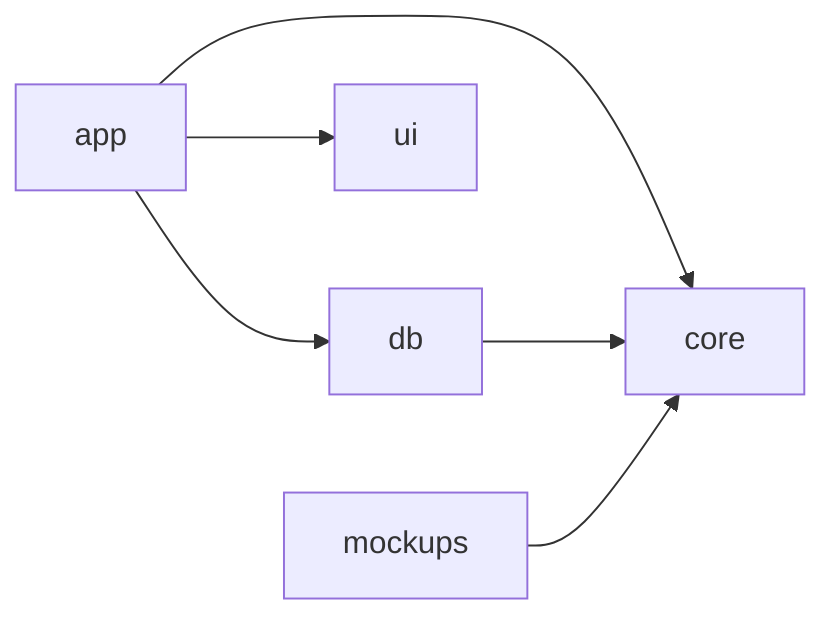

# Wine Match

[](https://github.com/NiedzielX/wine/actions/workflows/ci.yml)

Platforma B2B2C dla restauracji: gość skanuje QR kod, wybiera danie i widzi najlepiej pasujące wina **z karty tej restauracji**, z ceną kieliszka lub butelki i krótkim „dlaczego”. Sommelier zachowuje pełną kontrolę nad rekomendacjami, a restauracja widzi, jak rośnie sprzedaż wina (Wine Attach Rate).

Rekomendacje liczy własny, deterministyczny silnik dopasowań (reguły sommelierskie i scoring). Normalne korzystanie z aplikacji nie wywołuje żadnego płatnego API LLM.

## Dla kogo

- **Goście restauracji** (telefon przy stoliku, bez rejestracji) i **kelnerzy** (widok personelu, kod polecenia „pokaż kelnerowi: W7K”).
- **Sommelier / Wine Director** (decyzje o pairingach), **Owner / GM** (biznes, import, publikacja, zespół).
- Grupa docelowa i problemy są **założeniami zespołu, nie wynikami badań**: właściciel zdecydował (D09, D19) budować produkt bez ich weryfikacji; badania (E01) nie zostały przeprowadzone. Szczegóły: [.ai/specs/product-brief.md](.ai/specs/product-brief.md).

## Zakres MVP i świadome nie-cele

**MVP (D01):** aplikacja gościa (G0–G12: wybór dania, cały stół, ścieżka kelnera, kod polecenia, PL/EN), panel sommeliera i restauracji (import menu i karty win z CSV / XLSX / PDF, kolejka review, publikacja, QR, KPI i okazje), zdarzenia użycia, opcjonalny import sprzedaży z POS (CSV / XLSX) i Wine Attach Rate, deterministyczny silnik.

**Nie-cele** (brief, sekcja „Non-goals”): płatne pozycje w rekomendacjach dla importerów lub producentów (N01), pozycjonowanie jako „AI Sommelier” i słowo „AI” w interfejsie gościa (N02), płatne API LLM przy każdym zapytaniu (N03), integracje z POS i e-menu, magazyn, prognozy, marketplace i profile gości (N04). Rozbudowa poza MVP jest rozpisana jako plan E11–E22 (niżej); jego realizacja nie zmienia nie-celów N01–N04.

## Uruchomienie

Wymagania: **Node.js ≥ 22.17** i **npm ≥ 11.6** (npm 10 dołączany do Node 22 nie instaluje Vitest 5 — zaktualizuj go: `npm install -g npm@11`). PostgreSQL ≥ 16 jest potrzebny tylko w trybie `DATA_SOURCE=postgres` i do testów bazy.

```bash
npm install
cp .env.example .env          # domyślnie DATA_SOURCE=memory: dane demo bez bazy
npm run dev                   # http://localhost:3000 → /r/halka
```

Z bazą danych:

```bash
# w .env: DATA_SOURCE=postgres, DATABASE_URL=postgres://…/winematch
npm run db:migrate            # schemat z migracji
npm run db:seed               # restauracja demo Halka
npm run dev
```

| Polecenie | Opis |
|---|---|
| `npm run dev` | aplikacja Next.js |
| `npm run dev:mockups` | statyczne, klikalne mockupy (Vite) |
| `npm run build` | sprawdzenie granic pakietów, build mockupów i aplikacji (z typecheckiem) |
| `npm start` | uruchomienie zbudowanej aplikacji |
| `npm run lint` | `oxlint`: brak `any`, pustych `catch`, `console.*`, ograniczenia importów między pakietami |
| `npm run typecheck` | TypeScript 7 we wszystkich pakietach |
| `npm test` | testy jednostkowe: silnik, serwisy, kontrakt repozytoriów |
| `npm run test:db` | testy integracyjne na PostgreSQL (tworzą bazę `<nazwa>_test`) |
| `npm run check:boundaries` | granice między pakietami |
| `npm run audit:gate` | audyt zależności produkcyjnych: wysokie i krytyczne blokują, wyjątki tylko jawne i z terminem |
| `npm run boot:check` | start zbudowanej aplikacji bez bazy (po `npm run build`): zła konfiguracja (także `PUBLIC_BASE_URL` w produkcji) zatrzymuje serwer, demo tylko świadomie, ogólne 500 i 503 z `GET /api/v1/health` bez sekretów |
| `npm run smoke` | smoke test uruchomionej aplikacji (`npm start` w drugim terminalu): ponad 200 sprawdzeń stron gościa, panelu, logowania, uprawnień, importu, QR i API. Loguje się kontem demo i **zmienia dane** (przełącza `active` wina, tworzy anulowane importy), więc uruchamiaj go tylko na instancji próbnej. Na prawdziwej instalacji użyj `npm run smoke -- --production <url> <slug>`: wysyła wyłącznie GET, nie loguje się i nie zależy od treści menu (sprawdza health, `/` po przekierowaniach, `/r/{slug}`, kształt publicznego menu API, `/admin/login`, 401 dla trasy z sesją i nagłówki bezpieczeństwa; `DEMO_RESTAURANT_SLUG` musi być równy slugowi). Każde żądanie obu trybów ma nagłówek `x-wine-match-synthetic: 1` (ruch własny): strony renderują się normalnie, ale nie zapisują zdarzeń użycia gościa. Wysyłaj go też z `curl` i monitoringu |
| `npm run user:create` | tworzy konto do panelu (patrz niżej) |
| `npm run restaurant:create` | zakłada restaurację i jej pierwszego właściciela na PostgreSQL (patrz niżej) |
| `npm run engine:matrix` | przegląd kalibracji silnika: najlepsze wina dla każdego dania demo |
| `npm run db:migration:create` | nowa migracja z różnicy encje ↔ baza |
| `npm run db:migrate` / `npm run db:seed` | migracje / dane demo |

**Logowanie do panelu.** Dane demo (po `npm run db:seed` albo w trybie `memory`) zawierają trzy konta ze wspólnym, **publicznym** hasłem `demo-halka-2026`: `marta@halka.pl` (Wine Director), `tomasz@halka.pl` (General Manager, tylko podgląd pairingów), `kelner@halka.pl` (kelner — bez dostępu do panelu). Konta demo nie mogą istnieć na prawdziwej instalacji. Prawdziwe konta:

```bash
USER_PASSWORD='długie hasło, min. 12 znaków' npm run user:create -- \
  --email jan@example.com --name "Jan Kowalski" --role sommelier --restaurant halka
```

**Nowa restauracja i jej właściciel** (`npm run restaurant:create`; na PostgreSQL po `npm run db:migrate`, bez danych demo). Jedna transakcja zakłada restaurację (`status: onboarding`, niepublikowaną) i konto z rolą `owner`; właściciel loguje się pod `/admin/{slug}` i zaczyna od Setup (import menu). Slug trafia na wydrukowane kody QR i nie jest normalizowany: tylko małe litery, cyfry i pojedyncze myślniki, 2–40 znaków, nie zajęte słowo (`admin`, `api`, …). Wszystkie pola poniżej są wymagane:

```bash
USER_PASSWORD='długie hasło, min. 12 znaków' npm run restaurant:create -- \
  --name "Bistro Nad Wisłą" --slug bistro-nad-wisla \
  --address "ul. Wiślna 1" --city Kraków --wine-director "Anna Nowak" \
  --owner-email anna@example.com --owner-name "Anna Nowak"
```

- Błędy pól i hasła są zgłaszane naraz, zanim polecenie połączy się z bazą. Brak `DATABASE_URL` albo niezastosowane migracje (`npm run db:migrate`) kończą się kodem 1 i niczego nie zapisują. Polecenie nie czyta `DATA_SOURCE`, `ALLOW_DEMO_DATA` ani `PUBLIC_BASE_URL` i nie ładuje danych demo.
- Zajęty slug albo e-mail istniejącego konta (bez względu na wielkość liter) → kod 1, nic nie zapisane. Flaga `--allow-existing-account` (np. ta sama osoba w drugim lokalu) dodaje istniejącemu kontu tylko członkostwo `owner`; jego hasło się nie zmienia, a `USER_PASSWORD` nie jest potrzebne.
- Hasło jest wyłącznie w `USER_PASSWORD` (nigdy w argumentach); ani ono, ani `DATABASE_URL` nie trafia na wyjście. Wartość z końcowym znakiem nowej linii jest używana dosłownie, więc nie ustawiaj jej przez `echo` bez `-n`.
- **W kontenerze** (usługa `migrate` z `docker-compose.yml`, obraz `migrator`; pełny runbook: [docs/DEPLOYMENT.md](docs/DEPLOYMENT.md)) hasło wczytaj bez echa i przekaż samą nazwą zmiennej, nigdy `-e USER_PASSWORD=…`, wartością w pliku compose ani flagą:

  ```sh
  stty -echo; printf 'Owner password: '; read -r USER_PASSWORD; stty echo; echo
  export USER_PASSWORD
  docker compose run --rm -e USER_PASSWORD migrate npm run restaurant:create -- --name … --slug … --address … --city … --wine-director … --owner-email … --owner-name …
  unset USER_PASSWORD
  ```

- **Przekazanie hasła właścicielowi:** na pilotaż maintainer zna hasło do czasu jego zmiany (zmiany hasła w panelu jeszcze nie ma) i przekazuje je właścicielowi razem z adresem `/admin/{slug}` jednorazowym kanałem poza systemem (nie e-mailem z hasłem w treści ani czatem zespołu). Zaproszenia do zespołu (jednorazowy link, A15; `npm run user:invite`) istnieją od E12 F2, ale zmiany hasła przez właściciela jeszcze nie ma (E12 F3).
- **Strona gościa świeżej restauracji** `/r/{slug}` odpowiada 200 od razu (nazwa, adres, „Tonight's menu is being updated”); ukrywanie restauracji `onboarding` przed gośćmi to osobne zgłoszenie.
- **Cofnięcie pomyłki** (brak polecenia usuwania; jedna transakcja `psql`, tylko zanim zaimportowano menu):

  ```sql
  BEGIN;
  DELETE FROM membership WHERE restaurant_id = (SELECT id FROM restaurant WHERE slug = '<slug>');
  DELETE FROM app_user u WHERE u.email = '<email>' AND NOT EXISTS (SELECT 1 FROM membership m WHERE m.user_id = u.id);
  DELETE FROM restaurant WHERE slug = '<slug>';
  COMMIT;
  ```

  Sesje znikają kaskadowo razem z kontem; konto z innymi członkostwami zostaje. Jeśli ostatni `DELETE` kończy się błędem klucza obcego (dania, wina, importy, zdarzenia gościa, publikacje), restauracja jest już w użyciu: wykonaj `ROLLBACK` i ustaw `UPDATE restaurant SET status = 'archived' WHERE slug = '<slug>'` (zajęty slug pozostaje zajęty).

Ciasteczko sesji jest w produkcji `Secure`. Żeby uruchomić build produkcyjny lokalnie po http (`npm run build && npm start`), ustaw `AUTH_COOKIE_SECURE=false` (jest w `.env.example`); nigdy na publicznym serwerze.

**Konfiguracja jest walidowana przy starcie** (`packages/core/src/config/env.ts`) i zawodzi zamykająco: błędna lub brakująca wartość zatrzymuje serwer (kod 1) z komunikatem wymieniającym każdy problem, zamiast po cichu uruchomić dane demo. W produkcji (`npm start`, `NODE_ENV=production`) **`DATA_SOURCE` musi być ustawione jawnie**, a `DATA_SOURCE=memory` (dane demo i konta z publicznym hasłem) wymaga świadomego `ALLOW_DEMO_DATA=true`. W produkcji `PUBLIC_BASE_URL` musi być też ustawiony i mieć schemat `https://` oraz publiczną nazwę hosta (nie adres IP, nie nazwa jednoczłonowa jak `localhost`, nie `.local`, `.localhost`, `.internal`, `.lan`, `.home.arpa`): wydrukowanego kodu QR nie da się poprawić, więc inaczej serwer nie wystartuje (kod 1). **Zmiana łamiąca (2026-11-05):** wcześniej brak adresu dawał tylko ostrzeżenie, a `AUTH_COOKIE_SECURE=false` nie miało z tym związku; nadal nie ma (nie zwalnia z tej reguły). Jedyne wyjście to jawne `ALLOW_LOCAL_BASE_URL=true` (lokalny uruchomiony build, CI, testy; start loguje ostrzeżenie). Żeby lokalnie uruchomić zbudowaną aplikację na danych demo: `DATA_SOURCE=memory ALLOW_DEMO_DATA=true AUTH_COOKIE_SECURE=false ALLOW_LOCAL_BASE_URL=true npm start`. `npm run db:seed` (konta z publicznym hasłem) odmawia przy `NODE_ENV=production`, chyba że `ALLOW_DEMO_DATA=true` (instancja próbna), a nawet wtedy na bazie z restauracją o innym slugu niż demo. `npm run build` nie potrzebuje ani środowiska, ani bazy.

**Logi** to jedna linia JSON na wpis (`LOG_LEVEL`), z redakcją sekretów: kluczy (`password`, `token`, `cookie`, `authorization`, `hash`, …) oraz wzorców w tekście błędów (skrót hasła, JWT, `Bearer`, ciasteczko sesji, adres bazy z hasłem). Klient nigdy nie dostaje śladu stosu. Każde żądanie API zostawia jeden wiersz `api request` (metoda, wzorzec trasy, status, czas; bez query, nagłówków i IP), a błędy serwera (`onRequestError`, `unhandledRejection`, `uncaughtException`) są logowane z redakcją i liczone.

**Strony sprzedażowe (E22):** `SHOWCASE_MODE=calculator` włącza publiczny kalkulator zwrotu dla restauracji (`/demo/roi`, wersja do druku `/demo/roi/summary`; bez logowania, bez zapisów, `noindex`; każda liczba to założenie zespołu, nie pomiar). Bez zmiennej (`off`) adresy `/demo/*` odpowiadają 404; inna wartość zatrzymuje start. Kalkulator nie czyta danych, więc może działać na każdym `DATA_SOURCE`. `SHOWCASE_MODE=demo` (F2) to osobna instancja publicznego dema fikcyjnej restauracji Halka: wymaga `DATA_SOURCE=memory` i `ALLOW_DEMO_DATA=true` (inaczej start kończy się kodem 1), nie ładuje kont demo (hasło `demo-halka-2026` nie istnieje), wyłącza logowanie (`/admin/login`, `POST /api/v1/auth/login` → 403 `showcase_read_only`) i zapis zdarzeń gości, a na stronach gościa pokazuje pasek „Dane demonstracyjne”. Dodaje przewodnik `/demo` i stronę `/demo/tour`; instancja: sekcja „Instancja demo” w `docs/OPERATIONS.md`. Sprawdzenie uruchomionej instancji: `npm run smoke -- --showcase http://localhost:3000`. Odsłony: jedna linia logu `showcase_view` z samą nazwą strony (`grep showcase_view | wc -l`).

**Metryki:** ustaw `METRICS_TOKEN` (min. 32 znaki, np. `openssl rand -hex 32`), a `GET /api/v1/metrics` z `Authorization: Bearer <token>` zwróci metryki procesu w formacie Prometheus; bez tokenu endpoint odpowiada 404. Alerty i runbook: [`docs/OPERATIONS.md`](docs/OPERATIONS.md).

Konfiguracja jest w jednym pliku `.env` w katalogu głównym; aplikacja, CLI migracji i testy bazy wczytują go same, a zmienne ustawione w środowisku mają pierwszeństwo.

## Wdrożenie produkcyjne

Produkcja to jedna VM z Docker Compose (`docker-compose.yml`: PostgreSQL 16, jednorazowe `migrate`, aplikacja) za reverse proxy z TLS; obraz (`Dockerfile`, cele `runtime` i `migrator`) jest niezależny od dostawcy, a konfiguracja pochodzi wyłącznie z `.env` w czasie uruchomienia (nic nie jest wypalone w obrazie). Szkic (pełne kroki, oczekiwane wyniki i co zrobić przy błędzie: **[docs/DEPLOYMENT.md](docs/DEPLOYMENT.md)**):

```sh
cp .env.example .env            # ustaw PUBLIC_BASE_URL (https), POSTGRES_PASSWORD, DEMO_RESTAURANT_SLUG, METRICS_TOKEN, WINE_MATCH_TAG
docker compose build
docker compose up -d db
docker compose run --rm migrate                                            # migracje (osobny krok, aplikacja nigdy nie migruje)
docker compose run --rm migrate npm run migration:pending -w @wine-match/db   # ma wypisać "No pending migrations"
docker compose up -d app
npm run smoke -- --production https://<domena> <slug>
```

Runbook zawiera też pierwszą restaurację (`restaurant:create`), ustawienia reverse proxy (TLS i HSTS, log bez query, limit ciała, blokada TRACE), kopie zapasowe i próbę odtworzenia (`pg_dump`/`pg_restore`) oraz **wycofanie** (poprzedni obraz, poprawka w przód, odtworzenie zrzutu; `migration:down` zabronione na produkcji). Monitoring i alerty: [docs/OPERATIONS.md](docs/OPERATIONS.md). Co robić bez agentów AI albo gdy zabraknie budżetu: [docs/CONTINUITY.md](docs/CONTINUITY.md). Job CI `image` buduje obraz i sprawdza go end-to-end (jeszcze nie jest wymaganym sprawdzeniem: decyzja właściciela po zielonych przebiegach na `main`).

Adresy po uruchomieniu (restauracja demo `halka`):

| Ekran | Adres |
|---|---|
| Landing, lista dań | `/r/halka`, `/r/halka/menu` |
| Szczegóły dania, rekomendacje, filtry | `/r/halka/dish/{id}`, `/r/halka/dish/{id}/wines`, `…/wines?sheet=filters` |
| Szczegóły wina, potwierdzenie | `/r/halka/wine/{id}?dish={id}`, `/r/halka/selected/{id}?serving=glass` |
| Cały stolik | `/r/halka/table`, `/r/halka/table/result?dish={id}&dish={id}` |
| Widok kelnera | `/r/halka/staff` |
| Logowanie | `/admin/login` |
| Import (po zalogowaniu) | `/admin/halka/import/menu`, `/admin/halka/import/wines` (`?job=` to podgląd) |
| Setup i kod QR | `/admin/halka/setup`, `/admin/halka/qr` |
| Panel (po zalogowaniu) | `/admin/halka` (dashboard), `/menu`, `/menu/{id}`, `/wines`, `/wines/{id}`, `/pairings/{id}` (decyzje sommeliera), `/review`, `/publish` |
| API publiczne | `GET /api/v1/dishes/{id}/recommendations?restaurant=halka`, `POST /api/v1/recommendations/table`, `GET /api/v1/public/restaurants/halka/menu` |
| API panelu (sesja + `X-CSRF-Token`) | `POST /api/v1/auth/login`, `POST /auth/logout`, `GET /auth/me`, `GET /restaurants/{slug}/pairings`, `PATCH/DELETE /pairings/{id}?restaurant=` (`If-Match`), `POST /pairings`, `POST /restaurants/{slug}/pairings/bulk-decision`, `PATCH /wines/{id}`, `POST /restaurants/{slug}/publish`, `POST /imports/menu\|wines`, `GET/DELETE /imports/{id}`, `PATCH /imports/{id}/rows`, `POST /imports/{id}/confirm`, `GET /restaurants/{slug}/qr?format=svg\|png` |

## Architektura

### Stos

| Obszar | Technologia |
|---|---|
| Aplikacja | Next.js 16 (App Router, Turbopack), React 19 |
| Język | TypeScript 7 (natywny kompilator) |
| Dane | PostgreSQL + MikroORM 7 (encje `defineEntity`, migracje, seedery, pula połączeń) |
| Dependency Injection | Awilix 13 |
| CSS | Tailwind CSS 4 — strony gościa; shadcn/ui (na Tailwind) — panel |
| Testy | Vitest 5 |
| Monorepo | npm workspaces |

### Pakiety

```
packages/
├─ core      domena, silnik dopasowań, porty repozytoriów, serwisy, dane demo
├─ db        MikroORM: encje, konfiguracja, migracje, seedery, repozytoria PostgreSQL
├─ ui        komponenty shadcn/ui, komponenty marki (MatchGlass), motyw panelu
├─ app       Next.js: strony gościa, panel, REST API, kontener DI
└─ mockups   statyczne mockupy do pokazów (korzystają z silnika z core)
```



Kierunek zależności jest jednokierunkowy i sprawdzany automatycznie (`scripts/check-boundaries.mjs`, część `npm run build`):

| Pakiet | Może importować | Nie może importować |
|---|---|---|
| `core` | nic z projektu | React, Next.js, MikroORM, `pg`, Awilix, `node:*` |
| `db` | `core`, MikroORM | React, Next.js, Awilix, `ui`, `app` |
| `ui` | React, Radix, Tailwind | `core`, `db`, `app`, Next.js |
| `app` | wszystko | w `src/app`: `db` i MikroORM (dane tylko przez serwisy); na stronach gościa: shadcn |

Pakiety wewnętrzne eksportują źródła TypeScript bez kroku build; Next.js kompiluje je przez `transpilePackages`.

### Warstwy i przepływ żądania

```
Żądanie HTTP (strona gościa / panel / REST)
  │
  ▼
app: komponent serwerowy lub route handler
  │  parsuje wejście, rozwiązuje serwis z zakresu żądania (Awilix)
  ▼
core: serwis aplikacyjny (RecommendationService, CatalogService)
  │  ładuje dane przez porty, decyzje deleguje do silnika
  ├──► core: silnik (pairingScore, recommendForDish, recommendForTable) — czyste funkcje
  ▼
port repozytorium (core/src/ports)
  ├─ DATA_SOURCE=memory   → core/src/memory  (dane demo Halka)
  └─ DATA_SOURCE=postgres → db/src/repositories (MikroORM, EntityManager per żądanie)
```

**Porty i adaptery.** Serwisy znają tylko interfejsy repozytoriów. Ta sama logika działa na danych demo w pamięci (rozwój bez bazy, testy jednostkowe) i na PostgreSQL. Obie implementacje przechodzą ten sam test kontraktu (`core/src/testing/repository-contract.ts`), a test integracyjny potwierdza, że dla wszystkich dań demo rekomendacje z bazy są identyczne z wynikiem silnika.

**Import i QR.** Menu i kartę win wgrywasz jako CSV (UTF-8 lub Windows-1250, `,` `;` lub tabulator), Excel (`.xlsx`) albo PDF z tekstem. Nagłówki mogą być po polsku lub angielsku; ceny typu `58,50 zł` są rozumiane. Najpierw widzisz **podgląd z kontrolą każdego wiersza** (błędy, ostrzeżenia, istniejące pozycje), poprawiasz, zaznaczasz, dopiero potem zatwierdzasz: zapis jest atomowy i działa raz. Nowe dania są szkicami (idą do gości po publikacji), nowe wina są od razu na liście, a silnik przygotowuje propozycje pairingów do przeglądu. Plik nie jest przechowywany. PDF to tylko tekst (bez tabel i bez OCR skanów), więc zawsze sprawdź każdy wiersz. Kod QR prowadzi pod `PUBLIC_BASE_URL/r/{slug}`: **ustaw `PUBLIC_BASE_URL` przed drukiem**, a zmiana adresu restauracji (slug) unieważnia wydrukowane kody.

**Uwierzytelnianie i uprawnienia.** Własne, minimalne uwierzytelnianie bez zewnętrznych zależności: hasła skrótem scrypt, sesja jako losowy token w ciasteczku httpOnly (w bazie tylko jego SHA-256), blokada konta na 15 minut po 5 nieudanych próbach, jedna odpowiedź dla złego hasła, nieznanego i zablokowanego konta. Uprawnienia ról są w jednej tabeli (`core/src/auth/permissions.ts`): GM i Owner prowadzą biznes, ale **decyzje o pairingach podejmuje tylko Sommelier**, dzięki czemu etykieta „Para sommeliera” / „Sommelier’s pairing” zawsze oznacza jego decyzję. Każde drzwi sprawdzają sesję i uprawnienie same (layout panelu, akcje serwerowe, route handlery API z tokenem CSRF), a w historii decyzji jest zalogowany użytkownik.

**Zapisy i publikacja.** Sommelier zmienia pairingi przez `SommelierService` (reguły w czystych funkcjach, zatwierdzenie atomowe, blokada optymistyczna przez `version`, wpis w historii decyzji). Goście nie widzą zmian od razu: czytają **ostatnią opublikowaną wersję** (migawkę pairingów), a `PublishService.publish` tworzy nową wersję. Dostępność wina i ustawienia dla gości działają od razu. Formularze panelu to akcje serwerowe, które działają bez JavaScriptu.

**Izolacja tenantów.** Każda metoda repozytorium (poza wyszukaniem restauracji po slugu) wymaga `restaurantId`; zapytanie bez zakresu restauracji nie istnieje w API portów.

**Dependency Injection.** `packages/app/src/server/container.ts` to jedyny root kompozycji:

| Rejestracja | Czas życia |
|---|---|
| ORM i pula połączeń (`postgres`) / magazyn danych demo (`memory`) | singleton (na proces) |
| `em` — fork EntityManagera MikroORM | scoped (na żądanie) |
| repozytoria, `RecommendationService`, `CatalogService` | scoped (na żądanie) |

Komponenty serwerowe biorą jeden zakres na render (`getRequestScope()`, oparty na `React.cache`), route handlery tworzą własny i zwalniają go w `finally`. Klasy dostają zależności przez konstruktor (tryb Awilix `PROXY`), więc `core` i `db` nie zależą od Awilix.

**Baza danych.** Encje w `packages/db/src/entities` odpowiadają `docs/DATA_MODEL.md`: restauracja, danie (profil smakowy jako kolumny `profile_*`), wino (profil jako `profile_*`), pairing, decyzje sommeliera (audyt, bez klucza obcego — przeżywa usunięcie pairingu), wersje publikacji (migawka), eventy gości, zadania importu. Baza sama pilnuje kluczowych reguł: jednej pary na danie–wino i jednego Primary na danie (częściowy indeks unikalny). Schemat zmienia się wyłącznie przez migracje w `packages/db/src/migrations`.

**Frontend.** Gość i panel to dwie grupy tras z osobnymi layoutami głównymi:

| | Strony gościa `(guest)` | Panel `(admin)` |
|---|---|---|
| Adresy | `/r/[slug]`, `/r/[slug]/dish/[dishId]` | `/admin/[slug]` (dashboard), `/menu`, `/wines`, `/pairings/[dishId]`, `/review` |
| UI | Tailwind, motyw `guest.css`, mobile-first | shadcn/ui z `@wine-match/ui`, desktop-first |
| Wspólne | `MatchGlass` z `@wine-match/ui/brand`, lokalne fonty Bodoni Moda i Hanken Grotesk | |

Stan gościa (preferencje, wybrane dania) jest w parametrach URL — bez cookies i `localStorage`. Filtry to linki, wybór dań to zwykły formularz `GET`, więc cała ścieżka gościa działa także bez JavaScriptu; JavaScript dodaje tylko licznik wybranych dań.

### TypeScript 7

TypeScript 7 to natywny kompilator bez klasycznego API JavaScript. Next.js sprawdza typy przez CLI `tsc` (`experimental.useTypeScriptCli` w `next.config.ts`); CLI MikroORM ładuje konfigurację w TypeScripcie przez `tsx`.

## Stan prac

Stan na 2026-11-08, z listy scalonych PR-ów (GitHub API, tylko odczyt) i specyfikacji. Szczegóły i numery PR-ów: [.ai/specs/backlog.md](.ai/specs/backlog.md), plan: [.ai/specs/2026-11-04-product-completion-plan.md](.ai/specs/2026-11-04-product-completion-plan.md), historia zmian: [CHANGELOG.md](CHANGELOG.md).

**Zbudowane (MVP i migracja z mockupów):** silnik dopasowań, aplikacja gościa G0–G12, panel (odczyt, zapisy sommeliera, publikacja z migawką, import menu i win CSV / XLSX / PDF, kod QR), logowanie i role, PL/EN, zdarzenia użycia (E02), import sprzedaży i Wine Attach Rate (E03), KPI w panelu (E04), „Jak to działa” (E07), cały stół i ścieżka kelnera (E08), kod polecenia (E09, domknięcie E11b), okazje sommeliera (E10), `restaurant:create` (E05-S01). Statyczne mockupy (`packages/mockups`) nadal są w repozytorium; ich wycofanie nie jest zrobione.

| Epik | Stan |
|---|---|
| E01 Discovery (badania) | **nie zrobione** (brak wywiadów, benchmarku, danych POS); nie blokuje budowy (D19) |
| E02–E04, E07–E10, E11b | **scalone, zrealizowane** |
| E05 Gotowość pilotażu | S01 scalone; S02 (wdrożenie) częściowo przez E11 |
| E06 Później | odłożone |
| E11 Wdrożenie produkcyjne | **w toku**: F1 scalone (#120: health, `PUBLIC_BASE_URL`, strażnik seedera, `smoke --production`); F2 (obraz, job CI `image`) i F3 (runbook `docs/DEPLOYMENT.md`, hosting) nie rozpoczęte. **Nie ma jeszcze instancji produkcyjnej** |
| E12 Konta, role, PIN kelnera | **w toku**: F1 (#118: zespół, status, dziennik) i F2 (#123, #125: zaproszenia) scalone; F3–F6 nie rozpoczęte |
| E13 Panel (edycja profili, historia publikacji) | nie rozpoczęte (specyfikacja `approved`) |
| E14 Administrator systemu, wiele lokali | nie rozpoczęte (`approved`) |
| E15 Rozliczenia | nie rozpoczęte (`approved`) |
| E16 Silnik v1.x | nie rozpoczęte (`approved`) |
| E17 Warstwa uczenia | nie rozpoczęte (`approved`) |
| E18 Doświadczenie gościa | nie rozpoczęte (`approved`) |
| E19 Operacje restauracji | nie rozpoczęte (`approved`) |
| E20 Dane i import | nie rozpoczęte jako epik (`approved`); #90 naprawiono wcześniej (#92) |
| E21 Jakość i zgodność | **w toku**: F1 scalone (#117: metryki, logi, redakcja); F2–F7 nie rozpoczęte |
| E22 Demo i kalkulator zwrotu | **w toku**: F1 (#122: kalkulator) i F2 (#126: przewodnik, demo tylko do odczytu) scalone; F3–F4 nie rozpoczęte |

Specyfikacje E12–E22 mają status `approved` na podstawie delegacji właściciela z 2026-11-04. Rola System Admin nie jest zaimplementowana (E14), a w panelu nie ma tworzenia ani usuwania dań i win (zob. „Usuwanie danych: co jest dziś” w [docs/DATA_MODEL.md](docs/DATA_MODEL.md)). Definicja wersji 1.0 nie jest ustalona (`package.json` ma `0.2.0`).

## Testy i CI

Lokalnie: `npm run lint`, `npm run typecheck`, `npm test` (jednostkowe), `npm run test:db` (PostgreSQL, testcontainers albo `TEST_DATABASE_URL`), `npm run test:e2e` (zbudowana aplikacja i `agent-browser`), `npm run build`, `npm run boot:check`, `npm run smoke`, `npm run check:context`, `npm run check:qa`, `npm run check:routes`, `npm run secrets:scan`, `npm run audit:gate` (pełna tabela: [.ai/docs/commands.md](.ai/docs/commands.md)).

Workflow **CI** (`.github/workflows/ci.yml`, każdy PR i push na `main`) ma joby `lint` (lint, granice pakietów, `check:qa`, `check:routes`, typecheck, `audit:gate`, `check:context`), `secrets`, `design`, `unit`, `a11y`, `build`, `database`, `e2e`. Obok działa CodeQL (`.github/workflows/codeql.yml`) i Dependabot. **Wymagane checki ochrony gałęzi `main`** (odczyt API ochrony gałęzi, 2026-11-08): `lint`, `unit`, `build`, `database`, `e2e`, `secrets`; gałąź jest `strict`, wymaga rozstrzygnięcia rozmów, `enforce_admins` włączone, wymaganych zatwierdzeń 0 (jeden opiekun repo). `design` i `a11y` biegną, ale nie są wymagane. Pokrycie testami jest raportowane bez progu.

## Bezpieczeństwo

Podsumowanie: sesje w ciasteczku httpOnly (w bazie tylko skrót), hasła scrypt, blokada konta, CSRF, izolacja restauracji przez `restaurantId` w każdej metodzie repozytorium, nagłówki bezpieczeństwa, konfiguracja zawodząca zamykająco, redakcja sekretów w logach, skan sekretów i audyt zależności w CI. Znane ograniczenia: zaproszenia do zespołu bez weryfikacji adresu e-mail (ryzyko zaakceptowane, T-04), brak zmiany hasła w panelu, brak limitów żądań (E21 F3), brak instancji produkcyjnej, jedna próba prompt injection i nie jest to dowód bezpieczeństwa.

- [security-notes.md](security-notes.md): warsztat agenta AI, sekrety („Gdzie żyją sekrety”), obejścia hooka, próba prompt injection i otwarte punkty.
- [docs/security/threat-model.md](docs/security/threat-model.md) (STRIDE, T-01…T-24) i [docs/security/dast-coverage.md](docs/security/dast-coverage.md).

**Konta demo** (po `npm run db:seed` albo w trybie `memory`; opisane wyżej): `marta@halka.pl`, `tomasz@halka.pl`, `kelner@halka.pl`, wspólne **publiczne** hasło z sekcji „Logowanie do panelu”. Nie wolno ich zakładać na prawdziwej instalacji.

## Mapa repozytorium

| Ścieżka | Zawartość |
|---|---|
| `packages/core`, `db`, `ui`, `app`, `mockups`, `testkit` | pakiety (testkit: narzędzia testowe i testy skryptów repozytorium) |
| `scripts/` | skrypty repozytorium (`check:*`, `smoke`, `secrets:scan`, `audit:gate`, `user:invite`, `review:pack` …) |
| `docs/` | dokumentacja produktu i techniczna; `docs/design/` (system projektowy), `docs/security/` |
| `.ai/specs/` | specyfikacje, backlog, brief produktu; `implemented/`, `research/` |
| `.ai/runs/`, `.ai/lessons/` | logi przebiegów agentów, lekcje |
| `.ai/docs/` | zasady dla agentów (polecenia, szablony, protokół review, praca równoległa) |
| `.ai/qa/` | scenariusze QA (powiązane z testami e2e przez `npm run check:qa`) |
| `.github/` | workflow CI i CodeQL, Dependabot, CODEOWNERS, szablon PR |

## Dokumentacja

| Dokument | Zawartość |
|---|---|
| [AGENTS.md](AGENTS.md), [CLAUDE.md](CLAUDE.md) | zasady pracy agentów AI i architektury |
| [SDLC.md](SDLC.md), [CODE_REVIEW.md](CODE_REVIEW.md), [BACKWARD_COMPATIBILITY.md](BACKWARD_COMPATIBILITY.md) | proces dostarczania, zasady review, kontrakty, których nie wolno łamać |
| [CONTRIBUTING.md](CONTRIBUTING.md), [CHANGELOG.md](CHANGELOG.md) | jak wnosić zmiany, historia zmian |
| [docs/PRODUCT_CONCEPT.md](docs/PRODUCT_CONCEPT.md) | problem, value proposition, model B2B2C, model biznesowy, KPI |
| [docs/USER_ROLES.md](docs/USER_ROLES.md) | role, potrzeby, macierz uprawnień |
| [docs/USE_CASES.md](docs/USE_CASES.md), [docs/USER_FLOWS.md](docs/USER_FLOWS.md) | use case’y, flow gościa, stolika, sommeliera, onboardingu, kelnera, importu |
| [docs/SCREEN_MAP.md](docs/SCREEN_MAP.md), [docs/SCREEN_SPECIFICATION.md](docs/SCREEN_SPECIFICATION.md) | mapa i specyfikacja ekranów |
| [docs/DATA_MODEL.md](docs/DATA_MODEL.md), [docs/API_SPECIFICATION.md](docs/API_SPECIFICATION.md) | encje i relacje (w tym usuwanie danych), REST API v1 |
| [docs/RECOMMENDATION_ENGINE.md](docs/RECOMMENDATION_ENGINE.md) | silnik: cechy, reguły, wzory, warstwa sommeliera |
| [docs/DEPLOYMENT.md](docs/DEPLOYMENT.md), [docs/OPERATIONS.md](docs/OPERATIONS.md), [docs/CONTINUITY.md](docs/CONTINUITY.md), [docs/DESIGN_SYSTEM.md](docs/DESIGN_SYSTEM.md) | wdrożenie i wycofanie, operacje i alerty, ciągłość pracy bez agenta, system projektowy |
| [security-notes.md](security-notes.md), [docs/security/](docs/security/) | bezpieczeństwo agenta i produktu |
| [.ai/specs/product-brief.md](.ai/specs/product-brief.md), [.ai/specs/backlog.md](.ai/specs/backlog.md) | brief produktu, backlog E01–E22 ze statusem |
| [.ai/docs/commands.md](.ai/docs/commands.md), [.ai/docs/engineering-standards.md](.ai/docs/engineering-standards.md), [.ai/docs/review-protocol.md](.ai/docs/review-protocol.md) | polecenia, standardy, protokół review |
| [.ai/qa/README.md](.ai/qa/README.md) | konwencja scenariuszy QA |

## Praca z agentami AI

Zasady dla agentów (Claude Code, Codex, Cursor i innych) są w [AGENTS.md](AGENTS.md) — w tym obowiązkowe reguły architektury (§1). Każdy pakiet ma własny `AGENTS.md`, a pliki `CLAUDE.md` je importują. Katalog `.ai/` przechowuje specyfikacje SDD, logi przebiegów i pamięć długoterminową projektu (`.ai/lessons.md`, `.ai/lessons/`).

## Niezweryfikowane w tym przeglądzie README

Wszystkie polecenia `npm run …` z README istnieją w `package.json` (sprawdzone skryptem). **Nie uruchomiono** żadnego z nich w tym przeglądzie, więc opisy zachowania (`boot:check`, `smoke`, `restaurant:create`, `user:invite`, `test:db`, `test:e2e`) pochodzą z dokumentacji i logów przebiegów, a nie z ponownego uruchomienia. Polecenia `docker compose …` z sekcji o `restaurant:create` w kontenerze odnoszą się do obrazu `migrate`, którego w repozytorium jeszcze nie ma (E11 F2); `docs/DEPLOYMENT.md` nie istnieje.
