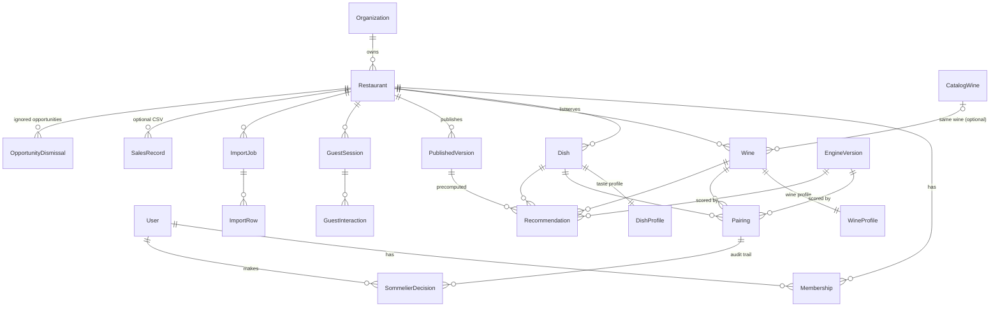

# Model danych

Docelowa baza: PostgreSQL. Identyfikatory: UUID v7 (sortowalne w czasie). Wszystkie tabele restauracji mają `restaurant_id` (izolacja tenantów, Row Level Security). Kwoty jako `numeric(10,2)` w walucie restauracji. Znaczniki czasu `timestamptz`.

Typy domenowe: `packages/core/src/domain/types.ts`. Encje MikroORM: `packages/db/src/entities` (definiowane przez `defineEntity`), migracje: `packages/db/src/migrations`.

## Stan implementacji

| Encja | W bazie | Uwagi |
|---|---|---|
| Restaurant | tak | `wine_director` jako tekst do czasu wprowadzenia User / Membership; `settings` jako jsonb |
| Dish + DishProfile | tak | profil jako **embeddable**: kolumny `profile_*` w tabeli `dish` (relacja 1:1 zawsze ładowana razem z daniem) |
| Wine + WineProfile | tak | profil jako embeddable: kolumny `profile_*` w tabeli `wine` |
| Pairing | tak | unikalność (dish, wine), częściowy indeks unikalny „jeden Primary na danie”, `version` do blokady optymistycznej |
| SommelierDecision | tak | audyt, `actor` jako tekst do czasu wprowadzenia User; **bez klucza obcego** do pairingu (kolumna `pairing_id`), żeby historia przeżyła usunięcie pairingu; ma `restaurant_id`, `dish_id`, `wine_id` |
| PublishedVersion | tak | migawka pairingów (approved / modified / rejected) w `snapshot` (jsonb), `number` unikalny w restauracji; goście czytają najnowszą |
| GuestInteraction | tak | zapisywana od E02 F1 (spec `2026-10-15-guest-usage-events`) przez `GuestInteractionRepository` (`record`, `listBySession`, `countGuestSessions`; pamięć: do 10 000 zdarzeń). `session_id` = parametr URL `sid` (bez tabeli GuestSession); `source`, `context`, `menuVersion` (= `restaurant.published_at`) w `props`; kolumna `version_id` nie istnieje. Sesja gościa = `session_id` ze zdarzeniem `guest_session_started` |
| ImportJob | tak | wiersze podglądu w kolumnie `rows` (jsonb) zamiast tabeli ImportRow |
| User (`app_user`), Membership, Session | tak | hasło jako skrót scrypt; w `session` tylko SHA-256 tokenu; licznik prób i blokada w `app_user`; `membership.role`: owner, manager, sommelier, waiter. `sommelier_decision.actor_id` wskazuje konto (zwykła kolumna) |
| ImportJob | tak | `rows` (jsonb) to sprawdzony podgląd wierszy, `notes` — jak odczytano plik, `result` — wynik zatwierdzenia; **plik nie jest przechowywany** (`storage_key` puste); status `preview_ready` → `confirmed` / `cancelled`; zatwierdzenie atomowe z blokadą wiersza. Rodzaj `sales` w Fazie 6 |
| Tłumaczenia treści (od 2026-10-15) | tak | `dish.translations`, `wine.translations`, `restaurant.translations` (jsonb, domyślnie `'{}'`), `pairing.comment_translations` (jsonb), `restaurant.content_locale` (text, domyślnie `'en'`). Kształt: `{ "pl": { "name": …, "description": … }, "en": { … } }`; pola bazowe zostają w języku `content_locale`. Migawka publikacji niesie tłumaczenia (`snapshot.content`, `snapshot.pairings[].commentTranslations`); starsze migawki bez nich czytane jako `{}`. Spec `2026-10-15-bilingual-content` |
| OpportunityDismissal (`opportunity_dismissal`, od 2026-10-16) | tak | zignorowane okazje sommeliera (spec `2026-10-16-sommelier-opportunities`, F1): jeden wiersz na (`restaurant_id`, `opportunity_key`), aktywny do `expires_at`; `dish_id` / `wine_id` **bez kluczy obcych**; `rule` z `CHECK` na pięć nazw sygnałów. Para z „Dodaj do propozycji” to zwykły wiersz `pairing` (`suggested`, bez wpisu w `sommelier_decision`) |
| Recommendation, GuestSession, ImportRow (osobna tabela), SalesRecord, EngineVersion, CatalogWine | nie | wejdą razem z funkcjami, które ich potrzebują (osobne specyfikacje) |

Poniżej model docelowy.

## Diagram relacji



## Encje

### Restaurant

| Pole | Typ | Uwagi |
|---|---|---|
| id | uuid PK | |
| organization_id | uuid FK | grupa restauracyjna (plan Group) |
| slug | text unique | `^[a-z0-9-]{2,40}$`, publiczny link i QR |
| name, tagline | text | |
| content_locale | text | `pl` / `en` (domyślnie `en`): język pól bazowych (tagline, city, nazwy i opisy dań, notatki o winach i notatki sommeliera) |
| translations | jsonb | `{pl?: {tagline, city}, en?: {…}}`; brak tłumaczenia → pole bazowe |
| address, city, country | text | |
| currency | char(3) | `PLN` |
| timezone | text | `Europe/Warsaw` |
| wine_director_user_id | uuid FK → User | nazwisko pokazywane gościom |
| settings | jsonb | `{showUnreviewed: bool, showScores: bool, glassPourMl: 150, locale: "en"}` |
| status | enum | `onboarding`, `active`, `paused`, `archived` |
| current_version_id | uuid FK → PublishedVersion | co widzą goście |
| published_at | timestamptz | |
| external_refs | jsonb | identyfikatory w POS / e-menu (przyszłe integracje) |
| created_at, updated_at | timestamptz | |

### User, Membership

| User | | Membership | |
|---|---|---|---|
| id | uuid PK | id | uuid PK |
| email | citext unique | user_id | uuid FK |
| name | text | restaurant_id | uuid FK |
| password_hash | text | role | enum `owner`, `manager`, `sommelier`, `waiter` |
| last_login_at | timestamptz | created_at | timestamptz |

System Administrator to flaga `is_staff` na User (poza Membership).

### Dish

| Pole | Typ | Uwagi |
|---|---|---|
| id | uuid PK | |
| restaurant_id | uuid FK | |
| name | text | |
| description | text | |
| translations | jsonb | `{pl?: {name, description}, en?: {…}}` (limity jak pól bazowych: nazwa 120, opis 1000 znaków) |
| category | text | `Starters`, `Mains`, `Desserts` (słownik per restauracja) |
| price | numeric | |
| status | enum | `draft`, `published`, `hidden` |
| sort_order | int | |
| external_ref | text | ID w POS / e-menu |
| import_job_id | uuid FK null | pochodzenie |
| deleted_at | timestamptz null | soft delete (historia analityki) |

### DishProfile (1:1 z Dish; w implementacji embeddable, kolumny `profile_*`)

| Pole | Typ | Zakres |
|---|---|---|
| dish_id | uuid PK FK | |
| intensity, fat, salt, sweetness, acidity, spice, umami, smoke, creaminess | smallint | 0–5 |
| protein | enum | `beef`, `game`, `poultry`, `pork`, `fish`, `shellfish`, `vegetable`, `mushroom`, `dairy`, `dessert` |
| cooking | enum | `raw`, `cured`, `poached`, `seared`, `roasted`, `grilled`, `braised`, `fried`, `baked`, `none` |
| source | enum | `draft` (import, reguły lub lokalny LLM), `confirmed` (personel) |
| drafted_by | text | `rules-1.0`, `local-llm:qwen2.5-7b`, … |
| confirmed_by, confirmed_at | uuid, timestamptz | |
| embedding | vector(384) null | opcjonalnie, pgvector; podobieństwo dań |

### Wine

Pozycja na karcie konkretnej restauracji (cena i dostępność są lokalne).

| Pole | Typ | Uwagi |
|---|---|---|
| id | uuid PK | |
| restaurant_id | uuid FK | |
| catalog_wine_id | uuid FK null | powiązanie z globalnym katalogiem (ten sam rocznik w wielu lokalach; przyszłe rekomendacje między restauracjami) |
| producer, name | text | |
| vintage | smallint null | null = NV |
| region, country | text | |
| grapes | text[] | pierwszy szczep = dominujący |
| list_number | int | numer na karcie („List no.”) |
| glass_price | numeric null | null = tylko butelka |
| glass_pour_ml | smallint | 150; 75 dla win słodkich |
| bottle_price | numeric | |
| bottle_size_ml | smallint | 750, 500, 1500 |
| active | bool | dostępne dziś (natychmiastowe, bez publikacji) |
| colour_hex | char(7) | kolor do „Match glass” |
| tasting_note | text | |
| translations | jsonb | `{pl?: {tastingNote, region, country}, en?: {…}}`; nazwy win i producentów nie są tłumaczone |
| stock_qty | int null | przyszłe: inventory |
| external_ref | text | ID w POS |

### WineProfile (1:1 z Wine; w implementacji embeddable, kolumny `profile_*`)

| Pole | Typ | Zakres |
|---|---|---|
| wine_id | uuid PK FK | |
| sweetness, acidity, tannin, body, fruitiness, oak, aromatic, freshness | smallint | 0–5 |
| alcohol | numeric(3,1) | % |
| style | enum | `sparkling`, `white`, `rose`, `orange`, `red`, `sweet` |
| adventurous | bool | poza klasycznymi oczekiwaniami (orange, PIWI, mniej znane regiony) |
| source | enum | `grape_defaults`, `catalog`, `confirmed` |
| embedding | vector(384) null | opcjonalnie |

### Pairing

Relacja Dish ↔ Wine z decyzją sommeliera. Unikalność `(dish_id, wine_id)`.

| Pole | Typ | Uwagi |
|---|---|---|
| id | uuid PK | |
| restaurant_id | uuid FK | |
| dish_id, wine_id | uuid FK | |
| status | enum | `suggested`, `approved`, `modified`, `rejected` |
| role | enum null | `primary`, `alternative`, `best_value`; max 1 `primary` na danie (indeks częściowy) |
| rank | smallint null | kolejność ustalona przez sommeliera |
| comment | varchar(140) null | „Why it works” w słowach sommeliera |
| comment_translations | jsonb | `{pl?: string, en?: string}`, każde do 140 znaków; gość widzi notatkę w swoim języku, inaczej `comment` |
| model_score | smallint | 0–99, wynik silnika przy ostatnim przeliczeniu |
| factors | jsonb | czynniki reguł `[{rule, delta}]` (wyjaśnialność) |
| engine_version | text FK | |
| source | enum | `engine`, `sommelier` |
| version | int | optymistyczna blokada (`If-Match`) |
| dirty | bool | zmiana od ostatniej publikacji |
| updated_by, updated_at | | |

```sql
create unique index pairing_one_primary on pairing (dish_id)
  where role = 'primary' and status in ('approved', 'modified');
```

### SommelierDecision (audit trail, append-only)

| Pole | Typ | Uwagi |
|---|---|---|
| id | uuid PK | |
| pairing_id | uuid FK | |
| user_id | uuid FK | |
| action | enum | `approve`, `modify`, `reject`, `restore`, `set_role`, `reorder`, `comment`, `create`, `delete` |
| before, after | jsonb | stan pary przed / po |
| created_at | timestamptz | |

Status pary jest pochodną ostatnich decyzji; tabela umożliwia raport „co zmieniono przed weekendem” i uczenie modelu na decyzjach sommelierów.

### PublishedVersion

| Pole | Typ | Uwagi |
|---|---|---|
| id | uuid PK | |
| restaurant_id | uuid FK | |
| number | int | kolejny numer |
| snapshot | jsonb | menu, wina, pary, ustawienia (to, co serwuje publiczne API). W implementacji: `pairings` (z `commentTranslations`) i `content` — tłumaczenia restauracji, dań i win, które widzą goście (zmiana tłumaczenia to zmiana do publikacji) |
| changes_count | int | |
| published_by, published_at | | |

Niezmienna; rollback = ustawienie `restaurant.current_version_id` na wcześniejszą wersję.

### OpportunityDismissal (`opportunity_dismissal`)

Zignorowane okazje w panelu sommeliera (spec `2026-10-16-sommelier-opportunities`, R6). Okazje liczymy przy odczycie (bez tabeli wyników); ta tabela trzyma tylko „Ignoruj”.

| Pole | Typ | Uwagi |
|---|---|---|
| id | uuid PK | z `IdGenerator`; ponowne „Ignoruj” zachowuje id |
| restaurant_id | uuid FK → `restaurant`, not null | zakres tenanta |
| opportunity_key | text not null | przedmiot okazji, np. `glass_match_unpaired:{dishId}`, `wine_unpaired:{wineId}`, `dish_no_primary:{dishId}:{none\|no_primary\|primary_hidden}`; **unique (`restaurant_id`, `opportunity_key`)** |
| rule | text not null | `CHECK` na `dish_no_primary`, `ordered_not_reviewed`, `glass_match_unpaired`, `wine_unpaired`, `shown_rarely_chosen` (wszystkie pięć od F1) |
| dish_id, wine_id | uuid null, **bez FK** | danie i wino z chwili zignorowania (lista „Zignorowane”); wiersz przeżywa usunięcie dania lub wina |
| dismissed_by | text not null | nazwa autora (`actor.name`) |
| dismissed_by_id | uuid null | konto autora (zwykła kolumna, jak `sommelier_decision.actor_id`) |
| dismissed_at, expires_at | timestamptz not null | `expires_at = dismissed_at + 30 dni` (`DISMISS_DAYS`); aktywna, gdy `expires_at > now` |

Zapis: `insert … on conflict (restaurant_id, opportunity_key) do update` (przedłuża termin, zmienia autora). „Przywróć” usuwa wiersz. Migracja `Migration20261016152214_opportunity_dismissal` jest addytywna; `down` usuwa tabelę bez strat dla biznesu (okazje po prostu wrócą).

### Recommendation (precomputed cache)

| Pole | Typ | Uwagi |
|---|---|---|
| id | uuid PK | |
| version_id | uuid FK → PublishedVersion | |
| dish_id | uuid FK | |
| context_key | text | znormalizowane preferencje, np. `serving=glass;styles=red;max=60` lub `default` |
| items | jsonb | `[{wineId, matchScore, rankScore, tier, role, bestValue, why}]` |
| engine_version | text | |
| created_at | timestamptz | |

Wariant `default` dla każdego dania liczony przy publikacji; pozostałe na żądanie i zapisywane (LRU / TTL do następnej publikacji). Zapytania o stolik cache’owane po posortowanej liście `dish_id` + `context_key`.

### GuestSession, GuestInteraction

| GuestSession | | GuestInteraction | |
|---|---|---|---|
| id | uuid PK (losowy UUID v4 w parametrze URL `sid`, bez ciasteczek i pamięci przeglądarki, bez danych osobowych) | id | bigint PK |
| restaurant_id | uuid FK | session_id | uuid FK |
| started_at | timestamptz | restaurant_id | uuid FK |
| source | enum `qr`, `link`, `staff` | name | text — nazwa eventu (lista w SCREEN_SPECIFICATION) |
| user_agent_class | text (`ios`, `android`, `desktop`) | dish_id, wine_id | uuid null |
| table_label | text null (opcjonalnie w QR: `?t=12`) | props | jsonb (`prefs`, `wineIds`, `serving`, `context`) |
| | | version_id, engine_version | |
| | | created_at | timestamptz |

Partycjonowanie miesięczne. Brak cookies śledzących i danych osobowych gościa. **Stan (E02 F1):** tabeli GuestSession nie ma — sesja to `sid` z URL, a jej źródło (`qr` / `link`) jest w `props.source` zdarzenia `guest_session_started`; kelner (`staff`) nie ma sesji gościa. Bez IP, UA, numeru stolika i tekstu od gościa.

### ImportJob, ImportRow

| ImportJob | | ImportRow | |
|---|---|---|---|
| id | uuid PK | id | uuid PK |
| restaurant_id | uuid FK | import_job_id | uuid FK |
| kind | enum `menu`, `wines`, `sales` | row_number | int |
| file_name, file_type, file_size | | raw | jsonb (oryginalne komórki) |
| storage_key | text (obiekt w S3) | parsed | jsonb (pola po mapowaniu i poprawkach) |
| status | enum `uploaded`, `parsing`, `preview_ready`, `confirmed`, `failed`, `cancelled` | issues | text[] |
| column_mapping | jsonb | include | bool |
| parser | text (`csv`, `xlsx`, `pdf-text`, `pdf-ocr`, `local-llm`) | result_entity_id | uuid null |
| error | text null | | |
| created_by, created_at, confirmed_at | | | |

### SalesRecord (opcjonalny import CSV, później API POS)

| Pole | Typ |
|---|---|
| id | bigint PK |
| restaurant_id | uuid FK |
| business_date | date |
| check_id | text (rachunek / stolik) |
| covers | smallint |
| item_type | enum `food`, `wine_glass`, `wine_bottle`, `other` |
| dish_id / wine_id | uuid null (dopasowane po nazwie lub external_ref) |
| quantity, net_amount | |

Wine Attach Rate = rachunki z `food` i `wine_*` / rachunki z `food`.

### EngineVersion

| Pole | Typ |
|---|---|
| id | text PK (np. `wm-rules-1.0.0`) |
| kind | enum `rules`, `learned` |
| config | jsonb (wagi, progi) |
| released_at | timestamptz |

## Przyszłość bez przebudowy

| Funkcja | Jak model to umożliwia |
|---|---|
| Integracja POS / e-menu | `external_ref` na Restaurant, Dish, Wine; SalesRecord z `check_id` |
| Inventory, dostępność w czasie rzeczywistym | `Wine.stock_qty`, `active`; webhook POS aktualizuje bez publikacji |
| Forecasting, pricing intelligence | SalesRecord + GuestInteraction (popyt pokazany vs. zrealizowany) |
| Optymalizacja portfela | CatalogWine + skuteczność par w wielu lokalach |
| Marketplace importerów | CatalogWine z dostawcą; osobna tabela ofert, nigdy w Pairing ani Recommendation |
| Profile smaku gości, rekomendacje między restauracjami | GuestSession → opcjonalne konto gościa; CatalogWine łączy te same wina w różnych lokalach |
| Model uczony (LightGBM) | SommelierDecision (etykiety) + GuestInteraction (konwersje) + `factors` jako cechy |
