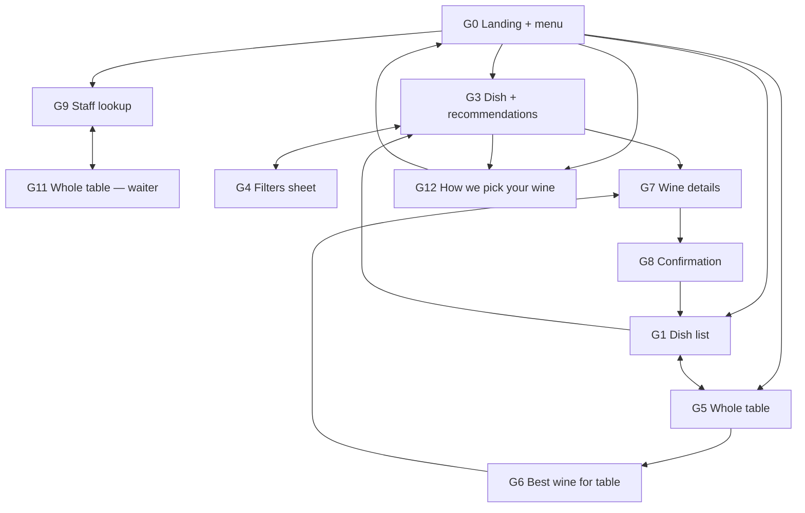
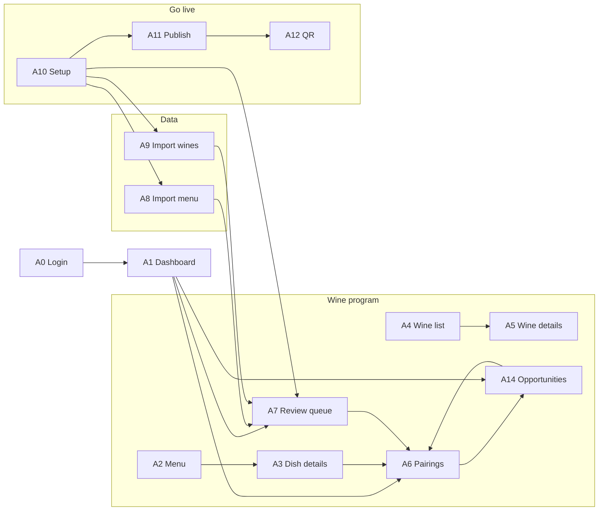

# Mapa ekranów i nawigacji

System składa się z dwóch aplikacji na wspólnym silniku i wspólnym API.

| | Guest application | Restaurant / Sommelier dashboard |
|---|---|---|
| Urządzenie | telefon (mobile-first, kolumna max 480 px) | laptop (desktop-first, sidebar 248 px); działa na tablecie i telefonie |
| Dostęp | publiczny link / QR, bez logowania | logowanie, role |
| Nawigacja | liniowa: top bar z „Back”, przełącznik „One dish / Whole table” | sidebar z grupami; na wąskim ekranie poziomy pasek |
| Adres | `/r/{slug}/…` | `/admin/…` |

W mockupie adresy są hash-routami (`index.html#/r/halka/menu`). Indeks wszystkich ekranów: `#/`.

## Guest application

```
G0  Restaurant landing + menu ................. /r/{slug}
 ├─ G1  Dish list ............................. /r/{slug}/menu
 │   └─ (G2 → 308 na G3) ....................... /r/{slug}/dish/{dishId}
 │       └─ G3  Dish + wine recommendations .... /r/{slug}/dish/{dishId}/wines
 │           ├─ G4  Filters (bottom sheet) ..... /r/{slug}/dish/{dishId}/wines?sheet=filters
 │           └─ G7  Wine details ............... /r/{slug}/wine/{wineId}?dish={dishId}
 │               └─ G8  Selection confirmation . /r/{slug}/selected/{wineId}?serving=&dish=
 ├─ G5  Whole table selection ................. /r/{slug}/table
 │   └─ G6  Best wine for your table ........... /r/{slug}/table/result
 │       └─ G7  Wine details ................... /r/{slug}/wine/{wineId}?table=1
 │           └─ G8  Selection confirmation
 ├─ G9  Staff lookup (waiter) ................. /r/{slug}/staff?dish={dishId}
 │   └─ G11 Whole table (waiter) ............... /r/{slug}/staff/table?dishes=&wine=   (przełącznik „One dish / Whole table” na G9 i G11)
 └─ G12 How we pick your wine ................. /r/{slug}/how-it-works   (także ze stopki G3)

Stany systemowe: unknown restaurant (dowolny błędny slug), ?demo=loading|empty|error
```



**Zasady nawigacji gościa**
- Każdy ekran poza G0 ma przycisk „Back” w top barze, prowadzący do logicznego rodzica (nie do historii przeglądarki), więc wejście z udostępnionego linku też ma sensowny powrót.
- Ikona filtrów w top barze jest widoczna tylko na G3.
- Główne akcje są w przyklejonym dolnym pasku w zasięgu kciuka (G5, G7); na desktopie pasek jest zwykłym blokiem pod treścią.
- Preferencje gościa (kieliszek / butelka, styl, budżet, body, mood) i wybór stolika są trzymane wyłącznie w parametrach URL i przechodzą między ekranami w linkach (bez ciasteczek i pamięci przeglądarki).
- Desktop (≥ 1024 px): G0 i G1 — nagłówek restauracji po lewej, menu po prawej; G3 — menu z bieżącym daniem po lewej, wina po prawej, filtry jako panel z prawej; G5–G9 i G11 w kolumnie do 720 px.

## Restaurant / Sommelier dashboard

```
A0  Login ........................................ /admin/login?next=
A1  Dashboard .................................... /admin
Wine program
 ├─ A2  Menu ..................................... /admin/menu?q=&cat=
 │   └─ A3  Dish details ......................... /admin/menu/{dishId}
 ├─ A4  Wine list ................................ /admin/wines?q=&style=
 │   └─ A5  Wine details ......................... /admin/wines/{wineId}
 ├─ A6  Pairing management ....................... /admin/pairings/{dishId}
 ├─ A7  Pairing review (queue) ................... /admin/review
 └─ A14 Opportunities (Okazje) ................... /admin/opportunities
Data
 ├─ A8  Import menu .............................. /admin/import/menu?step=preview|done
 ├─ A9  Import wine list ......................... /admin/import/wines?step=preview|done
 └─ A13 Import sales (POS) ....................... /admin/import/sales?job=
Go live
 ├─ A10 Setup checklist (onboarding) ............. /admin/setup
 ├─ A11 Publish .................................. /admin/publish
 └─ A12 QR generation ............................ /admin/qr
Guest view
 └─ link do G0 (nowa karta)
```



**Zasady nawigacji panelu**
- Sidebar zawsze widoczny (desktop); bieżąca sekcja oznaczona `aria-current`.
- Liczniki w nawigacji: *Review queue* (liczba propozycji `suggested`), *Publish* (liczba niepublikowanych zmian). *Opportunities* (A14, po *Review queue*) celowo **bez licznika** (spec `2026-10-16-sommelier-opportunities`, Q3); ich liczbę pokazuje jedna linia na A1 (Q19).
- Ekrany szczegółów mają breadcrumb „← Menu” / „← Wine list”.
- Każdy adres `/admin/*` bez sesji przekierowuje na A0 z parametrem `next`; po zalogowaniu wraca na żądany ekran.
- Wylogowanie z karty użytkownika na dole sidebara.

## Uprawnienia do ekranów

| Ekran | Guest | Waiter | Sommelier | Owner / GM |
|---|:-:|:-:|:-:|:-:|
| G0–G8 | ✓ | ✓ | ✓ | ✓ |
| G9, G11 | – | ✓ | ✓ | ✓ |
| A1 Dashboard | – | – | ✓ | ✓ |
| A2–A5 | – | – | ✓ edycja | ✓ edycja |
| A6, A7 | – | – | ✓ decyzje | podgląd |
| A14 Opportunities | – | – | ✓ decyzje | podgląd |
| A8, A9 | – | – | ✓ | ✓ |
| A10 Setup | – | – | ✓ (bez slugu) | ✓ |
| A11 Publish | – | – | ✓ | ✓ |
| A12 QR | – | – | ✓ | ✓ |

W mockupie oba konta demonstracyjne mają pełny dostęp; ograniczenia ról GM dotyczą wersji produkcyjnej (wymuszane w API).
