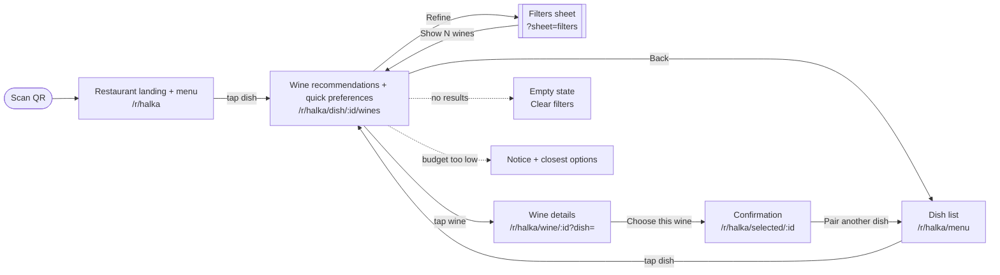
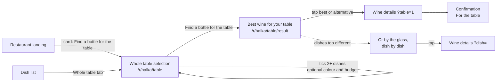
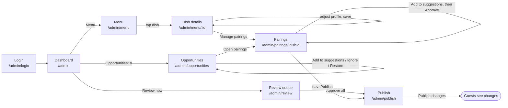
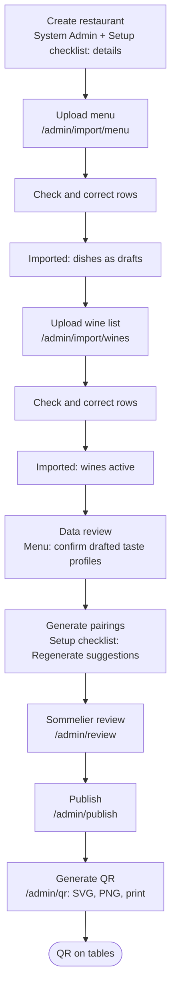
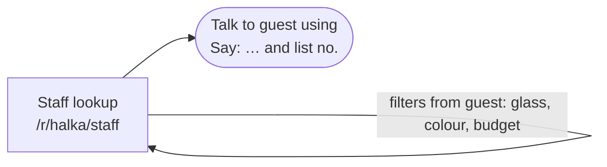
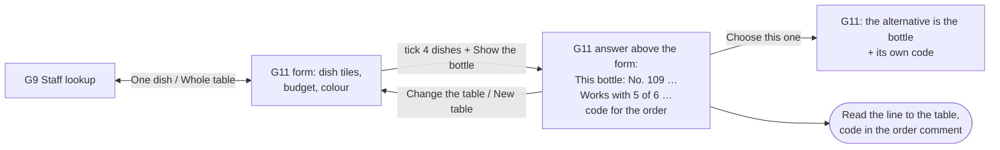
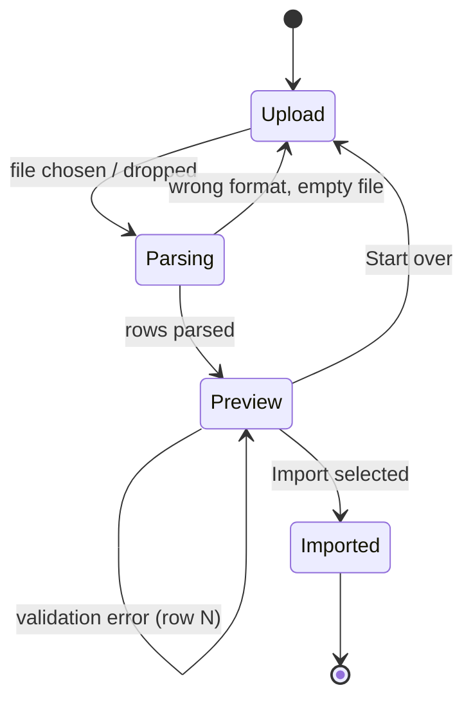

# User flows

Każdy flow ma diagram, opis kroków z adresem ekranu w mockupie (hash route) oraz liczbę interakcji. Wszystkie flow da się przeklikać w mockupach bez backendu.

---

## 1. Guest: QR → Restaurant → Dish → Wine recommendations → Filters → Wine selection

| Krok | Ekran | Akcja gościa | System |
|---|---|---|---|
| 1 | Landing z menu | skan QR | nagłówek restauracji i menu na jednym ekranie, eventy `guest_session_started`, `menu_viewed` |
| 2 | Landing z menu | wybór dania | `GET /dishes/{id}/recommendations?…`, event `recommendations_viewed` |
| 3 | Recommendations | opcjonalnie: szybkie preferencje (By the glass / By the bottle / Red / White / Sparkling) albo „More…” → arkusz filtrów | przeliczenie listy; preferencje zostają w URL dla kolejnych dań |
| 7 | Recommendations | wybór wina | event `recommendation_clicked`, `wine_viewed` |
| 8 | Wine details | kieliszek / butelka → „Choose this wine” | event `wine_selected` |
| 9 | Confirmation | pokazanie telefonu kelnerowi | event `selection_shown_to_waiter` |

**Najkrótsza ścieżka do listy win: 1 dotknięcie** (danie na stronie z kodu QR). Do wyboru wina: 3. Stare adresy `/r/{slug}/dish/{id}` przekierowują (308) na listę win. Na desktopie (≥ 1024 px) menu zostaje w lewej kolumnie obok win (spec `2026-10-15-guest-short-path-and-desktop`).

---

## 2. Whole table: Restaurant → Multiple dishes → Best bottle for table → Recommendation

| Krok | Ekran | Akcja | System |
|---|---|---|---|
| 1 | Landing / Menu | wejście w tryb stolika: karta „Several dishes on the table?” nad menu na G0 (przycisk w nagłówku restauracji tylko, gdy karty nie ma — np. menu z samych deserów) albo przełącznik „Whole table” na G1 | — |
| 2 | Whole table | zaznaczenie dań (licznik, przycisk aktywny od 2) | event `table_dishes_selected` |
| 3 | Whole table | opcjonalnie: „How many people are drinking wine?” (2–8, „8+”; domyślnie „Skip”), kolor, budżet na butelkę | — |
| 4 | Whole table | „Find a bottle for the table” | `POST /recommendations/table` |
| 5 | Best wine for your table | linia „Works with n of m dishes, less so with: …” przy butelce i alternatywach; surowy wynik silnika per danie, Overall match (bez liczb, gdy restauracja ukrywa procenty), cena; 2 alternatywy; desery odłożone; budżet bez wyników → komunikat i 2 najbliższe butelki; ewentualna propozycja kieliszków | event `table_recommendation_viewed` |
| 5a | Best wine for your table | ilość (E08 F4): bez wybranej liczby osób **żadnej ilości** — tylko pytanie i linki 2–8; jedno dotknięcie liczby → „For 6 people: 3 bottles · 960 zł” (300 ml na osobę, do 2 kieliszków zamiast kolejnej butelki, jeśli wszyscy piją to samo wino) | event `table_recommendation_viewed` z `people` |
| 6 | Wine details → Confirmation | jak w flow 1, z domyślną butelką; `people` przechodzi dalej, a „For the table” na potwierdzeniu pokazuje tę samą linię ilości dla wybranego wina | `wine_selected` z `context=table` (i `people`, gdy wybrano) |

Przykład (dane demo Halki, `wm-rules-1.2.0`): Beef tartare 83%, Wild mushroom risotto 90%, Duck breast 80% (surowe wyniki; pieczęć przy risotto i kaczce) → Savigny-lès-Beaune, „Works with all 3 dishes.”, overall 85%. Stół 6 dań (śledź, przegrzebki, sandacz, seler, antrykot, jeleń) → Radikon Slatnik, „Works with 5 of 6 dishes, less so with: Venison loin.”.

---

## 3. Sommelier: Login → Menu → Dish → Suggested pairings → Review → Approve → Publish

| Krok | Ekran | Akcja | API |
|---|---|---|---|
| 1 | Login | e-mail, hasło | `POST /auth/login` |
| 2 | Dashboard | baner z liczbą propozycji / nawigacja Menu | `GET /restaurants/{id}/analytics/summary` |
| 3 | Menu | wybór dania (status, pokrycie pairingami) | `GET /restaurants/{id}/dishes` |
| 4 | Dish details | korekta profilu (podgląd na żywo), zapis | `PATCH /dishes/{id}` |
| 5 | Pairings | „Approve” propozycji, rola Primary, kolejność, notatka | `PATCH /pairings/{id}`, `POST /pairings/{id}/decisions` |
| 6 | Review queue | przegląd pozostałych dań, „Approve all for this dish” | `POST /restaurants/{id}/pairings/bulk-decision` |
| 7 | Publish | checklista, ustawienia gościa, „Publish changes” | `POST /restaurants/{id}/publish` |
| opcj. | Opportunities (A14) / karta na A6 | „Add to suggestions” (wino trafia do „Engine suggestions” dania; gość nic nie widzi do „Approve” i publikacji), „Ignore” (wraca najwcześniej po 30 dniach), „Restore” | akcje serwerowe (spec `2026-10-16-sommelier-opportunities`, F2), bez REST |

---

## 4. Restaurant onboarding: Create restaurant → Upload menu → Upload wine list → Data review → Generate pairings → Sommelier review → Publish → Generate QR

Ekran **Setup checklist** (`/admin/setup`) pokazuje 8 kroków ze statusem (wykonany / do zrobienia) i przyciskiem przejścia do każdego z nich.

| Krok | Wynik | Warunek „done” w checkliście |
|---|---|---|
| Create restaurant | Restaurant, slug, Wine Director | dane zapisane |
| Upload menu | Dish (`draft`), DishProfile (`draft`) | ≥ 1 danie |
| Upload wine list | Wine, WineProfile | ≥ 1 wino |
| Data review | DishProfile `confirmed` | wszystkie profile potwierdzone |
| Generate pairings | Pairing (`suggested`) | ≥ 1 pairing |
| Sommelier review | Pairing (`approved` / `modified` / `rejected`) | każde danie ma zatwierdzoną parę |
| Publish | PublishedVersion | brak niepublikowanych zmian |
| Generate QR | pliki SVG / PNG | restauracja opublikowana |

---

## 5. Waiter assisted selection

1–2 interakcje: wybór dania z listy, ewentualnie jeden filtr. Kolejność zawsze według sommeliera.

**Cały stolik (G11, `/r/{slug}/staff/table`, spec `2026-10-16-whole-table-waiter-path` F2):** stolik zamawia kilka dań, kelner przełącza „One dish / Whole table” (albo otwiera zakładkę `/staff/table`).

5 dotknięć do wyniku dla stołu 4 dań (4 kafle + „Show the bottle”), bez JS; przy karcie 30+ dań dochodzą przewinięcia albo kotwice sekcji (z JS — pole „Find a dish”). Zdanie „pasuje do n z m, słabiej do …” zastępuje „Say: …”. Jeden kod polecenia na wynik (butelka pokazana jako pierwsza); alternatywa dostaje kod dopiero po „Choose this one”. Zdarzenie `staff_table_lookup` w sesji kelnera. Ilość (F4): kelner dotyka liczby osób pod butelką (2–8) albo wybiera ją w formularzu — dopiero wtedy „For 6 people: 3 bottles · 960 zł”; bez wyboru ilości nie ma.

---

## 6. Flow importu (szczegół kroków 2–3 onboardingu)

Statusy `ImportJob`: `uploaded → parsing → preview_ready → confirmed | failed | cancelled`.
